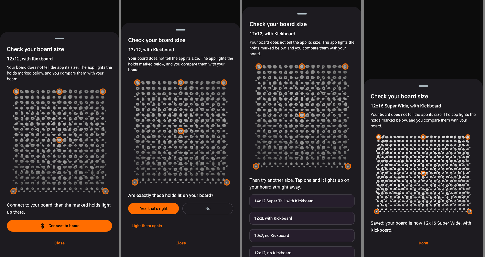
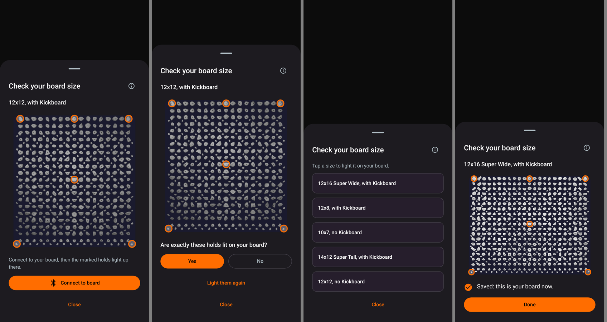
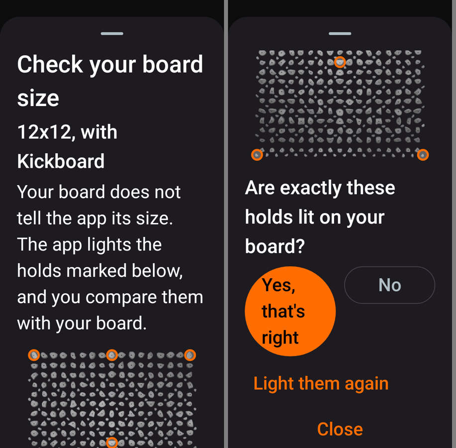
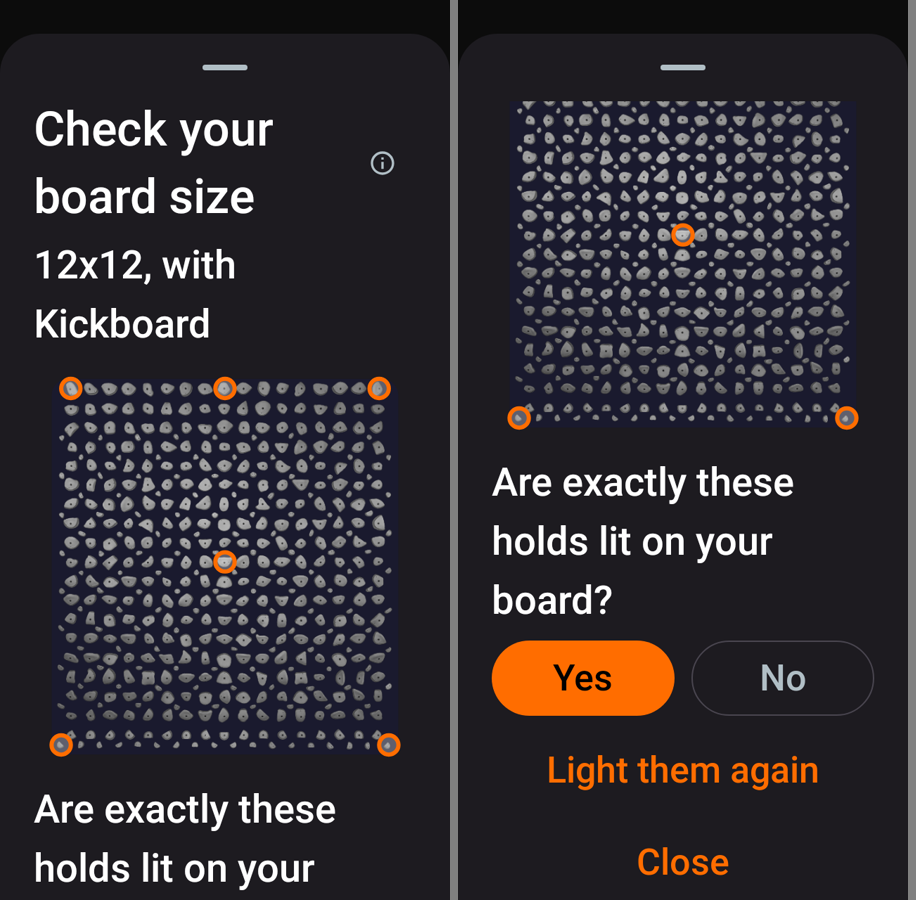
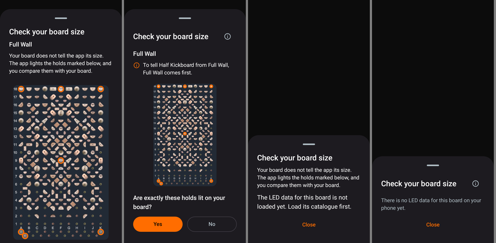
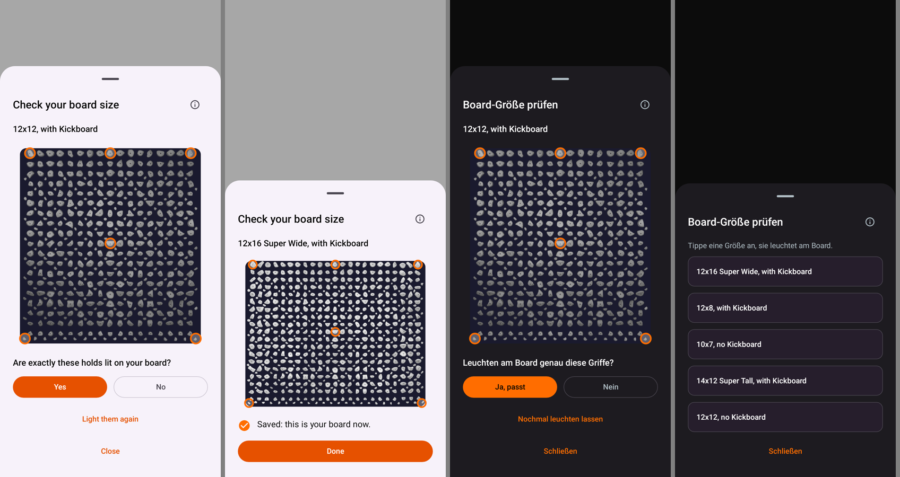
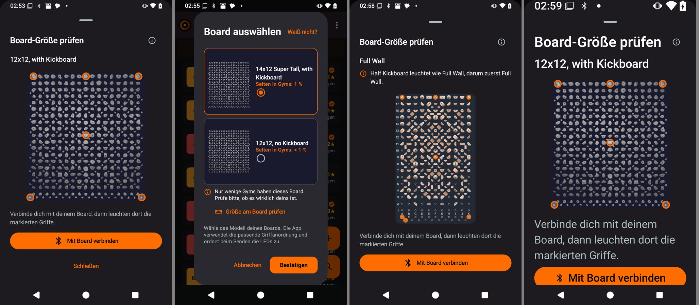

# Board size check: UI pass (#55, into #53)

Night of 7 to 8 November 2026. Branch `fix/0.2.5-board-size-check` (draft PR [#55](https://github.com/CruxCoach/CruxCoach/pull/55) into `feat/0.2.5-board-size-check`, PR #53).

Commits:
- `fb125abd3` fix(board): the size check no longer lights over another sender's climb
- `f12d2d31e` fix(board): UI pass of the size check sheet and the picker link
- `e391c712f` fix(board): clearer look-alike hint, no-data state without a pointer
- `94b96bcc9` fix(board): centre a wrapped relight label; review renders without hangs

The test build of `f12d2d31e` was checked on a phone. `e391c712f` and `94b96bcc9` change only texts, one label's alignment and the review test; they were checked in the renders.

## How the pass ran

- `BoardSizeCheckUiReviewTest` renders every state of the sheet and the board picker with its link. It uses the holds the check really picks from the bundled geometry (Kilter, Tension Board 1, Kilter Homewall).
- Every state is rendered in English and German, at 320 and 411 dp, at font scale 1.0 and 2.0, and in dark and light.
- Four render cycles. Cycles 1 and 3 each got an independent critique against `design.md` and the existing 0.2.4 sheets.
- Cycle 4 found nothing of weight.

## Before and after (411 dp, font 1.0)

The four states shown are: no board connected, holds lit, the list after "No", and saved.

Before (start of the night):

After:

- **Less text.** The two-sentence intro moved behind the info icon next to the title. Status lines ("Connect to your board…", "Lighting the marked holds…", "Something else lit the board…") use the quieter supporting style of the app's other sheets.
- **One question, two answers.** Yes and No only appear once the holds are lit. Until then the sheet says why (lighting, replaced by another sender, send failed) and offers one button.
- **After "No"** the list of other sizes replaces the rejected size's picture. The most common sizes come first, "Tried" sits under the name, and rows are at least 56 dp high.
- **The result** has a check mark and one filled button ("Done"; in the picker "Back to the board picker"). The size is not repeated in the sentence.

## Small phone, largest font (320 dp, font 2.0)

Before. "Yes, that's right" wrapped into a round blob:

After. "Yes" and "No" sit side by side while both fit, and stack at full width when they don't (German "Ja, passt" at 320 dp and 200 %):

## Tall board and no data (320 dp, font 1.0)

Each pair shows before, then after.

- **Tension Board 1 (Full Wall).** Before, the question and Yes/No were below the fold. Now the picture is capped, so the question and the answers stay in view. The hint says in one line why Full Wall comes first.
- **No LED data.** The sheet no longer sends the user to a catalogue it cannot load from here.

## Light mode and German

- **The board picture** sits on the dark board colour in both themes, so the white holds stay visible on a light sheet.
- **Filled buttons** use the theme's own colours. In light mode that is the darker orange with white text, which has better contrast than before.

## On the phone (build `f12d2d31e`, German, without a board)

From left to right:
1. **From a climb's ⋮ menu ("Falsche Griffe am Board?").** The title, info, size, picture, connect hint and button fit on one screen. The info dialog opens and closes. "Mit Board verbinden" opens the connection sheet, and Back returns to the check.
2. **The picker.** A rare Kilter size (14x12) shows its hint with the "Größe am Board prüfen" link, and the link opens the check for that size.
3. **Tension Board 1 with Half Kickboard selected.** The check starts with Full Wall and gives the short reason in one line (this build still has the earlier wording; `e391c712f` changes it to "Um Half Kickboard von Full Wall zu unterscheiden, kommt Full Wall zuerst."). The picture is capped at 45 % of the screen height, so the connect button stays in view. The two marked holds on the kickboard row get separate rings. Cancelling the picker leaves the saved board unchanged.
4. **Font scale 2.0.** The sheet scrolls, like the app's other sheets.

Home, climb list, logbook and main menu work, with no crash.

## Decisions

Each line gives what changed, why, and where to change it.

- **Answers are "Yes" / "No"** (German "Ja, passt" / "Nein").
  - Why: the long English label stacked the buttons at 320 dp already at normal font.
  - Where: `board_size_check_yes`.
- **The picture takes at most 45 % of the screen height.**
  - Why: on small phones tall boards pushed the question and its answers below the fold.
  - Where: `maxHeight` in `BoardSizeCheckImage`.
- **Yes/No stay in the scrolling sheet** rather than pinned to the bottom.
  - Why: the app's other sheets scroll the same way.
  - Where: `BoardSizeCheckContent`.
- **Filled buttons use the theme colours** instead of the fixed accent orange.
  - Why: contrast in light mode.
  - Where: the `Button`s in `BoardSizeCheckSheet.kt`.
  - Side effect: in light mode the picker's own Confirm button (0.2.4) is a lighter orange than the sheet's buttons.
- **The look-alike hint is one line:** "To tell Half Kickboard from Full Wall, Full Wall comes first."
  - Why: the old sentence explained the kit and repeated "Full Wall" three times.
  - Where: `board_size_check_look_alike_first`.
- **The picker link reads "Check the size on your board".**
  - Why: the two-part label was cut at 320 dp and 200 %.
  - Where: `board_size_check_link`.
- **Rings shrink when two marked holds are close.**
  - Why: they overlapped on the Tension kickboard row.
  - Where: `BoardSizeCheckImage`.
- **"Tell us in the feedback" and "Load its catalogue first" are gone.**
  - Why: a hint without its action.

## Not checked

- **With a real board:** Yes/No, the list after "No", "Fits" / "Saved" / "Selected", the relight after another sender's climb, and a dark board after closing. These need hardware. They are covered by session and content tests.
- **The 12x14 picture** is missing its top rows. This is a separate issue, not part of this pass.
