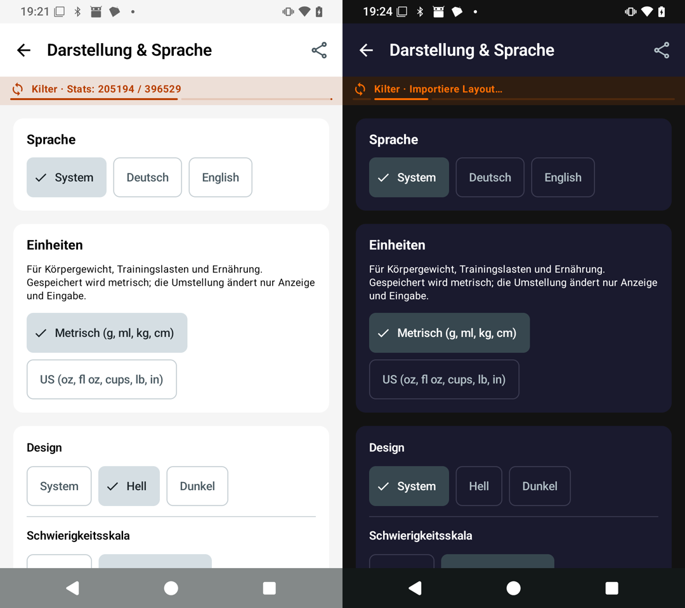
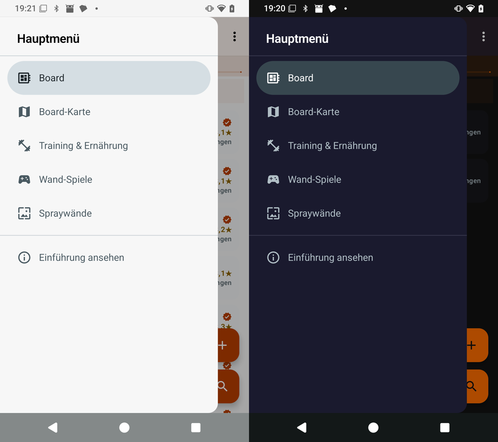
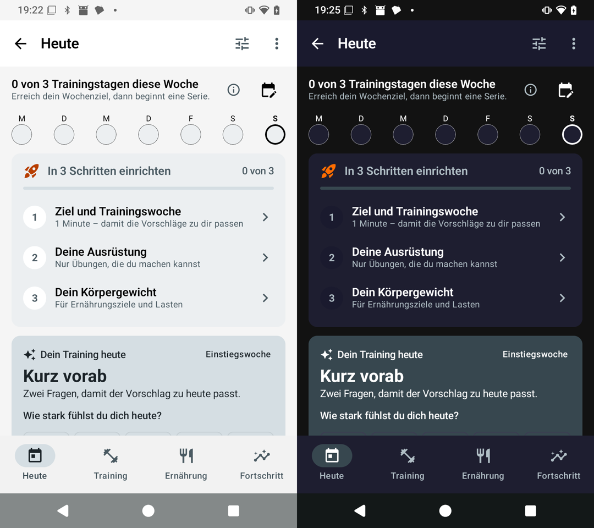
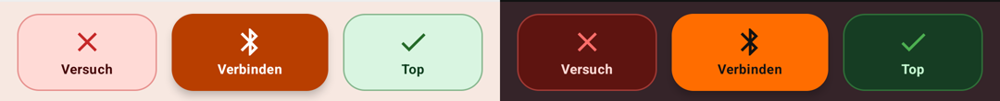
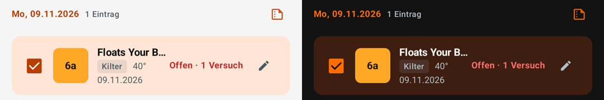
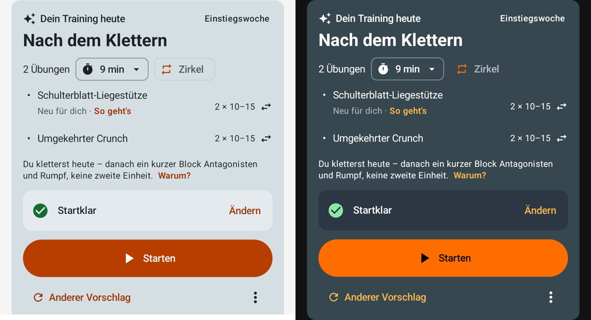
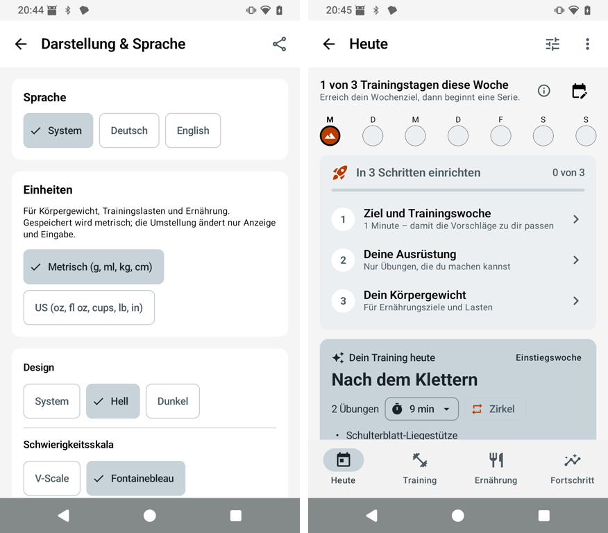
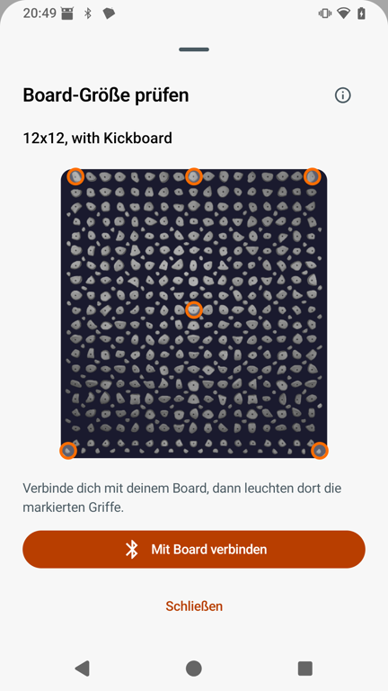
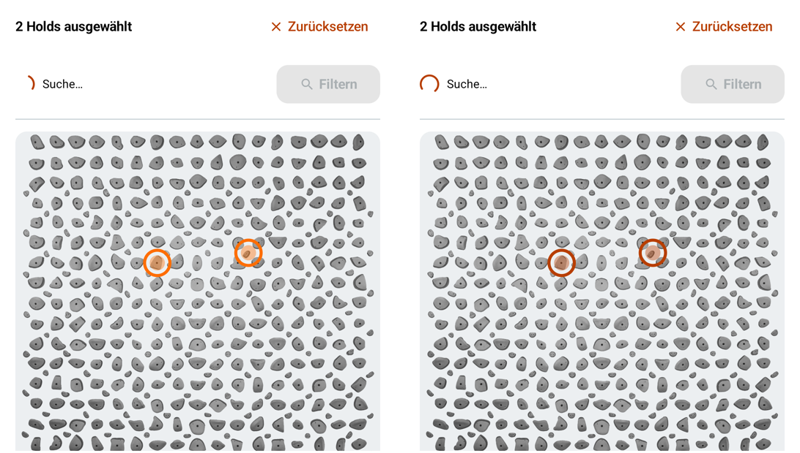
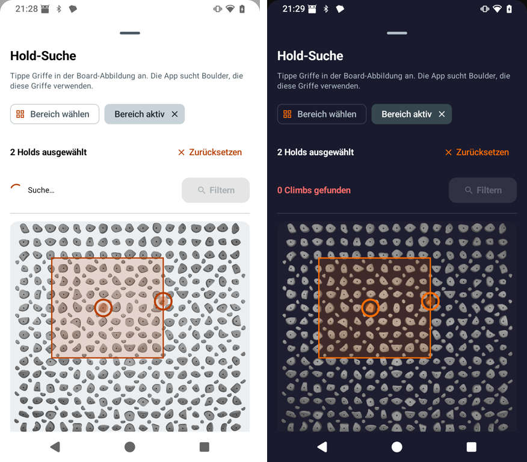

# Light and dark contrast across the app (PR #92)

**Goal:** every text reaches at least 4.5:1 and large text and controls at least 3:1, in the light and the dark theme, and the app keeps its orange look. The theme's colour tokens change first; screens change only where they hard-code colours.

**State, 8 November:** the code is in draft PR [#92](https://github.com/CruxCoach/CruxCoach/pull/92). Its CI is green, and test build 1 (`6aba0609`) was checked on a phone in light and dark.

**Night of 8–9 November:** rebased onto the release branch, then an audit of every call site and test build 2 (`453debc6`), checked on the phone in light and dark. See the last section.

## What was wrong
- **Lilac surfaces.** The colour schemes set only a few Material roles, so Material filled the rest with its lilac defaults. In the light theme this showed on the drawer, cards, the day row, the setup card and the navigation bar. In the dark theme it showed on the top bar and the drawer.
- **Orange text** `#FF6D00` on white: 2.8:1. White labels on the darker orange `#E65100`: 3.8:1.
- **Status colours as text in light:** yellow star ratings 1.6:1, green 2.8:1, red 3.5:1, blue 2.6:1.
- **Selected chips:** an orange label on 20 % orange, 3.8:1 in light.
- **Dark labels on orange fills** in light: 3.3:1.

## What changes
| Role | Light | Dark |
|---|---|---|
| Orange (`OrangeAccent`, primary) | `#B83E00`: 5.2:1 on the background, 5.6:1 for white on it | `#FF6D00` as before: 6.0:1 on the surface, labels dark |
| Green / yellow / red / blue | `#256B29` / `#8A6100` / `#C62828` / `#1565C0` | as before; red slightly lighter, `#FF6E6A` |
| Selected chip | `#FFE5D6` with `#9A3500` (6.0:1) | `#3D1E10` with `#FF6D00` (5.4:1) |
| Surfaces | neutral greys from `#F7F7F7` to `#E8E8E8` | the app's navy-black `#1A1A2E` to `#303045` |
| Muted text (`onSurfaceVariant`) | `#4A5A62`, at least 5.8:1 | `#B0BEC5`, at least 6.7:1 |

A unit test, `ThemeContrastTest`, checks every text role on every surface in both themes, every role pair and the outlines, and that no Material default is left.

## Before (current release branch, on the phone; light left, dark right)
Appearance settings:

Main menu:

Training, today:

## After (renders from PR #92)
Building blocks, light and dark:

Training today, nutrition and training settings, light:

The same screens and the logbook statistics, dark:

## After (test build 1 on the phone; light left, dark right)
Appearance settings:

Main menu:

Training, today:

The phone check also covered the following, in both themes, with no crash:
- the board list, where star ratings now read in dark yellow on light
- the climb page with the deep orange "Connect" button and white label
- the logbook, the settings list, onboarding and the tour spotlight

## Night of 8–9 November: an audit of every call site (test build 2)
The first pass fixed the theme's tokens. A static audit of every screen then looked for labels that still miss the target because of how a screen uses the tokens. It found about 110, almost all in the light theme:
- **Orange or status text on its own faint tint** (badges, chips, selected rows, banners, the climb dock): 3.3–4.5:1. These now use the container pairs: the quiet orange of the selected chips, and green, yellow and red containers with their labels. Banners with an icon keep the colour on the icon and use the normal text colour.
- **Default button labels on container cards** (error, caution, positive and secondary cards): 3.2–4.4:1. They take the card's on-colour. The Today suggestion card keeps its orange links in a deeper orange in light and a lighter one in dark.
- **Faded secondary text** (`onSurfaceVariant` at 60–80 %): 2.6–3.8:1. No longer faded.
- **Fixed colours used as text** (phase, grade and session tags, the flash marker, the bar percentages, the unread badge): the text colour, or one that reads on their fill.
- **Screens merged since the first pass:** the year in review pages are dark in both themes and keep the bright orange; the water, fat and energy rings get deeper tones in light.
- **One more token:** the dark theme's error container is deeper (`#5E1410`), so the red attempt button no longer outweighs the green send button.

Test build 2 on the phone, light left, dark right. The climb dock:

A selected logbook entry:

The Today suggestion card with its links:

The check also covered home, settings and appearance, the training week row and the setup card, with no crash.

## 9 November: the maintainer's review, test builds 3 and 4
Rebased onto the release branch with #55. The review asked for three things:
- the bright orange for rings drawn on a board picture
- a clearer selected default chip in light
- the same fixes for the patterns #83 added

**Selection in light.** The light `secondaryContainer` went from `#D5DEE3` to `#C8D3D9`. A selected chip or segment stands out at 1.40:1 against the page (was 1.25), and the bottom-bar pill at 1.36:1 against the bar (was 1.22). The text on it stays above 4.5:1. Test build 3, appearance settings and the training bottom bar:

**The size check's rings** sit on the dark board picture in both themes and take the bright orange:

**The hold search's rings.** Test build 3 gave them the bright orange too. But the Kilter Original pictures are holds without a backdrop, drawn on the light card (`#ECEFF1`), where the bright orange measured 2.4:1 in the screenshot (left). Since test build 4, the rings and the zone frame take the bright orange only on a board photo (a picture without transparency), and the theme's orange otherwise: 4.9:1 on the light card (right).

Test build 4 with a zone, light left, dark right:

No crash in either build.

## Next
- #101 and #95 are not merged yet. Their orange patterns get the same fix in whichever PR merges second.
