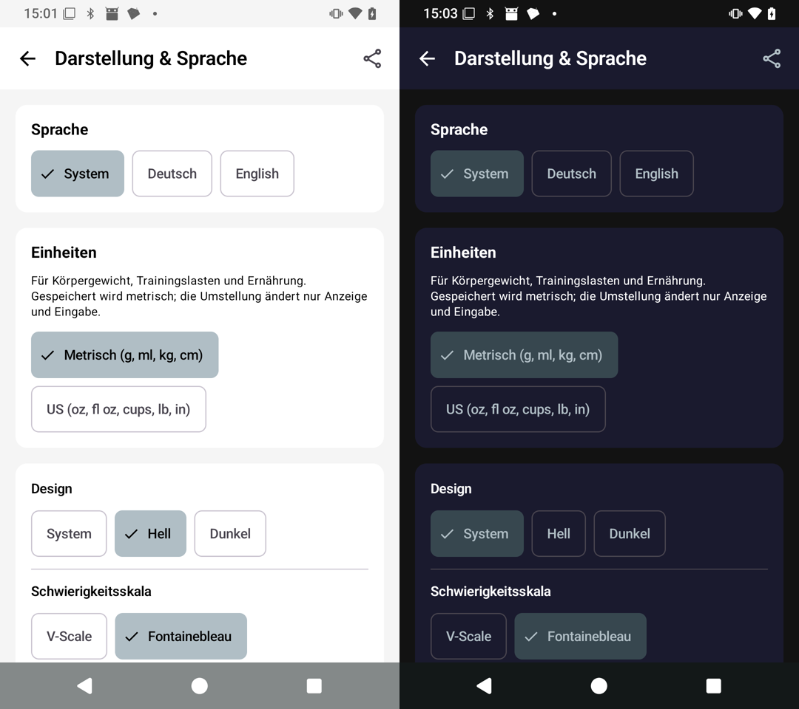
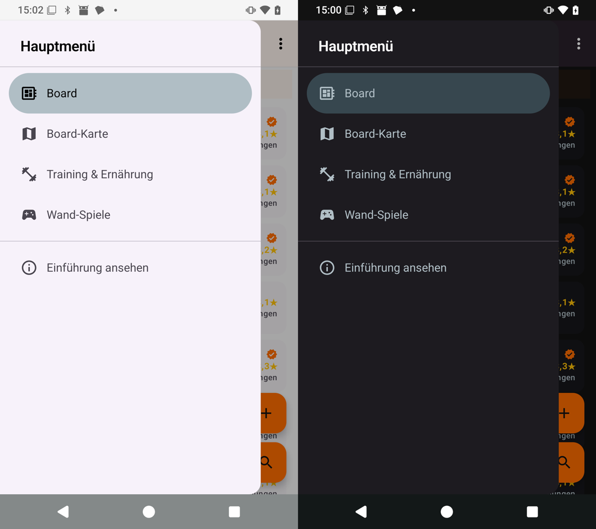
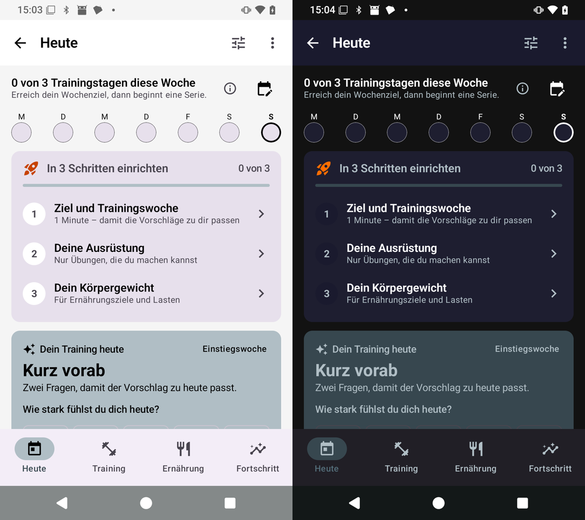
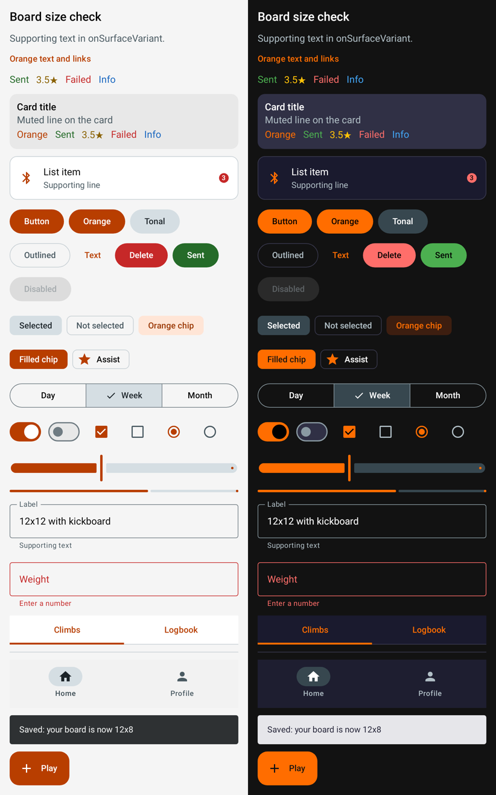
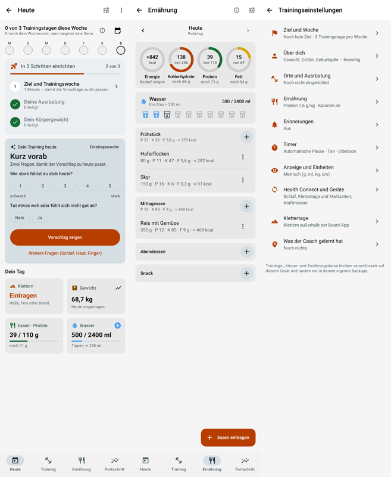
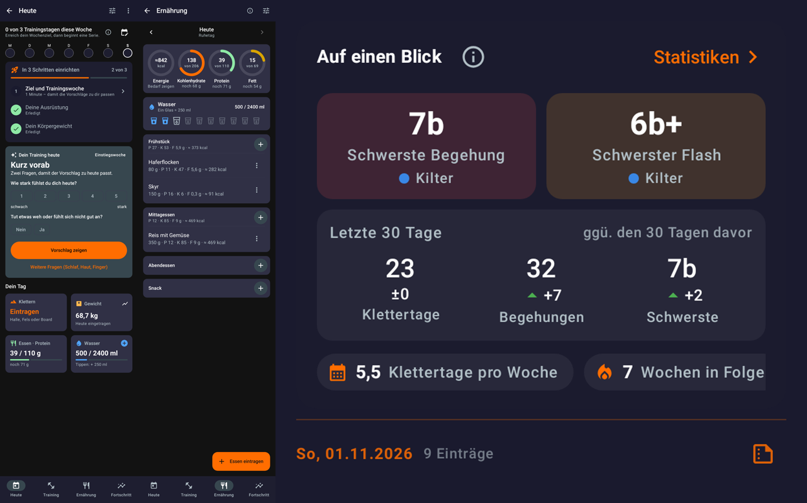

# Light and dark contrast across the app (PR #92)

**Goal:** every text reaches at least 4.5:1 and large text and controls at least 3:1, in the light and the dark theme, and the app keeps its orange look. The theme's colour tokens change first; screens change only where they hard-code colours.

**State, 8 November:** the code is in draft PR [#92](https://github.com/CruxCoach/CruxCoach/pull/92) and the renders below are from it. The test build and the phone check follow once the release branch's CI is green again.

## What was wrong
- **Lilac surfaces.** The colour schemes set only a few Material roles, so Material filled the rest with its lilac defaults. In the light theme this showed on the drawer, cards, the day row, the setup card and the navigation bar. In the dark theme it showed on the top bar and the drawer.
- **Orange text** `#FF6D00` on white: 2.8:1. White labels on the darker orange `#E65100`: 3.8:1.
- **Status colours as text in light:** yellow star ratings 1.6:1, green 2.8:1, red 3.5:1, blue 2.6:1.
- **Selected chips:** an orange label on 20 % orange, 3.8:1 in light.
- **Dark labels on orange fills** in light: 3.3:1.

## What changes
| Role | Light | Dark |
|---|---|---|
| Orange (`OrangeAccent`, primary) | `#B83E00`: 5.2:1 on the background, 5.6:1 for white on it | `#FF6D00` as before: 6.0:1 on the surface, labels dark |
| Green / yellow / red / blue | `#256B29` / `#8A6100` / `#C62828` / `#1565C0` | as before; red slightly lighter, `#FF6E6A` |
| Selected chip | `#FFE5D6` with `#9A3500` (6.0:1) | `#3D1E10` with `#FF6D00` (5.4:1) |
| Surfaces | neutral greys from `#F7F7F7` to `#E8E8E8` | the app's navy-black `#1A1A2E` to `#303045` |
| Muted text (`onSurfaceVariant`) | `#4A5A62`, at least 5.8:1 | `#B0BEC5`, at least 6.7:1 |

A unit test, `ThemeContrastTest`, checks every text role on every surface in both themes, every role pair and the outlines, and that no Material default is left.

## Before (current release branch, on the phone; light left, dark right)
Appearance settings:

Main menu:

Training, today:

## After (renders from PR #92)
Building blocks, light and dark:

Training today, nutrition and training settings, light:

The same screens and the logbook statistics, dark:

## Next
1. The test build, then a phone check in light and dark: home, climb, logbook, settings, map and training.
2. A rebase onto the release branch once the open UI-pass PRs (#81–#84) are merged.
