# Logbook statistics, reorganised (2026-11-01)

Room: #feat-0.2.5-analytics · issue [#44](https://github.com/CruxCoach/CruxCoach/issues/44) · draft pull request [#48](https://github.com/CruxCoach/CruxCoach/pull/48)

**Fifth version (7 November):** the fixes from the maintainer's review, with renders and a check on the test phone with a long logbook, are in the section [Review round](#review-round-7-november) below. Before that, the first version of this report showed the new elements the maintainer chose from the [ideas](2026-11-01-stats-ideas.md): at a glance, milestones, how your boards feel, tries until the send and the session recap. The maintainer then asked to fit them into the existing statistics so that nothing is shown twice: one overview at the top of the logbook, and statistics where every number and chart appears once. That first cleanup dropped some figures 0.2.4 showed; the fourth version brought all of them back inside the same cards, added climbing days per week over time, and showed climbing days, sends and the hardest grade side by side in the overview.

The renders come from the design test with a made-up logbook on three boards, on a German phone, dark and light. The phone section shows the same build on the test phone.

## What 0.2.4 showed, and where it is now

Checked against the 0.2.4 code. Nothing is gone; some numbers moved into another card.

| 0.2.4 | Now |
|---|---|
| Best grade, sends, tries, climbing days, distinct problems, flash rate (logbook tiles) | The six period numbers at the top of the statistics, with changes; the overview shows climbing days, sends and hardest of the last 30 days |
| Hardest flash, sends per day, sessions per week, week streak (records row) | The bests row under the six numbers, for the chosen period and board; the overview keeps the hardest flash, the running streak and the eight-week average |
| Board comparison (sends, best grade) | Board chips |
| Rolling performance level | Progress, one line per board |
| Grade pyramid | Grades: sends per grade, in the intensity-zone colours |
| Outcomes by grade, flash donut | Grades: problems per grade |
| Sent climbs per grade | Tap a grade: its sends and the problems behind them |
| Log entries over time, weekly volume | Activity: sends over time, entries over time |
| Activity calendar, angles, hold heatmap | Unchanged |
| Period comparison | The changes under the period numbers |

## What was shown twice

| Before | Now |
|---|---|
| Six tiles at the logbook top and "at a glance" at the top of the statistics | One overview card at the logbook top |
| Grade pyramid, outcomes by grade, flash-or-later donut, sent climbs per grade | One chart: problems per grade (flash, sent later, not yet sent) |
| Rolling level and hardest new send per month | One progress chart, one line per board |
| Activity calendar, log entries over time, weekly volume | One activity card: calendar or entries per week |
| Board chips and the tappable comparison table | Board chips, each with its sends |
| Records row and period comparison | The overview card, the milestones and the changes under the period numbers |

## Review round (7 November)

The maintainer reviewed the pull request and asked for nine fixes before it is ready. All of them are in commit cba69441; the two small fixes the phone check found are in commit 602c1255.

1. **Session recap at the end of a timed session:** flashes now count tries from earlier days, as the recap in the logbook does. A first-go send of a problem you tried before is no flash on the card you share.
2. **Climbing days per week:** the chart spans the whole period, from your first entry at the earliest until today. A month only partly inside the period, like the current month, counts only its days inside it. The average is taken over the whole period, not from the first to the last active week.
3. **Repeats per grade:** tap a grade in either grades view to see its sends and the problems behind them ("20 sends · 20 problems"); the difference is the repeats.
4. **Bests of the period**, back as a row under the six numbers, for the chosen period and board: hardest flash, sends in one day (with the day), climbing days a week and weeks in a row. The overview keeps the running streak and the eight-week average.
5. **Sends over time** counts sends without a grade, in grey, so the columns add up to the sends number.
6. Switching the period quickly can no longer show the numbers of the period chosen before.
7. **The card at the end of a timed session** shows only the milestones that session reached, not those of an earlier session the same day.
8. Smaller ones: "30 days" are today and the 29 days before, so they compare 30 days with 30; near V0, how wide a grade is now measured inside the graded range (before, board feel differences near V0 looked smaller than they are); "tries per month" shows every month of the period, keeps months without a first send as gaps (a faint dashed line) and scrolls sideways for long logbooks, starting at the newest month; tapping a month works again after a period change; at the largest font sizes the numbers stand two to a row so their labels keep whole words; the changelog names the three hardest sends.
9. The release-gate flow for the honest flash and the statistics is rewritten for the new layout.

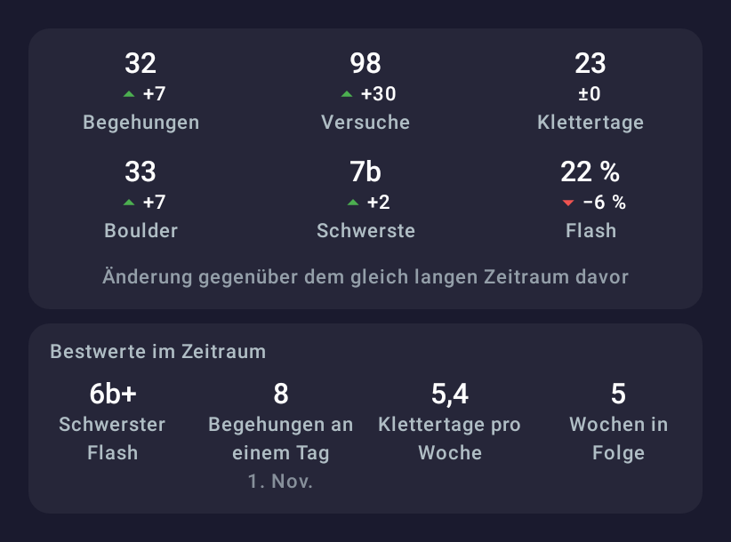
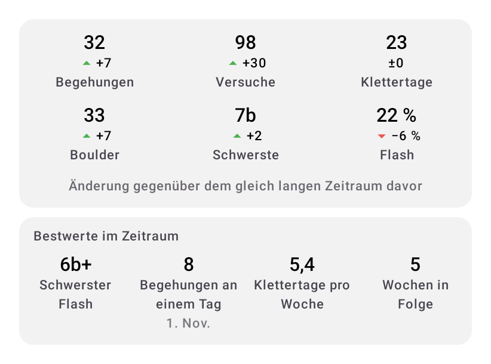
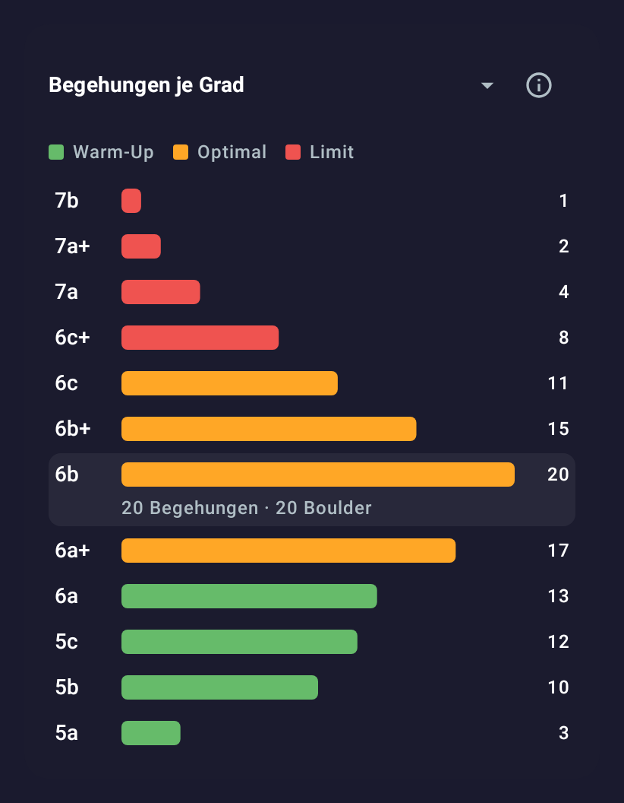
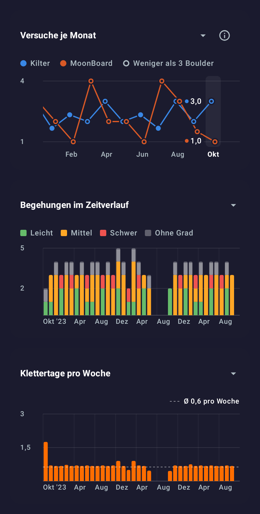
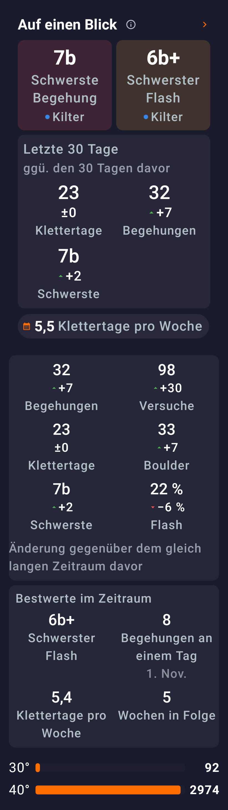

### On the test phone

Test build 9 (commit cba69441) with a made-up logbook of three years: 3,038 entries on three boards, a four-month break, sends without a grade, and a new hardest grade this morning.

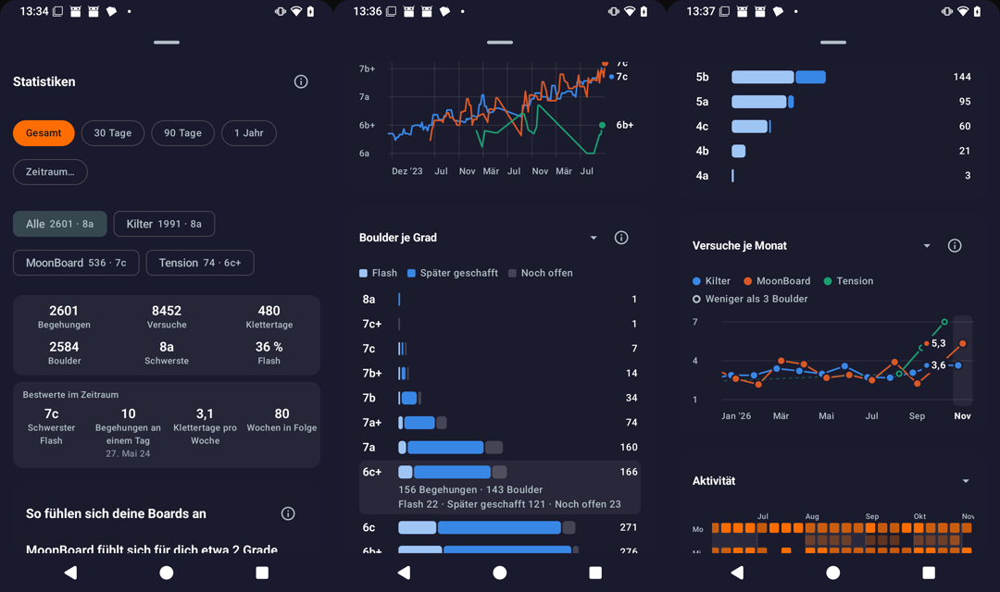
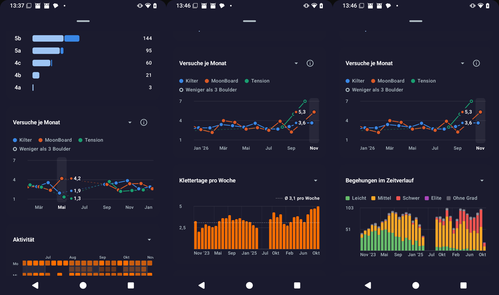
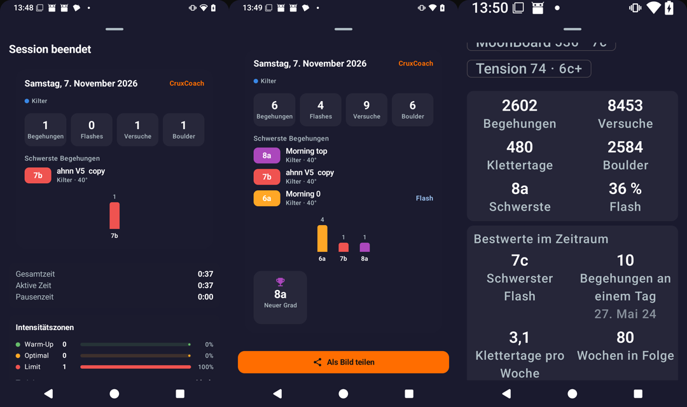

- **End of a timed session:** one try on a problem before the session, then a first-go send of it in a timed list session. The card shows 0 flashes and no milestones. This morning's new grade stays off it, because the session did not reach it. The day's recap in the logbook shows the whole day with the new grade, and the session's send is no flash there either.
- **Climbing days per week:** over 90 days the weekly view has all 13 weeks with the average over the whole period. Over three years the monthly view keeps the break, and November counts only its first seven days.
- **Bests, repeats, sends:** the bests follow the period and board. Tapping 6c+ shows "156 Begehungen · 143 Boulder", and flash, later send and open add up to the 143. Sends over time add up to 2,601, the sends number.
- **30 days:** the statistics' 30 days now show the same numbers as the overview's last 30 days. Tapping "1 year" and then right away "30 days" ends on 30 days.
- **Tries per month** opens at the newest month, scrolls back to the break, which shows as a dashed line, and a tap selects a month again after a period change.
- **Largest font size:** the overview, the six numbers and the bests keep whole words.
- Found here and fixed in commit 602c1255: the angle count wrapped onto two lines at the largest font size, and a progress line ending at the very top had its grade cut off.
- Not new, but worth knowing: with 3,038 entries the overview appears about 7 seconds after the logbook opens; the list shows after about one. Computing all the statistics takes about 100 ms on the server, so the time goes into reading the logbook, the same way 0.2.4 filled its tiles.

### The release-gate flow

`logbook-honest-flash-and-stats` is rewritten for the new layout. On the test phone the app's test tags do not show up as ids, so the flow finds everything by its German text or description, as the testing guide recommends. It logs three tries and a first-go send on the same problem, checks the overview, that the send is no flash, the day's recap and the statistics with their bests, and deletes both entries again. Each step was walked by hand on test build 9. Doing so showed that the logbook puts comments in quotes, so the flow now finds its markers inside the text. The other logbook flows still use test tags that are gone; that is a separate follow-up.

## The logbook top

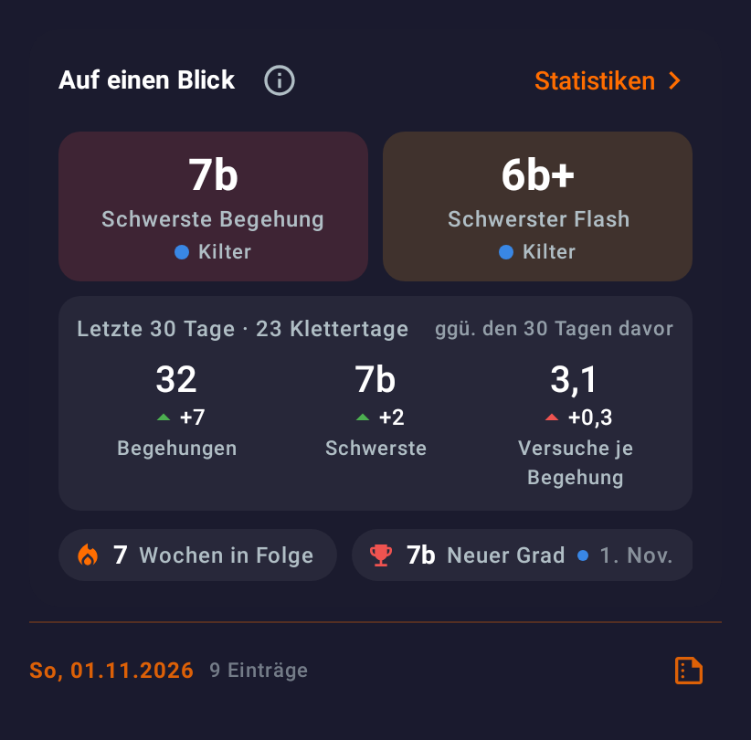

- One card instead of six tiles: the hardest send and hardest flash, then the last 30 days against the 30 days before: climbing days, sends and the hardest grade side by side, each with its change.
- Below, small chips: climbing days per week (the average of the last eight weeks) and the milestones (weeks in a row, new grades, 50/100/250… sends, biggest day).
- It always covers the whole logbook and every board. Tapping it opens the statistics; the ⓘ explains the numbers.
- The period chips of the list moved into the logbook filter, next to result, board and angle. The list and the statistics no longer share a period.
- Each day in the list has a recap button next to its date.

## The statistics, top to bottom

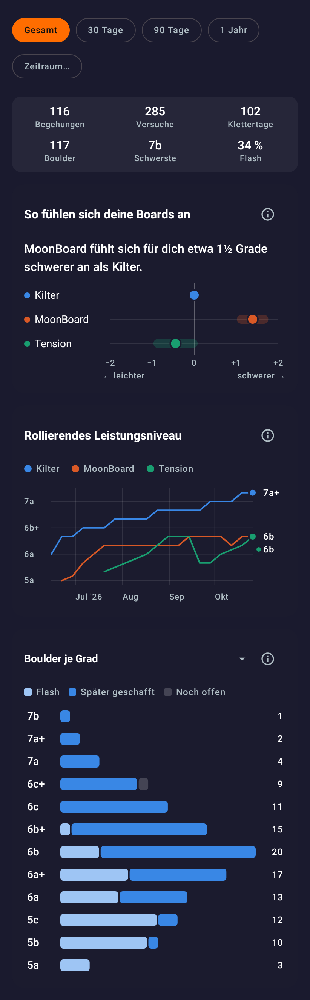
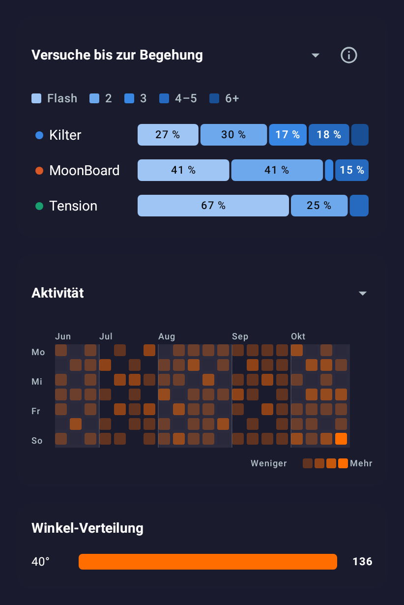

1. **Filters:** the period, then the board chips (only with more than one board). Each board chip shows its sends and best grade in the period ("Kilter 11 · 7a"), so the chips are the comparison of the boards.
2. **The period in six numbers**, two rows of three: sends, tries and climbing days; problems, the hardest grade and the flash rate. For 30 or 90 days, a year or a custom range, each shows its change against the period of the same length before (the hardest grade in grade steps). These are the six tiles of the 0.2.4 logbook top.
3. **How your boards feel** (only with enough data): one sentence and a dot per board on a scale of grades.
4. **Progress:** the rolling performance level, one line per board when you look at all boards together, each line ending in its current grade.
5. **Grades**, two views: problems per grade, each problem once by its best result (flashed, sent later, not yet sent); or sends per grade, every send with its repeats, in the intensity-zone colours (warm-up, optimal, limit). Tap a grade for its numbers.
6. **Tries:** until the send (flash, 2, 3, 4–5, 6+ per board), per grade (one bar per board), per month (one line per board).
7. **Activity**, four views: the calendar; climbing days per week (weeks off as empty columns, over more than half a year the weekly average of each month, with the period's average as a dashed line); entries over time; sends over time. The last two are stacked by grade band, per week or per month for long periods.

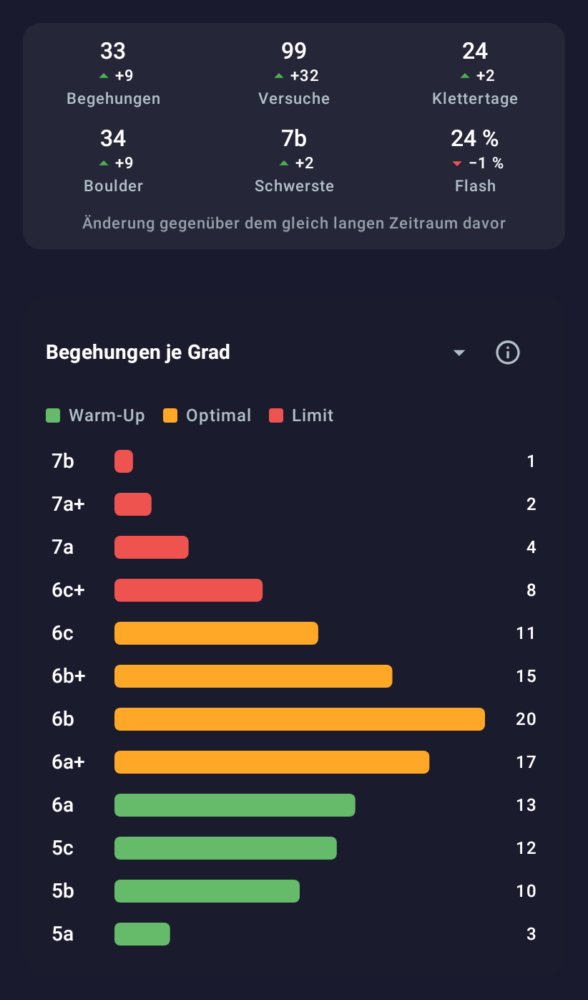
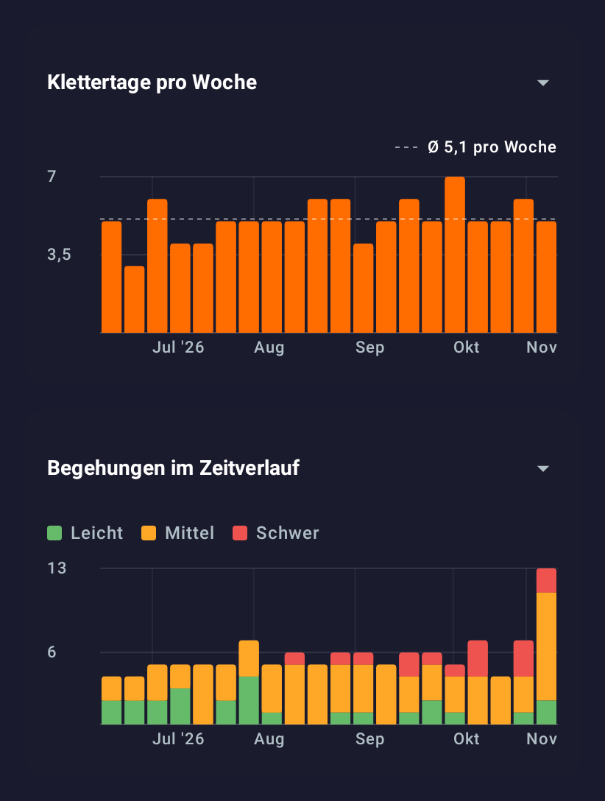

8. **Angles** and **holds**, as before.

## One colour language

- Light blue means a flash, darker blue more tries, grey a problem not yet sent: in problems per grade and in tries until the send.
- Each board has one colour in every chart and on every dot.
- Grade colours (green, orange, red, purple) mark grades and grade bands: the record tiles, the recap and entries per week.
- Orange stays the app's accent: chips, the calendar, the angles.

## How your boards feel

How the estimate works:
- For each problem, the tries until its first send, counted across sessions.
- For a pair of boards, a line through the logarithm of the tries over the grade, with one slope for both boards. The slope says how many more tries a harder grade costs you, and the gap between the boards how many more tries the same grade costs on the other board. The gap divided by the slope is how much harder the other board is, in grades of your grade scale near your usual grade.
- It only shows when it says something: at least 8 sent problems on each board, sends at two or more of the same grades, tries that clearly rise with the grade, and an uncertainty of at most one grade. The pale band around a dot shows that uncertainty.
- In the made-up logbook, MoonBoard was set 1.6 difficulty steps harder and Tension 0.6 easier. The estimate shows about 1½ grades harder and about half a grade easier.

## Session recap

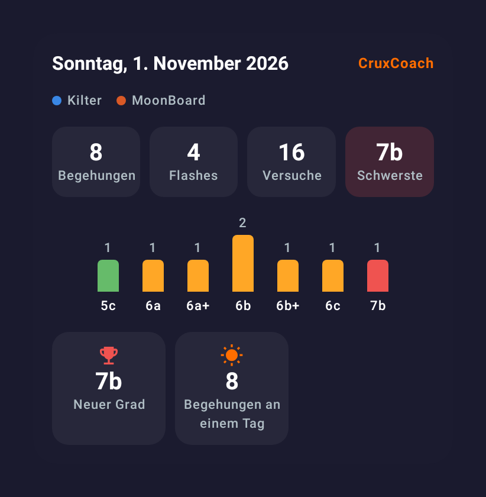

- Opens from the recap button next to a date in the logbook. The summary at the end of a timed session now shows the same card, with its time and intensity details below it.
- The card shows the date, the boards, sends, flashes, tries and problems, the three hardest sends of the session (grade, name, board and angle, a flash marked; a problem sent twice shows once), the sends per grade and the milestones of that day. "Share as image" shares exactly this card through the phone's share menu.

## Light theme

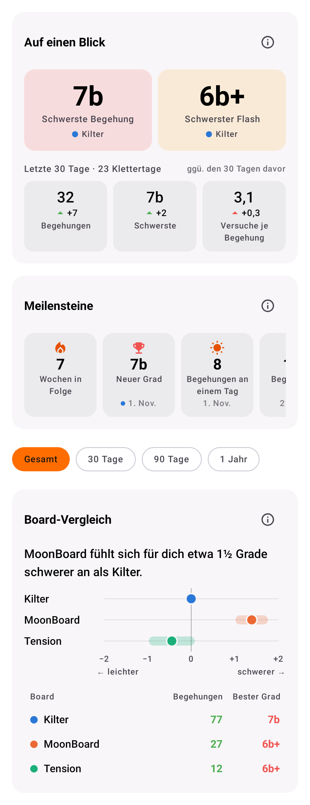
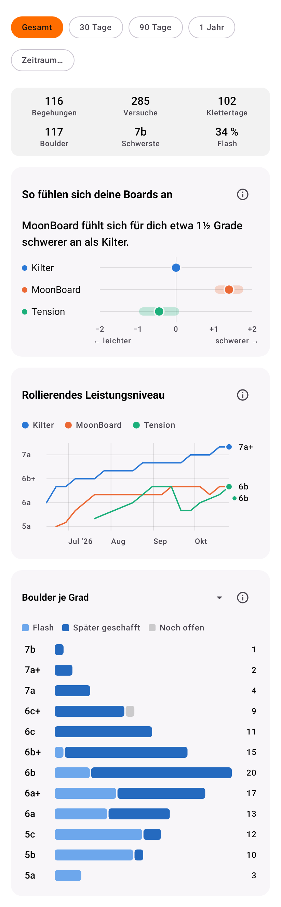

## On the test phone

**Test build 7** (commit 77e34527, the restored statistics), same made-up logbook:

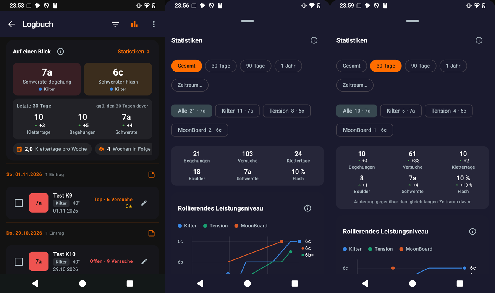
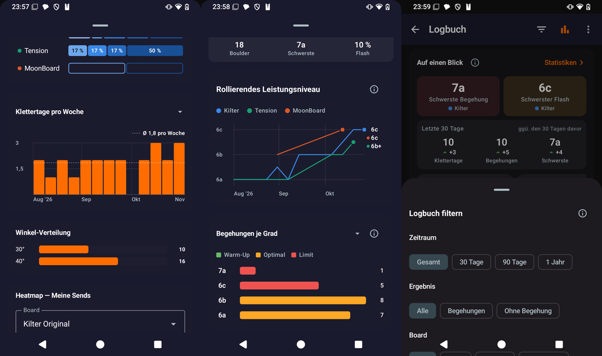

- The overview shows climbing days, sends and the hardest grade side by side, with the per-week chip and the streak below.
- The board chips show sends and best grade; the six period numbers show their changes for 30 days.
- Climbing days per week shows a week without climbing as a gap, with the dashed average; sends per grade comes in the zone colours.
- The three fixes from build 5 hold: the overview grows in, the period chips in the logbook filter match the other filter chips, the calendar starts at the first entry.
- Not explained yet: the very first tap on the overview's "Statistiken" link right after the update did not open the statistics; five later taps did.
- The recap with the three hardest sends came one build later (commit b2770231). On the phone it shows the day's hardest sends, and "Share as image" shows the card in the share menu's preview. The first tap on "Statistiken" after that update opened the statistics.

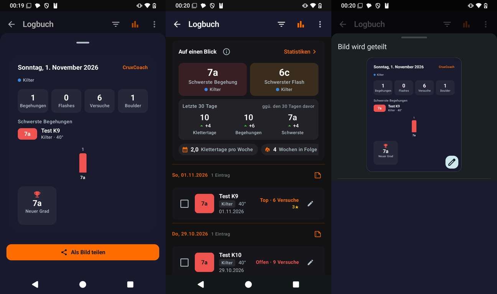

**Test build 5** (commit 7d153ec9), before the 0.2.4 figures came back:

Test build 5 (commit 7d153ec9) on the test phone, with the small made-up logbook of the earlier phone test: three boards, 21 entries.

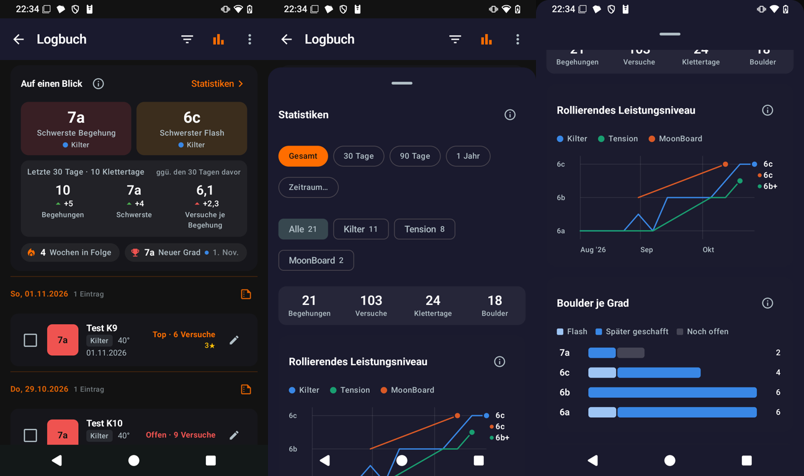
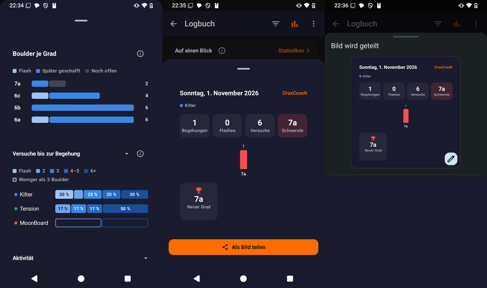

- The overview card reads well. Tapping it opens the statistics.
- The board chips show their sends: "Alle 21", "Kilter 11", "Tension 8", "MoonBoard 2".
- How your boards feel stays hidden here, because MoonBoard has only 2 sent problems. That is intended.
- With only two problems, MoonBoard's bar in "tries until the send" is hollow, as the legend says.
- "Share as image" opens the phone's share menu with the card as its preview.
- These screenshots show build 5, before the 0.2.4 figures came back; the renders above show the current state.
- Fixed after this check, in the next build: the overview appeared a moment after the list and pushed it down in one jump (it now grows in); the period chips in the logbook filter were orange unlike the other filter chips; the activity calendar started with empty months before the first entry.
- Not checked on the phone: the end-of-session summary with the card (only in the renders), and the light theme (only in the renders).

## The other ideas

None of these is built. Each could go into a place that already exists, so no new card is needed:

1. **Open projects:** a filter in the logbook ("Open projects": tried, not yet sent, newest try first, with tries so far).
2. **Project grade per board:** a faint band in "Tries per grade" across the grades where you usually need 3 to 6 tries.
3. **Median:** next to the average in the details when you tap a grade.
4. **One grade over the months:** tapping a grade in "Tries per grade" shows that grade month by month.
5. **Angles:** a small angle switch in the tries card (all angles / 40° / 50°).
6. **Points per week:** needs a points table first and would be a new card, so later.

## Tests

- Review round: all 507 tests of the statistics package pass locally on both commits, among them the new ones for the period, climbing days per week over the whole period, the bests, sends without a grade, the session's own milestones, flashes at the end of a session and the grade width near V0.
- Earlier: at a glance, milestones and the recap (11 tests), the board feel and the tries buckets (5), stats across boards (9), the statistics computation (51, including the period before, climbing days per week, monthly buckets and sends per grade), the statistics sheet with its info and activity selector (1), board colours (3): all pass locally. CI runs the full suite.
- The removed charts took their tests with them. The tests on flash detection now check the grades chart instead of the donut.
- The design test renders all pictures above; CI skips it.
