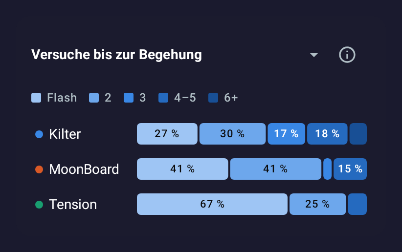
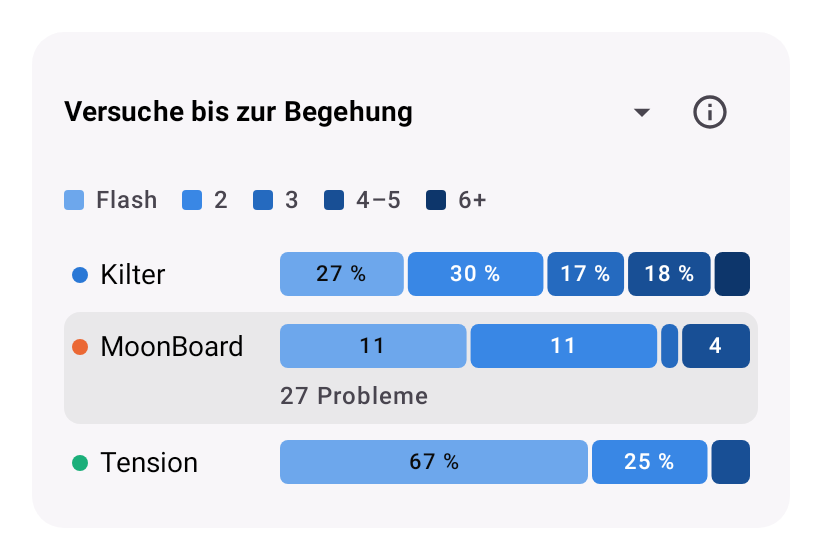
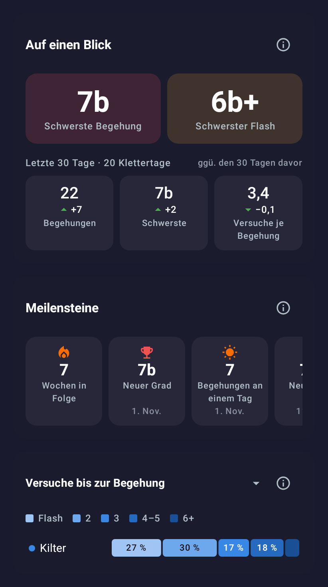
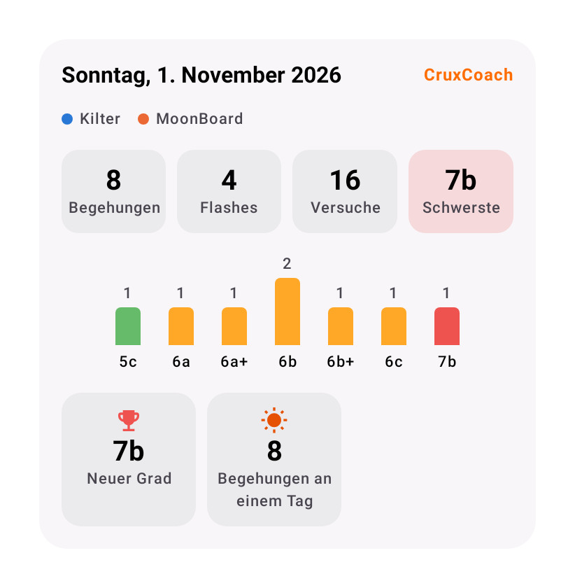

# Statistics: at a glance, milestones, board feel, tries until the send, session recap (2026-11-01)

Room: #feat-0.2.5-analytics · issue [#44](https://github.com/CruxCoach/CruxCoach/issues/44) · draft pull request [#48](https://github.com/CruxCoach/CruxCoach/pull/48)

From the [ideas for the statistics](2026-11-01-stats-ideas.md), the maintainer chose ideas 1 (at a glance), 2 (tries until the send) and 3 (how your boards feel), plus the shareable session recap and the milestones. All five are built into pull request #48. The other ideas only go in if they fit without crowding the screen; see the last section for where they could go.

The pictures come from the design test with a made-up logbook on three boards, rendered on a German phone in dark and light. They are renders, not screenshots from a phone.

## Calmer, not longer

The new cards replace parts of the statistics instead of adding to them:

| Before | Now |
|---|---|
| Records row (hardest flash, sends per day, sessions per week, week streak) | At a glance (hardest send and flash) and the milestones (biggest day, weeks in a row). The climbing days of the last 30 days take the place of sessions per week. |
| Period comparison, hidden in a dropdown | At a glance: the last 30 days against the 30 days before |
| Board comparison as a plain table | The same table with each board's colour, led by how the boards feel |
| Stats across boards only with two or more boards | Also with one board, without a legend |

The sheet now reads from top to bottom: board chips, at a glance, milestones, interval chips, board comparison, then the charts as before.

## At a glance and milestones

- **At a glance:** the hardest send and the hardest flash over the whole logbook as two big tiles in their grade colour, with the board they were done on (only when you climb on more than one board).
- Below: the last 30 days against the 30 days before. Sends, the hardest grade, and tries per send, each with an arrow. Green means better, so fewer tries per send gets a green arrow pointing down. The 30 days replace "this month against last month" from the idea list, so the 1st of a month does not show everything in red.
- **Milestones:** one row of badges, newest first, scrolling sideways. A new grade (the first send of a grade harder than every send before; the very first day of a logbook only sets the starting point), 50, 100, 250, 500 and more sends, the biggest day (from 5 sends on) and weeks in a row while the streak runs.
- Both follow the board chips but not the interval chips, which is why they sit above them.

## How your boards feel

The board comparison opens with one sentence and a small chart: one row per board, its dot on a scale of grades, the main board on the 0 line. In the picture: "MoonBoard fühlt sich für dich etwa 1½ Grade schwerer an als Kilter."

How it is estimated:
- For each problem, the tries until its first send, counted across sessions as in the rest of #44.
- For a pair of boards, a line through the logarithm of the tries over the grade, with one slope for both boards. The slope says how many more tries a harder grade costs you. The gap between the boards says how many more tries the same grade costs on the other board. The gap divided by the slope is how much harder the other board is, in grades of your grade scale near your usual grade.
- It shows only when it says something: at least 8 sent problems on each board, sends at two or more of the same grades, tries that clearly rise with the grade, and an uncertainty of at most one grade. The pale band around a dot shows that uncertainty.
- In the made-up logbook, MoonBoard was set 1.6 difficulty steps harder and Tension 0.6 easier; the estimate shows about 1½ harder and about half a grade easier.

## Tries until the send

- The first view of the tries section: per board, the share of problems sent as a flash, on the 2nd or 3rd try, after 4–5 or after 6 and more tries. Five shades of one blue, light for few tries, dark for many.
- Tries from earlier sessions count, so a send after attempts on another day is no flash.
- Tap a board to see the number of problems in each part instead of the shares.
- With one board the section shows the same views for that board:

## Session recap

- In the logbook, each day has a small recap button next to its date. At the end of a timed session, the summary has a "Share as image" button.
- The card shows the date, the boards, sends, flashes, tries, the hardest grade, the sends per grade as small columns in grade colours, and the milestones of that day.
- "Share as image" turns exactly this card into a picture and opens the share menu of the phone.

## The other ideas, and where they could fit

None of these is built. Each could go into a place that already exists, so no new card is needed:

1. **Open projects:** a filter in the logbook ("Open projects": tried, not yet sent, newest try first, with tries so far).
2. **Project grade per board:** a faint band in "Tries per grade" across the grades where you usually need 3 to 6 tries.
3. **Median:** next to the average in the details when you tap a grade.
4. **One grade over the months:** tapping a grade in "Tries per grade" shows that grade month by month.
5. **Angles:** a small angle switch in the tries section (all angles / 40° / 50°).
6. **Points per week:** needs a points table first and would be a new card, so later.

## Tests

- New unit tests for at a glance, milestones and the recap (11) and for the board feel and the tries buckets (5). The tests of the existing statistics and stats across boards pass as well. The removed period comparison took its two tests with it.
- The design test renders all pictures above in dark and light; CI skips it.
- Not yet tried on a phone. The share button needs a real phone to check.
