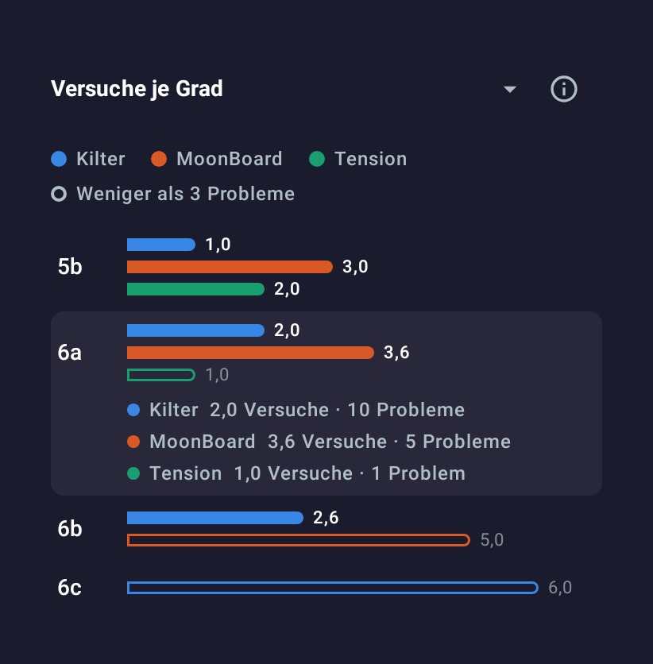
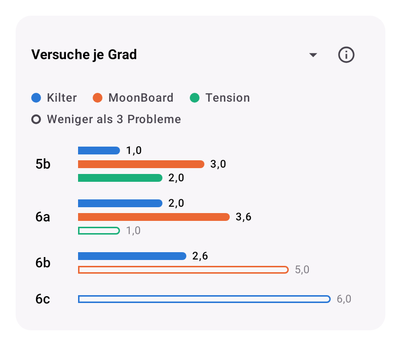
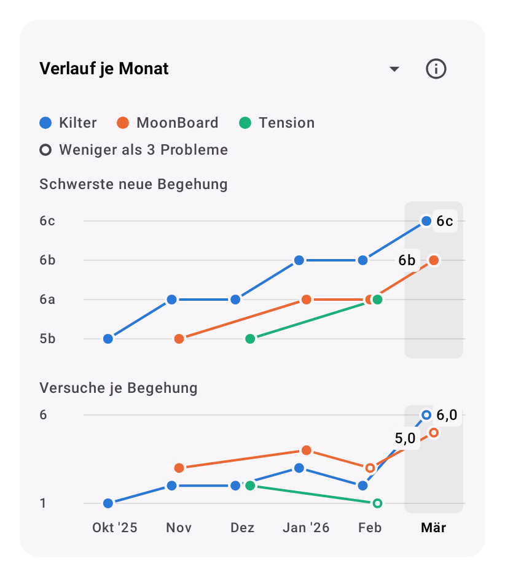
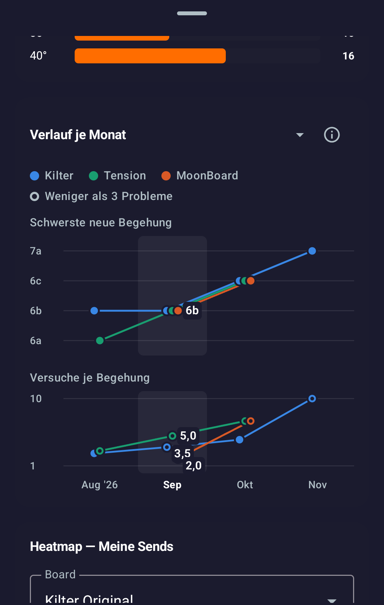
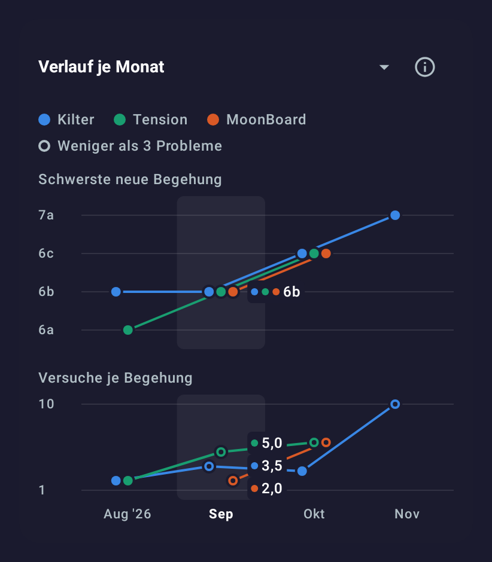

# Stats across boards: second version (2026-11-01)

Issue: [#44 Cross-board stats](https://github.com/CruxCoach/CruxCoach/issues/44) · branch `feat/0.2.5-analytics` · draft pull request [#48](https://github.com/CruxCoach/CruxCoach/pull/48) against `feat/0.2.5-release`

If you log on more than one board, the logbook statistics get a new section below the charts. A selector in its title switches between two views. The second version replaces the tables of the first one with charts and moves the explanations behind the info button next to the title.

The stills come from the design-review test: a German phone, with a made-up logbook on three boards. Further ideas for the statistics are in a [separate report](2026-11-01-stats-ideas.md).

## Tries per grade

| Dark | A grade tapped | Light |
|---|---|---|
|  |  |  |

- One bar per board under each grade; its length is the average tries until the first send, the number sits at its end.
- A board without sends at that grade gets no bar.
- Hollow bars rest on fewer than 3 problems and say little.
- Tap a grade to see how many problems are behind each bar.

## Progress by month

| Dark | Light |
|---|---|
|  |  |

- Two small line charts over the same months, oldest on the left: the hardest problem sent for the first time that month, and how many tries those new sends took on average.
- The latest month is selected and its values stand beside the dots. Tap another month to see its values.
- Hollow dots rest on fewer than 3 problems.

## Design

- Each board keeps one colour everywhere in the section, also when the interval hides another board. The colours stay apart for the common kinds of colour blindness and in both themes.
- The legend sits once at the top; the hollow marker only shows up in it when the chart has such values.
- Screen readers get every value spelled out per grade or month.

## How it counts

- One problem is one climb on one board at one angle, the same unit the flash detection uses.
- Its tries are all attempts up to and including the first send. If you log a few attempts and then the send in one session, the app keeps them as one entry with the try count. Attempts from earlier sessions are added to it.
- Repeats after the first send do not count. They say nothing about how hard the grade felt on that board.
- The interval chips (30 days, 90 days, 1 year, all, custom) pick problems by the day of their first send. Tries from before the interval still count.
- All boards in CruxCoach share one difficulty scale, so a grade means the same on every board.
- The section ignores the board filter, like the board comparison row above it. It appears only when two boards have sends in the interval.
- It works with the logbook you already have, without a database change.

## Phone test and label fix

Test build 2 was tried on a phone with a made-up logbook on three boards ([test report](../release-0.2.5/2026-11-01-phone-test-41-48.md)). Every number matched. One issue: when the values of the selected month lie close together, their labels stacked, and one label covered another board's point.

A fix is ready but not yet in a build. The values now stand in one column beside the whole group of dots, each led by its board's colour dot, and equal values sit further apart:

| On the phone (build 2) | With the fix |
|---|---|
|  |  |

## Open

- The label fix goes into the next build once the maintainer agrees.
- Not yet tried with a real multi-board logbook.
- Ideas for later: one grade over the months (tries for 6b on each board, month by month), and the median next to the average.
