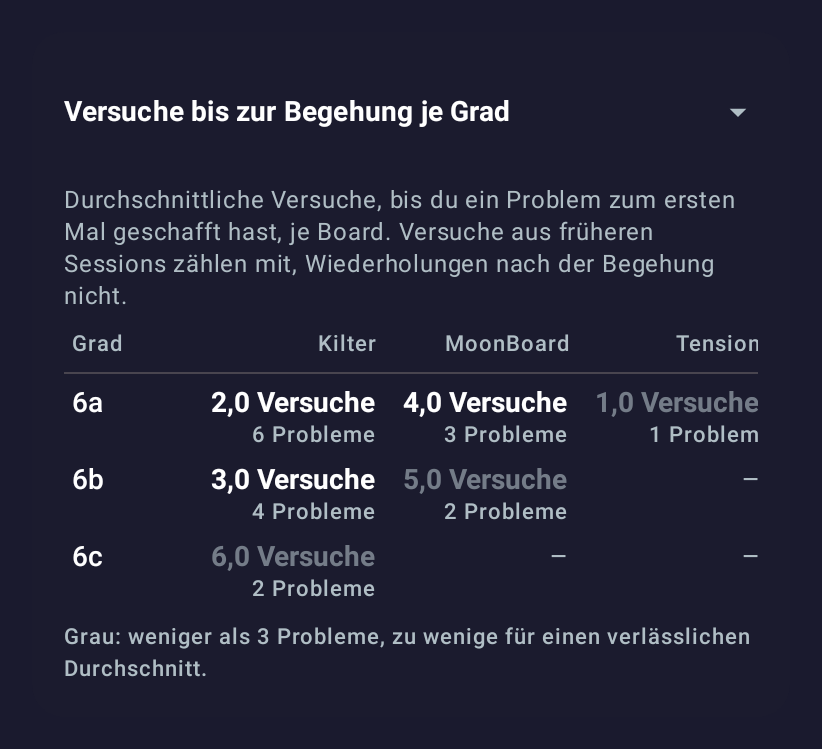
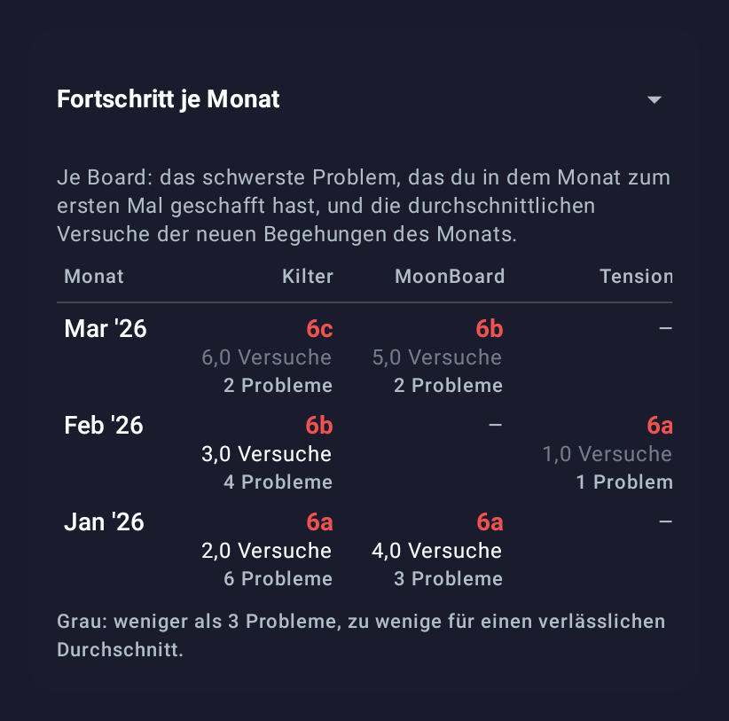

# Stats across boards: first version (2026-11-01)

Issue: [#44 Cross-board stats](https://github.com/CruxCoach/CruxCoach/issues/44) · branch `feat/0.2.5-analytics` · draft pull request against `feat/0.2.5-release`

If you log on more than one board, the logbook statistics get a new section below the charts. A selector in its title switches between two views. The stills below come from the design-review test: a German phone in the dark theme, with a made-up logbook on three boards.

## Tries to send per grade

- One row per grade and one column per board.
- Each cell shows the average tries until a problem was sent for the first time, and the number of problems behind it.
- Averages over fewer than 3 problems are grey, because they say little.

## Progress per month

- Per month and board: the hardest problem sent for the first time that month, then the average tries of that month's new sends.
- Newest month first.

## How it counts

- One problem is one climb on one board at one angle, the same unit the flash detection uses.
- Its tries are all attempts up to and including the first send. If you log a few attempts and then the send in one session, the app keeps them as one entry with the try count. Attempts from earlier sessions are added to it.
- Repeats after the first send do not count. They say nothing about how hard the grade felt on that board.
- The interval chips (30 days, 90 days, 1 year, all, custom) pick problems by the day of their first send. Tries from before the interval still count.
- All boards in CruxCoach share one difficulty scale, so a grade means the same on every board in this table.
- The section ignores the board filter, like the board comparison row above it. It appears only when two boards have sends in the interval.
- It works with the logbook you already have, without a database change.

## Open

- Not yet tried on a phone with a real multi-board logbook.
- Ideas for later: one grade over the months (tries for 6b on each board, month by month), and the median next to the average.
