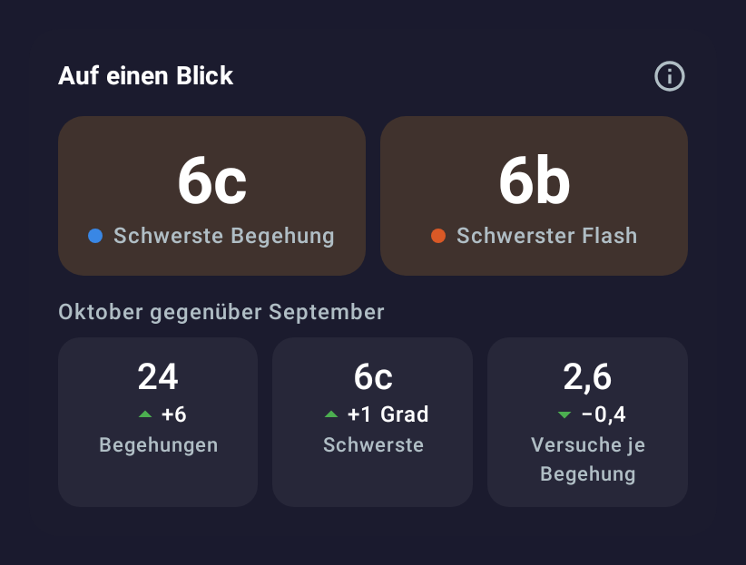
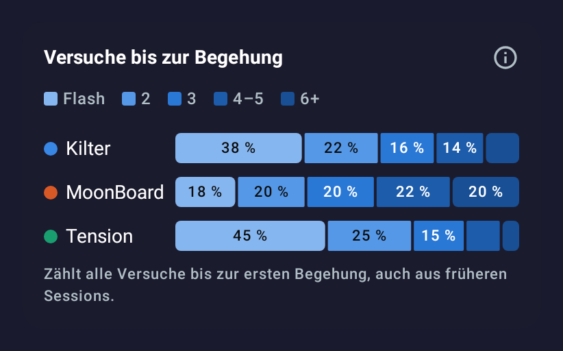
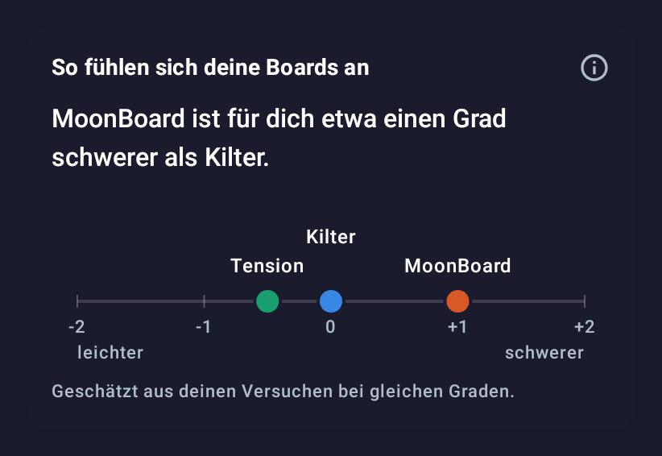
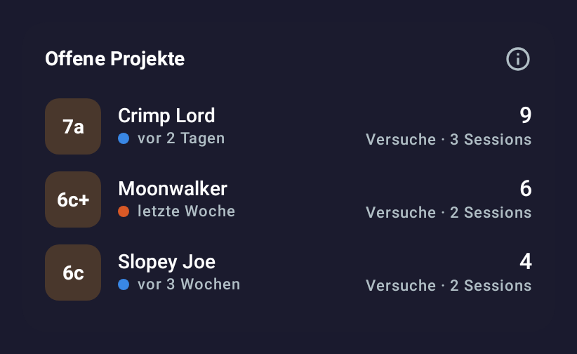
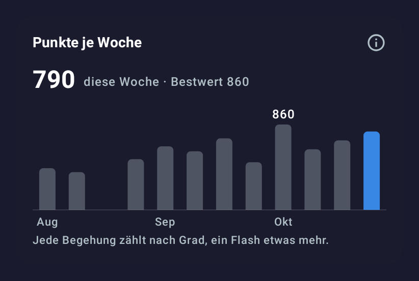

# Ideas for the statistics (2026-11-01)

Room: #feat-0.2.5-analytics · issue [#44](https://github.com/CruxCoach/CruxCoach/issues/44)

Ideas for making the logbook statistics more useful and easier to read, each described by what it does. The pictures are drawings from a design test with made-up data on a German phone. They are **not in the app** and not in the pull request; they show how an idea could look.

The redesigned views for #44 itself are in the [second-version report](2026-11-01-stats-across-boards.md).

## The design rules behind them

- Each board has one colour, the same in every chart.
- Numbers sit at the marks; no tables and no axis you have to read off.
- A chart explains itself with its title. The longer explanation sits behind the info button.
- Hollow marks mean little data behind a value.
- Tap for details instead of showing everything at once.

## 1. At a glance

- Two big tiles at the top of the statistics: hardest send and hardest flash, with the board's colour dot.
- Below: this month against last month for sends, hardest grade and tries per send, each with an arrow. Green means better, so fewer tries per send is green too.
- The app already computes most of this; today the period comparison hides in a dropdown further down.
- Effort: small.

## 2. Tries until the send

- Per board, the share of problems you sent as a flash, on the 2nd try, 3rd try, 4th–5th and after 6 or more.
- Counts tries across sessions, so a send after attempts on an earlier day is not a flash.
- Shows at a glance on which board you send fast and where you work for it. Fits as a third view in the section of #44.
- Effort: small; it uses the same counting as #44.

## 3. How your boards feel

- One sentence and a scale: "MoonBoard feels about one grade harder for you than Kilter."
- Estimated from your tries at the same grades on both boards; shown only when there is enough overlap.
- Answers the question many people ask when they climb on several boards, for your own climbing instead of in general.
- Effort: medium; the estimate needs care and a minimum amount of data.

## 4. Open projects

- Problems you tried but have not sent yet: grade, board, tries so far, sessions, last try.
- Sorted by the last try, so the current projects are on top. Tap to open the problem.
- Effort: small to medium; the attempts are already in the logbook.

## 5. Points per week

- Every send scores by its grade, a flash a bit more. One bar per week, this week highlighted, best week marked.
- One number that grows with both volume and difficulty, so a week of many easier sends and a week of one hard send can be compared.
- Effort: medium; the points table needs to be decided first.

## More ideas without a drawing

- **Session recap**: after a session, one card with sends, flashes, tries, hardest grade and a small grade strip; shareable as an image.
- **Project grade per board**: the grade where you usually need 3 to 6 tries, as a hint for what to try next.
- **One grade over the months**: tries for one grade (say 6b) on each board, month by month.
- **Milestones**: first send of a new grade, 100 sends, biggest day.
- **Angles**: the same tries charts for 40° against 50°.
- **Median** next to the average, so one long project does not drag a grade.

## My suggestion

1. Ideas 1 and 2 first: small, built on data the app already has, and they make the top of the statistics readable at a glance.
2. Then 4 (open projects) and the session recap: they help during and right after training.
3. Ideas 3 and 5 later: they need a decision on the estimate and the points table.

Which of these go into 0.2.5 is up to the maintainer.
