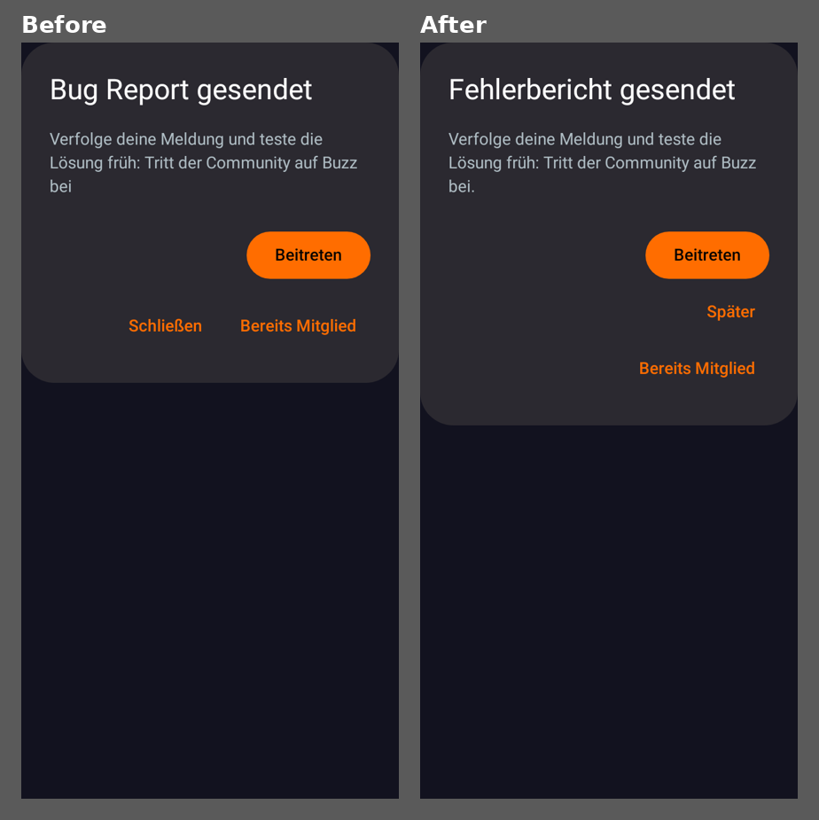
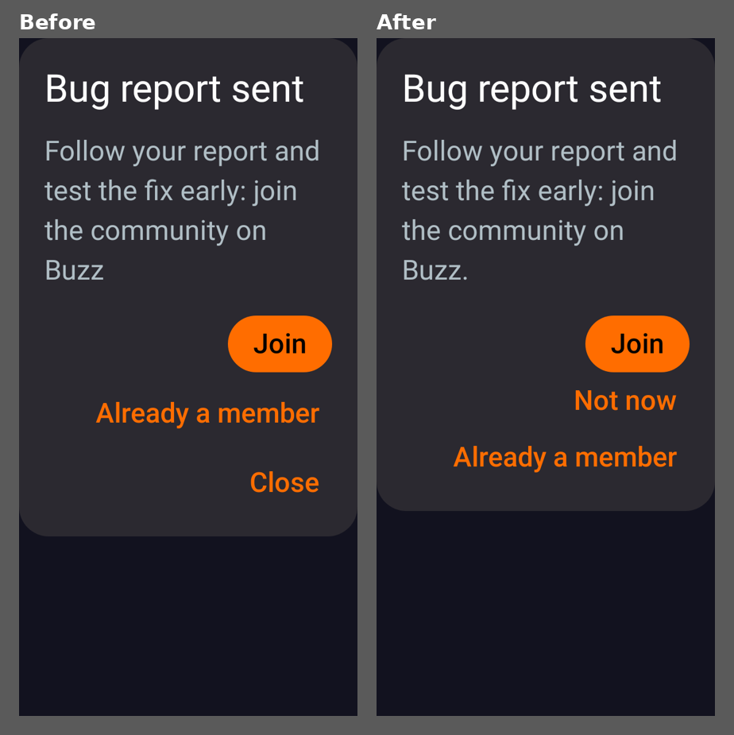
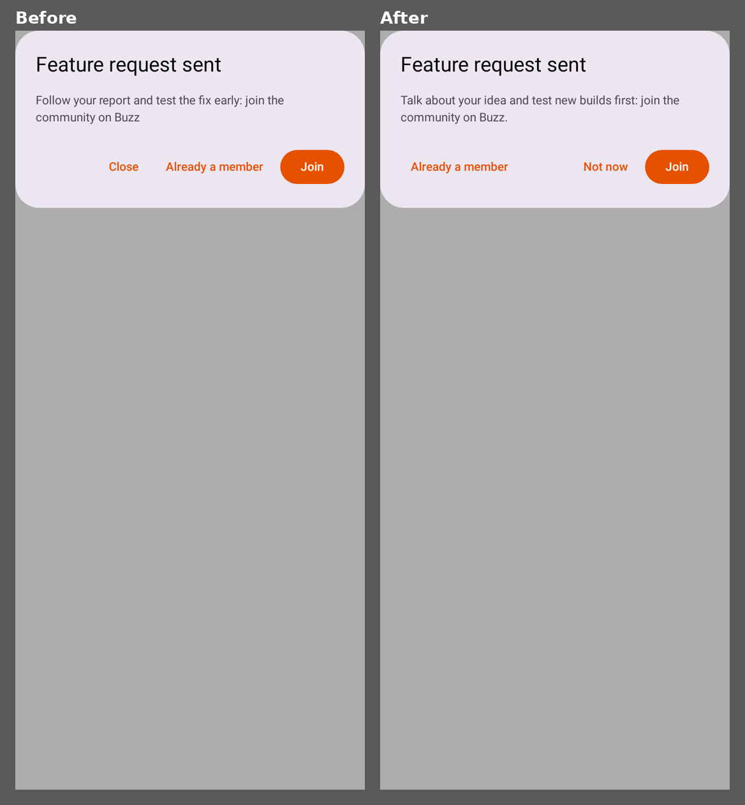
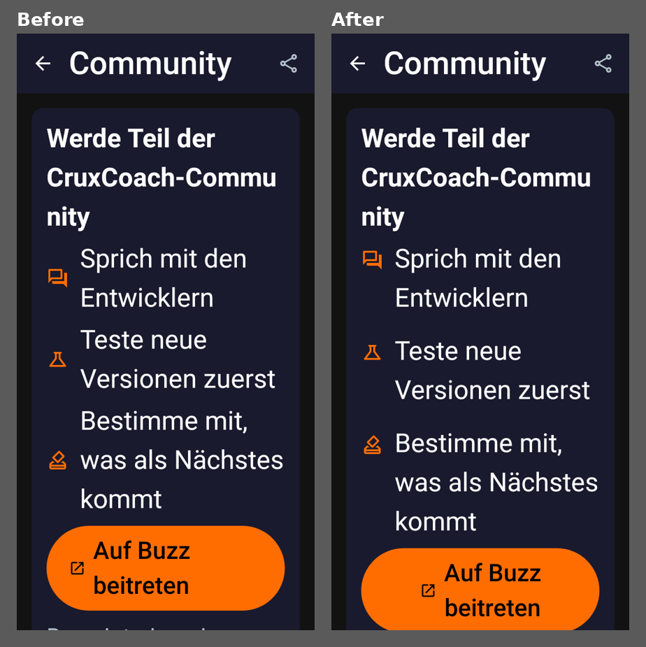
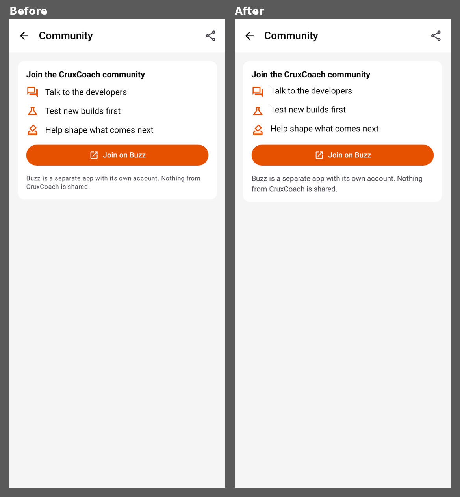
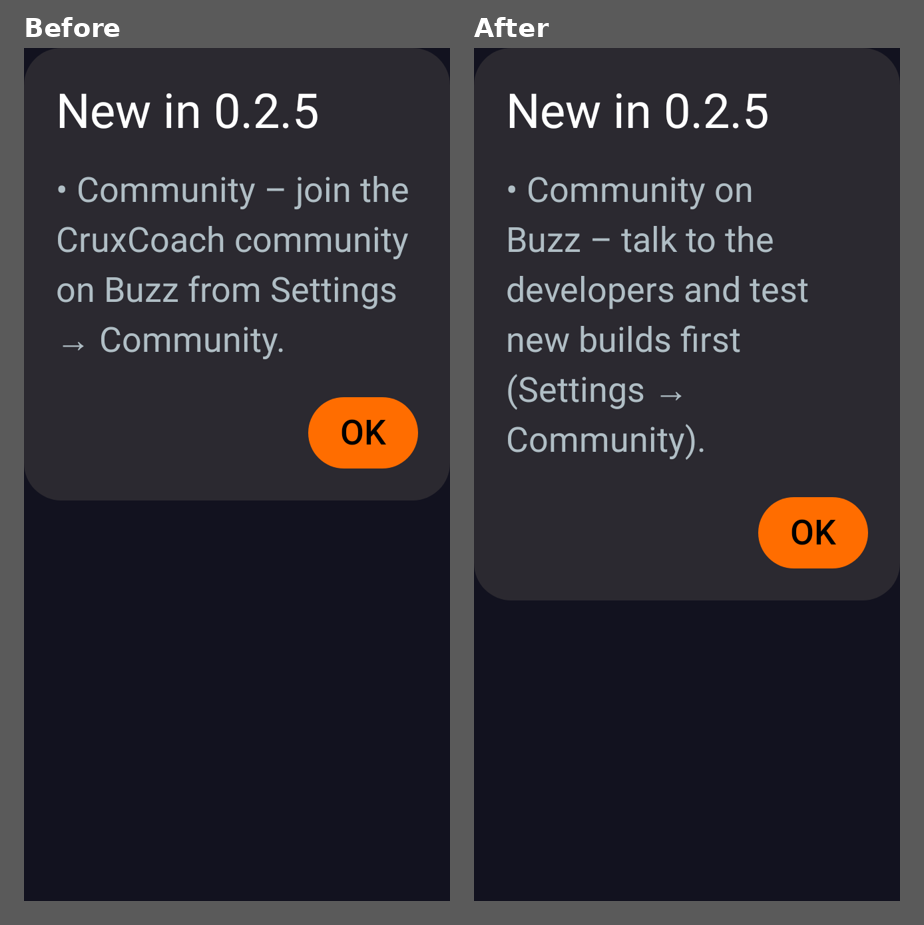

# Community entry points: UI pass

Room: #feat-0.2.5-community · PR [#82](https://github.com/CruxCoach/CruxCoach/pull/82) into `feat/0.2.5-release` (follow-up to #51) · 2026-11-08

The community feature from #51 has four entry points:
- Settings → Community
- its row in the Settings overview
- the hint after a sent bug report or feature request
- the line in What's new 0.2.5

All four were measured against the app's `design.md` and against comparable 0.2.4 screens: About, Bugs & feature requests, and What's new 0.2.4.

## How

- `CommunityUiReviewTest` (new) renders every entry point in 16 variants: English and German, dark and light, 320 and 411 dp wide, font scale 1.0 and 2.0. That is 144 images per run, with the 0.2.4 screens included for comparison. The test only runs when `CRUXCOACH_UI_REVIEW_DIR` is set.
- I ran four render cycles. After each one I looked at every image myself. In the first three, an independent reviewer who had not seen the code also critiqued the renders against `design.md`.
- Cycle 4 found nothing of weight.

## What changed

| Where | Before | After | Why |
|---|---|---|---|
| Hint after a feature request | Same text as for a bug: "…test the fix early…" | "Talk about your idea and test new builds first: join the community on Buzz." | A feature request has no fix. "Try it early" would have promised the idea gets built. |
| Hint buttons | Close · Already a member · Join, split into a row of one and a row of two on small screens | Already a member … Not now · Join in one row when they fit, otherwise stacked with Join on top | Close used to move around with the screen size. "Not now" says the hint comes back after the next report. |
| Hint, German title | "Bug Report gesendet" / "Feature Request gesendet" | "Fehlerbericht gesendet" / "Wunsch gesendet" | Matches "Fehlerberichte" and "Wünsche" in the app. |
| Hint texts | No full stop | Full stop | Like every other dialog text. |
| Community page, points | Icon centred on a wrapped point; same gap between points as between lines | Icon on the first line; the gap grows with the font size | At large font the points ran together into one block. |
| Community page, note | Small text | Normal body size | `design.md`: body text stays at a readable size. |
| Community page, German note | "Buzz ist eine eigene App mit eigenem Konto. Von CruxCoach wird nichts weitergegeben." | "Buzz ist eine separate App mit eigenem Konto. CruxCoach gibt nichts weiter." | Shorter, and "eigen" no longer appears twice. |
| Join button, German, large font | Wrapped label pushed away from its icon | Label as wide as its longest line, icon next to it, both centred | |
| What's new 0.2.5 | "Community – join the CruxCoach community on Buzz from Settings → Community." | "Community on Buzz – talk to the developers and test new builds first (Settings → Community)." | Says what you get. The dash stays with its name when the line wraps. |

Left as they were:
- the page title and its three points, which are the brief's wording
- the short toast when no app can open the link, as asked in the #51 review
- the icons
- the bug-report hint text, which is the brief's wording

## Before and after

Hint after a bug report, German, 320 dp, font 1.0:

Hint after a bug report, English, 320 dp, font 2.0:

Hint after a feature request, English, light, 411 dp:

Settings → Community, German, 320 dp, font 2.0:

Settings → Community, English, light, 411 dp:

What's new 0.2.5, English, 320 dp, font 2.0:

In the renders, dialogs sit at the top of the screen; on the phone they are centred.

## Tests

- `CommunityJoinTest`: 10 tests, updated for "Not now", the new texts and the German titles.
- `CommunityHintButtonsTest` (new, native text measuring): one row at 411 dp, a stack with Join on top at 320 dp.
- `SettingsNavigationTest`: 7 tests. `ReleaseMetadataTest`: 6 tests.
- All of them pass, and `CommunityUiReviewTest` renders all 144 images.

## Still open

- **Check on the phone.** The flows, a German title that wraps at the largest font, and Back on the hint have not been checked on the phone yet. The renders break "CruxCoach-Community" inside the word at 320 dp and font 2.0. The same happens to "Open-source licenses" on the 0.2.4 About page, so it is probably the renderer and not the app.
- **Noted, not changed (outside this feature):**
  - The "…sent" title and toast appear as soon as a report is queued for delayed delivery, not when its delivery is confirmed. This behaviour is older than #51.
  - In the light theme, small orange text on the dialog background has a contrast of about 3.1:1. That is a theme-wide question.
