# LED effects: UI pass

2026-11-07/08 · room #feat-0.2.5-done-led-effects · [#34](https://github.com/CruxCoach/CruxCoach/issues/34) · fixes in [PR #81](https://github.com/CruxCoach/CruxCoach/pull/81) (draft, into `feat/0.2.5-release`)

The LED effects (contributed in [PR #21](https://github.com/CruxCoach/CruxCoach/pull/21)) had never had a UI pass. This pass checks four places against the app's design guide (`design.md`) and the 0.2.4 cards on the same page:

- the "LED effects" card under Settings → Board & Bluetooth
- the flashing-light notice
- the info text
- the quick pick in a climb's ⋮ menu

The effects themselves are unchanged: their look, timing and boards. So is the golden test that pins them.

## How it was checked

- **Renders.** A new `LedEffectsUiReviewTest` draws:
  - every state of the card, below the 0.2.4 "All boards" card
  - the notices, the info dialog and the sheet

  Each screen is drawn in English and German, at 320 and 411 dp wide, at font scale 1.0 and 2.0, in dark and light. That is 16 variants per screen, about 260 pictures per round.
- **Review.** In each round I looked at the renders myself. A fresh reviewer that had not seen the code then critiqued them against `design.md`, with the 0.2.4 card as the reference. Each round had a different reviewer.
- **Rounds.**
  - Round 1, before: 3 high, 7 medium and 3 low findings.
  - Round 2: one new high finding of my own, the squeezed status line (see the table).
  - Round 3, after the second review: no high findings, six medium.
  - Round 4, after the third review: no high findings. Its medium findings were outside this feature: the shared info dialog has no scroll hint, and the English names from the contribution wrap at a space. One more was a wording choice, so the rounds stopped there. Its low notes are polish: icon size at the largest font, the button indent when the action wraps, and the status row height changing between states.
- **Tests.**
  - `LedEffectsSectionTest` (7) and the 16 render tests pass.
  - All `led.*` tests pass, including the golden test, and so do all `ui.settings.*` tests.
- **Phone.** The signed test build of round 2 (`ff82fb14`), on a phone, German, dark theme, on 2026-11-08. Everything I checked works:
  - **Status and connect.** After the setup without a catalogue, the card looks as rendered. Choosing Pulse with no board shows "Kein Kilter Board verbunden." with "Board verbinden", which opens the board connection sheet. Back closes it.
  - **Flashing notice.** A strobe asks first. Cancel keeps the previous effect, "Einschalten" switches, and the other strobe then switches without asking.
  - **"Remove animations".** With it turned on in Android, the warning appears under the chips at once and a strobe asks again with the reason. It was turned off again afterwards.
  - **Info.** The info dialog scrolls.
  - **"Keep running in other apps".** The switch asks for the notification permission. After a denial it shows the hint and "Benachrichtigungen erlauben", which opens Android's notification page for the app without a crash. Once notifications are allowed, the hint is gone and the switch turns on. Leaving the app without a board shows no notification.
  - **Largest font.** At font size 2.0, "Board verbinden" moves below the status text.
  - **Climb menu.** Without a board, the climb's ⋮ menu shows no LED entry.

  Not checked on the phone:
  - the quick pick and the effects at the wall, which need a connected Kilter board or the board simulator
  - the round-3 details, whose build is held up by an unrelated CI failure (a date-dependent training test that has failed on every pull request since midnight UTC); they are covered by the renders

## What was wrong, and what changed

| Finding | Weight | Change |
|---|---|---|
| At 320 dp with the largest font, German labels broke mid-word: "Zwei-Phasen-Str\|oboskop", "Chaos-Strobosko\|p", "weiterlaufe\|n" | high | "Wechselblitz", "Chaosblitz", and "Auch in anderen Apps" for the switch |
| The quick-pick sheet opened half-high. At large fonts, "Done" and two effects were below the screen edge | high | The sheet opens fully, like the cleaning sheet |
| "Running on the board now." was green text, 2.8:1 contrast in the light theme | high | A green icon, with the text in the normal text colour |
| With "Connect board" beside it, the status text was squeezed to two letters wide at 320 dp and the largest font (round 2) | high | The button moves below the text when both don't fit |
| What each effect does stood under the chips, and the switch had its own (i) | medium | One explanation behind the card's (i), covering the board, the effects, pauses, the limit and other apps |
| "Connect a Kilter Board to see it." had no button | medium | "No Kilter Board connected." with "Connect board" |
| In the quick pick, "Ended … Send it again" had no button | medium | "Restart" in the sheet, which is opened from that climb |
| The chosen strobe lost its flash mark (round 1). With the mark kept, it then lost the check (round 2) | medium | A chosen effect shows the check, and strobes carry the flash mark at the end of the chip |
| The flashing-light notice was long and gave the reason for asking again last | medium | One short paragraph that names the effect and says "even with Remove animations on" |
| Running in other apps keeps the board connected to this phone, so at a gym nobody else can connect. That was only in the info | medium | While the switch is on, the card says so next to it |
| The warning and the notification hint were the smallest text on the card | medium | Same size as the status line |
| The sheet had its own title style and a small "Done" on the left | low | The card's title and (i), and a full-width "Done", like the logbook and angle sheets |
| Gentle and flashing effects were mixed | low | None, Pulse, Rainbow, then the two strobes |
| The switch showed ON while missing notifications kept it from running | low | It shows off and offers "Allow notifications" |
| The "Remove animations" note looked like ordinary help text | low | A warning icon, as in the training warnings |

Status texts are now shorter, for example "Waiting for a climb.", "This board can't show effects." and "Needs notifications for the Stop button.". German names follow the same rule.

## Before and after

Card in German, 320 dp, largest font, light theme, notifications off:

| Before | After |
|---|---|
| 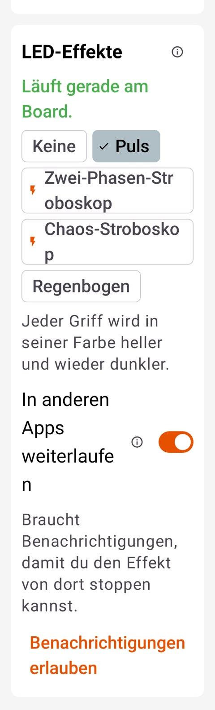 | 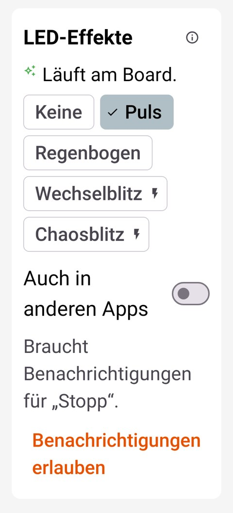 |

Quick pick in German, 320 dp, largest font, dark theme:

| Before | After |
|---|---|
| 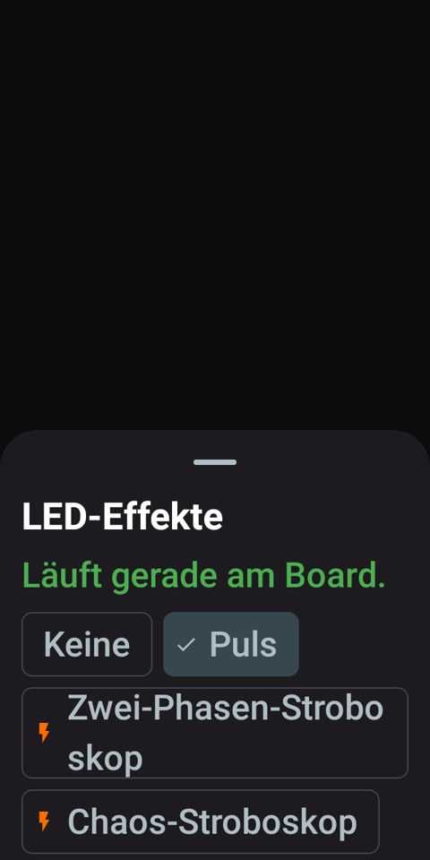 | 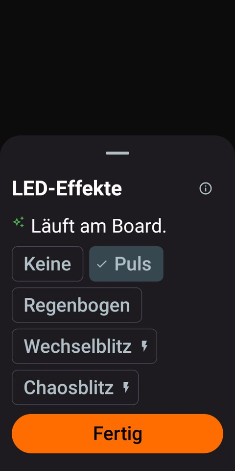 |

Card in English, 411 dp, light theme, running:

| Before | After |
|---|---|
| 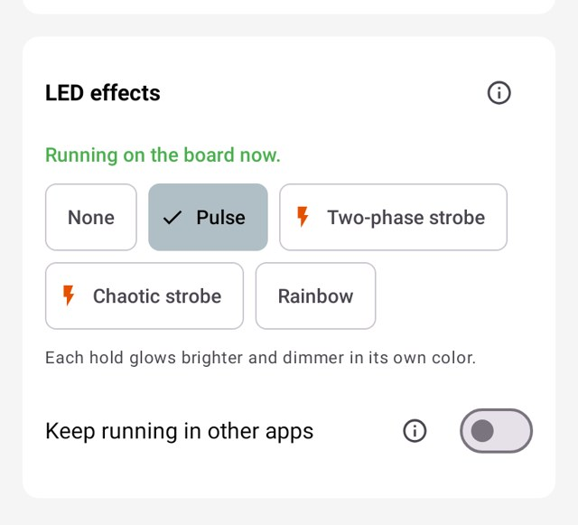 | 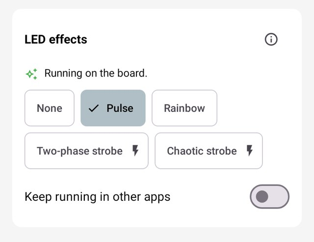 |

Flashing-light notice with "Remove animations" on, German, 320 dp, largest font:

| Before | After |
|---|---|
| 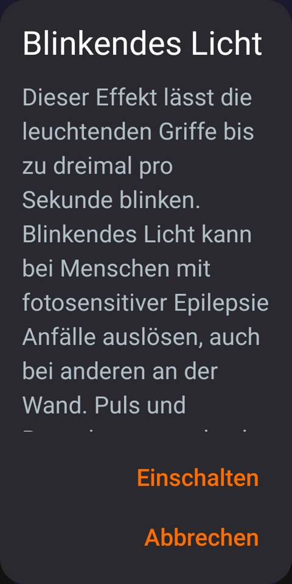 | 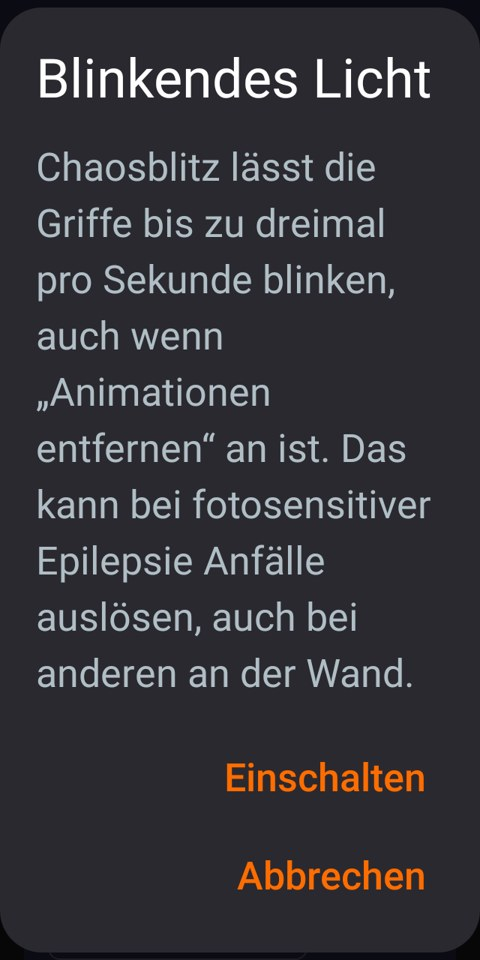 |

More states after the pass:

| No board (DE, 320 dp, largest font) | Quick pick, ended (EN, 411 dp) | Info (EN, 411 dp) |
|---|---|---|
| 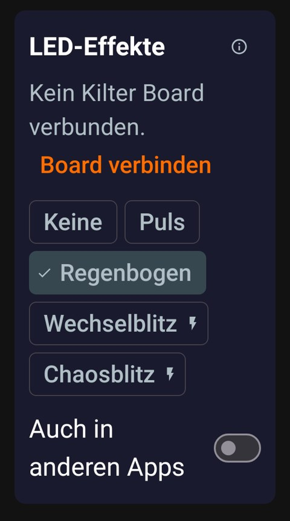 | 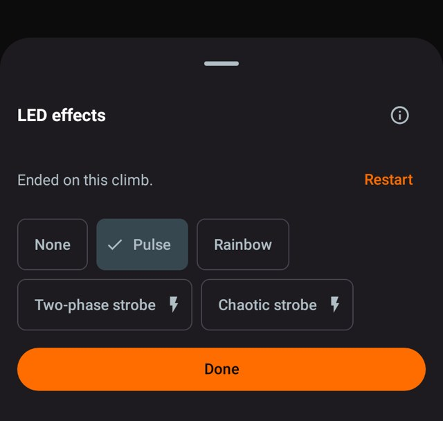 | 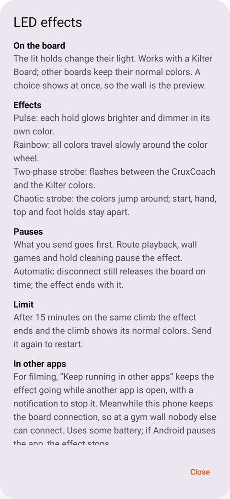 |

| Strobe with "Remove animations" (EN, 411 dp) | Running in other apps (DE, 411 dp) |
|---|---|
| 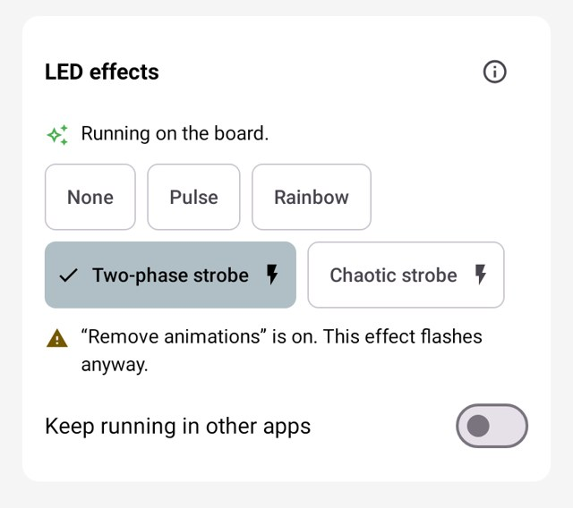 | 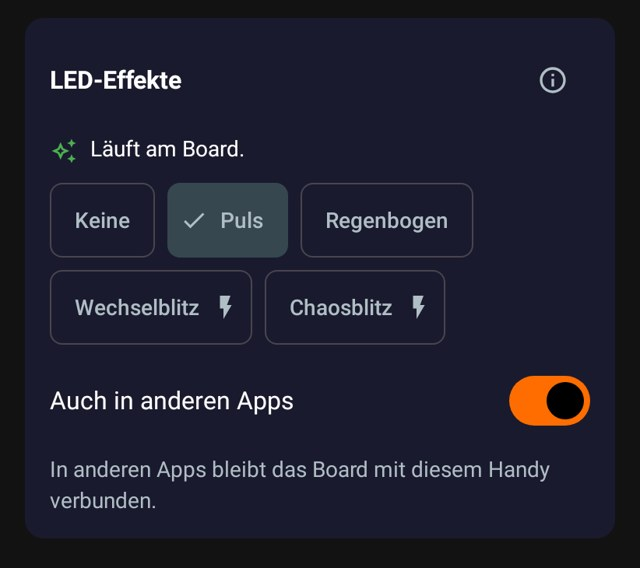 |

On the phone (round-2 build):

| No notifications | Largest font | Notice with "Remove animations" |
|---|---|---|
| 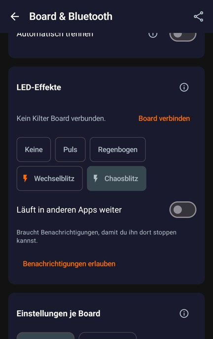 | 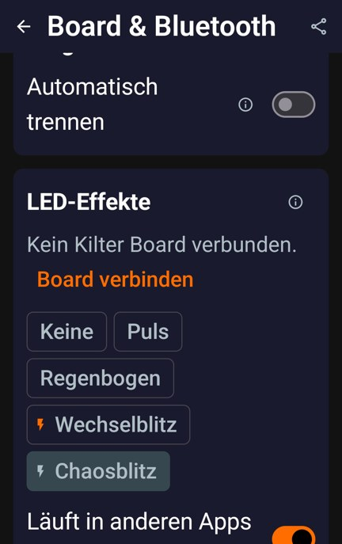 | 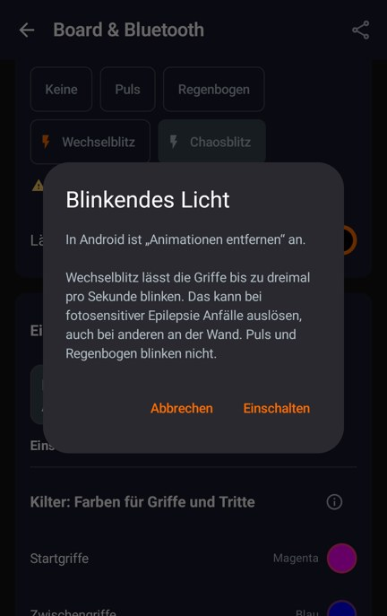 |

## Left as is

- **"Restart" on the settings page.** The page has no climb to send, so it shows only "Ended on this climb."; the info says how to restart. The quick pick, opened from the climb, has the button.
- **Choices with an unsupported board.** They stay active, because the choice applies to all boards and takes effect once a Kilter Board is connected.
- **English effect names.** "Two-phase strobe" and "Chaotic strobe" come from the contribution and wrap at the space at the largest font.
- **The reference card.** Its own title, "Board-Verbindung freigeben", also breaks mid-word at 320 dp with the largest font. It is a 0.2.4 card and outside this pass.
- **Dialogs and the info.** They use the theme's default surfaces and scroll like every other info dialog in the app. A hint that more text follows would have to go into the shared info dialog, not into this feature.
