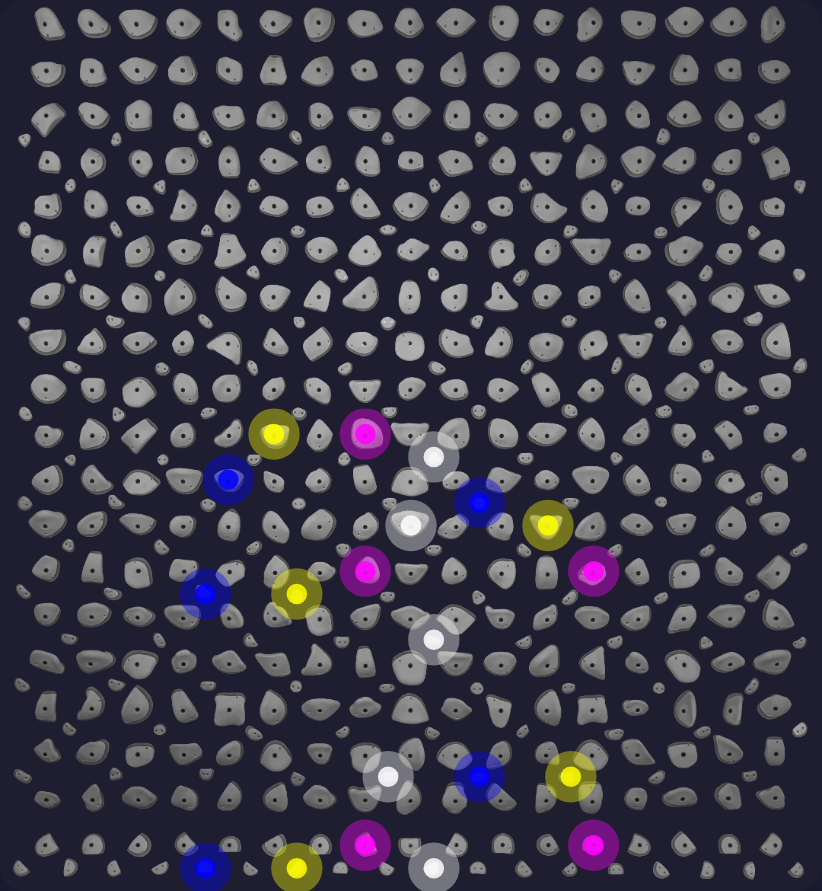
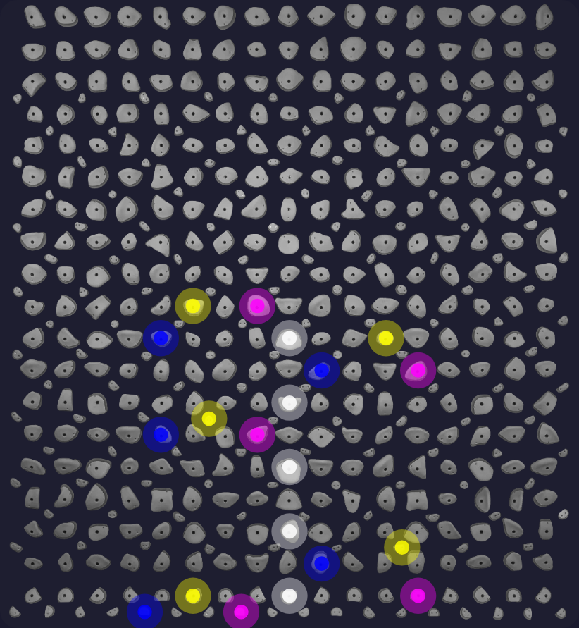
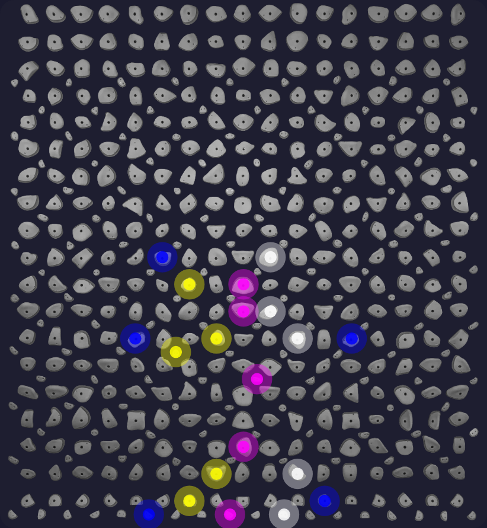
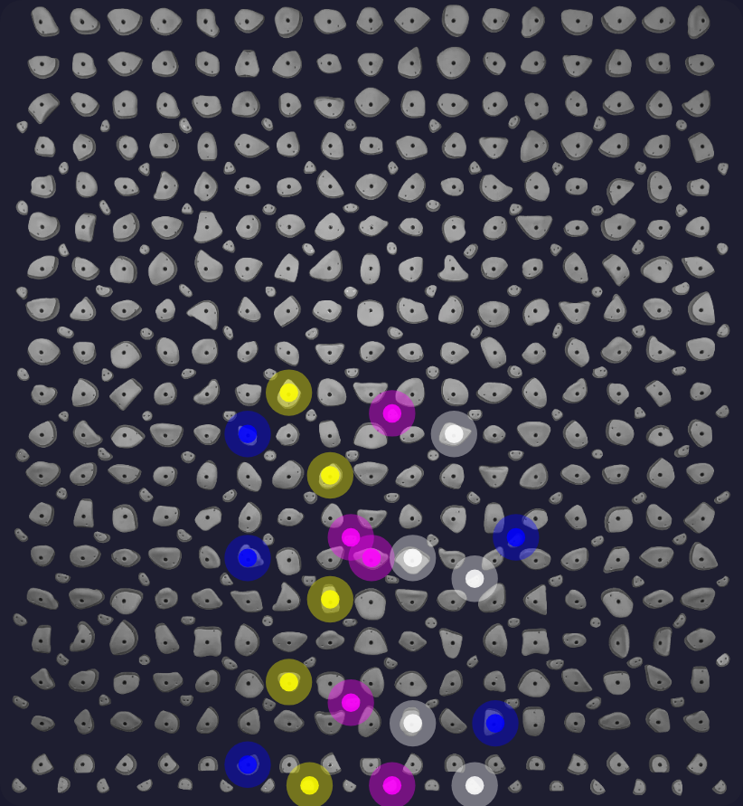
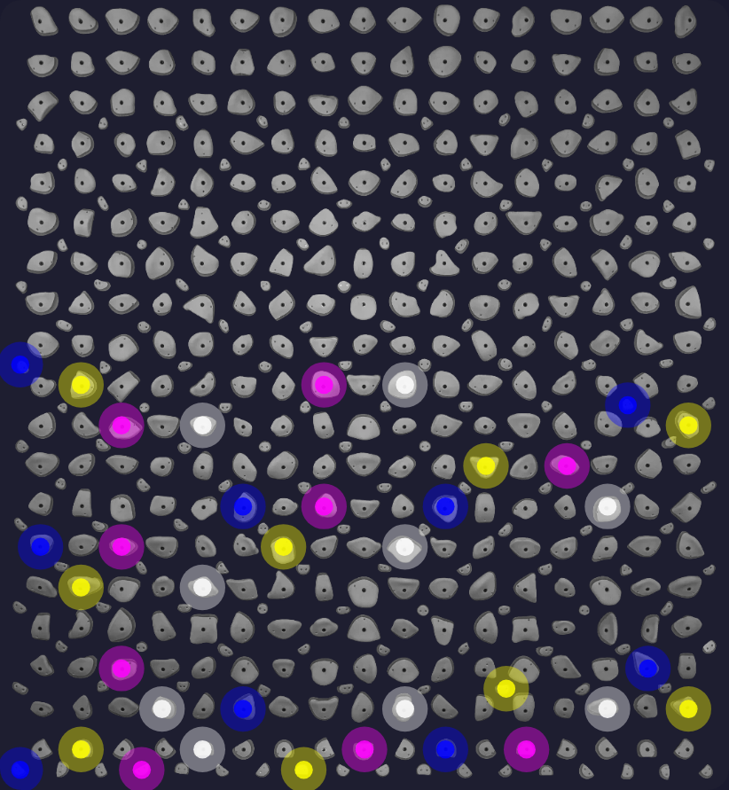
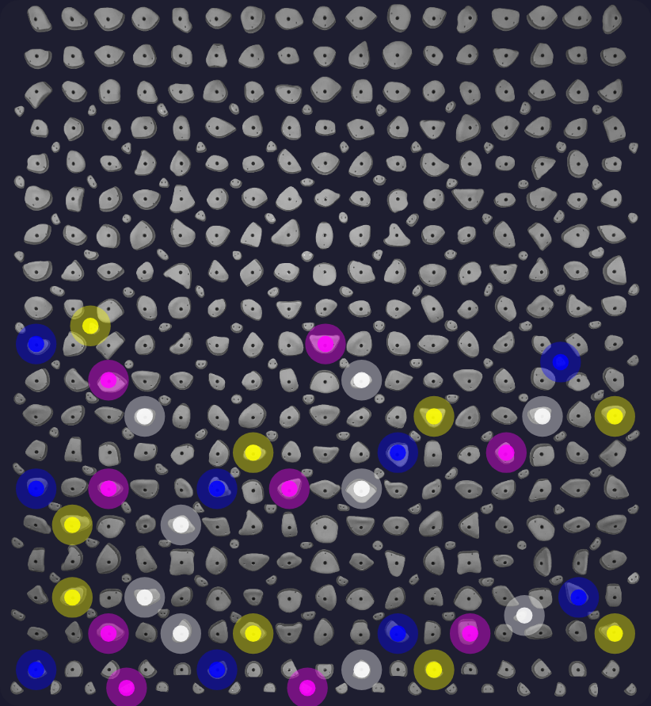
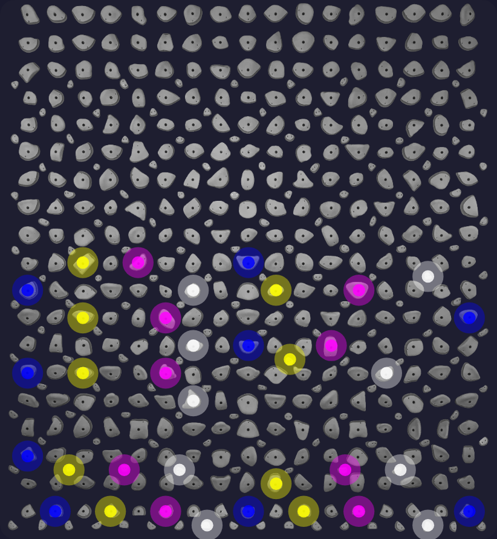
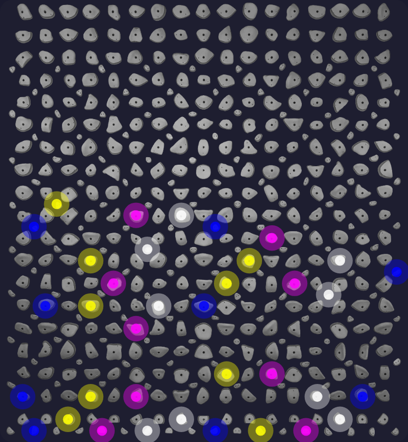

# Knot: spacing sets the reach, and a fresh field every game

Knot ([#154](https://github.com/CruxCoach/CruxCoach/issues/154), [PR #155](https://github.com/CruxCoach/CruxCoach/pull/155)), commit `b22a34be5`, 2026-11-17; renders updated for commit `91d93d56b` (spacing first, see the end).

## Spacing sets the reach

Every spacing lights the same spots: per colour, players + 1 hand spots and one foot spot per player (12 lit holds solo, 20 for two, 28 for three, 36 for four, 44 for five). The field stays 0.8 m per climber plus 0.4 m wide. What the spacing changes is the reach. From the middle of a climber's part, the farthest colour should be about 50, 75 or 100 cm away (close, medium, wide). A climber's hands on the two farthest colours should be at most about 90, 120 or 150 cm apart. The app picks the fewest, widest stripes that keep this, measured at the middle of each stripe, and repeats the colours across the field as often as that needs.

Measured on the hand spots that light up (nearest-hold field; farthest colour from the middle of a part, worst part):

| Board, climbers | Close | Medium | Wide |
|---|---|---|---|
| Kilter 12x12, 2 | 50 cm | 60 cm | 90 cm |
| Kilter 12x12, 3 | 40 cm | 62 cm | 83 cm |
| Kilter 12x12, 4 | 53 cm | 74 cm | 104 cm |
| Kilter 16x12, 5 | 47 cm | 74 cm | 104 cm |
| Kilter 7x10, 2 | 50 cm | 70 cm | 80 cm |
| Solo, any board | 40–50 cm | 40–50 cm | 40–50 cm |
| MoonBoard, 2 | 50 cm | 50 cm | 50 cm |

- **Solo:** the 1.2 m field keeps every colour within about half a metre, whatever the spacing.
- **MoonBoard:** with three colours, red must never touch green. So the colours run there and back (green, blue, red, blue, green …), and two climbers end up at about 50 cm in every spacing.
- **Two farthest colours:** they stay within the targets on every board. The largest gaps were 91 cm on close, 111 cm on medium and 121 cm on wide.

## A fresh, fair field every game

With the board's catalogue, the app rates each hand hold by the average grade of the climbs at the board's angle that use it as a start, hand or finish hold. Only holds with at least 20 such climbs get a rating. Every game then draws its spots anew:

- The hardest fifth of the rated hand holds in the field never lights up.
- The spots keep away from the last game's holds where the wall allows.
- Each spot is drawn among the free holds of its stripe at about its height, still about 30 cm from the others.
- Of 24 draws, the field whose colours and climbers' parts come out closest to equally hard lights up.

Jugs and large holds count three times in the draw once a board's hold types are unlocked. Without a catalogue, the field takes the nearest holds, as before. The preview before a game shows exactly the field that will light.

In the tests with made-up ratings from 10 to 30, the drawn fields came out much more even than the nearest holds. The colours' averages differed by 0.5 to 3.9 grade points against 3.5 to 12.1, and the climbers' parts by at most 2.9 against up to 7.9.

## Renders: Kilter 12x12 with kickboard, rated from its catalogue at 40°

The board preview as the app draws it, dark theme. Each pair is two games in a row: the second avoids the first one's holds.

### Close, 2 climbers (7 stripes)
 

### Wide, 2 climbers (5 stripes)
 

### Close, 4 climbers (14 stripes)
 

### Wide, 4 climbers (9 stripes)
 

## Update: the spacing comes first (commit `91d93d56b`)

The first renders had spots of one colour on neighbouring holds: two magenta hand spots about 14 cm apart (wide, 2 climbers, game 2) and two magenta foot spots about 20 cm apart (close, 4 climbers, game 1). The cause was the fallback: when no free hold kept the 30 cm, the draw took any free hold, and only fairness ranked the 24 draws.

- The spacing now gives way last. A drawn spot would rather take one of the hardest holds than a hold next to another spot. Where no free hold keeps the spacing, it takes the one farthest from the spots so far.
- No draw may put two spots closer together than the nearest-hold field does. Of the rest, the draw with the fewest spots too close to another wins, then the fairest one. Should no draw manage that, the nearest holds light.
- A test checks a first game and the following one for the 7x10, 12x12, 16x12 and both MoonBoards, in every spacing and number of climbers, over four seeds.

In the renders above, now drawn this way, the closest two spots are 28 cm apart (one diagonal step on the 8-inch grid). The exception is close with 4 climbers, game 2, at 20 cm. There the nearest-hold field has a 20 cm pair too: 16 foot spots in narrow stripes don't fit 30 cm apart on the kickboard.

## Still open

- A game on the phone with the Kilter catalogue loaded (time to build the field, two games in a row).
- One round on a real Kilter board, on the release build after the merge.
