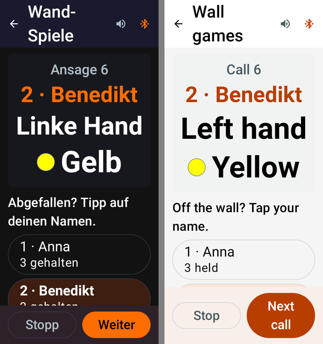
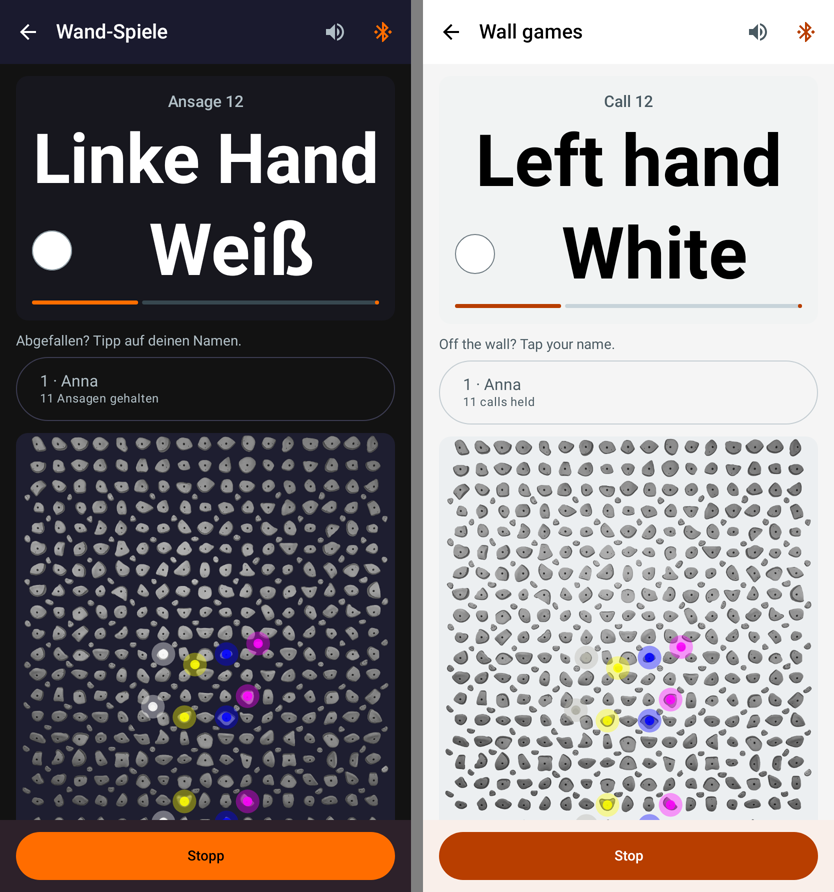
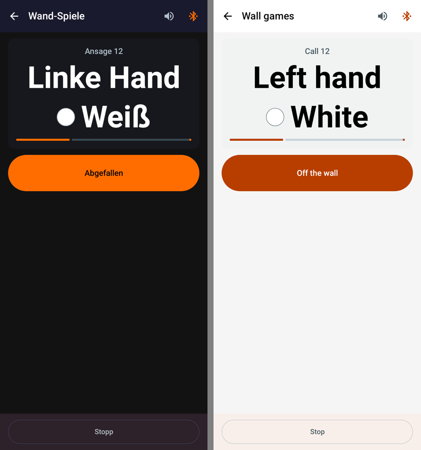
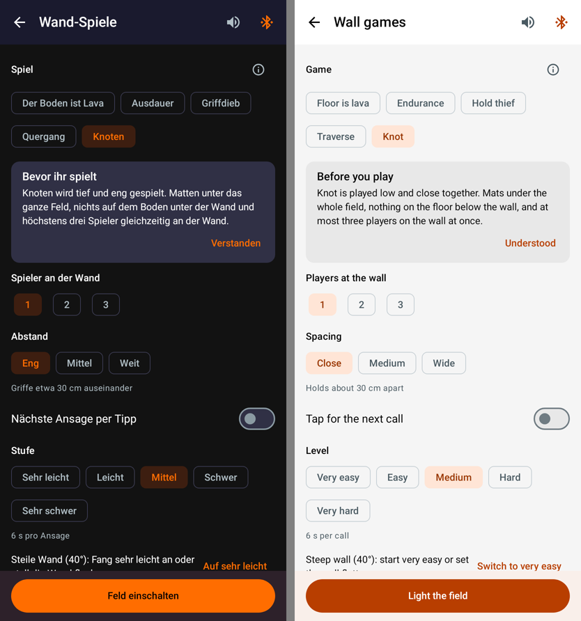
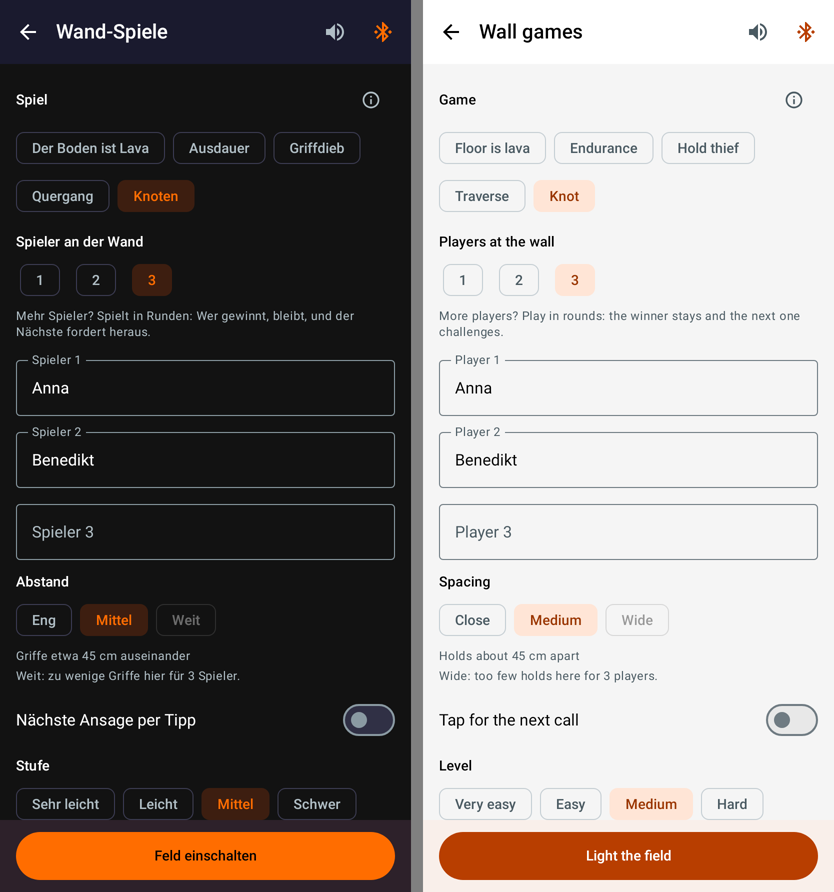
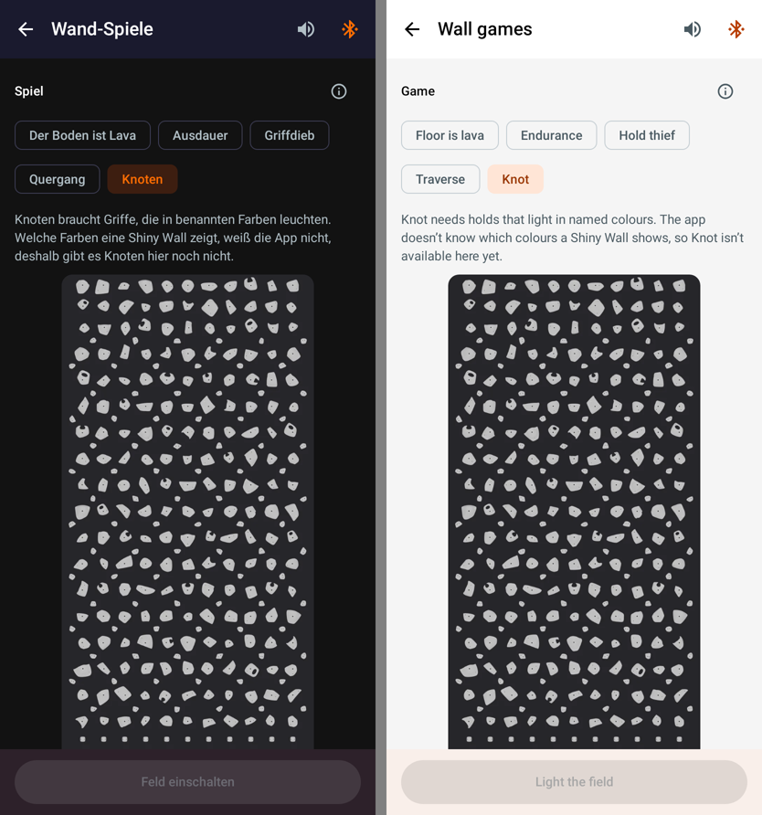
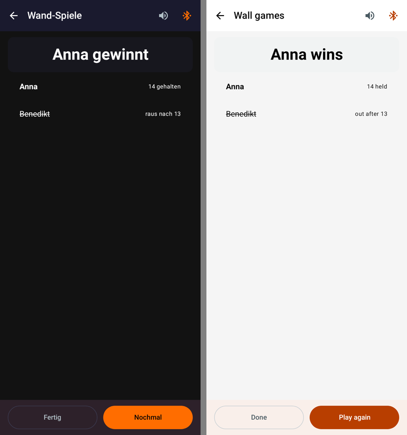

# Knot: UI pass (17 Nov 2026)

Knot is a new wall game for 1 to 3 players ([#154](https://github.com/CruxCoach/CruxCoach/issues/154), [PR #155](https://github.com/CruxCoach/CruxCoach/pull/155)). This is its UI pass, measured against the app's `design.md`.

## How

- Every Knot screen and state was rendered with the Compose UI review test (`WallGamesUiReviewTest`), on the real Kilter 12x12 hold positions. That covers 14 screens: setup, first visit with the safety card, three players, tap mode, a greyed-out spacing, Shiny Wall, start positions, countdown, a running call with and without the timer, solo, winner, solo result and stopped.
- Each screen was rendered in 16 variants: dark and light, English and German, font 1.0 and 2.0, 320 and 411 dp wide.
- Round 1: two reviewers who had not seen the code critiqued all 112 renders against the guide, one at font 1.0 and one at 2.0.
- Round 2: one reviewer looked at the fixed renders.
- Round 3: my own check of the screens changed in round 2. Nothing of weight remained.
- The real flow is checked on a phone with the board simulator, on the test build.

## What changed

### The call
The player now comes first, large and in the accent colour, because the recorded call also starts with "Player 2". The called player's button is highlighted. The colour dot and the colour word are centred together. Stop is outlined, so it no longer looks like the main action. Each name button is one row with a short count ("6 held", "out after 4"), and at the largest font the name and count stack. A fresh Out shows "Undo" until the next call. The board preview now shows only for the start positions: during a call the wall shows the field, and the preview used to redraw with every time tick.

| Before | After |
|---|---|
|  |  |

At the largest font (411 dp), and in tap mode at 320 dp with the largest font, where Stop and Next stay in one row:

| 411 dp, font 2.0 | 320 dp, font 2.0, tap mode |
|---|---|
|  |  |

### Solo
Solo has one filled "Off the wall" button in place of a list of one.

| Before | After |
|---|---|
|  |  |

### Setup
The spoken/read-out choice is gone, because the calls are now bundled recordings. The new controls are spacing (close / medium / wide) and the "Tap for the next call" switch. The rounds hint shows only once the wall is full. The steep-wall action sits under its sentence.

| Before (first build) | After |
|---|---|
|  |  |

A spacing the wall can't keep playable for this many players is greyed out, and the note says which one and why:

### Shiny Wall
One line and no empty board.

| Before | After |
|---|---|
|  |  |

### Start positions and result

| Start positions | Winner |
|---|---|
|  |  |

## Kept on purpose

- The number before a typed name ("2 · Anna") stays, because the calls say "Player 2" and everyone needs to know which one is theirs.
- The countdown shows only the number, like the other wall games.
- At 320 dp with the largest font, the running screen may need a short scroll to reach the second or third name.

The pictures are app renders and show no people.
