# Knot: holds per colour, the sliders and the live preview

Knot ([#154](https://github.com/CruxCoach/CruxCoach/issues/154), [PR #155](https://github.com/CruxCoach/CruxCoach/pull/155)), commit `4638d115f`, night of 17 to 18 Nov 2026. The pictures are Robolectric renders of the app's own screens. They show no people.

## What changed

- **Holds per colour,** a third difficulty next to speed and spacing:
  - Every climber has 4 + 3 (Many), 3 + 2 (Normal, the default) or 2 + 1 (Few) hand and foot spots of each colour within reach. Neighbours share the stripes between them.
  - Spacing stays the reach and holds per colour the count, so the two are independent.
- **Distances:** spots of one colour stay 30 cm apart, and no two lit holds come closer than 20 cm.
- **Feet:** where a climber has only one foot spot of a colour, both feet are never called to it.
- **Greyed steps:** a step the wall can't fit, or one that lights more than the board takes in the app (127 holds on Aurora boards, one frame on the MoonBoard), is greyed out with the reason. If Normal doesn't fit, the field falls back to Few, then Many.
- **Setup screen:**
  - The board preview comes first, with a bracket and the player's name under each part and the number of lit holds.
  - Below it, speed, spacing and holds per colour as stepped sliders with labelled stops, harder to the right. Each slider has a line on what it gives: the call time, the reach, the holds per player.
  - "Draw again" gives another field when the catalogue rates the holds.
  - While the field is lit for the start, the same sliders show. The preview follows them at once, and the wall follows when a slider is let go.

## Lit holds (12x12 and 16x12, Many / Normal / Few)

| Climbers | Close | Medium | Wide |
|---|---|---|---|
| 12x12, 2 | 49 / 35 / 21 | 42 / 30 / 18 | 35 / 25 / 15 |
| 12x12, 4 | 98 / 69 / 42 | 77 / 55 / 33 | 63 / 45 / 27 |
| 16x12, 5 | 126 / 88 / 54 | 91 / 65 / 39 | 77 / 55 / 33 |
| 7x10, 1 | – / 20 / 12 | – / 20 / 12 | – / 20 / 12 |

Many doesn't fit the 7x10 solo, so it's greyed there. On the MoonBoard, 2 climbers get 35 / 25 / 15 at close and medium, and 28 / 20 / 12 at wide.

## Timing on the JVM with the real Kilter catalogue

The catalogue was copied into the app's schema: 224,398 climbs and 345,610 rows of statistics.

- **Grade query plus ratings** at 40°: 0.80 to 0.93 s, giving 550 rated hand holds.
- **The field:** everything the app works out per settings change, off the main thread (nine plain fields and a drawn one), takes 8 to 66 ms.
- **Two games in a row** with Normal or Few share 0 to 2 holds.
- **Many** lights so many holds that the wall leaves little choice: the next game shares 2 to 79 of them. The most is with 4 climbers at close spacing, where 79 of 98 holds come back.

These are server times; a phone takes longer. The app logs both times ("Knot grades", "Knot field") for the check on the release build.

## Renders

### Preview on the 12x12 at medium spacing: Few, Normal, Many

| | Few | Normal | Many |
|---|---|---|---|
| 2 climbers | 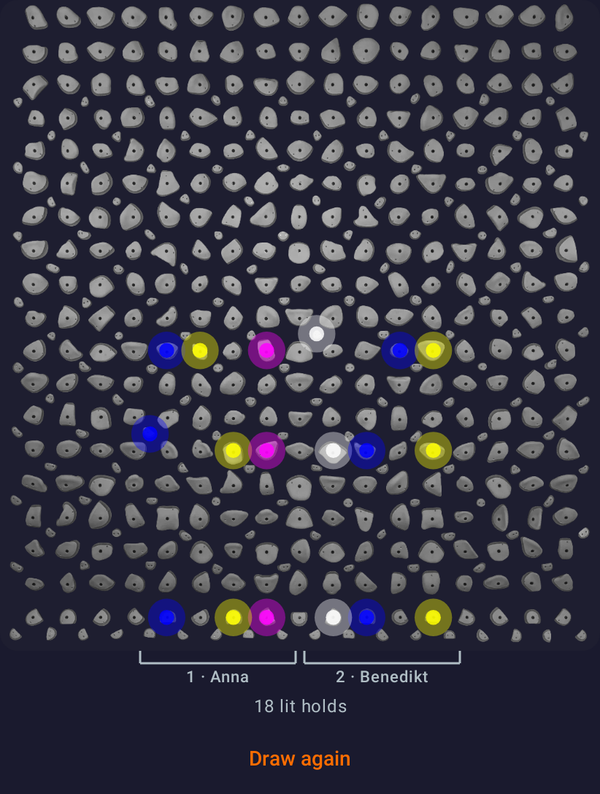 | 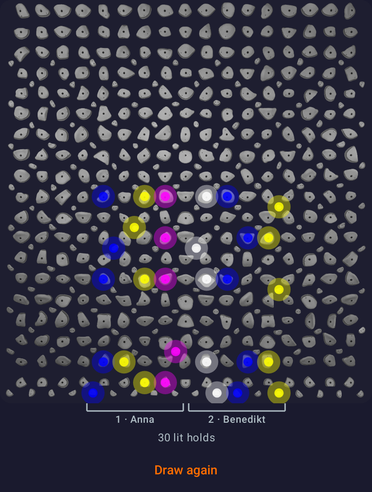 | 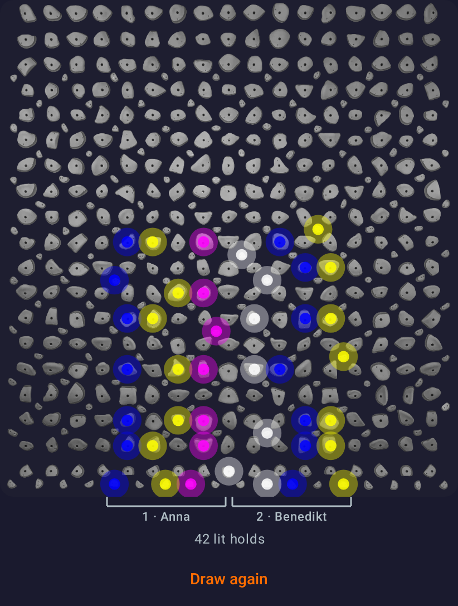 |
| 4 climbers | 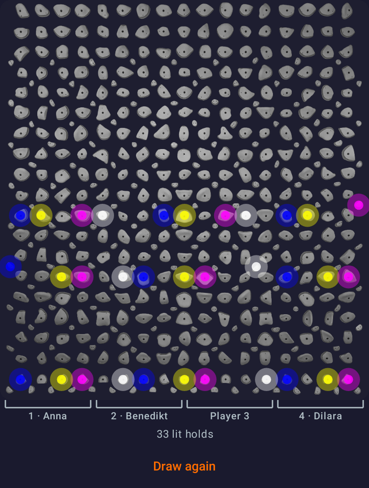 | 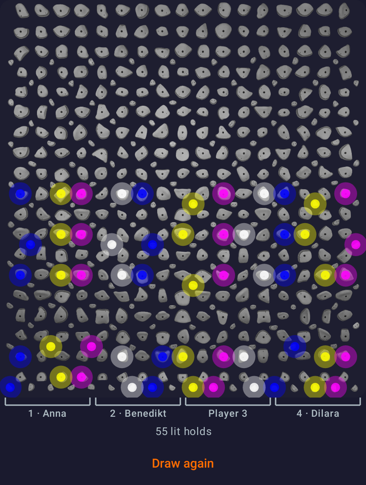 | 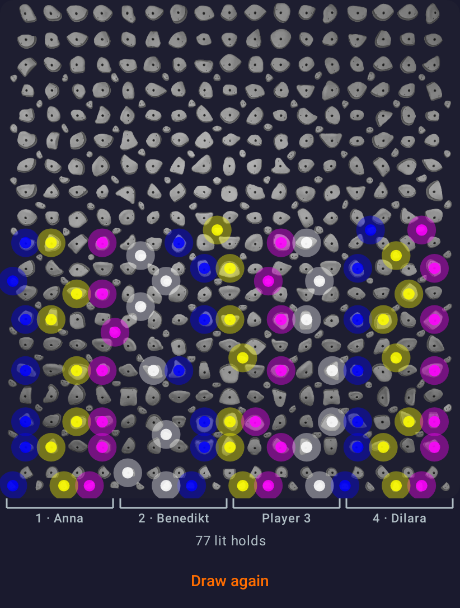 |

### Setup screen, 411 dp

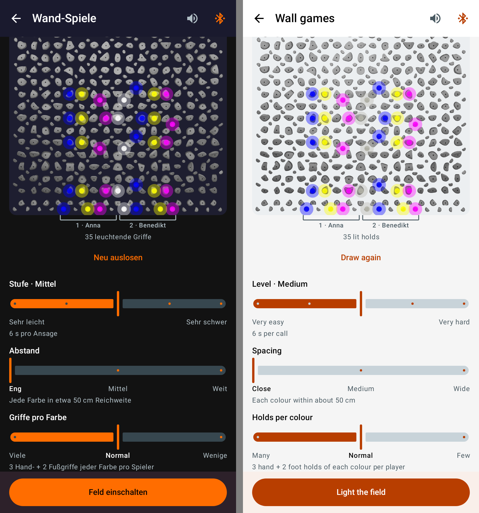

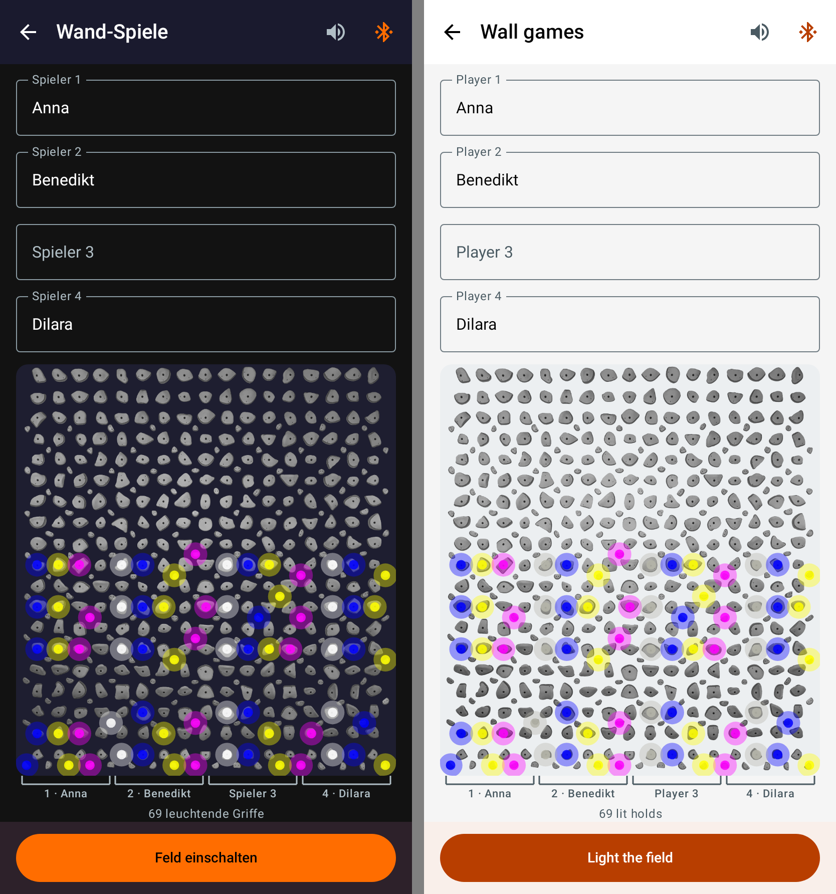

### Setup screen, largest font

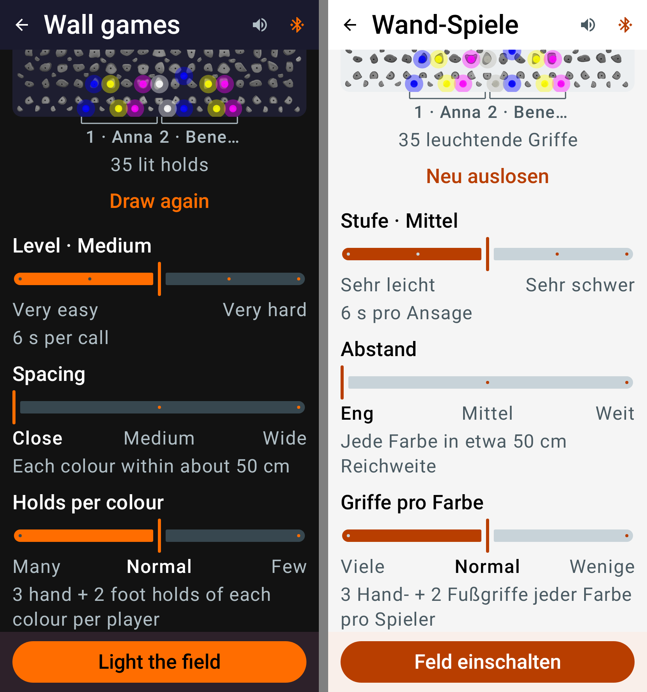

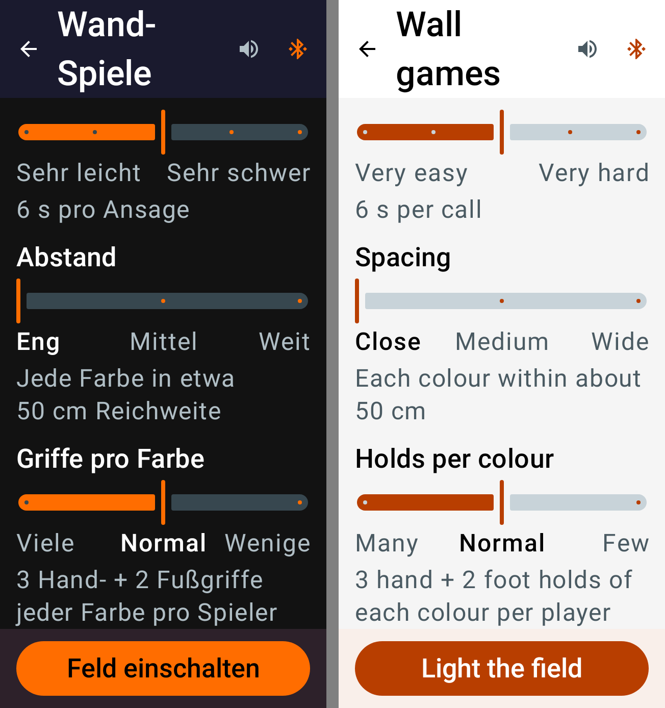

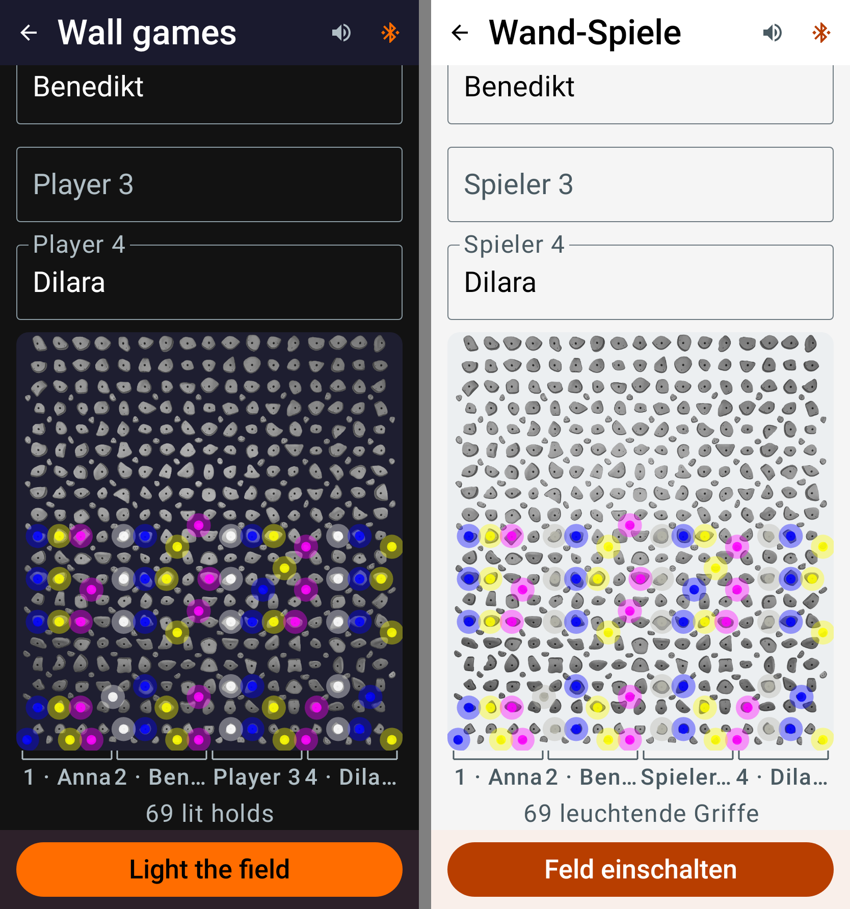

### Start positions with the field on

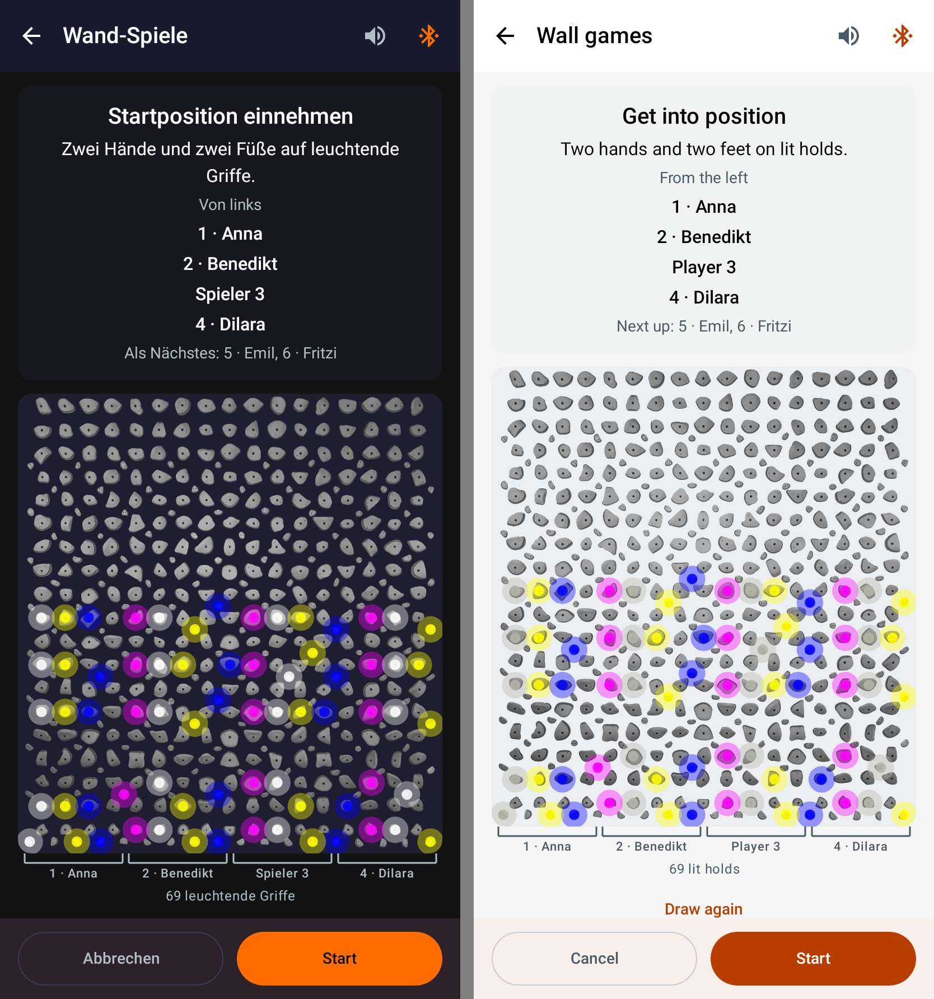

## Review of the renders

One reviewer who hadn't seen the code went through the renders. I fixed:

- The five level labels broke into letters at the largest font. The slider now shows only the two end labels, with the current value in the title.
- The line under the preview was long and its "3 + 2" unclear. The reach and the holds per player now sit under their sliders, and the preview keeps only the number of lit holds.
- The brackets carried no names. Each now shows the player who starts in that part.
- The wording mixed "climber" and "player". It now says "player" / "Spieler" throughout.

Kept as decided before: white lit holds show light grey in the light preview.

## Still open

Phone checks, on the release build in the morning:

- The sliders by touch, and the wall following a slider while the field is lit.
- Two games in a row with the catalogue loaded, and the "Knot field" time on the phone.
- That the hang timer speaks.
