# PaintBox: UI pass

Draft [#90](https://github.com/CruxCoach/CruxCoach/pull/90), commit `ca1ca5e68`. PaintBox's screen was brought to the app's design guide (`design.md`) and the 0.2.4 screens. The functions behind the buttons are unchanged. The phone check with the test build comes next.

## How it was checked

- Every screen and state was rendered with a Compose UI review test (`PaintBoxUiReviewTest`): dark and light, English and German, font scale 1.0 and 2.0, 320 dp and 411 dp wide. That is 16 screens, among them the editor, live, sending, not connected, loading, missing catalogue, unsupported board, Quantum, MoonBoard, the photo step, the pictures sheet and the colour picker.
- Three render rounds. After the first and the second, two fresh reviewers who had not seen the code critiqued the renders against `design.md` and other screens of the app.

## What changed

| Before | After |
| --- | --- |
| Tools (brush, eraser, colour, undo, redo, clear) in a row that scrolled sideways; at 320 dp and the largest font, colour and undo were off screen | One row that fits 320 dp at the largest font: brush or eraser, the colour, undo and redo. The chosen tool is filled, and the colour fades while the eraser is on |
| Save, Save as, Pictures and Send now in a second sideways-scrolling row at the bottom; Send now could be off screen | One main action at the bottom: **Connect board** without a connection, otherwise a **Live** switch next to **Send**. While live or sending, a short status takes the button's place |
| Three icons in the app bar (photo, Bluetooth, lamp); the title broke into "PaintB / ox" at the largest font | Info, Bluetooth and the ⋮ menu. **Use a photo**, **Pictures**, **Save**, **Save as** and **Clear picture** are in the menu |
| Two hint lines always visible (gestures, Quantum limits) | Behind the info button |
| Photo step: OK, Cancel and the background tool in a row; the board name greyed out above | ✕ cancels, **Apply** is the main button, a top-bar action picks another photo, and the **Background** chip shows the colour it leaves out |
| German showed "BG Color" and "Pick Background Color" | "Hintergrund" and "Tippe im Bild auf die Hintergrundfarbe." |
| Missing catalogue: two sentences, "Board catalogues" and "Retry" | One line and **Get the catalogue**; back in PaintBox, the board is tried again by itself |
| Pictures sheet: "No saved pictures yet." only; "1 picture files could not be read" | An empty state with **Save the current picture**; correct singular and plural |

Editor, dark, German (before | after):

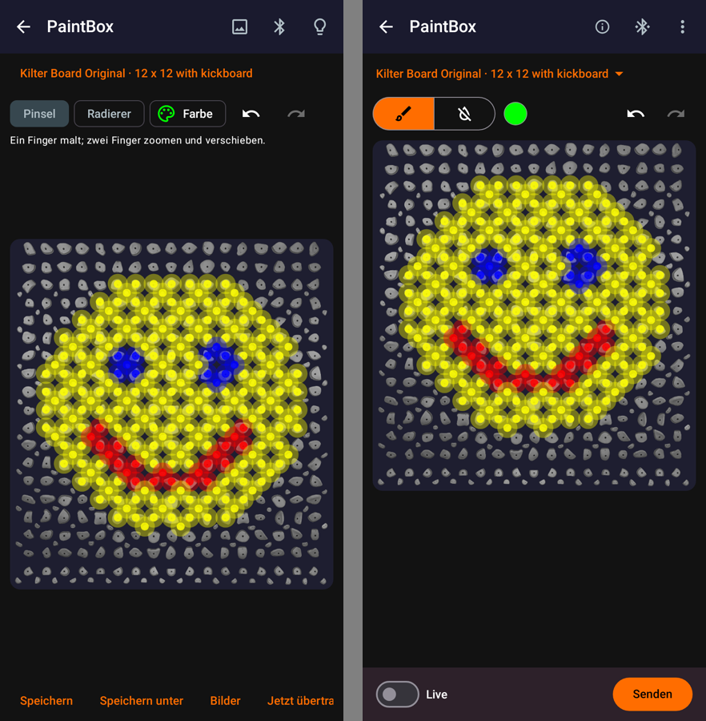

Largest font at 320 dp, English (before | after):

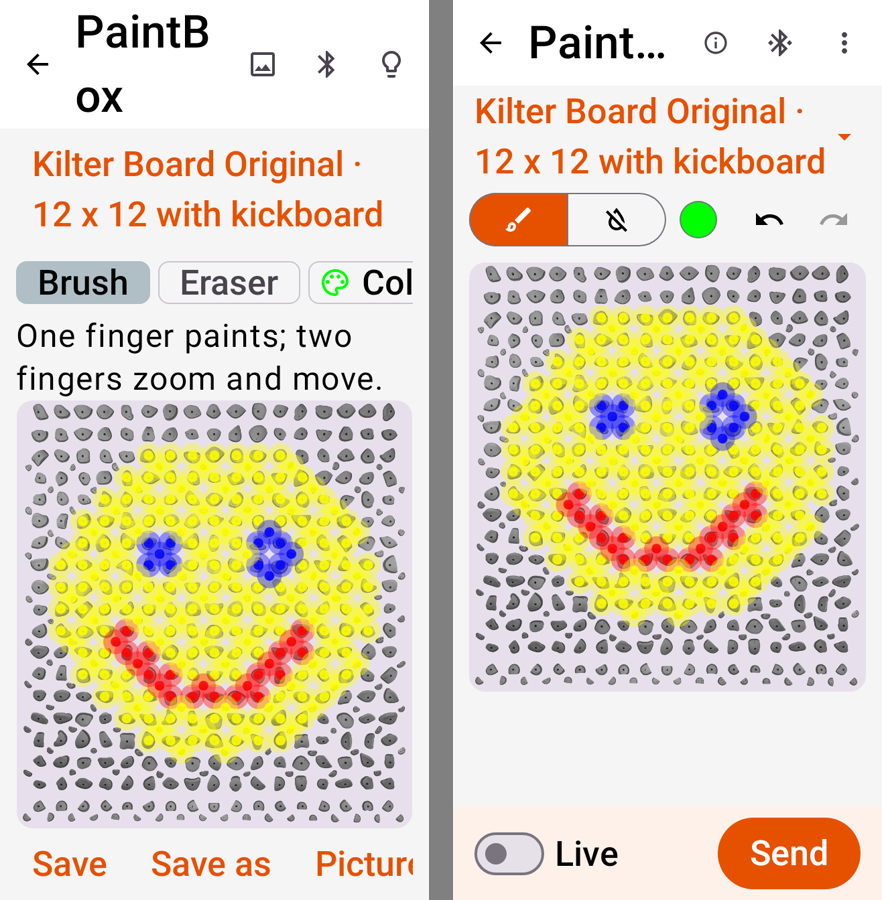

Photo step (before | after):

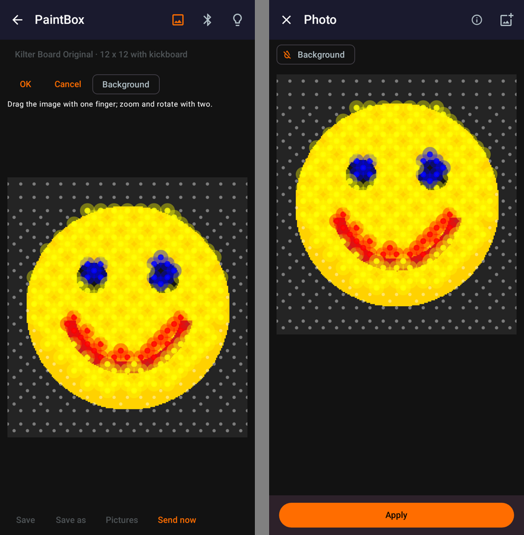

Missing catalogue (before | after), not connected | live:

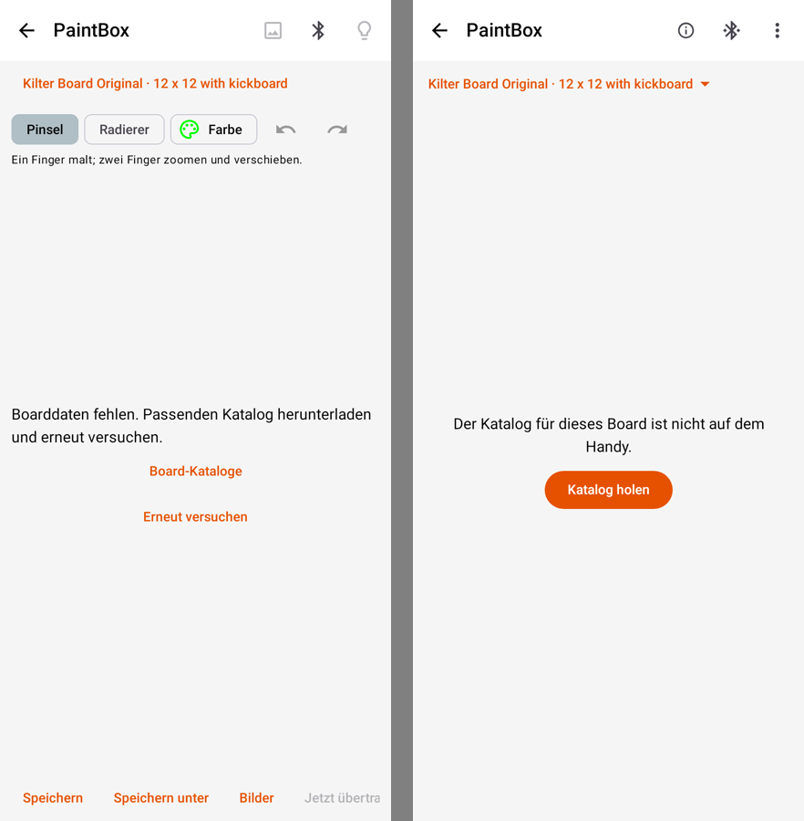 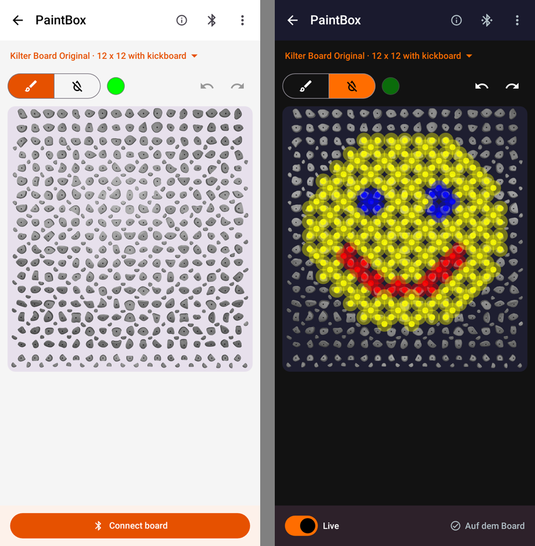

Pictures sheet and MoonBoard:

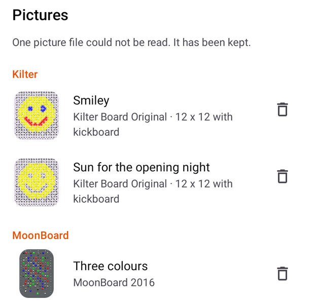 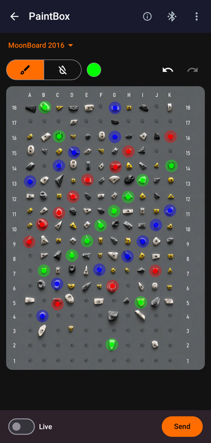

## Left as it is

- The eraser icon is a crossed-out drop, because the app's icon set has no eraser.
- These belong to the whole app, not to PaintBox:
  - In the light theme the board sits on a pale background. That comes from the shared board view.
  - The colour picker is shared too.
  - At the largest font on 320 dp, the title is cut to "Paint…", as on other screens.
- In the pictures sheet, each picture keeps its delete icon, which asks before deleting. The note about unreadable files gives no action: the files are kept on purpose.

## Phone check (test build 1, `ca1ca5e6`)

On the test phone (Android 15, without Google services), German, with the Kilter 12 x 12 catalogue and no board connected:

| Check | Result |
| --- | --- |
| Settings → Extras → PaintBox | Opens with the active board |
| Tap and swipe to paint, another colour, eraser, undo, redo | Works; one swipe is one undo step |
| ⋮ menu: Save with a name, Pictures, Clear picture (with confirmation) | Works; the thumbnail appears after about a second |
| Load a picture with unsaved changes | Asks "Änderungen speichern?" first, then loads the picture with its board |
| Use a photo | The system photo picker opens (no Google services needed); dragging the photo works; Apply turns it into hold colours |
| Background on a photo with a white background | The chip shows the picked colour, and white holds stay off |
| ✕ in photo mode | Brings back the previous picture |
| Board switch to Shiny Wall and back to Kilter | Shiny Wall shows "PaintBox funktioniert noch nicht mit Shiny Wall."; after picking Kilter again, the Kilter board opens straight away |
| "Board verbinden" without a connection | Opens the usual Bluetooth sheet |
| Info button | Shows the short help (painting, the board, pictures) |
| Largest font, and a 320 dp screen at the largest font | Everything fits; the title is shortened at 320 dp |
| Crashes | None in the log |

Two-finger zoom cannot be driven over adb; the screen tests cover it.

One rough edge found: loading a picture or changing the board set the colour back to green. Fixed for the next build: the colour stays when the new board can show it.

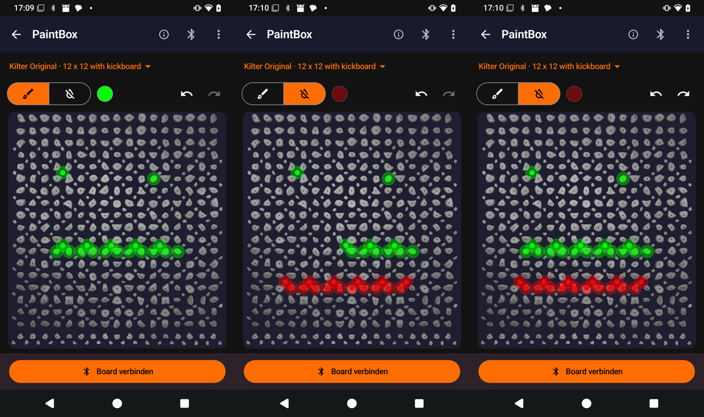

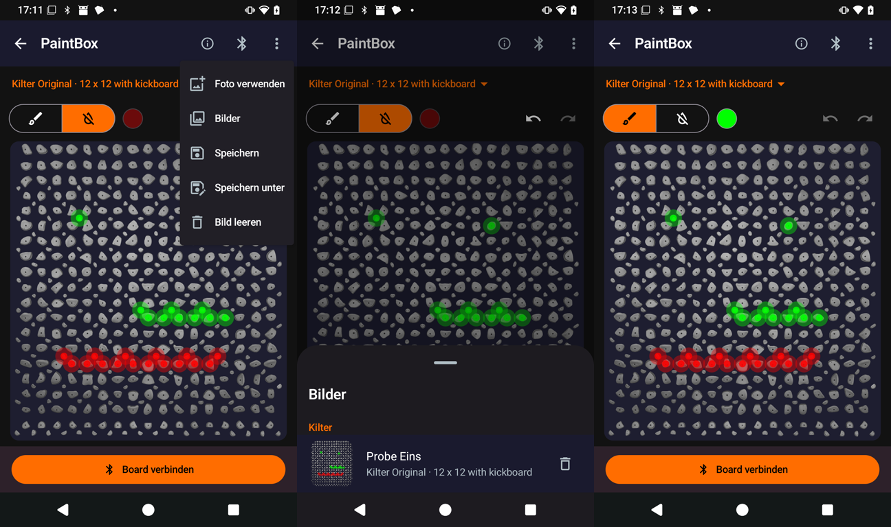

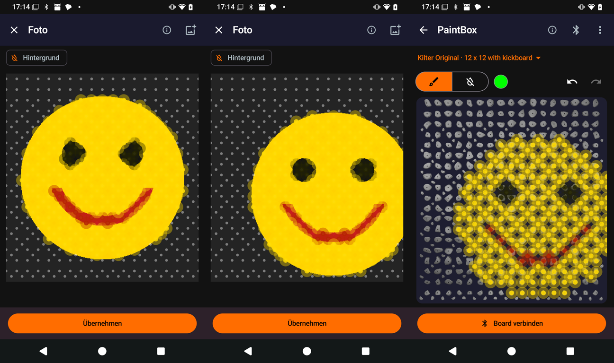

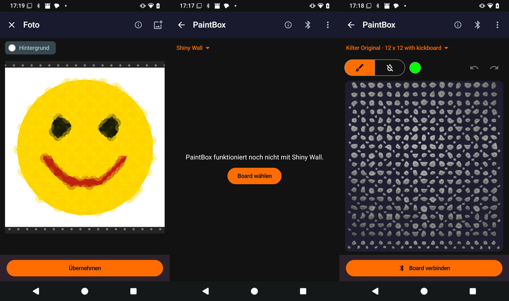

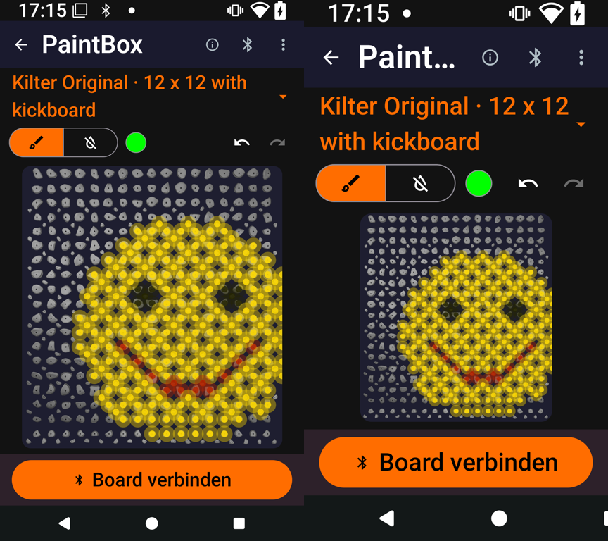

## Phone check (test build 5, `74dbc444`)

The review fixes, on the same phone (German, Kilter 12 x 12 and 16 x 12 catalogues, no board connected):

| Check | Result |
| --- | --- |
| Pictures list | Shows "Bilder bleiben auf diesem Handy und sind nicht Teil des Backups." under the title |
| Open a picture of the board the app already uses | Opens straight away, no question |
| Open a picture of another board size | Asks "Board wechseln?" and names the board. "Abbrechen" keeps the board and the picture. "Wechseln" opens the picture and the app switches to its board |
| The same with unsaved changes | After "Wechseln" it asks "Änderungen speichern?"; "Verwerfen" opens the picture |
| "Board wechseln?" at the largest font on a 320 dp screen | Fits; both buttons are visible |
| Info button | The board paragraph says that large bright pictures are shown dimmer |
| "Board verbinden", board list, Settings, training | Open as before; no crash in the log |

These parts of the review fixes need a board, so the phone could not show them: refusal during a shared session or board sharing, the API-2 limit of 127 holds, dimming on the wall, a frame finishing after Back, and a board change from the connection sheet. Unit tests cover them, and the wall steps in the room ask for them.

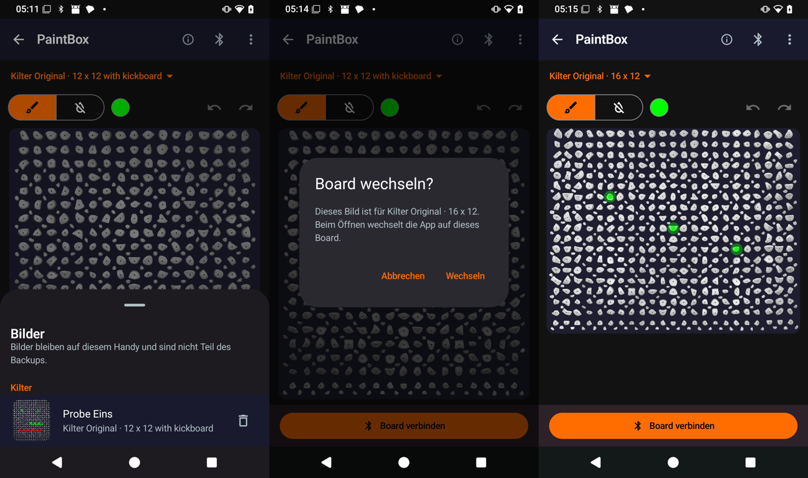

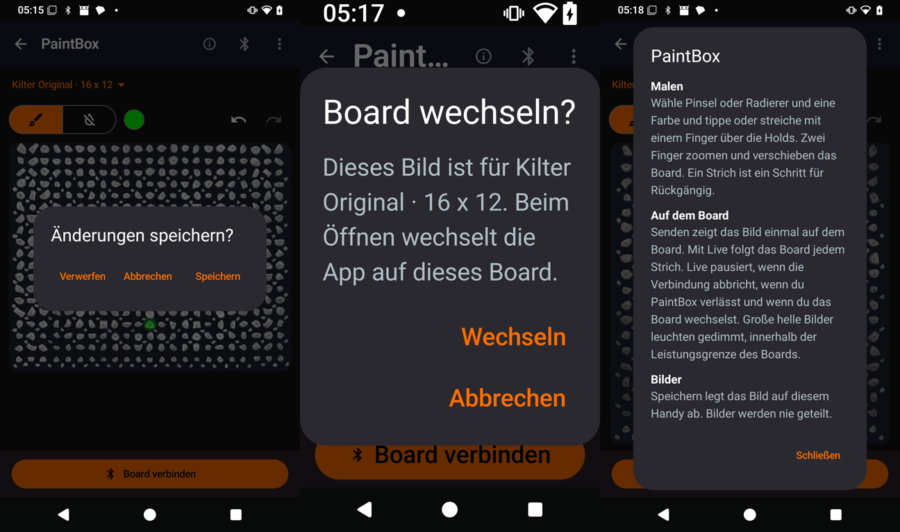

## Phone check (test build 6, `5f263615`)

The follow-ups, on the same phone: a MoonBoard 2016 picture with four holds, saved and then opened while the app was on the Kilter 12 x 12. After "Board wechseln?" → "Wechseln" the MoonBoard picture opens with its four holds and stays (test build 5 could replace it with an empty picture). Opening it again on the MoonBoard asks nothing. No crash in the log.

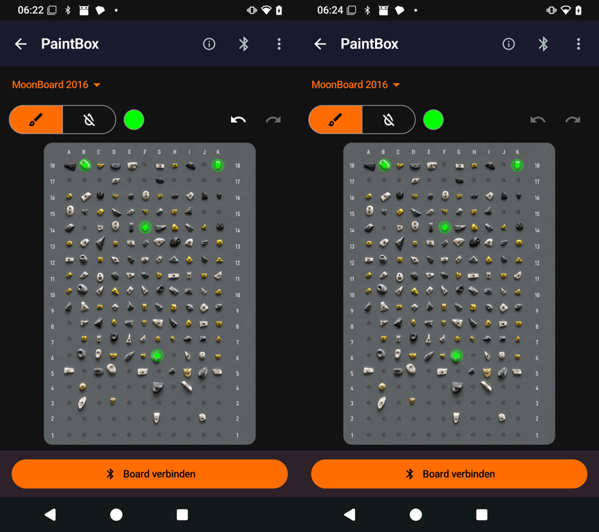

## Next

- The board simulator test and a test on a real board.
