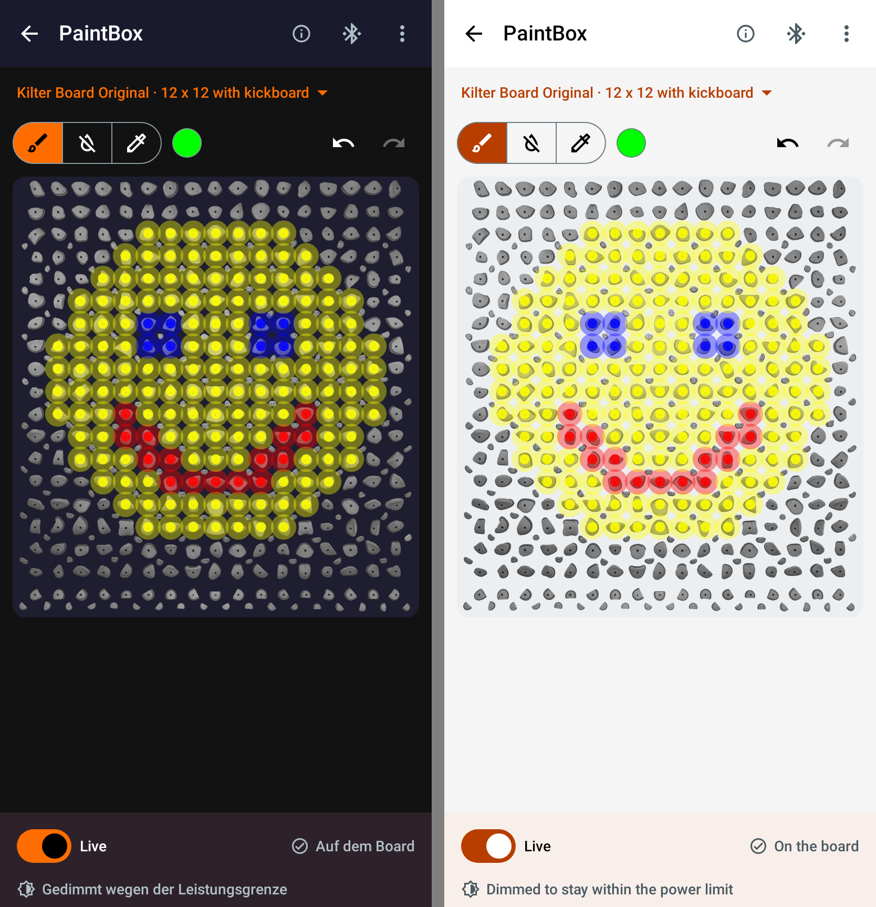
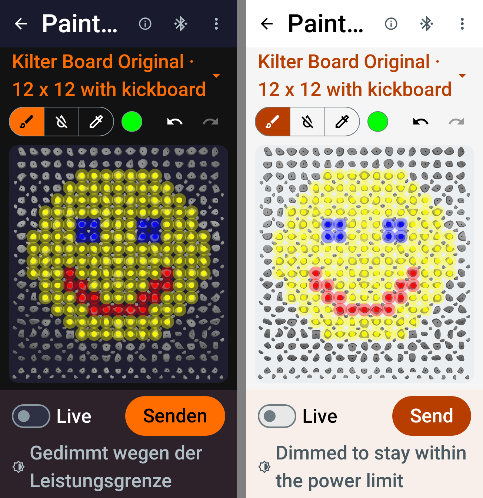
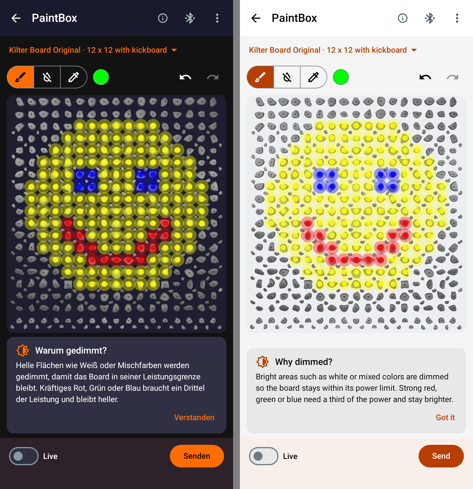
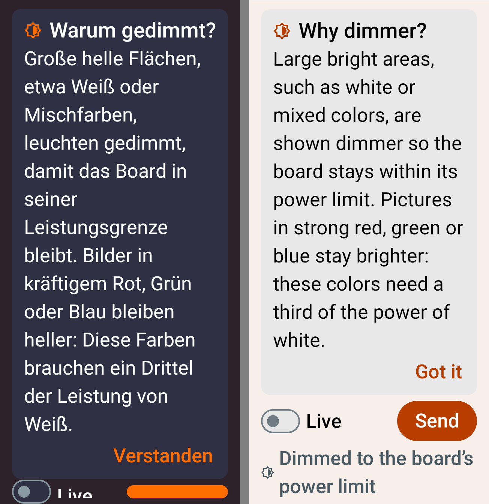
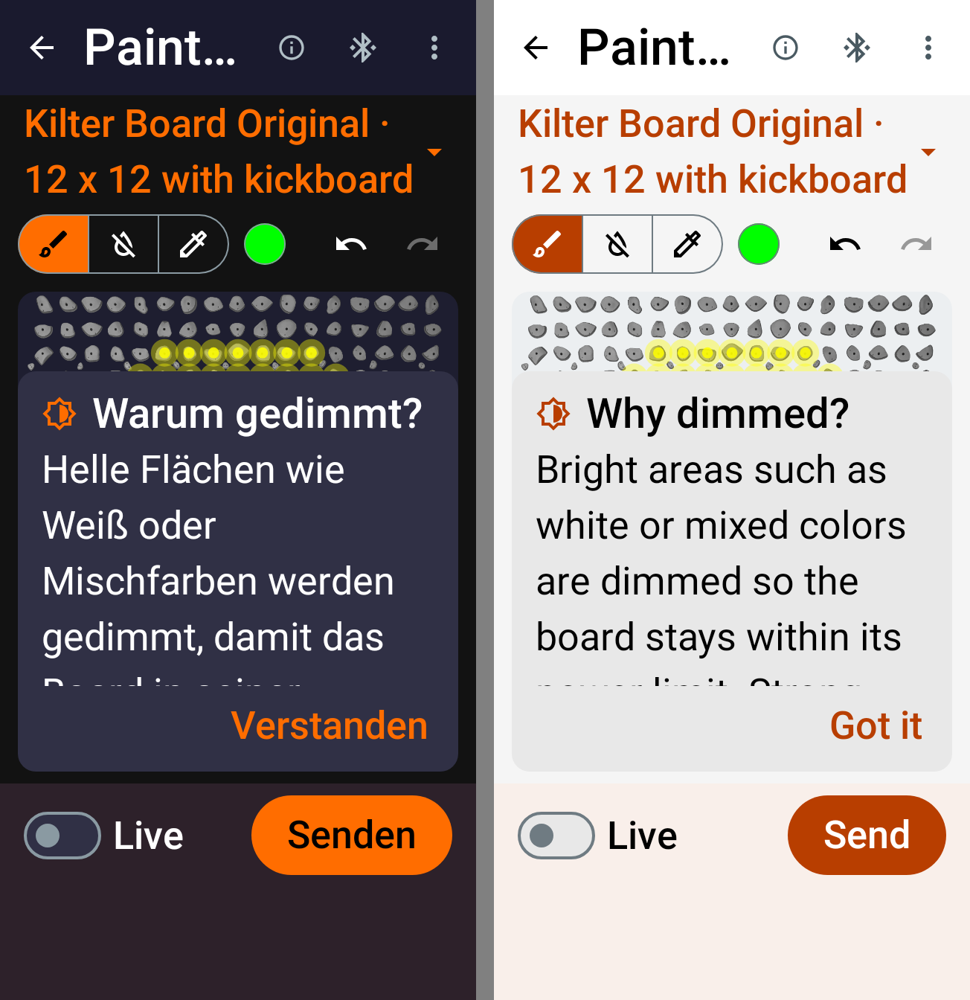

# PaintBox: can the dimmer do better?

Room: #feat-0.2.5-paintbox · 15 November 2026 · code state: `feat/0.2.5-release` at `365f5c904`

The question: Hugie's full-wall pictures on a Kilter board came out very dim in white and mixed colours, while red stayed visible. Is there a way to change the dimmer so pictures look better, without raising the power budget?

**Short answer:** for white the budget is the wall. A full white wall can't get brighter than about 30 % without drawing more power. That follows from the budget and from the 8/8/4 colour levels the LED box takes. What can help is choosing *which* holds are dimmed and *how much is lit*, not a smarter scale. Details and numbers below.

## How the dimmer works today

**API 3 (current LED boxes).** The protocol has no power budget of its own. PaintBox keeps a picture within about what the maker's LED test draws: every hold position lit in one full colour channel. Each hold counts `r/7 + g/7 + b/3` (RGB332: 8 levels of red and green, 4 of blue). White counts 3, yellow, cyan and magenta count 2, and pure red, green or blue count 1. If the total is above the number of LED positions, every colour is scaled by the same factor (1.0, 0.9, … 0.2), rounded per channel, and a channel that was on stays at least at its lowest level (`fitV3PictureBudget`).

**API 2 (older boxes).** Each channel has 2 bits (0–3). The frame is scaled until `LEDs per hold × Σ(r+g+b)/30 ≤ 16.67 W` (`computeV2Scale` with the picture headroom). With 2 bits, the steps a full channel can take are 100 %, 67 %, 33 % and off.

## Numbers

The numbers come from a simulation of the API-3 dimmer for a Kilter 12x12 with 476 LED positions. The percentages are each colour's load after dimming, compared with full.

| Picture | Today (one factor) | Finer factor (0.01 steps) | Dim the brightest first |
| --- | --- | --- | --- |
| Whole wall white | white 30 % | white 30 % | white 30 % |
| Half the wall white | white 60 % | white 60 % | white 60 % |
| Half red, half white | red 43 %, white 40 % | same | **red 100 %**, white 30 % |
| Logo: 60 % red, 20 % white | red 86 %, white 79 % | same | **red 100 %**, white 60 % |
| Yellow smiley (70 % yellow, blue eyes, red mouth) | yellow, red 57 %, blue 67 % | same | **red, blue 100 %**, yellow 57 % |
| Whole wall red | red 100 % | red 100 % | red 100 % |

What this shows:

1. **White on a big area stays at about 30 %**, whatever the dimmer does. Per hold the budget is one full channel. White has three channels, and with 8/8/4 levels the brightest white within one channel's load is (2, 2, 1) of (7, 7, 3). In a lit gym that reads as grey.
2. **A finer scale gains nothing visible.** The colour levels are so coarse that 0.35 and 0.30 round to the same colour. Not worth doing.
3. **Strong red, green or blue are three times cheaper than white.** A whole wall of pure red needs no dimming at all, which matches what Hugie saw.
4. **Choosing which colours to dim is the real lever.** If the colours that draw the most (white, then mixed colours) are dimmed first, and pure colours are kept at full for as long as the budget allows, mixed pictures get their strong colours back at 100 %. The cost: white drops further against them (30 % next to full red instead of 40 % next to 43 %). Whether that looks better depends on the picture. For logos and pixel art with colour on the wall it probably does; for a white-dominated picture nothing changes.

## Ways to optimise for our use case

| Idea | What it gains | Cost and risk | When |
| --- | --- | --- | --- |
| **The "dimmed" line under Send and Live** ([#130](https://github.com/CruxCoach/CruxCoach/pull/130)) | You see it while you paint and can choose stronger colours or leave areas dark | None | 0.2.5 |
| **Dim the brightest first** (see above) | Strong colours at full in mixed pictures | Changes the look of mixed pictures; should be compared at the wall first, e.g. as a switch in a lab build | After 0.2.5 |
| **Photo import: light less** (an outline mode, or "keep large bright areas dark") | Big: half as many lit holds doubles the brightness of the rest | A new option in the photo tools | After 0.2.5 |
| **Say how far it is dimmed** ("dimmed to 60 %") | Shows whether a change helps | One more number in the line | Maybe, with the above |
| Finer factor | Nothing visible (see point 2) | — | No |
| Lighting halves in turn | Would stay within the budget at every moment | Visible flicker: the Bluetooth link takes a few frames per second at most | No |
| On API 2: mixing levels 3 and 2 between holds | A little more brightness overall | Uneven holds in an even area | No |

## Recommendation

Keep 0.2.5 as it is: the budget stays the same, and the new line says when a picture is dimmed. After 0.2.5, try "dim the brightest first" as a switch in a wall-test build, side by side with today's dimmer on two or three typical pictures (a logo, a smiley, a photo), and decide from what the wall looks like. The outline option for photo import is the bigger win for bright photos and is worth its own small feature.

What is not known and only a measurement can show: how the LED box turns a colour level into brightness (if it applies its own curve, the levels could be chosen better), and whether the box limits its own power. Both belong to the limit test build planned after 0.2.5.

## UI pass of the dimmed line (#130)

Renders of every variant (dark and light, English and German, font scale 1.0 and 2.0, 320 and 411 dp), three cycles with a design critic and an independent code review. The pictures show a synthetic picture, no wall photo.

- **The line** sits under Live and Send and keeps its place while a board is connected, so the board never moves under a stroke when it comes and goes. With Live on:

  

- **Largest font on a 320 dp screen:** the line takes two lines at most.

  

- **The one-time card**, over the lower part of the board:

  

- **Before and after at the largest font, 320 dp:** in the first cycle the card sat in the bottom bar and pushed Live and Send off the screen. Now it lies over the board, takes at most 40 % of the screen and its text scrolls.

  | Before | After |
  | --- | --- |
  |  |  |

Not taken from the critique: an icon that grows with the font (the "On the board" status uses the same 18 dp icon), and a different card colour (the same card as the other one-time introductions in the app).
