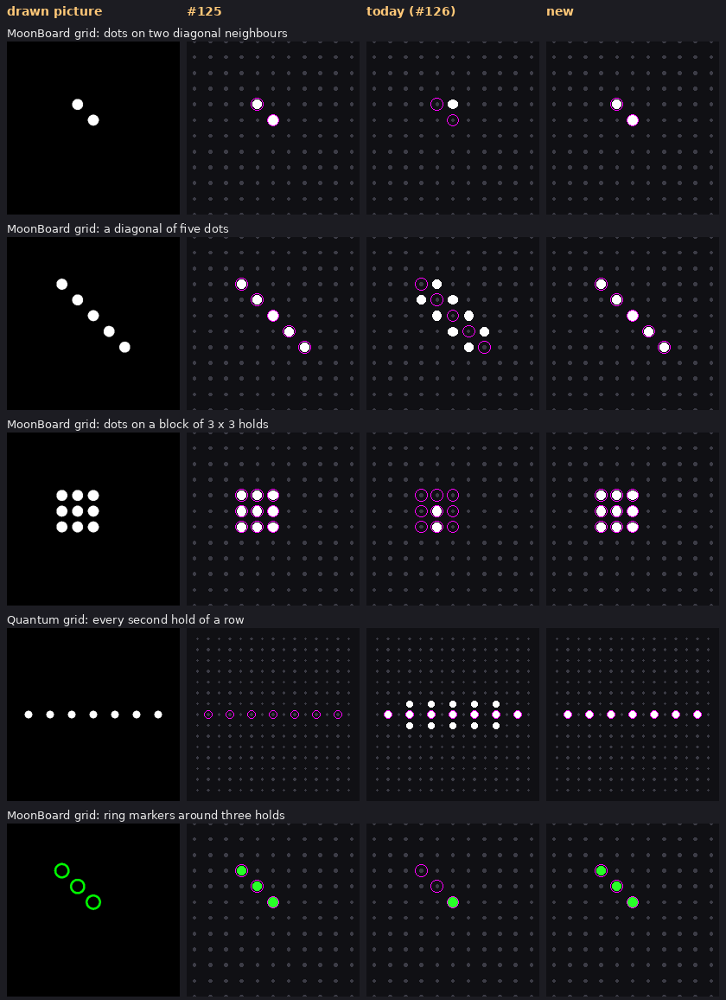
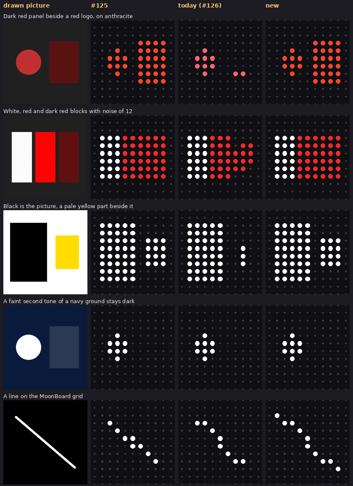
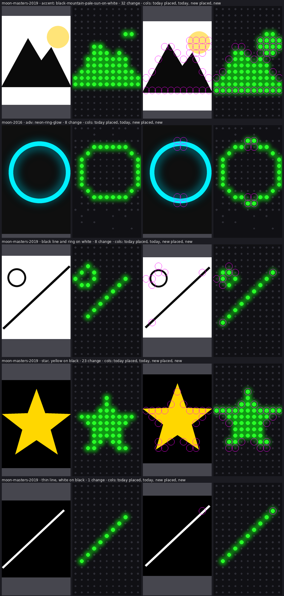
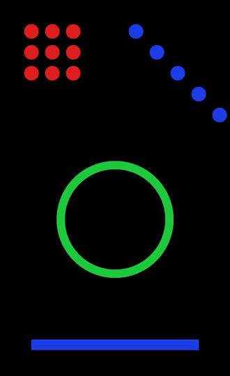
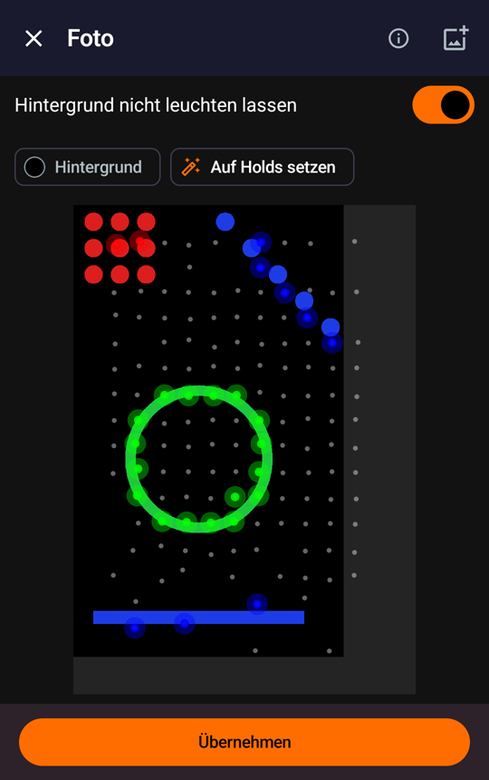
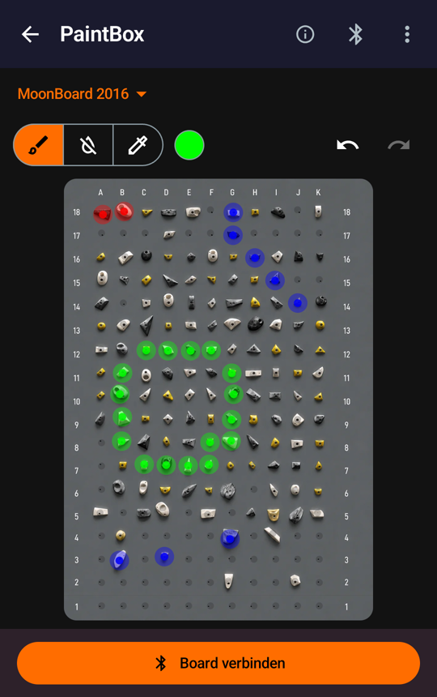
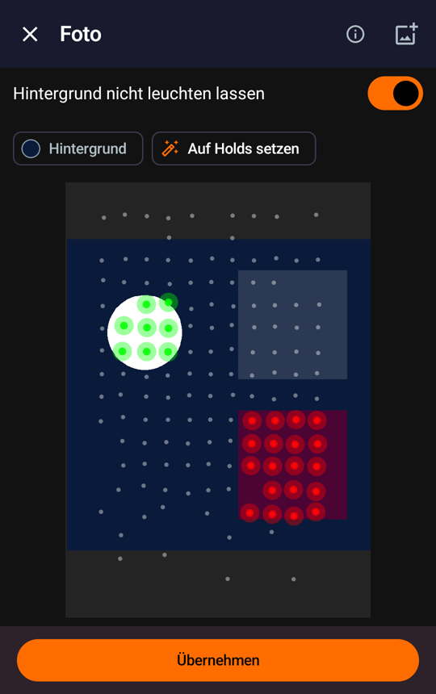

# PaintBox photo mapping: the holds under the picture again

15 Nov 2026 · Crux · PR [#132](https://github.com/CruxCoach/CruxCoach/pull/132) (`fix/0.2.5-paintbox-mapping`, into `feat/0.2.5-release`)

The photo mapping of #126 lit the wrong holds for dots on square grids, lost faint flat tones beside a logo and in noisy photos, left a few scattered holds for a pale part beside a black picture, and shrank Quantum photos without need. This fix brings those cases back to at least what #125 did, keeps what #126 improved, and also fixes ring markers and line ends on the MoonBoard.

Every rule was first measured with a Python reference of the mapping on drawn test cases and on 47 test pictures on five board layouts, then ported to Kotlin. The Kotlin gives the same holds as the reference in 1173 of 1180 drawn cases; the other 7 are dots that lie almost exactly between two holds.

## What changes

| Problem | Rule now |
|---|---|
| Dots on neighbouring holds of a square grid lit the holds beside them | A hold whose middle a dot covers lights and is never thinned away |
| A small dot lit a neighbour, or nothing when it lay exactly on a hold | A dot apart from everything lights the hold nearest to it, when it is about half a hold spacing wide or more; a smaller speck lights nothing |
| A short stroke kept holds beside it | Thinning weighs a hold's own disc as much as the wide one |
| Lines on the MoonBoard stopped one hold short at both ends | A hold under the end of a line stays; a hold that only sees the edge of a dot beside it goes |
| Ring markers around holds disappeared | A thin ring drawn around a hold, with nothing else around, lights that hold |
| A flat tone just under 0.13 beside a coloured logo vanished | It counts when it is strong against the picture's own clear parts, as in #125 |
| Noise broke flat tones up | Flat levels are also found on distances averaged over 3 × 3 pixels |
| A pale part beside a black picture left 3 or 4 scattered holds | Flat tones count when black is the picture too (by strength only: a light grey stays dark, as in #125), and a line needs a part of the picture at full strength |
| Quantum photos were made smaller to leave room | No reserve: a photo is made smaller only when it asks for more than 92 LEDs of a colour |

## Drawn cases

Holds right / wrong over many placements (magenta rings in the pictures mark the holds that should light):

| Case | #125 | today | new |
|---|---|---|---|
| Two dots on neighbouring holds, MoonBoard grid (24 cases) | 48 / 0 | 24 / 12 | 48 / 0 |
| Dot patterns (diagonal, 3 × 3, every second hold …), MoonBoard grid | 99 / 0 | 95 / 60 | 141 / 0 |
| The same on a 15 × 15 grid | 111 / 0 | 120 / 56 | 159 / 0 |
| The same on Kilter rows | 51 / 0 | 54 / 0 | 66 / 0 |
| Ring markers around holds, MoonBoard grid | 36 / 0 | 30 / 0 | 48 / 0 |
| Ring markers, 15 × 15 grid | 36 / 0 | 26 / 8 | 52 / 8 |

A single dot at 40 random places (MoonBoard grid): how often exactly the nearest hold lights.

| Dot width (hold spacings) | #125 | today | new |
|---|---|---|---|
| 0.5 | 0 | 20 | 0 (nothing lights) |
| 0.6 | 0 | 32 | 40 |
| 0.7 | 0 | 35 | 39 |
| 0.85 | 0 | 26 | 37 |
| 1.0 | 5 | 16 | 34 |

Where the lit hold is not the nearest, it lies at most 0.14 hold spacings farther from the dot than the nearest one (today up to 0.8).

Tones (holds in the part in question, Kilter rows / MoonBoard grid):

| Case | #125 | today | new |
|---|---|---|---|
| Dark red panel (#581212) beside a red logo, on anthracite | 70 / 24 | 4 / 2 | 70 / 24 |
| Dark red panel (#5c1111) beside a white logo | 70 / 12 | 0 / 0 | 70 / 24 |
| Navy panel (#2b3954) beside a white logo: must stay dark | 0 / 0 | 0 / 0 | 0 / 0 |
| Dark red block with noise ±12 | 56 / 18 | 37 / 10 | 63 / 18 |
| Pale yellow part beside a black picture | 48 / 12 | 4 / 3 | 48 / 12 |
| Light grey part beside a black picture: stays dark | 0 / 0 | 4 / 4 | 0 / 0 |
| Glow around a white bar on black: only the bar lights | 38 / 14 | 38 / 14 | 38 / 14 |

## Test pictures

47 pictures (drawn ones and logos) on Kilter (two sizes), MoonBoard 2016, MoonBoard Masters 2019 and Quantum XL, fitted and settled as a new photo is. 49 of 235 board/picture pairs change; 33 of them are placed a little differently. Logos are shown by letter only. In brackets: holds that change when the photo stays where it was placed today.

| Picture | Board | Holds today → new | Holds that change (same placement) | Placed differently |
|---|---|---|---|---|
| CruxCoach icon (transparent) | quantum-xl | 121 → 125 | 4 (4) |  |
| CruxCoach logo (black ground) | quantum-xl | 89 → 125 | 56 (0) | yes |
| black line and ring on white | kilter-10 | 45 → 45 | 4 (4) |  |
| black line and ring on white | moon-2016 | 12 → 14 | 2 (2) |  |
| black line and ring on white | moon-masters-2019 | 14 → 14 | 8 (4) | yes |
| drawn: black-mountain-black-sun-jpeg | kilter-28 | 330 → 335 | 19 (0) | yes |
| drawn: black-mountain-pale-sun-on-white | kilter-10 | 201 → 228 | 131 (23) | yes |
| drawn: black-mountain-pale-sun-on-white | kilter-28 | 348 → 333 | 177 (21) | yes |
| drawn: black-mountain-pale-sun-on-white | moon-2016 | 51 → 55 | 28 (8) | yes |
| drawn: black-mountain-pale-sun-on-white | moon-masters-2019 | 53 → 63 | 32 (10) | yes |
| drawn: black-mountain-pale-sun-on-white | quantum-xl | 93 → 111 | 70 (13) | yes |
| drawn: black-mountain-red-sun-on-white | kilter-28 | 330 → 335 | 19 (0) | yes |
| drawn: black-mountain-red-sun-on-white-jpeg | kilter-28 | 330 → 335 | 19 (0) | yes |
| drawn: cyan-disc-line | moon-masters-2019 | 38 → 38 | 2 (2) |  |
| drawn: cyan-disc-line-black-bar | moon-masters-2019 | 38 → 38 | 2 (2) |  |
| drawn: neon-ring-glow | moon-2016 | 26 → 26 | 8 (8) |  |
| logo C | moon-masters-2019 | 82 → 87 | 23 (0) | yes |
| logo D | kilter-28 | 336 → 337 | 1 (1) |  |
| logo E | kilter-28 | 227 → 228 | 1 (1) |  |
| logo E | moon-2016 | 47 → 48 | 1 (1) |  |
| logo E | moon-masters-2019 | 57 → 62 | 13 (4) | yes |
| logo E | quantum-xl | 100 → 94 | 6 (0) | yes |
| logo F | moon-2016 | 44 → 47 | 31 (0) | yes |
| logo F | moon-masters-2019 | 51 → 52 | 3 (0) | yes |
| logo G | kilter-10 | 107 → 121 | 40 (8) | yes |
| logo G | kilter-28 | 210 → 208 | 148 (3) | yes |
| logo I | kilter-10 | 77 → 77 | 2 (2) |  |
| logo I | kilter-28 | 134 → 133 | 9 (0) | yes |
| logo J | kilter-10 | 180 → 181 | 1 (1) |  |
| logo J | kilter-28 | 222 → 223 | 1 (1) |  |
| logo J | moon-2016 | 51 → 50 | 29 (2) | yes |
| logo J | moon-masters-2019 | 48 → 46 | 4 (4) | yes |
| logo J | quantum-xl | 82 → 83 | 3 (1) | yes |
| logo K | kilter-10 | 22 → 23 | 7 (0) | yes |
| logo K | moon-2016 | 9 → 10 | 19 (2) | yes |
| logo K | moon-masters-2019 | 9 → 10 | 19 (2) | yes |
| logo K | quantum-xl | 13 → 16 | 3 (0) | yes |
| logo L | kilter-10 | 181 → 185 | 15 (15) |  |
| logo L | kilter-28 | 250 → 251 | 1 (1) |  |
| logo L | moon-2016 | 47 → 48 | 5 (5) |  |
| logo L | moon-masters-2019 | 51 → 53 | 2 (2) |  |
| logo L | quantum-xl | 88 → 92 | 56 (2) | yes |
| star, yellow on black | moon-2016 | 35 → 40 | 5 (0) | yes |
| star, yellow on black | moon-masters-2019 | 39 → 42 | 23 (0) | yes |
| thin line, white on black | kilter-10 | 31 → 30 | 3 (3) | yes |
| thin line, white on black | moon-2016 | 8 → 9 | 1 (1) | yes |
| thin line, white on black | moon-masters-2019 | 8 → 9 | 1 (2) | yes |
| word SEND, green on white | kilter-28 | 108 → 112 | 4 (0) | yes |
| word SEND, green on white | moon-masters-2019 | 23 → 20 | 19 (0) | yes |

Drawn pictures, placed as a new photo (today placed · today · new placed · new; magenta rings mark the holds that change):

Seen side by side, picture by picture:
- **Better:** dots, rings and line ends; frames on the MoonBoard closed (logo E); star tips and petal tips (logo J); a pale sun beside black mountains now lights as a disc instead of three holds; letters inside a disc show as holes (logo C); a wordmark row without the gap (logo K).
- **Neutral:** small shifts of one or two holds along outlines; a new placement a few percent larger or moved by part of a hold spacing.
- **To judge:** a glowing ring on the MoonBoard 2016 gets two holds one row further out at top and bottom: closer to the ring band, but the octagon is less even. A logo with a thin oval outline on the smaller Kilter is placed 4 % larger, and the bottom of the outline shows as 5 single holds instead of 1.

## Second commit: review follow-up (`c50b1e45`)
An independent review of the first commit found no crash bugs, but one real gap: a faint flat tone close to the bar between counting and not lit part of its holds once the photo had noise. Its pixels were judged one by one, so noise put some on each side of the bar.

| Case (holds in the panel, MoonBoard grid / Kilter rows) | #125 | first commit | now |
|---|---|---|---|
| Light grey `#d0d0d0` beside a black picture, noise ±4 | 0 / 0 | 4 / 21 | 0 / 0 |
| The same, noise ±8 | 0 / 0 | 4 / 24 | 0 / 0 |
| Faint navy panel beside a white logo, noise ±4 | 0 / 0 | 10 / 56 | 0 / 0 |
| The same, noise ±8 | 0 / 0 | 11 / 41 | 0 / 0 |
| Grey `#cccccc` beside a black picture, noise ±12 (should light, 12 / 48) | 7 / 32 | 12 / 46 | 12 / 48 |

- **Rule now:** a flat tone counts or not as a whole, judged at the mean distance of its band of levels.
- **Measured:** none of the 1180 drawn cases and none of the 235 test picture pairs change (also fitted and settled). The Kotlin still matches the Python reference in 1173 of 1180 drawn cases (the same 7 near-ties).
- **Also:** the dot step compares squared distances and stops early; new tests for a speck, a ring around a hold, the noisy grey and navy panels, and a stroke that lights only the row nearest to it.

## Phone check (test build 2, `c50b1e45`)
On the test phone, without a board: a fresh install, MoonBoard 2016, PaintBox → ⋮ → "Use a photo" with a drawn test picture (a 3×3 block of red dots, a diagonal of five blue dots, a green ring and a blue line), "Place on holds", then "Apply".

| Test picture | Placed on holds | In the editor |
|---|---|---|
|  |  |  |

- **Diagonal:** five dots, five holds in a diagonal (G18, G17, H16, I15, J14). H17 has no hold mounted, so the dot there takes G17, the nearest mounted hold.
- **Ring:** the mounted holds under the ring band light, none inside it.
- **Block:** the placement put most of the block above row 18 or on empty positions; the two mounted holds under its dots light (A18, B18), nothing beside it.
- **Line:** the three holds next to the line light, at both of its ends.
- The board browser and settings open as before.

## Third commit: owner review (`e2acb512`)
Two defects of the second commit, both reproduced on the Python reference first:

| Case | #125 | second commit | now |
|---|---|---|---|
| Navy ground, white disc, faint navy panel (must stay dark) + small wine-red element: holds in the element, Kilter rows | 15 | 0 | 19 |
| The same with a larger element: holds in the panel, Kilter rows / grid | 0 / 0 | 53 / 14 | 0 / 0 |
| Four logo blocks as JPEG 90 %, Kilter rows (clean: 188) | – | 204 | 188 |
| Red and white bars one hold spacing apart on anthracite, JPEG 95–70 %, Kilter rows (clean: 138) | – | 153 | 138 |

- **Two faint tones:** the second commit judged a band of flat levels as a whole. Two tones at about the same distance from the ground fell into one band, so the panel and the element went together. Now the pixels of a band are grouped by colour (4 bits per channel; neighbouring common colours form one tone, so noise still keeps a tone together), and each tone counts or not at its own mean distance.
- **JPEG fringe:** the 3 × 3 smoothing that keeps a noisy tone together also made bands out of long straight edges, and a JPEG's ringing beside them got full weight. Smoothed distances now count only where the distances around a pixel lie within 0.2 of each other: noise stays below that (up to 0.15 at ±12 levels), an edge lies far above it (0.3 to 1).
- **Measured:** none of the 1180 drawn cases and none of the 235 test picture pairs change (also fitted and settled); of the tone, ink and noise probes only the two JPEG pictures change, back to the clean result.
- **Kept on purpose:** a hold under a stroke lights and is never thinned, like the hold under a dot. Where a line runs along a sparse Kilter row, the holds under it light besides the denser row beside it, so the line can be two rows thick in places (logo G on Kilter 12 × 12: 207 → 215 holds).
- **Tests:** two faint tones judged each on its own; shapes one spacing apart stay apart as a JPEG; the noisy blocks keep the same holds, not only as many; a light grey stays dark, and a grey right at the bar lights in full or not at all with noise. The two new tests fail on the second commit.
- **Phone (test build 3, without a board, MoonBoard 2016):** the two-tone picture as a JPEG lights the white disc and the wine-red element, and the faint navy panel stays dark. The dot picture from the earlier check lights the same holds as with build 2.

## Open
- Ring markers on the staggered Kilter rows are unchanged (already as in #125). Thin rings of some sizes (for example 0.7 hold spacings across and a tenth of a spacing thick) still light nothing on both layouts: the ring falls between the samples of the hold's disc.
- Moving a photo by a quarter hold spacing changes about as many holds as today.
