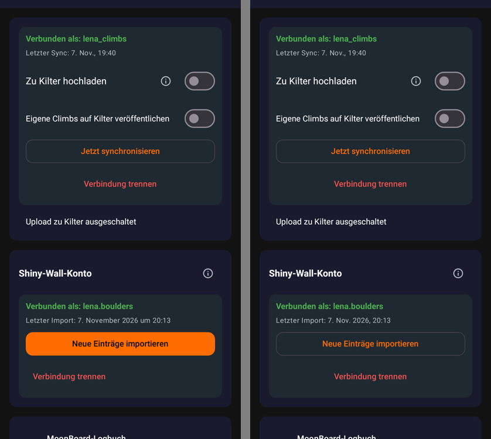
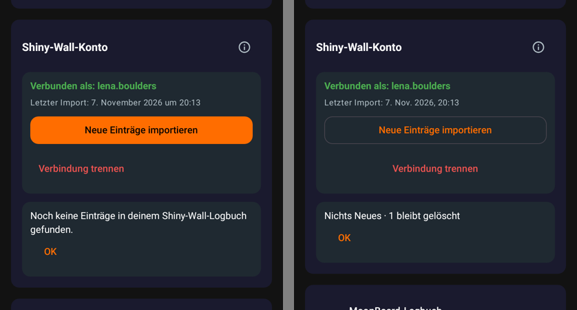
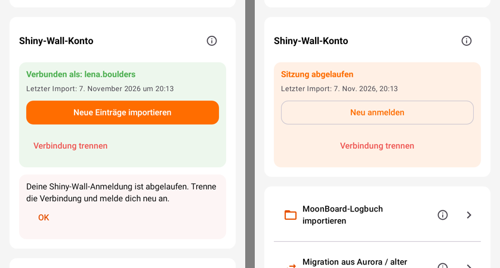
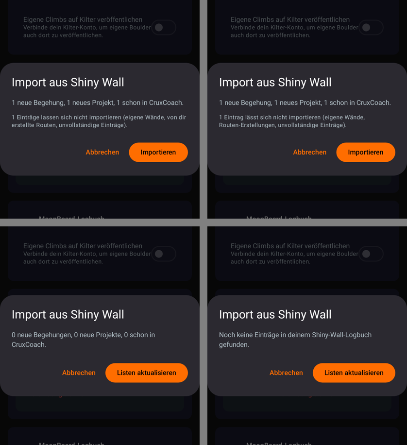
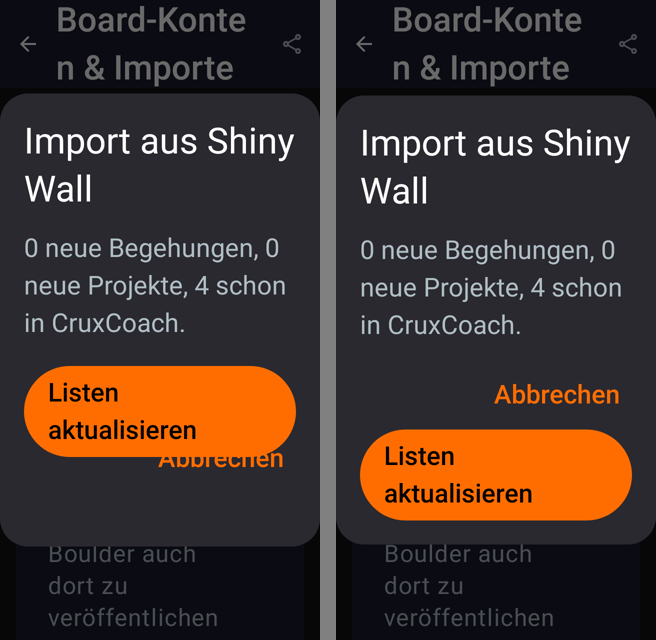

# Shiny Wall account import: phone check and UI pass (#56)

Pull request: [CruxCoach/CruxCoach#56](https://github.com/CruxCoach/CruxCoach/pull/56) (into #50, Shiny Wall account import). Commits `12dc7b687` and `4247e3883`, on top of `8379e5ec7`.

## Phone check of `8379e5ec7`

The signed test build was freshly installed. It imported a Shiny Wall logbook with one flash:

| Step | Result |
|---|---|
| Preview | "1 neue Begehung, 0 neue Projekte, 0 schon in CruxCoach." |
| Import 1 | Logged as a flash on the Shiny Wall board at 40° |
| Delete it in CruxCoach, then import 2 | It does not come back |
| Disconnect, sign in again, import 3 | It still does not come back |
| Log | No email address, token or password; no crash |

**Bug found:** after imports 2 and 3, the card said "Noch keine Einträge in deinem Shiny-Wall-Logbuch gefunden." ("No entries found in your Shiny Wall logbook yet"), although the logbook has the entry. That import had nothing new, known or skipped to count, so the summary fell back to the empty-logbook text. Fixed in `12dc7b687`: preview and result now also count the entries you deleted in CruxCoach. The UI pass below shows them.

**Not checked on the phone:** a project over several days. The unit tests cover it.

## UI pass

`ShinyWallAccountUiReviewTest` renders the imports page with the 0.2.4 Kilter card above the Shiny Wall card. It covers every state of the card, the sign-in sheet and the import dialogs, in each of these variants:

- English and German
- dark and light
- 320 and 411 dp wide
- font scale 1 and 2

That makes 368 images per cycle. I looked at each cycle myself, and after cycles 1 and 2 a separate reviewer, who had not seen the code, critiqued the renders against `design.md`. There were three cycles in all. In the pictures below, the left side is before (cycle 1) and the right side is after (cycle 3).

### Card next to the Kilter card
"Neue Einträge importieren" is now an outlined button with its own spinner, and "Verbindung trennen" is centred, both as on the Kilter card. "Letzter Import" uses the short month.

### Result after deleting an entry
Before, the card said there were no entries. Now the result starts with the outcome ("Nichts Neues") and counts what you deleted ("1 bleibt gelöscht"). A result with new entries still starts with them ("3 Begehungen · 1 Projekt · 2 Listen").

### Expired sign-in
Before, an error text told you to disconnect and sign in again, with only "OK". Now the card itself says "Sitzung abgelaufen" and offers "Neu anmelden", like the Kilter card.

### Preview
- **Top:** "1 Einträge lassen sich nicht importieren" now has a singular. The reason says "Routen-Erstellungen" instead of "von dir erstellte Routen", which read as if own routes were not imported (the info text says they are).
- **Bottom:** an empty account says so instead of showing three zeros.
- **Deleted entries:** when you have deleted entries in CruxCoach, the preview adds "1 Eintrag, den du in CruxCoach gelöscht hast, bleibt gelöscht."

### Largest font on a 320 dp phone
"Listen aktualisieren" wraps onto two lines there and covered "Abbrechen". The two buttons now share one flow, so the second one goes below the first. The dialog also keeps its width when the progress bar appears.

### Also changed
- The sign-in spinner is orange, so it shows on the disabled button.
- The result says "schon in CruxCoach", as the preview does.
- The English info text says "ascents", as the result does.

### Left as it is
- **Sign-in sheet:** at 320 dp and 200 % font, the privacy paragraph fills the first screen, so you scroll to reach the fields. The text says where email and password go; its wording is the maintainer's call.
- **Preview:** it does not list the lists it will update. Its format was set on purpose.
- **Mid-word line breaks at 320 dp and 200 % font:** these also show in the 0.2.4 Kilter card and in the page title.

## Tests
The focused tests on `4247e3883` are all green:

| Test class | Tests |
|---|---|
| `ShinyWallSyncEngineTest` | 20 (now also counts deleted entries) |
| `ShinyWallImportTextTest` | 4 (new) |
| `ShinyWallParsersTest` | 10 |
| `ShinyWallAccountClientHttpTest` | 14 |

The 16 render configurations ran green too.

The phone check of the new test build is next.
