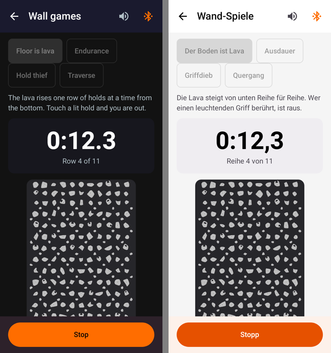
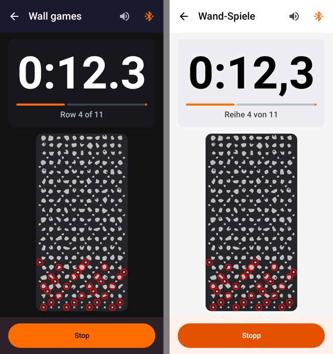
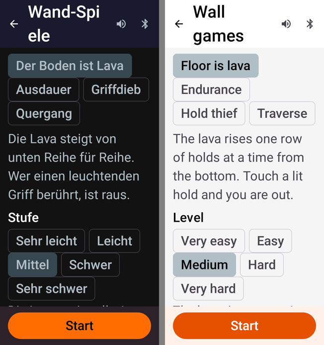
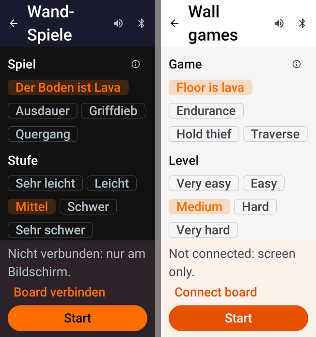
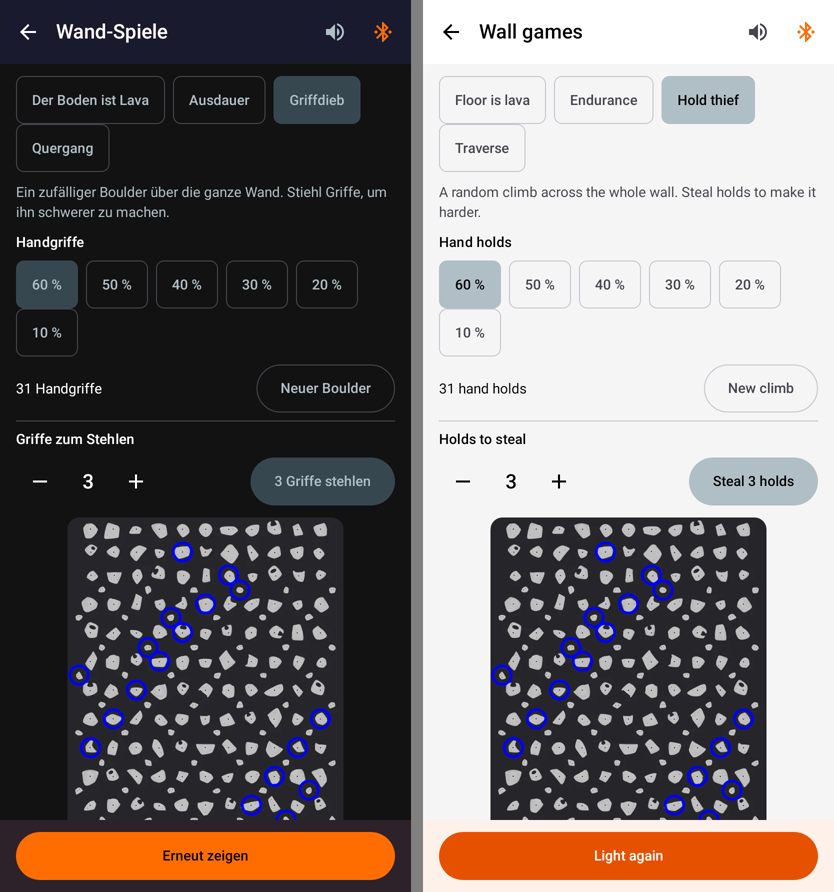
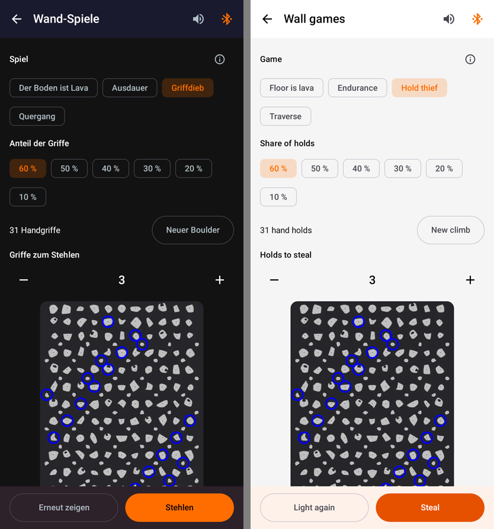
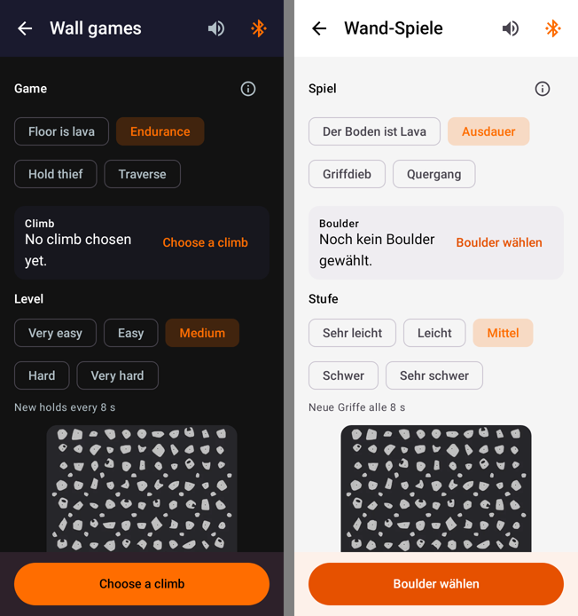
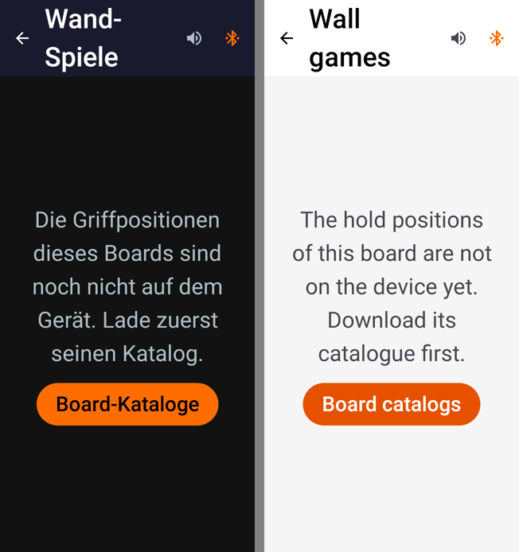

# Wall games: UI pass (9 November 2026)

Pull request: [#101](https://github.com/CruxCoach/CruxCoach/pull/101), into `feat/0.2.5-release`. Issue: [#31](https://github.com/CruxCoach/CruxCoach/issues/31).

Every game and state of the wall games screen was rendered in English and German, dark and light, at 320 and 411 dp and at font scale 1.0 and 2.0 (19 scenes, 16 variants each, on a Shiny Wall). Four render cycles followed, each with an independent critique against the app's design guide. The Shiny Wall parts of the board picker (variant list, variant prompt) and the route categories filter were reviewed too; they need no change.

## A game in progress

The phone lies on the floor during a game. The game chips and the rules used to stay on screen, so the wall's bottom rows, where the lava starts, sat below the fold. Now the screen shows a large clock, a progress bar and the whole wall.

| Before | After |
| --- | --- |
|  |  |

## The largest font on a 320 dp phone

The rules paragraph is behind the ⓘ next to "Game". Chips use the app's orange selection. The bottom bar says whether the wall follows, then the main action. The title breaks at its hyphen instead of inside the word.

| Before | After |
| --- | --- |
|  |  |

## Hold thief

Three actions in three styles became one flow: light the climb, then "Steal" is the main action and "Light again" the second. The number of holds to steal stands once, set with a stepper.

| Before | After |
| --- | --- |
|  |  |

## Every state has its next step

Endurance and Traverse without a climb offer "Choose a climb" as the main button. Without hold positions on the phone, the screen opens the board catalogues. An empty list of recent climbs leads back to the climbs.

| Choose a climb | No hold positions (largest font) |
| --- | --- |
|  |  |

## Not changed, on purpose

- The four games stay as chips, visible at once.
- Chip height at the largest font, the ring style of lit holds and the light theme's error red are app-wide.
- The board picker's mismatch box is the shared component from 0.2.4.
