# Training: clear weight and count fields (#58), device test

Pull request [#60](https://github.com/CruxCoach/CruxCoach/pull/60) for issue [#58](https://github.com/CruxCoach/CruxCoach/issues/58).
Tested on an Android phone with the community test builds of the pull request, app in German, kg and lb.

## What was checked

| Area | Result |
|---|---|
| Text input: "Kurzhantel-Bankdrücken 3x10 2x16kg, …, Blockheben beidarmig 3x10s 2x20kg, …, Ausfallschritt gehend 3x12 2x10kg" | preview "3 × 10 · 2 × 16 kg", pick-up "40 kg", lunge "+20 kg", one-arm row "20 kg" |
| Workout editor | Gewicht pro Hantel · Zusatzgewicht · Gesamt, beide Hände · Gesamt inkl. Stange · Gewicht am Kabelzug · Gewicht der Hantel · Sätze pro Seite; dialogs "… in kg" |
| Player, dumbbell bench press (body weight 80 kg) | "Gewicht pro Hantel", 2 × 16 kg = 40 % KG, rows "2 × 16 kg", "Viel Reserve → nächste Sätze +1 kg pro Hantel", "Neuer Bestwert: e1RM 2 × 22,7 kg" |
| Player, two-arm pick-up | "Gesamt, beide Hände", hint "Mit zwei Blöcken: je 20 kg", 40 kg = 50 % KG |
| Player, squat, lat pulldown, one-arm row, walking lunge | Gesamt inkl. Stange · Gewicht am Kabelzug · Gewicht der Hantel (rows per side) · Zusatzgewicht +20 kg |
| Summary | volume 1325 kg (both dumbbells counted), "Nächstes Mal: 2 × 18 kg", sets "2 × 16 kg", "15 kg entlastet" |
| Exercise detail and stats | step "Trag das Gewicht einer Hantel ein.", estimated 1RM, chart and bests "2 × 22,9 kg", % body weight 57 %, volume hint |
| Own exercise "Kurzhantel-Curls im Sitzen" | "Wie viele gleichzeitig: Eine Hantel / Zwei Hanteln", player label "Gewicht pro Hantel" |
| lb | editor "35,3 lb", dialog "Gewicht pro Hantel in lb" |
| Performance values | entry dialog "Gewicht pro Hantel in kg", list "2 × 16 kg × 13 · geschätztes 1RM 2 × 22,9 kg" |

## Fixed after the first build (checked again on build 89162c7)

- On body-weight exercises the value "15 kg entlastet" or "Körpergewicht" squeezed the label "Zusatzgewicht" into a broken word. The value is now the signed number ("-17 kg", "0 kg"), with "17 kg entlastet" or "Körpergewicht" in a line underneath.
- The learned 1RM of assisted pull-ups read "-4,2 kg"; it now reads like the sets ("geschätztes 1RM 2 kg entlastet").
- Bests of a bench press were labelled "Beliebige Leiste" (any edge); now "Insgesamt".

The weekly review shows the bench press record as "geschätztes 1RM 2 × 22,7 kg". The board list, Today, Nutrition and Progress open as before.

## Screens

| | |
|---|---|
| 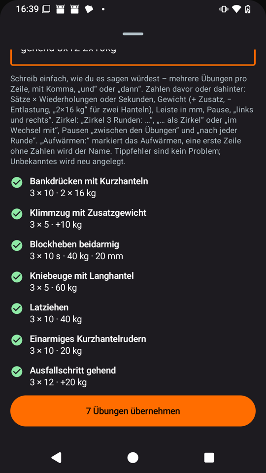 | 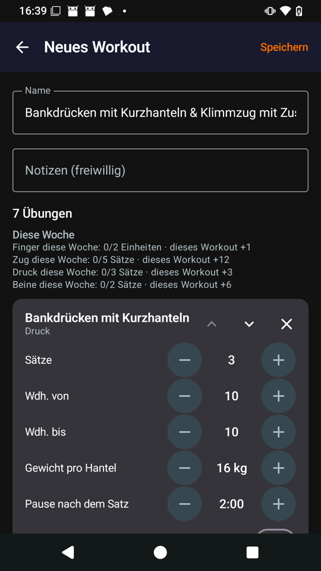 |
| 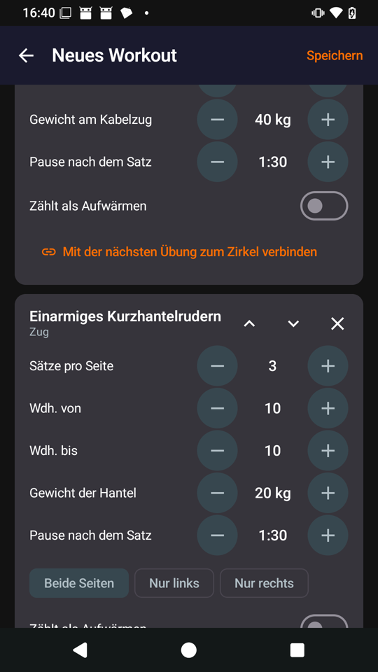 | 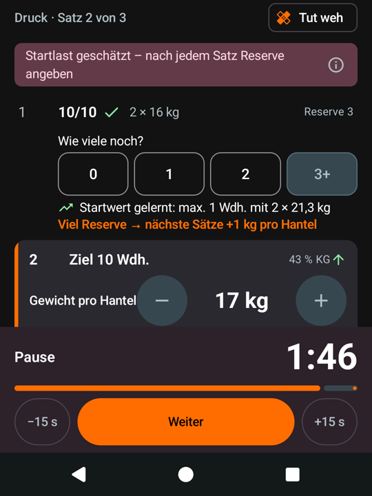 |
| 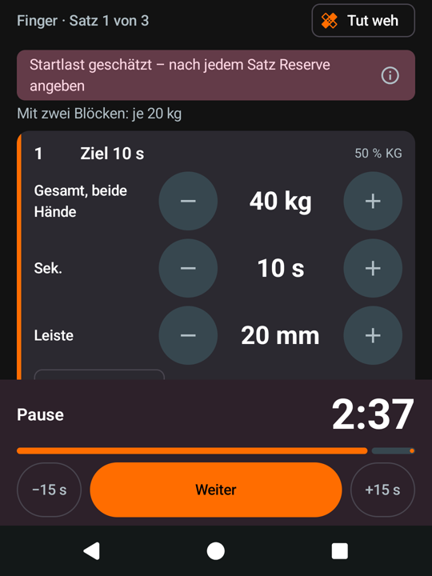 | 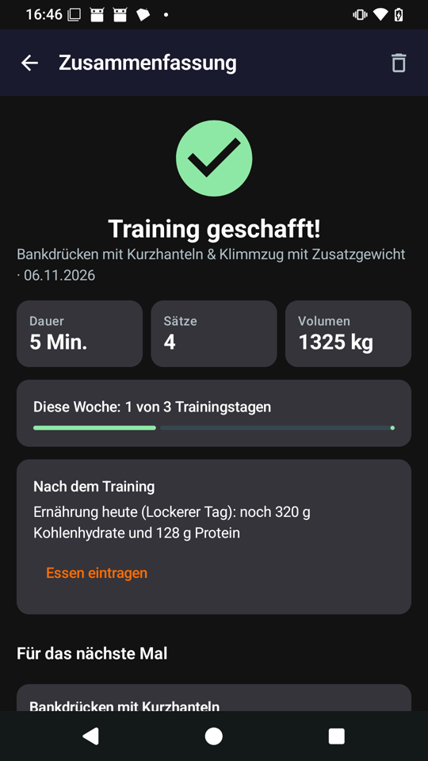 |
| 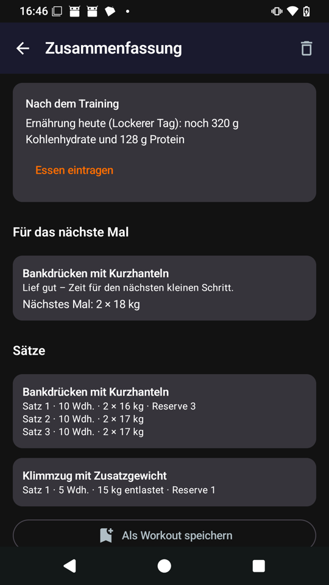 | 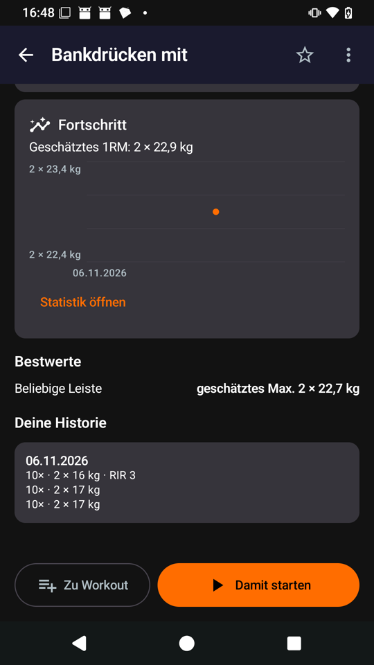 |
| 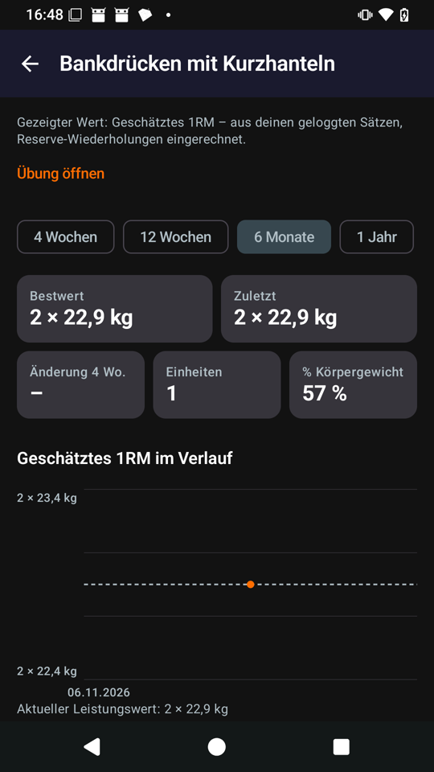 | 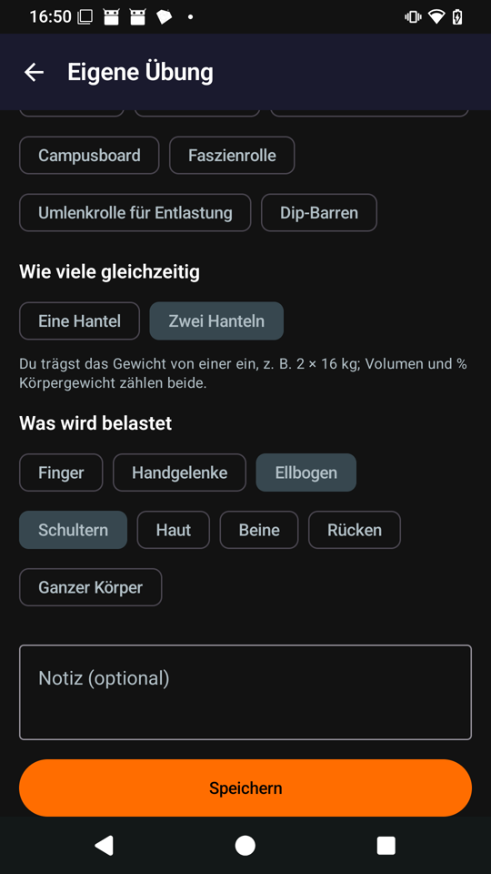 |
| 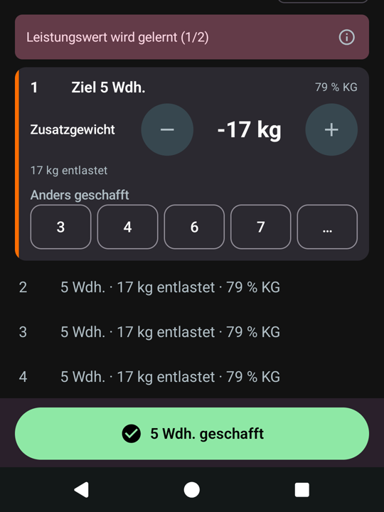 | 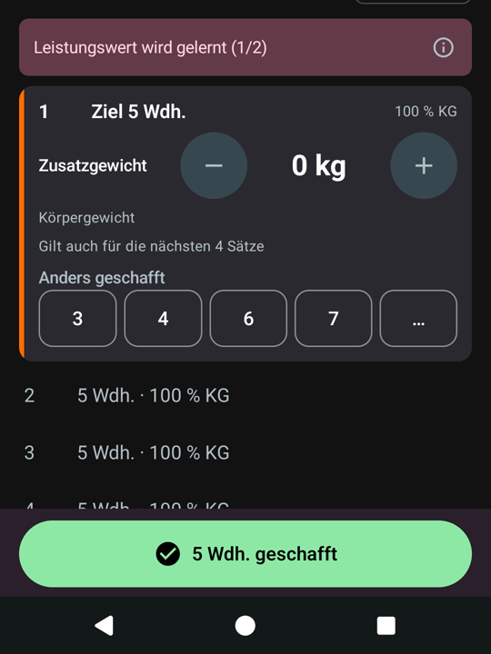 |
