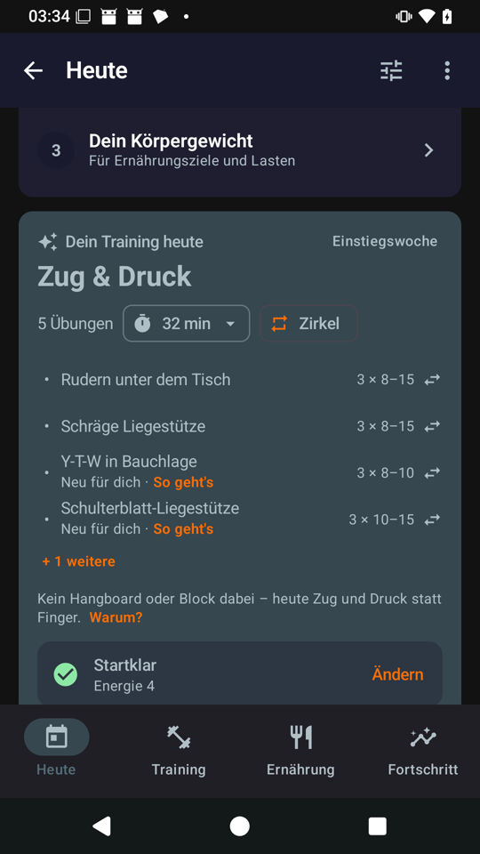
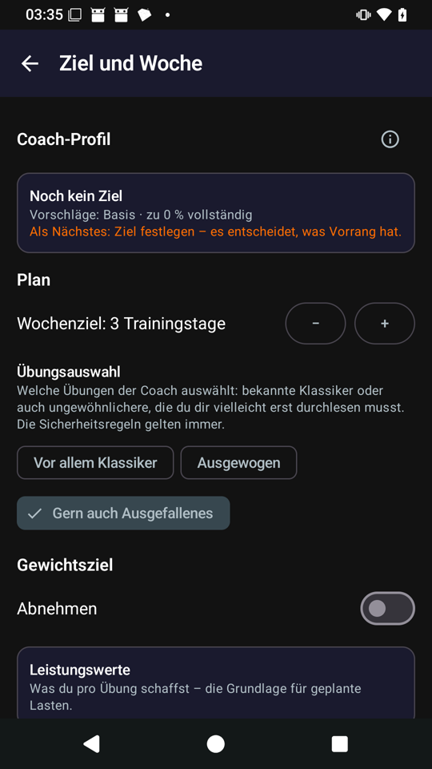
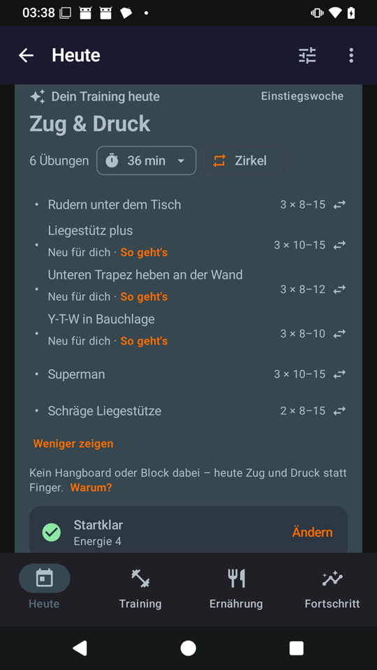
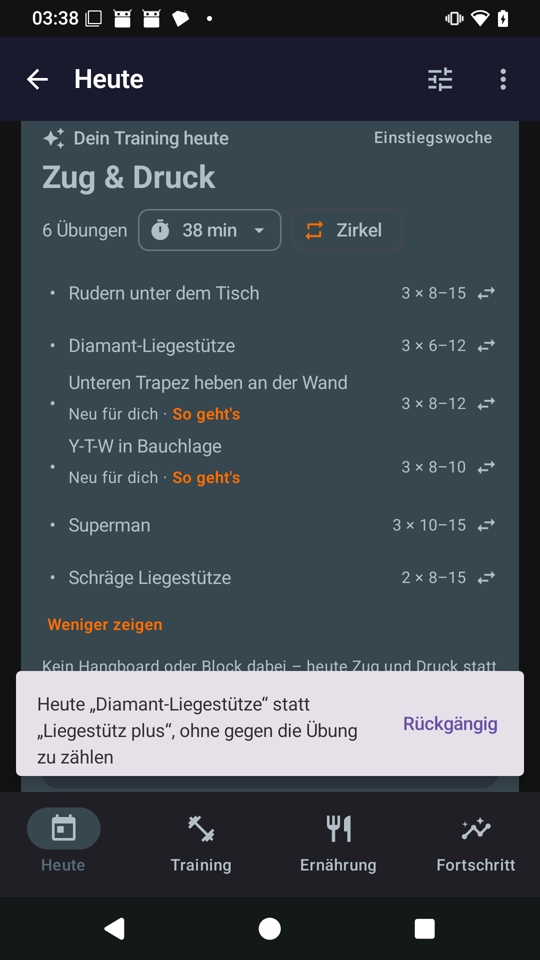
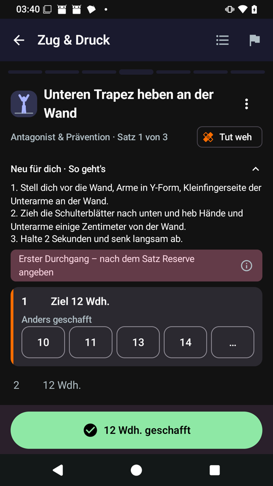

# Well-known exercises first: proposal (issue #68)

Step A of [#68](https://github.com/CruxCoach/CruxCoach/issues/68): what the levels are, how every catalogue exercise is classified, how the coach chooses with them, the preference, what the card shows, and how the simulation checks it. **The questions for the maintainer are in section 7 (numbered, each with a recommendation).**

**Update 2026-11-07:** built in draft pull request [#71](https://github.com/CruxCoach/CruxCoach/pull/71), with the recommended answer to every question. [Section 10](#10-built-step-b) covers what changed while building it, the simulation, five new questions and the phone check.

## 1. Three levels of familiarity

| Level | English | German | One line |
|---|---|---|---|
| 1 | **Basic** | **Basis** | Anyone who climbs, went to a gym or had PE knows it, and the name says what to do. |
| 2 | **Common** | **Gängig** | People who train know it (climbers who train, gym goers, calisthenics); one look at the steps is enough. |
| 3 | **Special** | **Speziell** | You read the steps first: an unusual name, a special set-up or a movement that needs learning. |

The brief's starting names were "Basis / Klettertraining / Speziell". The middle level holds more than climbing training: Romanian deadlift, goblet squat, face pull and Bulgarian split squat are gym classics, and the L-sit and front lever come from calisthenics. So I suggest "Gängig" / "Common" (question 1).

**Climbing basics count as Basic.** Everyone who uses the app climbs, so traversing, down-climbing, dynos, limit bouldering, slab sessions and easy warm-up climbing are Basic, like the push-up (question 2).

**How this differs from what the catalogue already has:**

- **`difficulty` (1–5)** says how hard an exercise is. Familiarity says how much explaining it needs. The two are independent. Twelve Basic exercises have difficulty 3 or more: weighted pull-up, wide pull-up, hanging leg raise, back squat, front squat, deadlift, kneeling and standing ab wheel, box jump, explosive pull-ups, dynos and limit bouldering. 24 Special exercises have difficulty 1 or 2, among them the Pallof press, the Copenhagen plank and finger tendon glides.
- **`beginner_friendly`** says an exercise is safe and simple to load for a beginner. It says nothing about the name. Of its 100 exercises, 48 are Basic, 40 Common and 12 Special. The Special ones are the Pallof press, the wall lower-trap raise, the serratus wall slide, radial/ulnar deviation, the isometric external rotation and elbow flexion, the adductor rock-back, lock-off scapular circles, finger tendon glides, hover hands, the block farmer hold and recruitment pulls. The tag stays: the comeback and "stay healthy" goals use it. Its general +0.5 at level 2 and below would go, because familiarity does that job better (question 10).

## 2. All 214 exercises

Result: **75 Basic, 104 Common, 35 Special**. Every exercise has a short reason (tables per category below).

| Category | Basic | Common | Special |
|---|---|---|---|
| Finger | 0 | 19 | 5 |
| Pull | 12 | 13 | 2 |
| Push | 9 | 5 | 3 |
| Antagonists and prehab | 4 | 11 | 8 |
| Core | 12 | 9 | 6 |
| Legs and hips | 16 | 13 | 4 |
| Mobility | 10 | 13 | 4 |
| Warm-up | 6 | 7 | 1 |
| Power | 3 | 4 | 1 |
| Endurance | 1 | 5 | 0 |
| Technique | 2 | 5 | 1 |
| **All** | **75** | **104** | **35** |

**What the data says about beginners' sessions.** For each slot I counted the Basic exercises a beginner can get (difficulty 2 or less, the equipment of the set-up):

| Slot | No equipment set up | Home (bar, dumbbells, bands, hangboard) | Gym |
|---|---|---|---|
| Pull | 1 Basic, 0 Common | 6 Basic, 3 Common | 10 Basic, 4 Common |
| Push | 3 Basic, 1 Common | 4 Basic, 1 Common | 9 Basic, 1 Common |
| Core | 5 Basic, 5 Common | 7 Basic, 5 Common | 9 Basic, 5 Common |
| Legs | 11 Basic, 1 Common | 11 Basic, 4 Common | 12 Basic, 6 Common |
| Antagonists | 0 Basic, 2 Common | 4 Basic, 9 Common | 4 Basic, 10 Common |
| Mobility | 8 Basic, 10 Common | 8 Basic, 11 Common | 8 Basic, 11 Common |
| Warm-up | 4 Basic, 4 Common | 5 Basic, 6 Common | 5 Basic, 6 Common |
| Finger strength | 0 Basic, 0 Common | 0 Basic, 1 Common | 0 Basic, 0 Common |

- **Without equipment, the pull slot has a single Basic exercise, the table row,** and the antagonist slot has none: scapular push-ups and the prone Y-T-W (both Common) fill it. That is why the table row is Basic here (borderline list), and why a slot never stays empty but falls back to the next level.
- **Finger strength (hangboard, pick-up block) has no Basic exercise at all.** Beginners don't get finger strength work anyway (the first-year guardrail), so this costs nothing. For everyone else, the finger slot is their one new exercise of the session until they know it.

## 3. Selection rules

### Who is a beginner, intermediate or advanced athlete (per kind of training)

| Group | When | Gets |
|---|---|---|
| Beginner | Coach setup not done (unless the logbook already shows 6c or harder); climbing under a year; one to two years without a performance value yet (the same rule as the first-year guardrail); or level 1 for this kind of training | Basic; Common only when no Basic exercise fits the slot; Special never by itself |
| Intermediate | Everyone else | Basic and Common; at most one Special per session |
| Advanced | Over five years of climbing, or level 4 or more for this kind of training (about 7b and harder with the years to match) | All levels, with variety as today |

"Level" is the coach's existing level per kind of training (`level()`): from the grade capped by years, the performance values and "easier/harder". I would not add a separate rule for the first weeks in the app. The new-exercise limit below already makes the start gentle: for a new user every non-Basic exercise is new, so the first sessions are Basic plus at most one new one, and the choice widens as exercises become known (question 3).

### Known to the athlete

An exercise counts as known when any of these is true. It is then allowed whatever its level, and it never counts as new:

- it was logged in at least two trainings
- it is a favourite, or a choice the athlete kept ("suggest it like this")
- it has a performance value
- the athlete created it

**Basic exercises are known to everyone.** Otherwise a new user could only get one exercise per session (question 4).

### New exercises per session

- **At most one exercise per session that is new to the athlete,** meaning neither Basic nor known. With "Open to unusual exercises" the limit is two.
- **Warm-ups and mobility count only when they are Special.** A Common warm-up such as the inchworm is easy to follow along.
- **The limit never empties a slot.** When only new exercises fit, the slot takes the best one and the card marks it. For a beginner whose slot has only Special exercises, the same applies: the slot is filled and marked "new to you", and that counts as the session's new exercise (question 6).
- **Unchanged:** safety and injury rules, the guardrails, equipment, "Never suggest", kept choices and favourites come first, as today.

### The novelty bonus

Today every exercise the athlete has never done gets +2.0 at the default variety. That pulls exactly the unknown exercises in, beginners included. New rules:

- **Within the athlete's levels,** the bonus stays as it is. Basics keep it, so a beginner still sees variety among them.
- **Above the athlete's levels,** there is no bonus.
- **With "Open to unusual exercises",** Special exercises get +1.0 on top, so they actually come.
- **"Routine or variety"** still scales the bonus, as today.

### Where it sits in the code (for step B)

- `ExerciseDefinition.familiarity` (`BASIC`, `COMMON`, `SPECIAL`) comes from a new `familiarity` field in `exercise_catalog.json`. A unit test makes sure every catalogue exercise has one.
- Custom exercises count as known.
- `SuggestionInput` gets the athlete's group per kind of training and the set of known exercises. These are counted from the trainings, favourites, kept choices and performance values, which `TodayCoach` already reads.
- In `pickSlots` a familiarity filter follows the difficulty filter (`withinLevel`). It falls back one level when empty and counts the new exercises.
- `alternatives()` puts known and Basic exercises first for "Don't know it".
- **No database migration:** the preference goes into the coach profile, which is stored as JSON next to `variety`.

## 4. The preference "Exercise choice" / "Übungsauswahl"

| Option | English | German | Effect |
|---|---|---|---|
| 1 | Mostly classics | Vor allem Klassiker | The beginner rules for everyone: Basic first, Common as a fallback, Special only when known |
| 2 (default) | Balanced | Ausgewogen | Follows experience (the table above) |
| 3 | Open to unusual exercises | Gern auch Ausgefallenes | All levels for everyone, up to two new exercises a session, a small bonus for Special ones |

- **Help text under the question:**
  - EN: "Which exercises the coach picks: well-known classics, or more unusual ones that you may need to read up on first. Safety rules apply either way."
  - DE: "Welche Übungen der Coach auswählt: bekannte Klassiker oder auch ungewöhnlichere, die du dir vielleicht erst durchlesen musst. Die Sicherheitsregeln gelten immer."
- **Where:**
  - In the coach setup, step 4 ("What suits you"), directly below "Routine or variety".
  - In the training settings, as one row in the "Plan" section that opens the three options. Today the settings have no row for "Routine or variety"; that one stays in the setup.
- **Next to "Routine or variety":** the two answer different questions, so they stay separate (question 7):
  - "Routine or variety" sets how often the exercises change.
  - "Exercise choice" sets which exercises are in the pool.
  - "Mostly classics" with "lots of variety" rotates among the classics. "Open to unusual exercises" with "fixed routine" keeps a routine that may hold unusual exercises.
  - Placed together, a one-line preview below them says what the combination does. The setup already has such a preview line.
- **Default:** "Balanced". Nothing changes for an athlete who never opens it, except that the levels now count.

## 5. On today's card

- **"New to you":** an exercise that is neither Basic nor known shows a small line under its name:
  - EN: "New to you · How it works"
  - DE: "Neu für dich · So geht's"

  One tap opens its steps (the existing exercise page). A tap on the exercise itself still opens the swap sheet.
- **"Don't know it" / "Kenne ich nicht":** the swap sheet of a new exercise gets this action at the top. It swaps the exercise for the best alternative for the same slot that is Basic or known to the athlete, through the same filters as a swap (equipment, injuries, guardrails, "Never suggest", one progression chain per session).
  - If there is none, the sheet says so and offers the steps.
  - It is logged as a swap with its own marker. **It costs the exercise nothing:** no dislike, no "turned down" rest, and the replacement gets no "liked" point either, because the coach picked it, not the athlete.
  - The swapped exercise does not come back as the coach's new pick for 14 days. After that it can come again, with the hint (question 8).
- **In the player** (question 9): the first time a new exercise comes up, its steps are open. After that they stay folded as today.

## 6. Simulation (#59)

Two personas are added: an intermediate home athlete with "Open to unusual exercises", and a new user who skips the coach setup. Every persona also taps "Don't know it" on every Special exercise in its first two weeks, to exercise the swap.

| Check | Persona | Threshold |
|---|---|---|
| No Special exercise unless known | Beginners (beginner-board, beginner-home-lb, youth-15, the new user), weeks 1–4 | 0 |
| Mostly Basic | Beginners, weeks 1–4, main exercises (warm-ups and mobility aside) | At least 70 % Basic |
| New exercises per session | Everyone | At most one (two with "Open"). Flag every training above that; a training whose slot had nothing else is reported, not counted |
| Advanced still get variety | advanced-taper | At least 30 % of the main exercises Common or Special, and the variety check as today (6 different exercises in every 8 trainings) |
| "Open" brings Special ones | The new "Open" persona | A Special exercise in at least half of all two-week stretches |
| "Mostly classics" stays classic | A run of home-hangboard with that choice | No Special exercise unless known; at least 80 % Basic outside the finger slot |
| "Don't know it" gives something known | Everyone, weeks 1–2 | The replacement is Basic or known in at least 95 % of cases, and the swapped exercise's learned preference is unchanged |

The checks read the catalogue's levels and what the athlete logged, not the coach's rules, like the checks in #59.

## 7. Questions for the maintainer

1. **Level names.** Middle level "Klettertraining" (the brief) or "Gängig" / "Common"? **Recommendation: "Gängig" / "Common".** It also covers gym and calisthenics classics. The names show only in the "New to you" help and, if wanted, the exercise library (question 11).
2. **Climbing basics as Basic** (traversing, down-climbing, dynos, limit bouldering, slab session, easy warm-up climbing)? **Recommendation: yes.** Every user climbs.
3. **Who is a beginner.** Setup not done (unless the logbook shows 6c or harder); climbing under a year; one to two years without a performance value yet, as the first-year guardrail already does; or level 1 for that kind of training. No separate rule for the first weeks, because the new-exercise limit already does it. **Recommendation: as in section 3.**
4. **Known and new.** Known means at least two logged trainings, a favourite, a kept choice, a performance value, or created by the athlete. Basic is known to everyone, and only non-Basic exercises count as new. **Recommendation: yes.** Without "Basic counts as known", a new user would get one exercise per session.
5. **New-exercise limit.** One per session, two with "Open". Warm-ups and mobility count only when Special. **Recommendation: yes.**
6. **A beginner's slot that only Special exercises fit.** Fill it, marked "new to you", or leave the slot out? **Recommendation: fill it.** "A slot is never left empty", and it counts as the session's new exercise. In the data this happens rarely, mainly the antagonist slot without equipment, and there the Common scapular push-ups and Y-T-W come first anyway.
7. **Preference.** "Exercise choice" with "Mostly classics / Balanced / Open to unusual exercises", default "Balanced". It sits in the setup below "Routine or variety", and in the settings as a row in "Plan". The two stay separate settings, with a shared preview line. **Recommendation: yes.**
8. **"Don't know it".** At the top of the swap sheet of a new exercise. It is no dislike, and the exercise does not return as a new pick for 14 days. **Recommendation: yes.** Alternative: no pause at all, so it may come back the next day.
9. **Steps open in the player** the first time a new exercise comes up? **Recommendation: yes.** It is a small change in the player.
10. **`beginner_friendly`.** It stays for the comeback and "stay healthy" goals, but its general +0.5 at level 2 and below goes, because familiarity does that job. **Recommendation: yes.**
11. **Show the level in the exercise library** (a label and a filter)? **Recommendation: not in this issue.** Later, if wanted.
12. **Borderline cases.** Please look through the 29 below and tell me what to change. **Recommendation:** take my levels as they are, except where you disagree.

## 8. Borderline cases (29)

29 cases. Prone Y-T-W also decides the bench I-Y-T, the nordic curl its assisted version, the band pull-apart its warm-up version, and the kneeling ab wheel the standing one.

| Exercise | My level | Or | Why |
|---|---|---|---|
| Band Pull-Apart (Band auseinanderziehen) | Basic | Common | the name says the whole movement |
| Prone Y-T-W Raise (Y-T-W in Bauchlage) | Common | Special | known prehab; the letters need the picture once |
| Radial/Ulnar Deviation (Handgelenk seitlich kippen) | Special | Common | technical name; the movement needs explaining |
| Serratus Wall Slide (Serratus-Wandgleiten) | Special | Common | specific set-up (forearms on the wall); easy to do wrong |
| Bird Dog (Bird Dog) | Common | Basic | common in fitness and back classes; the name does not say it |
| Dead Bug (Dead Bug) | Common | Basic | common in fitness classes; the name does not say it |
| Toes to Bar (Füße zur Stange) | Common | Basic | known from calisthenics and CrossFit; the name says the goal |
| V-Sit (V-Sitz) | Common | Basic | known shape from gymnastics |
| Density Hangs (Lange moderate Hänger) | Common | Special | hangboard format; the protocol needs a look |
| Minimum Edge Hangs (Minimale Leiste) | Common | Special | known protocol among climbers who train |
| Open-Hand Block Lift (Blockheben mit offener Hand) | Common | Special | pick-up block, open hand |
| Bulgarian Split Squat (Bulgarische Kniebeuge) | Common | Basic | gym classic; the name needs knowing |
| Cossack Squat (Kosakenkniebeuge) | Special | Common | unusual name; a side squat that needs explaining |
| Front Squat (Frontkniebeuge) | Basic | Common | gym classic |
| Goblet Squat (Goblet-Kniebeuge) | Common | Basic | gym classic; 'goblet' needs knowing |
| Nordic Curl (Nordic Curl) | Common | Special | known from team sports; the name does not say it |
| Tibialis Raise (Schienbeinheben) | Common | Special | the name says it, but few know it |
| Cat-Cow (Katze-Kuh) | Common | Basic | known from yoga |
| Pancake Stretch (Grätsch-Vorbeuge) | Common | Special | known from gymnastics |
| Band Shoulder Dislocates (Schulterdurchschwung mit Band) | Common | Special | known with a band or stick, but the name misleads |
| Gentle Sleeper Stretch (Sanfte Sleeper-Dehnung) | Common | Special | known shoulder stretch |
| Dynos & Deadpoints (Dynos & Deadpoints) | Basic | Common | every climber knows dynos |
| Inverted Row (Körpergewichtsrudern) | Common | Basic | known as the Australian pull-up; set-up needs a look |
| Lock-Off Hold (Blockieren an der Stange) | Common | Basic | climbers know lock-offs |
| Negative Pull-Up (Negative Klimmzüge) | Common | Basic | 'negative' needs knowing |
| Table Row (Rudern unter dem Tisch) | Basic | Common | the name says it; the only pull exercise without a bar |
| Diamond Push-Up (Diamant-Liegestütze) | Basic | Common | a known push-up variant |
| Push-Up Plus (Liegestütz plus) | Special | Common | the 'plus' needs explaining |
| World's Greatest Stretch (Weltbeste Dehnung) | Common | Special | common warm-up; the name does not say it |

## 9. All exercises by category

\* on the borderline list.

### Finger

| Exercise | Level | Why |
|---|---|---|
| Assisted Hang (Entlastetes Hängen) | Common | first hangboard step; the feet-on set-up is quick to grasp |
| Band Finger Extensions (Fingerstrecker mit Gummiband) | Common | climber prehab with a band |
| Bodyweight Hang (Hängen mit Körpergewicht) | Common | hangboard basic for climbers who train |
| Density Hangs (Lange moderate Hänger) | Common * | hangboard format; the protocol needs a look |
| Finger Rolls (Fingerrollen) | Common | forearm exercise from the gym; needs a look |
| Half-Crimp Hangs (Halb aufgestellt hängen) | Common | climbers know the grip |
| Max Hangs (Max Hangs) | Common | climbing-training classic |
| Max Hangs Small Edge (Max Hangs an kleiner Leiste) | Common | max hangs on a smaller edge |
| Minimum Edge Hangs (Minimale Leiste) | Common * | known protocol among climbers who train |
| One-Arm Edge Pick-Up (Blockheben einarmig) | Common | pick-up block training is common among climbers who train |
| One-Arm Hangs (Einarmig hängen) | Common | the name says it (and it is hard) |
| One-Arm Pinch Block Lift (Zangenblock einarmig heben) | Common | pick-up block with a pinch |
| Open-Hand Block Lift (Blockheben mit offener Hand) | Common * | pick-up block, open hand |
| Open-Hand Hangs (Hängen mit offener Hand) | Common | climbers know the grip |
| Pinch Hangs (Zangen-Hänger) | Common | climbers know pinches |
| Repeaters 7:3 (Repeaters 7:3) | Common | climbing-training classic |
| Sloper Hangs (Aufleger-Hänger) | Common | climbers know slopers |
| Three-Finger Drag Hangs (Dreifinger hängend) | Common | climbers know the grip |
| Two-Arm Edge Pick-Up (Blockheben beidarmig) | Common | pick-up block training |
| Block Farmer Hold (Block halten mit neutralem Handgelenk) | Special | special set-up (block held with a neutral wrist) |
| Fixed-Edge Isometric Pull (Isometrischer Zug an fixer Leiste) | Special | strap or no-hang set-up that needs explaining |
| Hangboard Recruitment Pulls (Aktivierungszüge am Hangboard) | Special | protocol needs explaining (pull hard without leaving the board) |
| Offset Hangs (Versetztes Hängen) | Special | uneven set-up that needs explaining |
| One-Arm Assisted Hang (Einarmig hängen mit Entlastung) | Special | pulley set-up |

### Pull

| Exercise | Level | Why |
|---|---|---|
| Active Dead Hang (Aktiver Dead Hang) | Basic | hanging from a bar |
| Band-Assisted Pull-Up (Klimmzug mit Band) | Basic | a pull-up with a band |
| Chin-Up (Klimmzug im Untergriff) | Basic | everyone knows it |
| Hammer Curl (Hammercurls) | Basic | gym classic |
| Lat Pulldown (Latziehen) | Basic | gym classic |
| One-Arm Dumbbell Row (Einarmiges Kurzhantelrudern) | Basic | gym classic |
| Pull-Up (Klimmzug) | Basic | everyone knows it |
| Seated Cable Row (Rudern am Kabelzug) | Basic | gym classic |
| Single-Arm Lat Pulldown (Einarmiger Latzug) | Basic | gym classic on one arm |
| Table Row (Rudern unter dem Tisch) | Basic * | the name says it; the only pull exercise without a bar |
| Weighted Pull-Up (Klimmzug mit Zusatzgewicht) | Basic | everyone knows it (hard, but known) |
| Wide-Grip Pull-Up (Breiter Klimmzug) | Basic | a pull-up with a wide grip |
| Advanced Tuck Front Lever (Frontlever fortgeschritten gehockt) | Common | front lever progression |
| Archer Pull-Up (Archer-Klimmzug) | Common | known from calisthenics |
| Assisted One-Arm Pull-Up (Einarmiger Klimmzug mit Hilfe) | Common | one-arm pull-up with help |
| Front Lever (Frontlever) | Common | known to climbers and calisthenics |
| Front Lever Raise (Frontlever-Heben) | Common | front lever progression |
| Inverted Row (Körpergewichtsrudern) | Common * | known as the Australian pull-up; set-up needs a look |
| Lock-Off Hold (Blockieren an der Stange) | Common * | climbers know lock-offs |
| Negative Pull-Up (Negative Klimmzüge) | Common * | 'negative' needs knowing |
| One-Arm Lock-Off (Einarmiges Blockieren) | Common | climbers know lock-offs |
| One-Arm Negative (Einarmige Negative) | Common | known among climbers who train |
| Scapular Pull-Up (Schulterblatt-Klimmzüge) | Common | known from climbing warm-ups |
| Straddle / One-Leg Front Lever (Frontlever gegrätscht / einbeinig) | Common | front lever progression |
| Tuck Front Lever (Frontlever gehockt) | Common | front lever progression |
| Frenchies (Frenchies) | Special | unusual name; a sequence that needs explaining |
| Typewriter Pull-Up (Typewriter-Klimmzug) | Special | unusual name; a sideways pull-up |

### Push

| Exercise | Level | Why |
|---|---|---|
| Bench Dip (Bank-Dips) | Basic | PE and gym classic |
| Diamond Push-Up (Diamant-Liegestütze) | Basic * | a known push-up variant |
| Dumbbell Bench Press (Bankdrücken mit Kurzhanteln) | Basic | gym classic |
| Dumbbell Overhead Press (Schulterdrücken mit Kurzhanteln) | Basic | gym classic |
| Incline Dumbbell Press (Schrägbankdrücken mit Kurzhanteln) | Basic | gym classic |
| Incline Push-Up (Schräge Liegestütze) | Basic | an easier push-up |
| Parallel Bar Dip (Dips am Barren) | Basic | gym classic |
| Push-Up (Liegestütze) | Basic | everyone knows it |
| Triceps Pushdown (Trizepsdrücken am Kabelzug) | Basic | gym classic |
| Archer Push-Up (Archer-Liegestütze) | Common | known from calisthenics |
| Elevated Pike Push-Up (Hecht-Liegestütze erhöht) | Common | pike push-up with the feet up |
| Pike Push-Up (Hecht-Liegestütze) | Common | known from calisthenics |
| Ring Dip (Ring-Dips) | Common | dips on rings |
| Wall Handstand Push-Up (Handstand-Liegestütze an der Wand) | Common | known from calisthenics |
| Box Mantle Press-Out (Mantle-Drücken an der Box) | Special | climbing-specific set-up |
| Pseudo Planche Push-Up (Pseudo-Planche-Liegestütze) | Special | unusual name and lean |
| Push-Up Plus (Liegestütz plus) | Special * | the 'plus' needs explaining |

### Antagonists and prehab

| Exercise | Level | Why |
|---|---|---|
| Band Pull-Apart (Band auseinanderziehen) | Basic * | the name says the whole movement |
| Bent-Over Reverse Fly (Reverse Flys mit Kurzhanteln) | Basic | gym classic (reverse flys) |
| Dumbbell Wrist Curl (Handgelenkbeugen mit Kurzhantel) | Basic | gym classic |
| Reverse Wrist Curl (Handgelenkheben im Obergriff) | Basic | gym classic (wrist curl, overhand) |
| Band External Rotation (Außenrotation mit Band) | Common | standard shoulder prehab; a look at the set-up (elbow at the side) is enough |
| Band Face Pull (Face Pulls mit Band) | Common | gym and prehab classic, mostly on a cable |
| Eccentric Wrist Extension (Exzentrisches Handgelenkstrecken) | Common | wrist prehab; 'eccentric' needs the steps |
| Finger Extensor Band Opens (Fingerstrecker mit Gummiband) | Common | climber prehab with a rubber band; the name says it |
| Forearm Pronation/Supination (Unterarmrotation mit Hantel) | Common | simple, but the grip on the dumbbell needs a look |
| Incline Prone I-Y-T (I-Y-T auf der Schrägbank) | Common | known prehab; the letters need the picture once |
| Isometric Wrist Extension (Handgelenkstrecker halten) | Common | a held wrist curl; a look at the position is enough |
| Isometric Wrist Flexion (Handgelenkbeuger halten) | Common | a held wrist curl; a look at the position is enough |
| Prone Y-T-W Raise (Y-T-W in Bauchlage) | Common * | known prehab; the letters need the picture once |
| Scapular Push-Up (Schulterblatt-Liegestütze) | Common | known from climbing and calisthenics warm-ups |
| Side-Lying External Rotation (Außenrotation in Seitlage) | Common | classic rotator-cuff exercise |
| Bottoms-Up Kettlebell Carry (Kettlebell kopfüber tragen) | Special | unusual grip set-up that needs explaining |
| Cuban Press (Cuban Press) | Special | unusual name; a combined lift that needs learning |
| Isometric Elbow Flexion (Ellenbogenbeugen gegen Widerstand halten) | Special | physio-style hold; the set-up against resistance needs explaining |
| Isometric External Rotation (Außenrotation gegen die Wand halten) | Special | physio-style hold against a wall; set-up needs explaining |
| Radial/Ulnar Deviation (Handgelenk seitlich kippen) | Special * | technical name; the movement needs explaining |
| Serratus Wall Slide (Serratus-Wandgleiten) | Special * | specific set-up (forearms on the wall); easy to do wrong |
| Turkish Get-Up (Türkisches Aufstehen) | Special | a long movement sequence that needs learning |
| Wall Lower-Trap Raise (Unteren Trapez heben an der Wand) | Special | physio exercise; the lift-off needs explaining |

### Core

| Exercise | Level | Why |
|---|---|---|
| Back Extension (Rückenstrecken) | Basic | gym classic (hyperextension) |
| Dumbbell Side Bend (Seitbeugen mit Kurzhantel) | Basic | gym classic |
| Front Plank (Unterarmstütz) | Basic | everyone knows the plank |
| Hanging Knee Raise (Knieheben im Hang) | Basic | the name says it |
| Hanging Leg Raise (Beinheben im Hang) | Basic | the name says it |
| Kneeling Ab Wheel Rollout (Bauchroller kniend) | Basic | ab roller, known from gyms and homes |
| Reverse Crunch (Umgekehrter Crunch) | Basic | gym classic |
| Side Plank (Seitstütz) | Basic | everyone knows it |
| Sit-Up (Sit-ups) | Basic | PE classic |
| Standing Ab Wheel Rollout (Bauchroller stehend) | Basic | the same known movement, only harder |
| Superman (Superman) | Basic | PE classic |
| Weighted Sit-Up (Sit-ups mit Zusatzgewicht) | Basic | a sit-up with a plate |
| Bird Dog (Bird Dog) | Common * | common in fitness and back classes; the name does not say it |
| Dead Bug (Dead Bug) | Common * | common in fitness classes; the name does not say it |
| Hollow Hold (Hohlkörper) | Common | gymnastics and climbing staple |
| Hollow Rocks (Hohlkörper-Schaukeln) | Common | gymnastics and climbing staple |
| L-Sit (L-Sitz) | Common | known shape from gymnastics |
| Toes to Bar (Füße zur Stange) | Common * | known from calisthenics and CrossFit; the name says the goal |
| Tuck Hollow Hold (Hohlkörper, gehockt) | Common | easier hollow hold |
| Tuck L-Sit (L-Sitz, gehockt) | Common | easier L-sit |
| V-Sit (V-Sitz) | Common * | known shape from gymnastics |
| Body Saw (Body Saw) | Special | unusual name and movement |
| Dragon Flag (Dragon Flag) | Special | unusual name; a movement that needs learning |
| Dragon Flag Negative (Dragon Flag, negativ) | Special | unusual name; a movement that needs learning |
| Hanging Windshield Wipers (Scheibenwischer im Hang) | Special | unusual movement that needs learning |
| Pallof Press (Pallof Press) | Special | unusual name (the example in #68) |
| Seated Pike Compression Lifts (Kompressionsheben im Langsitz) | Special | unusual name and position |

### Legs and hips

| Exercise | Level | Why |
|---|---|---|
| Air Squat (Kniebeuge ohne Gewicht) | Basic | everyone knows the squat |
| Barbell Back Squat (Kniebeuge mit Langhantel) | Basic | gym classic |
| Box Jump (Sprung auf die Box) | Basic | the name says it |
| Box Step-Up (Aufsteigen auf die Box) | Basic | the name says it |
| Calf Raise (Wadenheben) | Basic | everyone knows it |
| Conventional Deadlift (Kreuzheben) | Basic | gym classic |
| Deep Squat Hold (Tiefe Hocke halten) | Basic | the name says it |
| Front Squat (Frontkniebeuge) | Basic * | gym classic |
| Glute Bridge (Beckenheben) | Basic | PE and fitness classic |
| Jump Squat (Kniebeuge-Sprung) | Basic | the name says it |
| Reverse Lunge (Ausfallschritt rückwärts) | Basic | everyone knows lunges |
| Single-Leg Balance (Einbeinstand) | Basic | the name says it |
| Single-Leg Calf Raise (Einbeiniges Wadenheben) | Basic | the name says it |
| Single-Leg Glute Bridge (Einbeiniges Beckenheben) | Basic | the name says it |
| Walking Lunge (Ausfallschritt gehend) | Basic | everyone knows lunges |
| Wall Sit (Wandsitzen) | Basic | PE classic |
| Assisted Eccentric Nordic Curl (Nordic Curl exzentrisch mit Hilfe) | Common | easier nordic curl |
| Assisted Pistol Squat (Einbeinige Kniebeuge mit Halt) | Common | pistol squat with help |
| Barbell Hip Thrust (Hip Thrust mit Langhantel) | Common | gym classic with a barbell set-up |
| Box Pistol (Einbeinige Kniebeuge zur Box) | Common | pistol to a box |
| Bulgarian Split Squat (Bulgarische Kniebeuge) | Common * | gym classic; the name needs knowing |
| Goblet Squat (Goblet-Kniebeuge) | Common * | gym classic; 'goblet' needs knowing |
| Isometric Hamstring Bridge (Brücke halten, Fersen auf der Bank) | Common | a held bridge with the heels up |
| Lateral Band Walk (Seitliches Gehen mit Miniband) | Common | common with a mini band |
| Nordic Curl (Nordic Curl) | Common * | known from team sports; the name does not say it |
| Pistol Squat (Einbeinige Kniebeuge (Pistol)) | Common | known from calisthenics |
| Romanian Deadlift (Rumänisches Kreuzheben) | Common | gym classic (RDL) |
| Single-Leg Romanian Deadlift (Einbeiniges Rumänisches Kreuzheben) | Common | RDL on one leg |
| Tibialis Raise (Schienbeinheben) | Common * | the name says it, but few know it |
| Copenhagen Plank (Long Lever) (Copenhagen Plank (langer Hebel)) | Special | unusual name and set-up |
| Copenhagen Plank (Short Lever) (Copenhagen Plank (kurzer Hebel)) | Special | unusual name and set-up |
| Cossack Squat (Kosakenkniebeuge) | Special * | unusual name; a side squat that needs explaining |
| High-Step Mantle (Hoher Tritt mit Mantle-Stütz) | Special | climbing-specific set-up |

### Mobility

| Exercise | Level | Why |
|---|---|---|
| Belayer's Neck Mobility (Nackenmobilisation für Sichernde) | Basic | simple neck movements |
| Butterfly Stretch (Schmetterlingsdehnung) | Basic | PE classic |
| Cross-Body Shoulder Stretch (Schulterdehnung quer vor der Brust) | Basic | everyone knows it |
| Doorway Chest Stretch (Brustdehnung im Türrahmen) | Basic | the name says it |
| Forearm Rolling & Self-Massage (Unterarm-Rollen & Selbstmassage) | Basic | the name says it |
| Gentle Finger Stretches (Sanfte Fingerdehnung) | Basic | the name says it |
| Kneeling Hip Flexor Stretch (Hüftbeuger-Dehnung im Kniestand) | Basic | everyone knows it |
| Wall Calf Stretch (Wadendehnung an der Wand) | Basic | everyone knows it |
| Wrist Extensor Stretch (Dehnung der Unterarmstrecker) | Basic | everyone knows it |
| Wrist Flexor Stretch (Dehnung der Unterarmbeuger) | Basic | everyone knows it |
| Active Straight-Leg Raise (Aktives gestrecktes Beinheben) | Common | physio-style; the active part needs a look |
| Band Shoulder Dislocates (Schulterdurchschwung mit Band) | Common * | known with a band or stick, but the name misleads |
| Cat-Cow (Katze-Kuh) | Common * | known from yoga |
| Child's Pose with Lat Stretch (Kindhaltung mit Latissimus-Dehnung) | Common | known from yoga, with a side reach |
| Deep Squat Hold with Prying (Tiefe Hocke mit Knie-Aufdrücken) | Common | deep squat with prying |
| Frog Stretch (Froschdehnung) | Common | known from yoga |
| Gentle Sleeper Stretch (Sanfte Sleeper-Dehnung) | Common * | known shoulder stretch |
| Knee-to-Wall Ankle Mobility (Sprunggelenk: Knie zur Wand) | Common | common ankle drill |
| Open Book Rotation (Offenes Buch) | Common | common thoracic drill |
| Pancake Stretch (Grätsch-Vorbeuge) | Common * | known from gymnastics |
| Pigeon Stretch (Tauben-Dehnung) | Common | known from yoga |
| Thoracic Extension on Foam Roller (Brustwirbelsäule strecken auf Rolle) | Common | foam-roller classic |
| Wall Slides (Armgleiten an der Wand) | Common | common shoulder drill |
| 90/90 Hip Switches (90/90-Hüftwechsel) | Special | unusual name and position |
| Adductor Rock-Back (Adduktoren-Wippen) | Special | unusual name and position |
| High-Step Mobility Drill (Mobilisation für hohe Tritte) | Special | climbing-specific drill that needs explaining |
| Lock-Off Scapular Circles (Schulterblattkreisen im Lock-off) | Special | unusual combination that needs explaining |

### Warm-up

| Exercise | Level | Why |
|---|---|---|
| Arm Circles (Armkreisen) | Basic | PE classic |
| Band Pull-Apart (Warm-up) (Band auseinanderziehen (Aufwärmen)) | Basic | the name says it |
| Easy Traverse & Warm-up Boulders (Leichtes Quergehen & Aufwärmboulder) | Basic | every climber knows it |
| Jumping Jacks / Easy Cardio (Hampelmänner / lockeres Warmlaufen) | Basic | PE classic |
| Leg Swings & Hip Circles (Beinpendel & Hüftkreisen) | Basic | PE classic |
| Wrist Circles (Handgelenkkreisen) | Basic | PE classic |
| Active Hang Shrugs (Schulterblatt-Aktivierung im Hang) | Common | known from climbing warm-ups |
| Inchworm (Raupe) | Common | common warm-up |
| Light Band Face Pull (Warm-up) (Band-Zug zum Gesicht (Aufwärmen)) | Common | face pull, lighter |
| Progressive Finger Warm-up Ramp (Finger-Aufwärmen mit Steigerung) | Common | climbing warm-up on the board |
| Push-up to Downward Dog (Liegestütz in den herabschauenden Hund) | Common | known from yoga |
| Standing Spine Wave (Wirbelsäulenwelle im Stand) | Common | common warm-up |
| World's Greatest Stretch (Weltbeste Dehnung) | Common * | common warm-up; the name does not say it |
| Finger Tendon Glides (Sehnengleiten der Finger) | Special | a hand sequence that needs explaining |

### Power

| Exercise | Level | Why |
|---|---|---|
| Dynos & Deadpoints (Dynos & Deadpoints) | Basic * | every climber knows dynos |
| Explosive Pull-Ups (Explosive Klimmzüge) | Basic | the name says it |
| Limit Bouldering (Limit-Bouldern) | Basic | every climber knows projecting |
| Campus Ladders (Campus-Leitern) | Common | climbing-training classic |
| Campus Max Reach (Maximaler Campus-Zug) | Common | campus classic |
| Double Dynos (Doppel-Dynos) | Common | climbers know dynos |
| Foot-On Campus (Campus mit Füßen) | Common | campus with feet on |
| Campus Touches & Bumps (Campus: Antippen & Nachsetzen) | Special | touches and bumps need explaining |

### Endurance

| Exercise | Level | Why |
|---|---|---|
| Traversing (Quergänge) | Basic | every climber knows traversing |
| 4x4s (4x4) | Common | climbing-training classic |
| ARC Training (ARC-Training) | Common | climbing-training staple; the acronym needs explaining once |
| Board EMOM (Board: jede Minute ein Boulder) | Common | training format known to climbers who train |
| Grade Pyramids (Grad-Pyramide) | Common | climbing-training format |
| Linked Circuits (Verkettete Boulder) | Common | climbers know circuits |

### Technique

| Exercise | Level | Why |
|---|---|---|
| Down-Climbing (Abklettern) | Basic | every climber knows it |
| Slab Session (Platten-Einheit) | Basic | every climber knows slabs |
| Drop-Knee Drill (Ägypter-Übung) | Common | climbers know the move |
| Flag Drill (Flaggen-Übung) | Common | climbers know flagging |
| One-Arm Climbing (Easy) (Einarmig klettern (leicht)) | Common | the name says it |
| Silent Feet (Leise Füße) | Common | common footwork drill |
| Sticky Feet (Präzise Fußtritte) | Common | common footwork drill |
| Hover Hands (Schwebende Hände) | Special | a drill that needs explaining |

## 10. Built (step B)

Draft pull request [#71](https://github.com/CruxCoach/CruxCoach/pull/71). It is built on the recommended answer to each question in section 7. Every number and group sits in one place in the code (`ExerciseFamiliarity`), so a different answer is a small change. Building it raised five more points; they are questions 13–17 below.

### What the app does now

- **Catalogue:** every exercise has its level from section 9 (75 Basic, 104 Common, 35 Special).
- **Who gets what:** as in section 3.
  - "Beginner" without a coach setup means: no experience answer and no grade from 6c. The experience question can also be answered under "Basics", without the setup.
  - A known exercise is always allowed and never counts as new.
- **At most one new exercise per training,** two with "Open to unusual exercises".
  - Once a training has its new exercise and only new ones are left near your level, a Basic or known exercise one difficulty step easier comes first (question 16).
  - If there is none either, a repeated slot of the same kind is left out, for example the second antagonist slot (question 17). A longer training fills up with known work instead.
  - The first slot of each kind is always filled, marked "new to you" if it has to be.
- **Known** means:
  - logged in two trainings, a favourite, a kept choice, or your own exercise;
  - or a performance value you entered, tested or estimated. A value the coach learned from a single training does not count (question 15).
- **Scoring:**
  - The bonus for exercises you have not done yet counts only within your levels.
  - "Open to unusual exercises" adds a small bonus for Special exercises.
  - The general bonus for `beginner_friendly` is gone.
- **Exercise choice / Übungsauswahl:**
  - In the coach setup (card 4) it comes after the favourites, which stay right below "Routine or variety" (question 13).
  - In the training settings it is three chips under "Plan" (question 14).
  - Choosing one shows a line in the setup's preview.
- **Today:**
  - A new exercise shows "New to you · How it works" under its name. The link opens the exercise page with its steps; a tap on the exercise itself still opens the swap sheet.
  - The swap sheet of a new exercise starts with "Don't know it: X instead", where X is the best Basic or known exercise for the slot. When there is none, the sheet says so. Either way, "How it works" is right there.
  - "Don't know it" holds for the day, also after a restart, and can be undone from the snackbar. It is no dislike, and the exercise is not the coach's new pick for 14 days.
- **Player:** the first time an exercise that is not Basic comes up, its steps are open at the top of its page and can be folded. Nothing changes for other exercises.

### Simulation

The full run covers 16 personas. Three are new:
- `open-home`: an intermediate athlete at home who chose "Open to unusual exercises".
- `home-classics`: `home-hangboard` with "Mostly classics".
- `new-no-setup`: a new user who answers none of the coach setup.

In the first two weeks every persona taps "Don't know it" on each Special exercise new to them.

| Check | Flags |
|---|---|
| Beginners, weeks 1–4: no Special exercise they do not know | 0 |
| Beginners, weeks 1–4: at least 70 % of the main exercises Basic or known; "Mostly classics": 80 % outside finger work | 0 |
| At most one new exercise per training (two with "Open"), where something known would have fitted | 0 |
| Advanced: at least 30 % Common or Special | 0 |
| "Open": a Special exercise in at least half of all two-week stretches | 0 |
| "Mostly classics": no Special exercise the athlete does not know | 0 |
| "Don't know it": something known in at least 95 % of the taps, no change to the learned preference, not back within 14 days | 0 |
| Info: a second new exercise because nothing known fitted | 1 training (after "too easy"). Before the change from question 17 it was 12, mostly with little equipment. |

Safety stays at 0. Two other numbers moved with the new picks: values far from the truth went from 5 to 7, and weekly-volume flags from 34 to 52 (9 of them from the new persona). Both are traced in the #59 follow-up.

The new checks found two problems in the first run, both fixed in the pull request:
1. A value the coach learned from one training made an exercise count as known, so a second new exercise came in.
2. In a slot with a level floor, the floor and the one-chain rule could leave only new exercises, even though a known one a step easier would have fitted.

They also showed that the safety check for contraindicated exercises was stricter than the comeback plan. From stage 5 on, the plan allows training outside its sessions to load the finger again. The check now follows that.

### Questions 13–17 (new)

13. **"Exercise choice" in the setup after the favourites.** The favourites stay right below "Routine or variety", as decided on 2026-10-16. **Recommendation: yes.**
14. **In the training settings as three chips under "Plan"**, not a row that opens a dialog. **Recommendation: yes.** One tap, and the help line stays visible.
15. **A performance value the coach learned from a single training does not make an exercise known.** Entered, tested and estimated values do. **Recommendation: yes.** Otherwise one training would be enough for loaded exercises.
16. **When a training already has its new exercise, a Basic or known exercise one step easier comes before a second new one.** **Recommendation: yes.** The alternative is two new exercises at the athlete's level.

17. **A repeated slot of the same kind is left out rather than bringing a second new exercise.** The phone check found this case: a new user without equipment got Y-T-W and scapular push-ups in the two antagonist slots, both new. **Recommendation: yes.** The first antagonist stays, and the training fills up with known work. The alternative is to fill both slots and mark both.

### Phone check (test build of ae685abf4)

A fresh install, so a new user with no history, no coach setup and no equipment set up. The app was in German.

1. **Today:** the table row and incline push-ups (Basic), then Y-T-W and scapular push-ups, both marked "Neu für dich · So geht's". Without equipment the antagonist slots have no Basic exercise (section 2). This build still filled both slots, which led to question 17; the change is in the pull request.

   
2. **"So geht's"** opens the exercise page with the steps.
3. **The swap sheet of Y-T-W:** nothing known fits, so it says so and offers "So geht's".

   
4. **Settings, "Ziel und Woche":** the "Übungsauswahl" chips under "Plan", with "Gern auch Ausgefallenes" chosen.

   
5. **Today with "Open":** Special exercises come in too, such as the lower-trap raise against the wall.

   
6. **"Kenne ich nicht: stattdessen Diamant-Liegestütze"** on "Liegestütz plus". The card swaps it, still with six exercises, and the snackbar offers undo. After a force-stop and restart the swap is still there.

    
7. **Player:** on the lower-trap raise, done for the first time, the steps are open and can be folded. Basic exercises have no steps block.

   
8. The Training, Nutrition, Progress and Today tabs open as before.
