# UI pass of the training area (0.2.5)

Pull request: [CruxCoach/CruxCoach#93](https://github.com/CruxCoach/CruxCoach/pull/93) (into `feat/0.2.5-release`). Updated after the maintainer's review: see [After the review](#after-the-review).

## How it was checked
The test `TrainingUiReviewTest` renders 73 screens and states of the training area: Today, Training, Nutrition, Body, Progress, the player, the coach setup and the comeback screens. Each one is rendered in four variants:

| | Theme | Language | Width | Font size |
|---|---|---|---|---|
| A | dark | German | 411 dp | 1.0 |
| B | light | English | 411 dp | 1.0 |
| C | dark | German | 320 dp | 2.0 |
| D | light | English | 320 dp | 2.0 |

Fresh reviewers who had not seen the code compared every screen with the app's design guide (`design.md`) and the 0.2.4 screens. There were five rounds. The last one found only medium points; they are fixed, or listed under "Left open".

## The main problem
At 320 dp and the largest font, many rows put a text next to a button, badge, stepper or value that kept its full width. The text then broke mid-word or into single letters:
- "Dei / n / Tra / ini / ng" next to "Einstiegswoche"
- "Startkla / r" next to "Ändern"
- "Weit / er" in the coach setup
- "Lösc / hen" on the injury card
- "Testen" one letter per line on the benchmark cards

One shared layout now handles all of these. The text and the other element stay side by side while the text fits beside it without breaking a word. Otherwise the other element moves below the text. A small icon such as ⓘ always stays next to its title.

## At a large font (1.3 and up)
- The bottom bar shows icons only; screen readers still hear each tab's name.
- Stat tiles and the Progress tiles go one under the other.
- The nutrition rings go two per row and show only the value inside, with the target under the ring.
- The food add tiles go two by two.
- The rest bar puts −15 s and +15 s above "Next".
- The exercise catalog puts its buttons under the text.
- The day planner and the week plan put the day above its plan.
- "Report injury" becomes an icon button, and snackbar actions get their own line.

## Before and after
Each picture shows variant C (dark, German, 320 dp, font 2.0): before on the left, after on the right.

**Today: the training card**
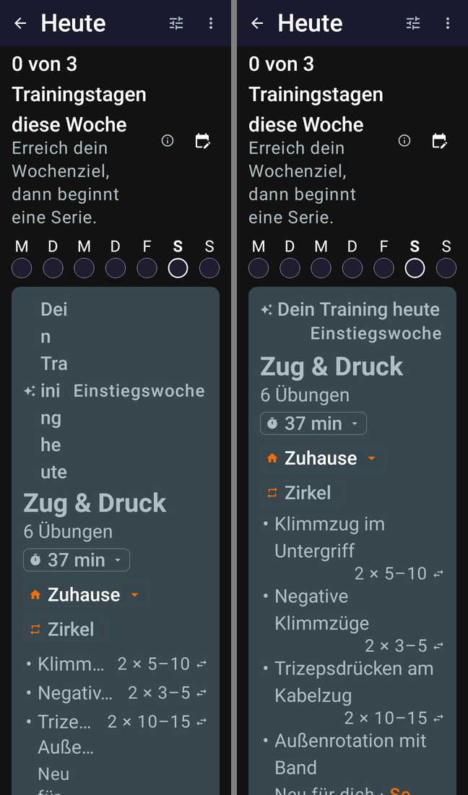

**Nutrition: rings and water**
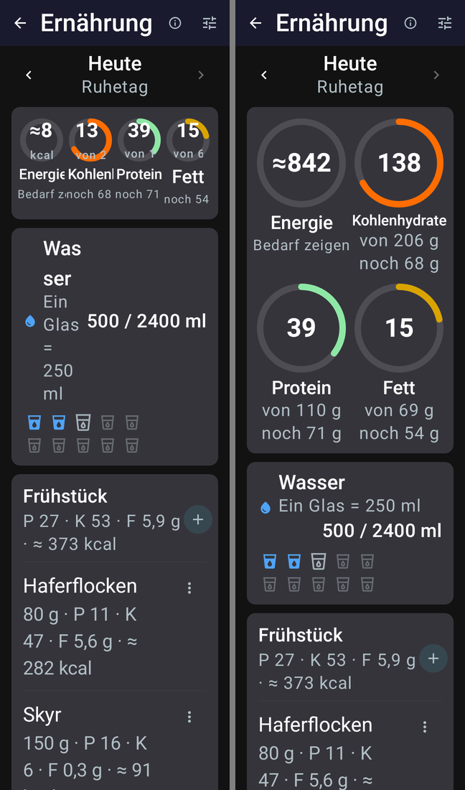

**Coach setup: sliders, title and buttons**
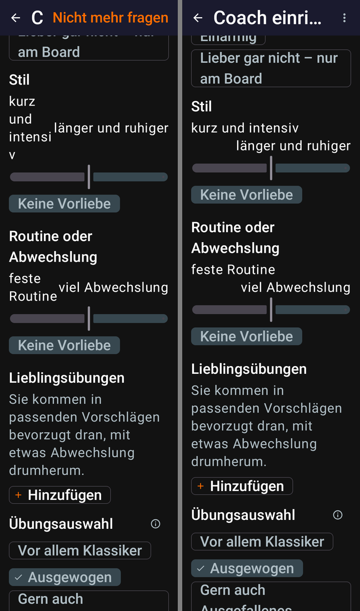

**Player: the active set**
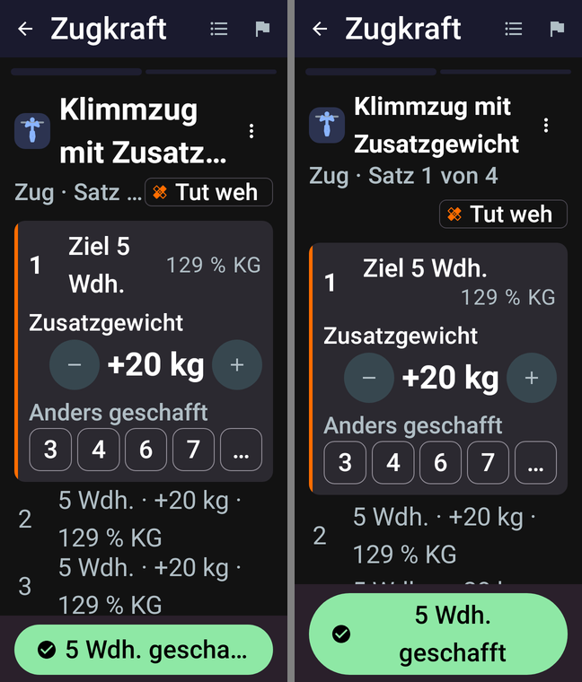

**Training: week plan and workouts**
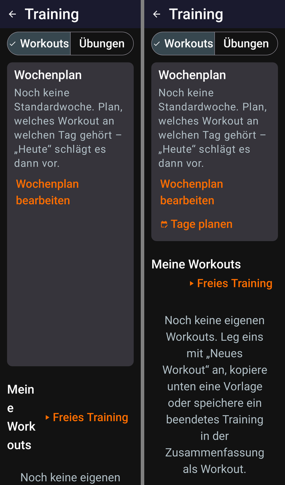

**Exercise catalog**
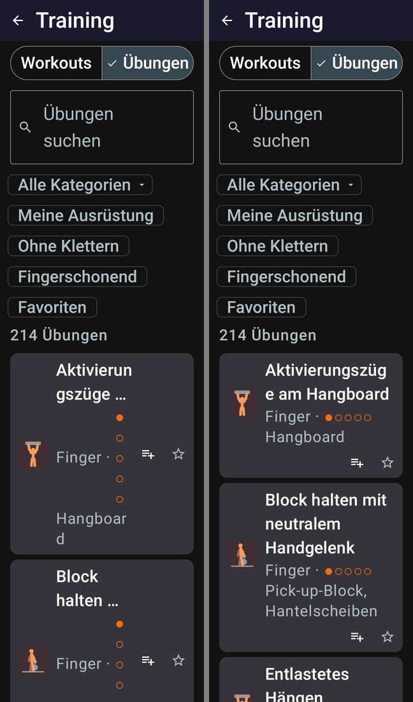

**Progress**
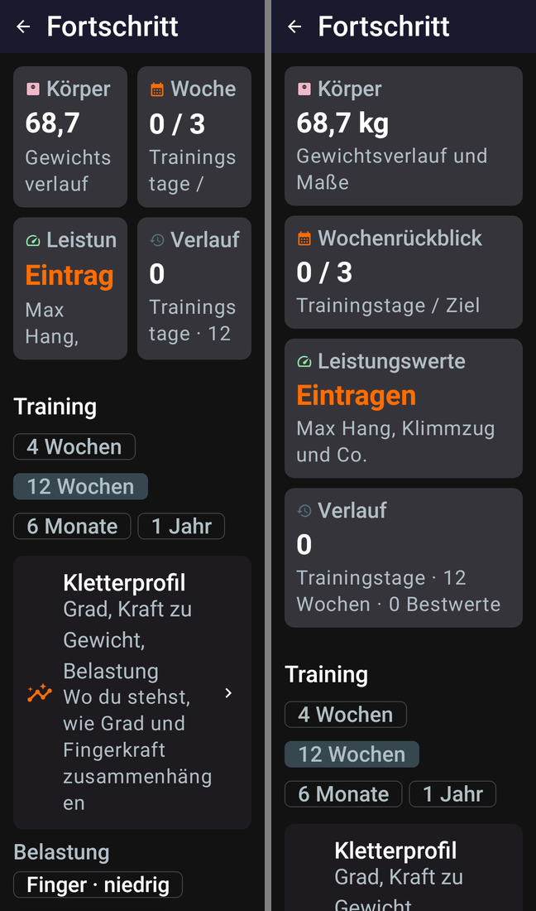

**Day planner**
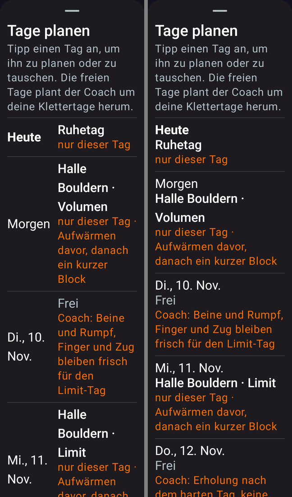

The same Today card at the normal size (variant A) stays as it was. A long name gets its own line, with the sets under it:
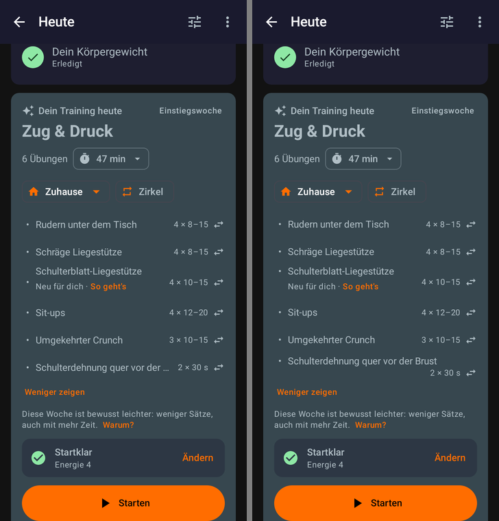

## On the phone
Test build 2 of #93 (commit `ec92dd5`, signed by APKTrack), installed as a new user on a phone without Google services. The check ran at the system font size 2.0 (about 411 dp wide):
- **Today:** the header stacks, the sets go under long names, and the bottom bar shows icons only. Screen readers still hear the tab names.
- **Player:** "Aufwärmen · 2 von 4" stays on one line with "Tut weh" under it, and the rest bar shows ±15 s above "Weiter".
- **Nutrition:** the rings go two per row with the target under the label.
- **Coach setup:** "Nicht mehr fragen" sits in the ⋮ menu.

At font size 1.0 the Today card looks as before. The font size on the phone was set back to 1.0 afterwards.

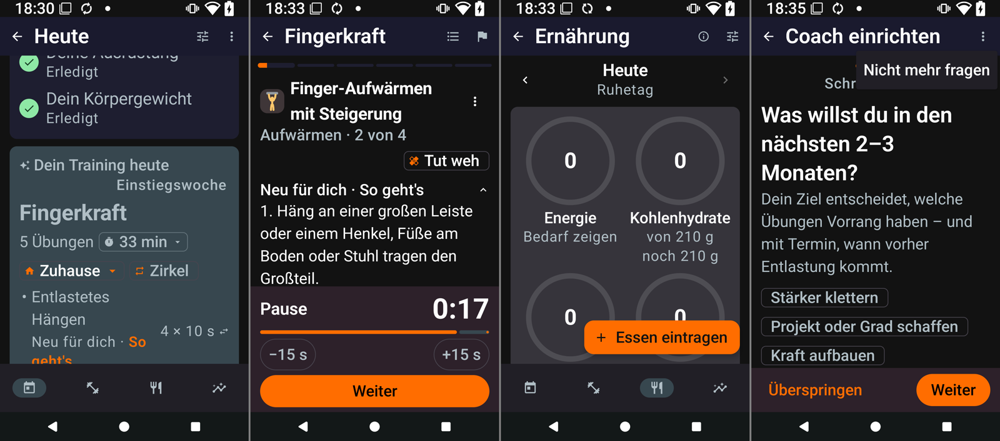

## After the review
The maintainer reviewed commit `ec92dd5`. The fixes are in two commits on top of it, `ec9b990` and `0a15c4c`:
- **Right to left:** the shared row places its parts with `placeRelative`, so it mirrors in right-to-left languages, as the old rows did.
- **Colours:** the four colour changes are taken out and left to the contrast pull request [#92](https://github.com/CruxCoach/CruxCoach/pull/92), whose contrast test covers them. They were the selected tab label, the Workouts|Exercises switch, the dimmed weight placeholder and the check-in chip outline.
- **Normal font size:** below font size 1.3 a text wraps beside its button as in the old rows. The button only moves below when a word would break. The limit on how tall a text may grow beside its button now applies from 1.3.
- **Icons:** an explicit `keepBeside` keeps an ⓘ beside its title. It replaces the rule "56 dp or less is an icon", so a short value like "109 % KG" no longer counts as an icon.
- **Edge cases:**
  - no negative width beside a button that is wider than the row
  - nutrition rings without a target keep "g" or "kcal" inside at a large font
- **Test:** `LabelBesideOrAboveTest` runs in CI, unlike the renders. It checks:
  - beside or below at 320 dp, at font size 2.0 and 1.0
  - a row whose accent bar takes its height from the layout
  - `keepBeside`
  - a short value that is not an icon
  - a button wider than the row
  - right to left

  With the old behaviour put back, 4 of its checks fail.

A fresh reviewer then read the review commit and found two more points, both fixed in `0a15c4c`. The block title in the "Why?" sheet keeps its ⓘ beside it, and the player's moved-set arrow stays beside the target when there is no "% KG".

The German comeback notice at 411 dp and font size 1.0, before and after. "Warnzeichen" is beside the notice again:
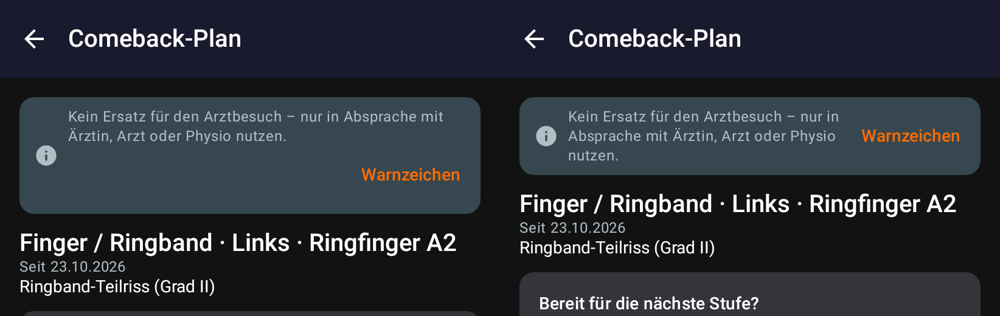

**On the phone:** test build 3 (commit `0a15c4c`, signed by APKTrack), installed over build 2, on a phone without Google services.
- **Font size 1.0, 411 dp:**
  - Today's setup card keeps "2 von 3" beside its title.
  - In the player, the target and "100 % KG" sit on one line, and the steppers and "Tut weh" stay beside their labels.
- **Font size 1.0, 360 dp** (display size set for the shot, then reset): "Starten" stays beside the measuring-round card.
- **Font size 2.0:**
  - "Zusatzgewicht" goes above its stepper, while "Sek." stays beside its own.
  - The energy ring without a target shows "0 kcal" inside.
  - On Body, the ⓘ stays beside "Körpergewicht".
- **Right to left,** forced in the system settings, then switched back: Today's setup card and the player's header and steppers are mirrored. German text in a forced right-to-left layout shows its usual punctuation artefacts ("von 3 2"); real right-to-left languages are not affected.

| Rings at font size 2.0 | Measuring round at 360 dp | Right to left |
|---|---|---|
| 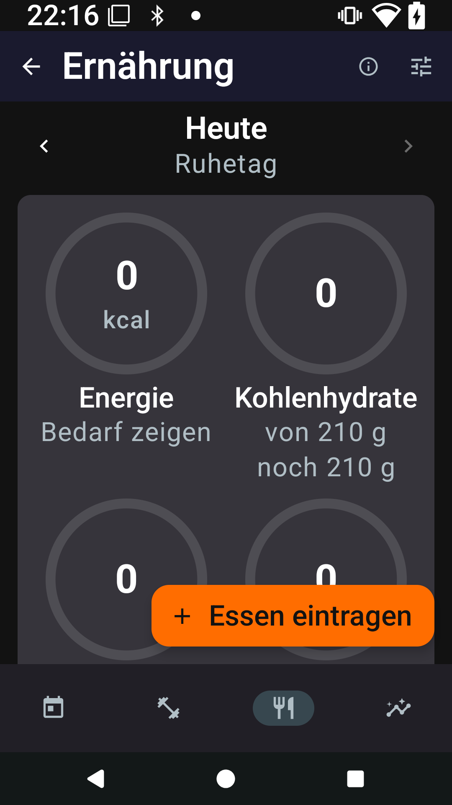 | 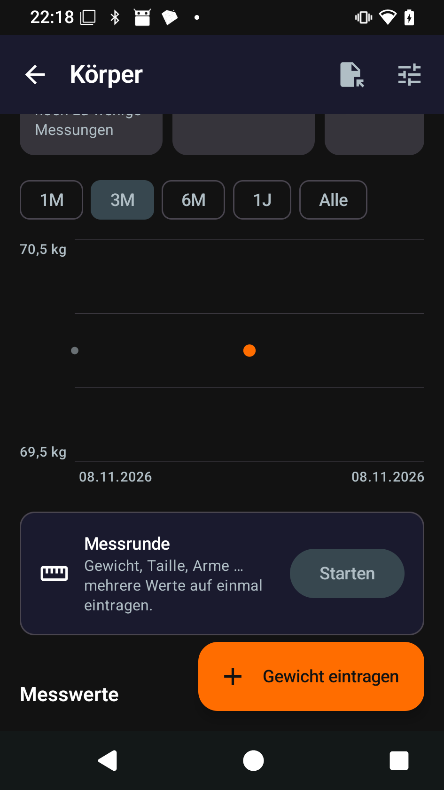 | 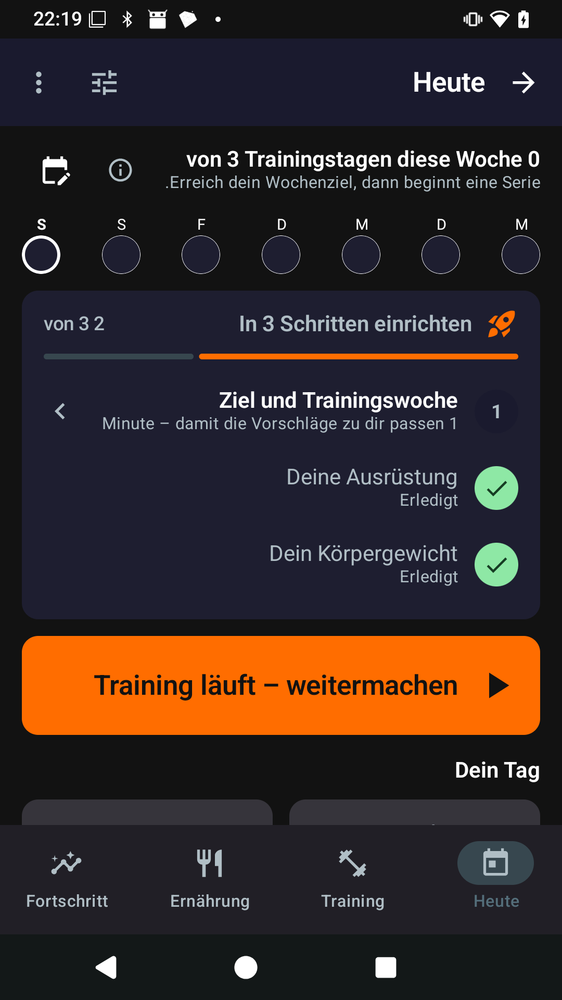 |

## Left open
- **Numbers and units can split at a line end** ("16 / kg"). A non-breaking space in the shared format strings would fix this. It touches the text export and many tests, so it is left out of this pass.
- **Chips and controls:**
  - chips whose label wraps to two lines
  - the different selected-chip styles
  - the 0–10 scale leaving "10" alone on a line
- **Content and wording:**
  - the text length on the comeback, goal, energy and weekly review screens, which carry medical and legal wording
  - the pain slider on the injury card runs 0–9, while the comeback diary uses 0–10
- **Seen in the review round, not changed (as in 0.2.4):**
  - At 360 dp and font size 1.0, the "Messungen" tile on Body breaks as "Messung/en"; the three tiles share the row as before.
  - The player's exercise name is one line with "…". A name that is a single very long word still counts as a word that would break, so "% KG" moves below it.
- **Behaviour:**
  - two "done" actions while a finished set is open in the player
  - the day planner's chooser dialog keeps its confirm button in the scrolling list
- **Test harness limits:**
  - The renders do not hyphenate. On the phone, long German words like "Bankdrücken" may hyphenate, and the phone check will show it.
  - Some dialogs are not font-scaled.
  - Decimal commas and German day names in the English renders come from the test machine's locale.
