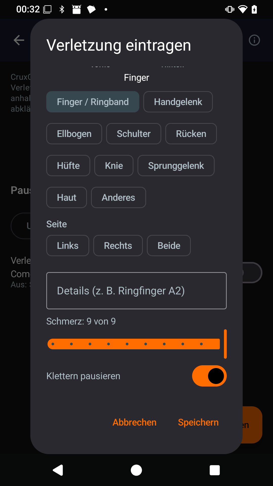
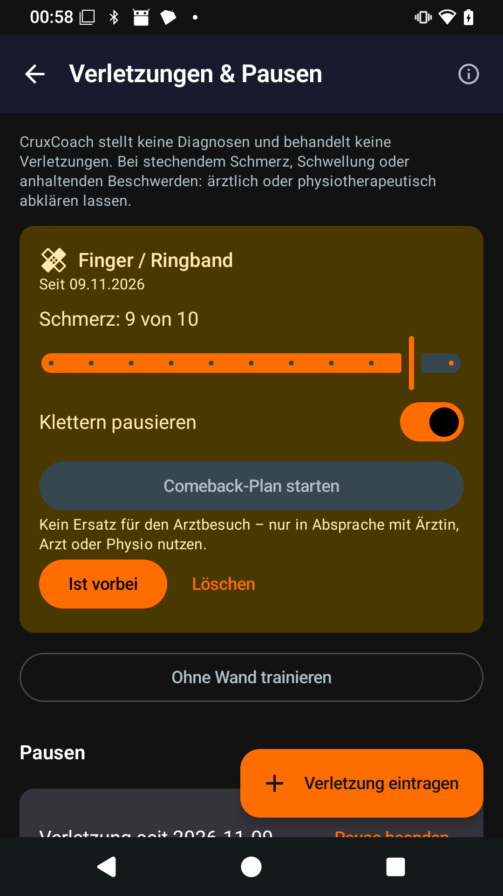
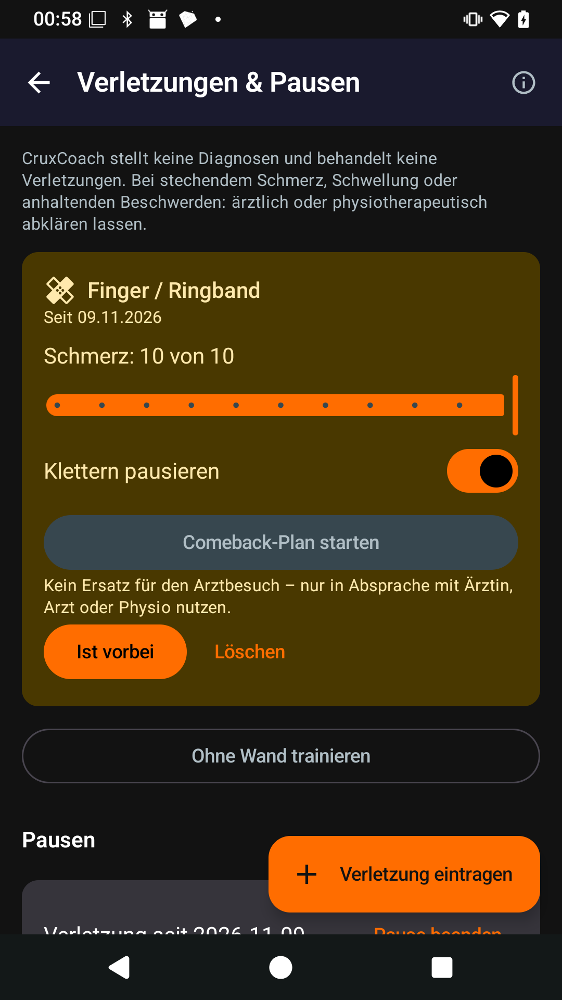
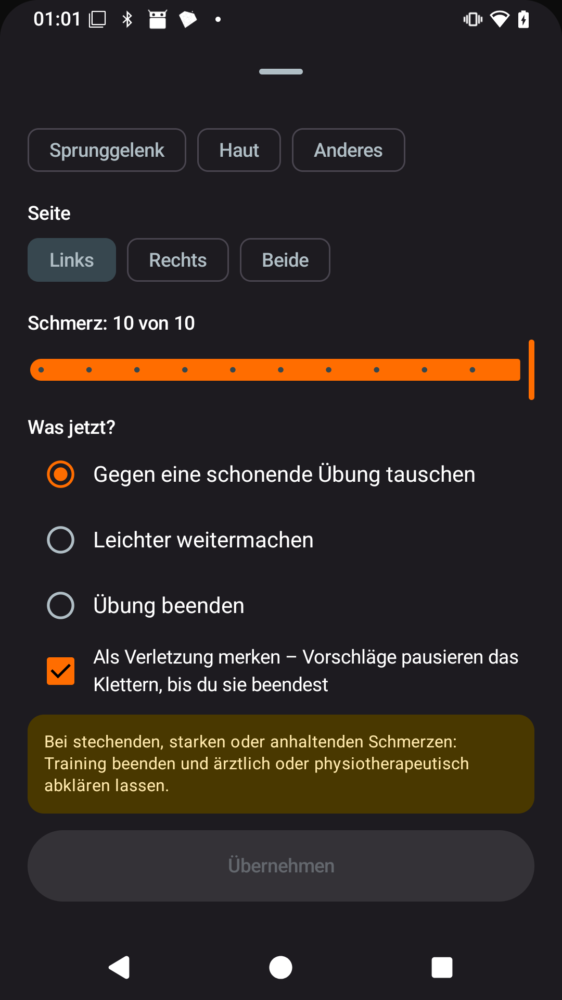

# Pain scale 0–10: upgrade test on the phone

Pull request: [CruxCoach/CruxCoach#94](https://github.com/CruxCoach/CruxCoach/pull/94) (into `feat/0.2.5-release`).

The injury card, the add-injury dialog and the player's pain sheet went up to 9; the comeback diary goes to 10. They all use 0–10 now. Values saved on the old scale stay as they are.

## How it was checked
Both test builds are APKTrack-signed and were installed on a phone without Google services. Both builds have the same package, so the second one installs as an update over the first, with its data kept.
1. **Build 1 of the PR (version code 1, commit `0a15c4c`)** has the old scale. I set up a new user without a board catalogue and entered an injury "Finger / Ringband" at pain 9, the old top ("Schmerz: 9 von 9").
2. **Build 2 (version code 2, commit `ab4b183`)** has the change and was installed over build 1. Results:
   - The injury shows "Schmerz: 9 von 10". The stored 9 is kept, not rescaled.
   - The slider has one step left. Raised to 10, it shows "10 von 10", and the value is still 10 after the screen is reopened.
   - The player's pain sheet ("Tut weh" in a free training) reaches "10 von 10". The sheet was not saved.

| Build 1, old scale | Build 2 over it | Raised to 10 | Player's pain sheet |
|---|---|---|---|
|  |  |  |  |

## Tests
- Backups with pain 9 or 10 pass the backup check; 11 and −1 are refused.
- An injury saved at 9 shows "9 of 10", stays 9, and its slider reaches 10.
- The player's pain sheet reaches 10, and pain 10 from the player is stored as 10.
