# Training simulation: tracing the open flags (#59)

Follow-up from [#59](https://github.com/CruxCoach/CruxCoach/issues/59): the full simulation run of 6 November left
flags on the weekly volume of an area and on the app's value of an exercise. Each flag was traced against the
app, decided as an app or a check problem, and fixed there. The same night added comeback athletes who don't
follow the plan to the letter, the comeback plans of the other regions and findings, and an athlete who changes
the card. After the maintainer's review, the comeback plan's weekly look back follows the maintainer's three
rules (see [the look back](#the-weekly-look-back-the-maintainers-three-rules)).

Pull request: [#98](https://github.com/CruxCoach/CruxCoach/pull/98) · branch `fix/0.2.5-training-sim-flags` ·
base `feat/0.2.5-release` @ 277534f3e.
Rebased onto the release branch as fbf239b79 (9 November, afternoon); the commits named below are from before
that rebase and carry the same changes.

## Numbers

Flags of the full run (29 personas). "Release" runs today's simulation, the new personas included, with the
release branch's weekly plan; "Weekly-plan fix" adds the fixes below; "Night" adds the review points, the
one-sided exercises and the refined checks (17af6d581); "Rules" adds the maintainer's review fixes and look-back
rules (939c0ba56).

| Group | Check | Release | Weekly-plan fix | Night | Rules |
|---|---|---:|---:|---:|---:|
| Safety | Max finger work while a rule forbids it | 8 | 8 | 0 | 0 |
| Safety | Exercise that loads an open injury | 187 | 198 | 0 | 0 |
| Safety | Next comeback stage offered while it still hurt | 2 | 2 | 2 | 0 |
| Safety | Painful comeback sessions without a step back, a repeat or a question | 1 | 1 | 0 | 0 |
| Load | The app's value far from what the athlete can do | 12 | 11 | 11 | 12 |
| Progress | An exercise stalled for weeks | 10 | 8 | 8 | 6 |
| Progress | No lighter week in a block | 0 | 1 | 1 | 1 |
| Progress | Comeback plan stuck on a stage although it stayed calm | 3 | 3 | 3 | 0 |
| Progress | Next comeback stage after a week with few sessions | 4 | 4 | 2 | 0 |
| Plan | Weekly volume of an area far from its target | 44 | 16 | 16 | 15 |
| Choice | More new exercises in a training than allowed | 3 | 2 | 2 | 5 |

The safety flags "exercise that loads an open injury" and "max finger work" were almost all one-sided work with
the healthy side, which the app plans on purpose; the check now tells it apart from work that loads the injured
side (see below). The "Choice" flags in the last column are trainings with two new exercises where one is
allowed, mostly on the day an injury frees an area again (shoulder, knee, back); they moved with the comeback
plans' new timing and are the same kind as before. The sections below describe the night's run at 17af6d581;
[the look back](#the-weekly-look-back-the-maintainers-three-rules) has the run with the rules.

## Weekly volume

### A. Finger goal without finger equipment (app)

**Seen:** `beginner-home-lb` and `new-no-setup` ended every week with finger 0.5 of 2 sessions. Neither has a
hangboard, a pick-up block or a board. Their finger work is the one bouldering day a week, and a volume day
counts half a session.

**Cause:** the finger goal was a fixed two sessions a week. The coach never adds finger work to reach it (that
stays with the recovery rules), so without equipment no training could ever reach the goal.

**Fix:** without finger equipment at any of the athlete's places, the finger goal is at most the climbing days
of the usual week (the standard week's climbing and board days, else the coach setup's), and at least one.

**Left:** with only volume climbing the goal of one session can still stay at 0.5 (a volume day counts half).
The card is not affected (the weekly plan never picks finger work for the week's goal); the progress view shows
"0.5 of 1".

### B. Pull over its maximum because of climbing later in the week (app)

**Seen:** `youth-15`, `masters-55`, `beginner-home-lb` and `new-no-setup` went over 1.25 × the pull maximum.
Example: `youth-15` boulders on Monday, Wednesday and Friday and trains on Tuesday. On Tuesday the week had room
for 7 pull sets, and the training used 6 of them. Wednesday's and Friday's bouldering then added 2 set
equivalents each: 12 against a maximum of 9.

**Cause:** the weekly cap counted only the climbing already logged.

**Fix:** the climbing still planned this week keeps its share of the room. The intensity comes from the day's
plan, else from what the athlete logged on that weekday last time, else volume. Climbing that an injury pauses
keeps no room, and a comeback stage holds it to its own level. When only that share cuts a training, the card
says so: "The climbing you still plan this week adds pulling and core work, so today plans fewer of these
sets." The first main exercise of a training still keeps two sets, but only while its area has room at all.

### C. A block phase that changes mid-week (check)

**Seen:** weeks in which a deload was brought forward or the taper began on a weekday were judged against
Sunday's lower targets.

**Fix (check):** such weeks have no single target, so the weekly-volume check skips them.

### D. Legs at 0 while the day turned into mobility (app)

**Seen:** `youth-15` and `masters-55` had legs at 0 in some weeks while Today suggested an easy mobility
session on a training day.

**Cause:** pull and core were full from climbing. The pull-and-push training lost most of its sets to the cap,
and with fewer than 6 work sets left the day became mobility, although legs were still at 0.

**Fix:** before the mobility session the coach tries the other kind of training (legs and core instead of pull
and push, or the other way round) when an area of that kind is still below its goal and has room beyond what the
planned climbing needs. That training may be shorter (4 work sets). Pull and push are never chosen the day
before a limit day. When neither kind fits, mobility stays.

### E. Push under half its goal (app)

**Seen:** `always-easy` and `gym-no-board` ended many weeks with push under half its goal.

**Cause:** the targets scale with the training days a week, climbing days included (five days: × 1.3). Push
and legs are trained only off the wall, so five days with two of them climbing asked for five days of pressing.

**Fix:** push and legs count the training days without climbing (at least one). Pull and core keep all days,
because climbing counts for them.

### Still flagged

- Legs at 0 against a goal of 1–2 sets in some weeks (`youth-15`, `masters-55`, `gym-no-board`,
  `advanced-taper`, 12 flags). The goal is so small that the weekly plan's most-needed area is always another
  one; not traced further.
- `new-no-setup` pull 9 against a maximum of 7 in week 5, and `picky` legs 9 against 6 in week 1 (the athlete's
  own swaps).
- `youth-15` week 10: the deload's trainings had 12.3 work sets on average against 13.9 in the build weeks; the
  check asks for a clearer drop. Not traced.

## Values far from the truth (convergence)

The remaining flags are slow climbs from a careful start: the first plan of a new exercise starts low, and a
session where every set was "3+" in reserve raises the load by two steps (one below 10 kg). Examples:
`gym-no-board` goblet squat 51 kg against a true 69 kg after 6 sessions, `always-easy` overhead press 46 kg
against 61 kg after 4 sessions. Light antagonist work (wrist curls) moves in 1 kg steps per dumbbell. This is
the known cost of the careful start; the "5+" answer the maintainer mentioned for later would close it faster.

## Comeback athletes who don't follow the plan

(Run at 17af6d581, before the look-back rules.)

| Persona | What the athlete does | Stage reached | Plan ended in week | Step backs | Repeats | Highest session pain |
|---|---|---|---|---:|---:|---:|
| `pulley-comeback` | follows the plan | 5 | 8 | 0 | 0 | 3 |
| `comeback-skipper` | skips about half of the sessions, keeps the stage when asked to step back | 5 | 10 | 0 | 2 | 3 |
| `comeback-eager` | climbs one level harder than the stage on half of the climbing days | 5 | 12 | 1 | 2 | 3 |
| `comeback-late` | starts the plan two weeks late, at stage 2 | 5 | 10 | 0 | 2 | 5 |

All four reach the last stage. The eager climber is stepped back once and takes four weeks longer. Two flags
stay: `comeback-skipper` and `comeback-late` were offered the next stage after a week with comeback sessions on
only two days (open question 3). Before the plan starts, `comeback-late` gets one-arm pick-ups for the healthy
hand, which the app plans on purpose.

## Comeback plans of the other regions and findings

(Run at 17af6d581, before the look-back rules.)

Nine athletes from `pulley-comeback` with another injury, each checked by a doctor and following the app's plan
for it: a pulley rupture and a tenosynovitis (findings with their own pain rule), and one injury each of the
shoulder, the inside of the elbow, the wrist, the knee, the ankle, the hamstring and the low back. The injured
tissue heals over a time that fits the finding or region. Region plans have no reference values, so the athlete
works at the effort each item asks for.

| Persona | Stage reached in 14 weeks | Plan ended in week | Step backs | Repeats | Highest session pain |
|---|---|---|---:|---:|---:|
| `comeback-rupture` | 3 | – | 1 | 7 | 3 |
| `comeback-tenosynovitis` | 5 | 11 | 0 | 3 | 2 |
| `comeback-shoulder` | 5 | – | 3 | 2 | 10 |
| `comeback-elbow` | 3 | – | 3 | 4 | 10 |
| `comeback-wrist` | 0 | – | 3 | 7 | 9 |
| `comeback-knee` | 3 | – | 3 | 4 | 8 |
| `comeback-ankle` | 5 | – | 1 | 5 | 5 |
| `comeback-hamstring` | 5 | – | 0 | 7 | 4 |
| `comeback-back` | 5 | 14 | 3 | 2 | 8 |

In the region plans the first strength stage often hurt in the simulation, and the plan stepped back each time,
as it should. How hard the first holds feel this early depends on the simulation's rough model of the injured
tissue, so the high pains say more about that model than about the plan.

Two things the plans did that look wrong:

- **Stuck on the first stage (`comeback-wrist`, weeks 10–14):** the tissue was healed in the simulation, the
  sessions hurt 0–2, the mornings were 0 or 1. The weekly look back still proposed repeating the stage every
  week: a morning that is 1 higher than the days before counts as an amber day, and two of them in a week mean
  "repeat". At 0 and 1 that happens by chance (open question 1).
- **A painful first week at stage 0 said "not enough entries"** (`comeback-rupture`, fixed): there is no stage
  below the first, so the look back proposed "stay", and the card for "stay" said "Not enough entries this week
  to say more" although every day was logged. It now proposes repeating the week, and the card names the painful
  day as it does at the later stages.

`comeback-knee` and `comeback-skipper` were offered stage 1 after a week whose mornings stayed at 3 for several
days (5/3/3/3/2 and 5/3/3/3/3/1/2; the 5 was the day before the look back's week) (open question 2).

### Found: one-sided exercises that load both sides (app)

**Seen:** around an injury of one arm or leg, Today offered one-sided exercises "for the healthy side only".
Most are right that way (a one-arm lat pulldown, a single-leg deadlift). Some still load the injured side: the
straight arm of an archer push-up or pull-up, the assisting arm of an assisted one-arm pull-up or hang, both
knees in a child's pose or a kneeling lunge stretch, both legs in a lunge or split squat.

**Fix:** the exercise catalogue names the regions such an exercise loads on both sides (`bothSides`, 20
exercises). Around an injury of one limb that rules the exercise out (pain 4 or more, or a comeback stage before
its open stage) it is left out instead of planned for the healthy side. A mild injury keeps the healthy side
doing the hard part, as before. Only the region that is loaded on both sides counts: the child's pose is left
out for an injured knee, but stays for the healthy shoulder.

**Check:** the safety check now accepts one-sided work the athlete did with the healthy side only, when the
exercise doesn't load the injured region on the other side as well. The same holds for one-handed finger work
with the healthy hand during a finger injury of one hand, which the app plans on purpose (the comeback plan
trains the healthy hand too).

## The weekly look back: the maintainer's three rules

The maintainer answered the three open questions of the night. Pull request
[#98](https://github.com/CruxCoach/CruxCoach/pull/98) now has:

1. **A rise of 1 in morning pain that stays within the stage's pain rule is no amber day.** A rise of 2, a rise
   into the amber range, or a morning at 5 or more still is.
2. **The stage holds while the week's middle morning pain is above the stage's rule.** With an even number of
   logged mornings the higher of the two middle values counts, so the stage holds when at least half of the
   mornings were above the rule. The card says why: "On at least half of the mornings you logged this week, the
   pain was above your rule of 2. The usual approach is to stay at this stage until it is back at 2 or less in
   the morning."
3. **The next stage only after the stage's sessions on at least min(3, the stage's planned session days)
   days.** A stage with two strength sessions a week moves on after two. This has its own text too: "The next
   stage builds on this stage's sessions on at least 3 days a week; this week it was 2. The usual approach is to
   stay at this stage for another week."

The rule is the one the plan applies, so a finding that changes it counts (a tenosynovitis allows 3, a pulley
rupture asks for 1 in its first two stages).

### Found on the way: the look back's week (app)

**Seen:** with the rules in place, `comeback-late` moved up to its next stage although the stage's first
session had hurt at 5 (the stage's amber limit is 3). And 18 look backs that said "stay" had found the stage's
sessions on two of the days they read, while the seven days before the look back had three.

**Cause:** the look back read today and the six days before. It usually comes in the morning, before the
day's sessions, so it never saw the stage's first day and saw only six days of sessions.

**Fix:** the look back's week is the seven days before today, never before the stage began. Today counts where it
warns (a morning at 5 or a jump of 2, an amber or red session) and with sessions already done, and the middle
morning comes from the seven mornings after the week's days, today's included. A first version read the seven
days and today as one window of eight days; on the phone the card then said "this week 8 of 8 logged days".
Tests cover a painful first day of a stage, three sessions a week, a painful day before the stage, a bad
morning today, and the card's "7 of 7".

### How often the first stage repeats now

Look-back proposals to repeat stage 0, per comeback athlete, before the rules (17af6d581) and now (939c0ba56):

| Persona | Stage 0 repeated (before → now) | Highest stage | Plan ended in week |
|---|---|---|---|
| `comeback-ankle` | 2 → 1 | 5 → 5 | – → 11 |
| `comeback-back` | 0 → 1 | 5 → 5 | 14 → 13 |
| `comeback-eager` | 0 → 0 | 5 → 5 | 12 → 10 |
| `comeback-elbow` | 2 → 2 | 3 → 3 | – → – |
| `comeback-hamstring` | 2 → 1 | 5 → 5 | – → 11 |
| `comeback-knee` | 4 → 1 | 3 → 5 | – → 14 |
| `comeback-late` | 0 → 0 | 5 → 5 | 10 → 9 |
| `comeback-rupture` | 4 → 4 | 3 → 5 | – → – |
| `comeback-shoulder` | 2 → 1 | 5 → 5 | – → – |
| `comeback-skipper` | 0 → 1 | 5 → 5 | 10 → 9 |
| `comeback-tenosynovitis` | 0 → 0 | 5 → 5 | 11 → 8 |
| `comeback-wrist` | 7 → 1 | 1 → 5 | – → 12 |
| `pulley-comeback` | 0 → 0 | 5 → 5 | 8 → 9 |
| **All** | 23 → 13 | | 6 → 10 plans ended |

The healed wrist that repeated its first stage for five weeks now repeats it once (after a week in which one
morning jumped from 0 to 2, which stays a warning) and finishes the plan in week 12. The pulley rupture still repeats stage 0 four times: its rule of 1 makes
sessions at 2 amber days, so the plan stays stricter after a rupture. Ten of the thirteen comeback
athletes now finish their plan within 14 weeks, against six before.

Why the look back said "stay" (all comeback athletes, whole run): the last stage went well and the plan ends
(10), the middle morning was above the rule (6), pressure pain was rising (2), too few session days (1). The
simulation's day report now names the reason.

### No move up with steady pain or too few session days

Every proposal of the next stage was checked against the week behind it:

- **Steady morning pain:** a move up after a week whose middle morning was above the stage's rule: **none**
  (a new check). A move up after a week with a session above the amber limit or a morning at 5 or more:
  **none** (was 2).
- **Too few session days:** a move up after a week with the stage's sessions on fewer than min(3, planned) days:
  **none** (was 2).
- **Stuck although calm:** a stage held for three weeks or more while the last two stayed within its rule:
  **none** (was 3).

### On the phone

Test build 7 (c4788cf37), with a backup of five comeback plans imported through Settings → Sichern & übertragen →
Daten importieren: each stage began 8 days ago, with a diary for the week.

| Plan | Diary | Look back |
|---|---|---|
| Wrist, stage 0 | mornings moving between 0 and 1, sessions daily | next stage offered (rule 1) |
| Knee, stage 0 | mornings steady at 3 | stays: mornings above the rule of 2 (rule 2) |
| Elbow, stage 0 | sessions on 2 days | stays: "at least 3 days a week; this week it was 2" (rule 3) |
| Shoulder, stage 4 | sessions on 2 days, the stage plans 2 strength days | next stage offered (rule 3) |
| Ankle, stage 0 | sessions 7, 5 and 3 days ago | next stage offered (the old window saw 2); "Steigern" moves it to stage 1 |

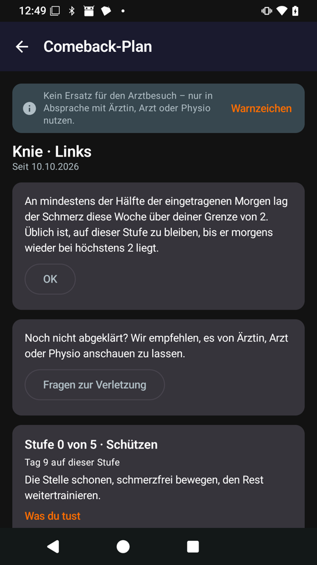 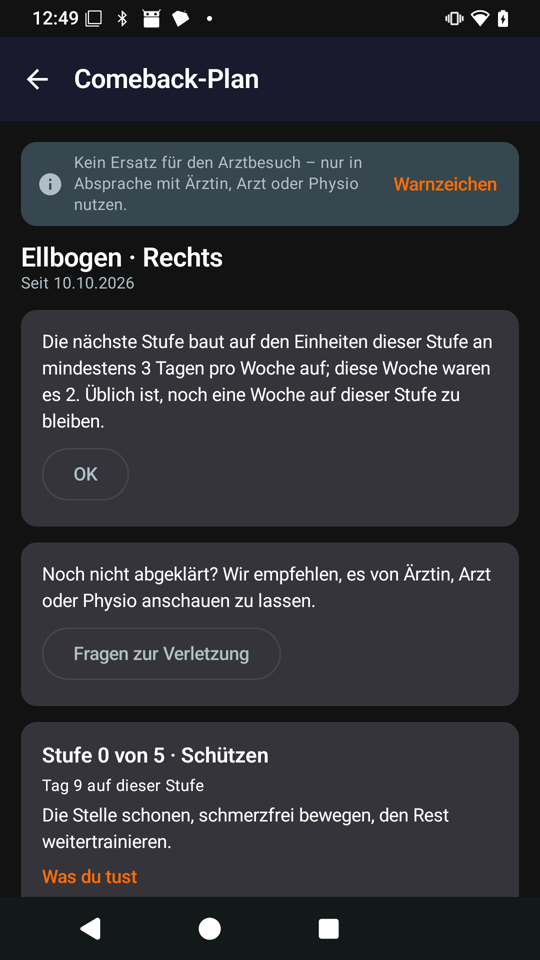 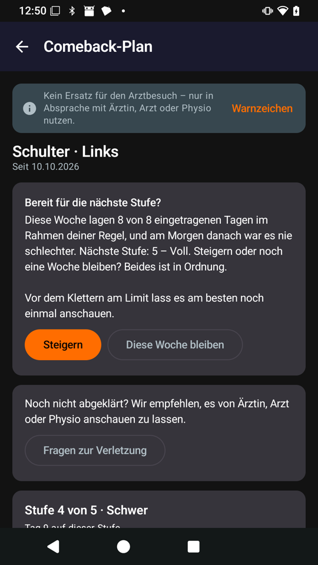

At font size 2.0 and 320 dp both new texts wrap cleanly, and "3 Tagen" and "von 2" stay together:

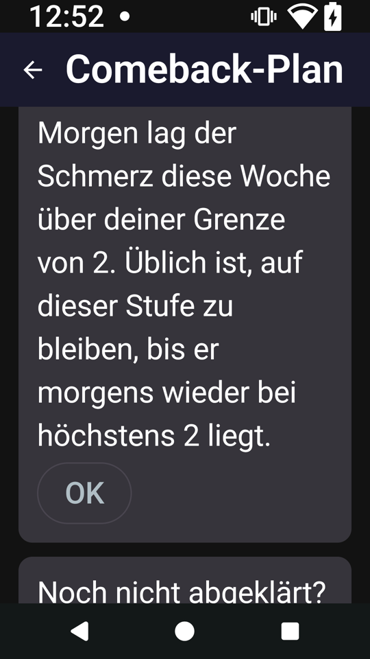 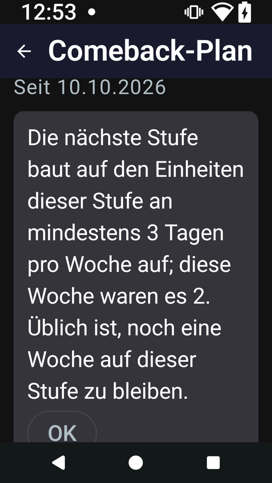

The phone also showed the eight-day window's "8 von 8 eingetragenen Tagen" on the card for the next stage (left).
Test build 8 (939c0ba56) has the seven-day week and says "7 von 7" (right); the knee and the elbow still stay, for
the same reasons.

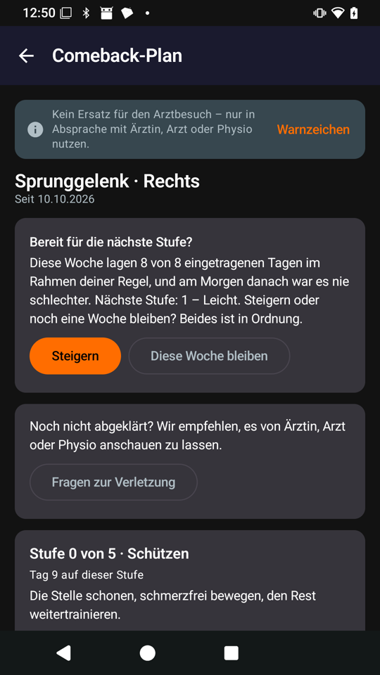 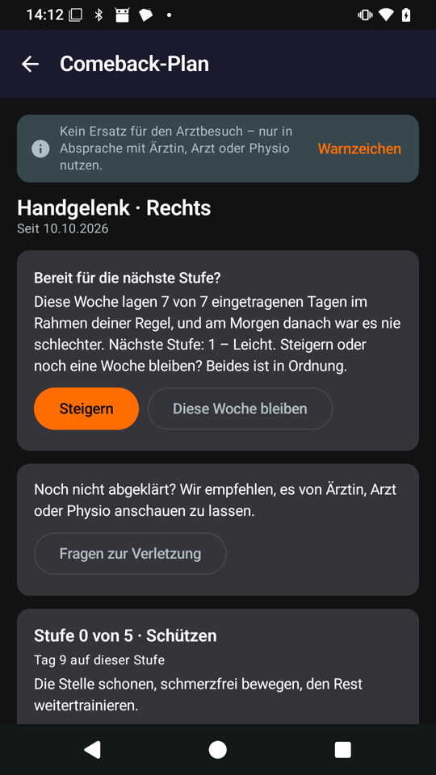

## Follow-up after the maintainer's review of #98 ([#114](https://github.com/CruxCoach/CruxCoach/pull/114))

1. **Only the stage's planned sessions count towards the next stage.** At finger stage 4 the tendon session is an
   optional warm-up; three days of only that warm-up met "three session days" and offered the next stage. Now only
   days with a session of a planned kind count, over the week's seven days (today's sessions never help a move up).
   Where the stage has optional sessions, the card says that they don't count.
2. **No next stage without a morning value** (the maintainer's rule). A week without one that is otherwise ready
   for the next stage asks for this morning's pain first; the answer becomes today's diary value and the look back
   decides as usual. "Skip" keeps the stage with a short hint, and the skip is remembered for that look back.

Simulation at 1aef00d4d: a new athlete `comeback-no-mornings` never logs the morning pain, skips the first question
and answers the later ones; it finishes its plan in week 9. A new safety check (a next stage offered without a
morning value in the week) finds nothing. All other flags and comeback numbers are as at #98's merge.

Phone, test builds 1 and 2 of #114, with four imported plans: the question (left), answered with 1 it offers the
next stage; skipped, the stage stays with the hint (middle); the warm-up-only week at finger stage 4 (right).

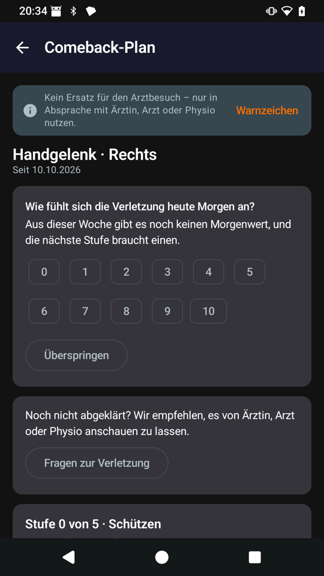 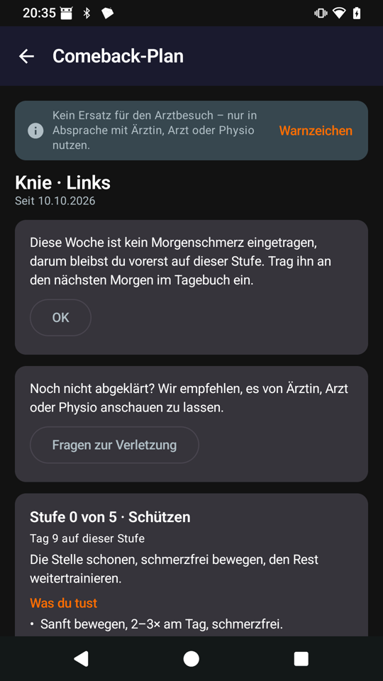 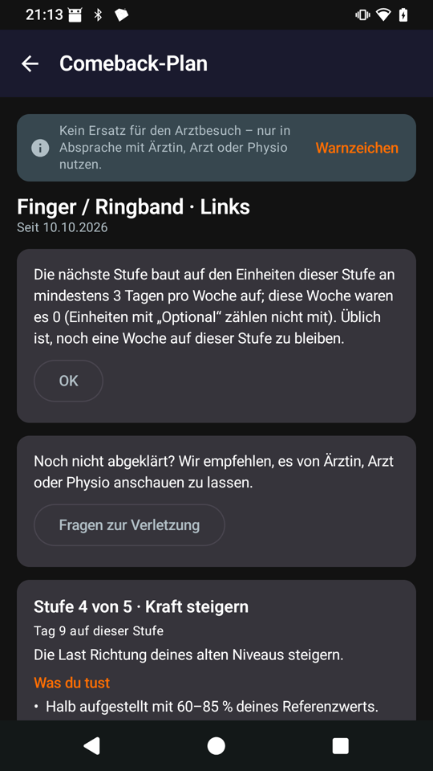

At font size 2.0 and 320 dp the question's chips wrap into rows and "Überspringen" fits:

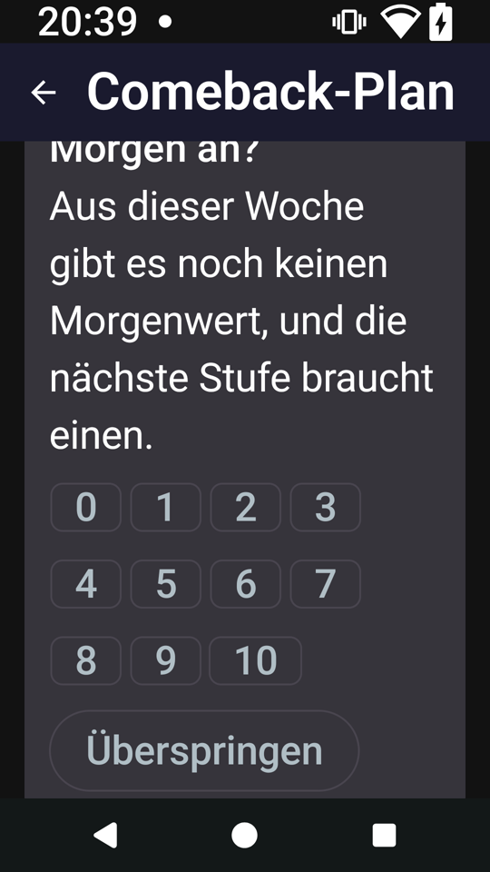

## Independent review

A fresh reviewer read the weekly-plan fix without the author's notes. Its findings and what happened:

1. The climbing reserve counted climbing that an injury pauses or a comeback stage holds back. **Fixed**, with a
   test for both.
2. The check for painful comeback sessions without a step back counted a move up just before the pain as the
   plan's answer. **Fixed**: only what came after the first painful session counts.
3. The finger goal used the equipment of the place picked today, so it changed with the place. **Fixed**: any of
   the athlete's places counts.
4. With only volume climbing the capped finger goal can stay out of reach. **Left** (see A).
5. The switch to the other kind ignored the climbing reserve, and a mobility session after a switch still named
   the area that called for it. **Fixed**.
6. The climbing reason won over "the week is full", and its text said "later" although today's climbing counts
   too. **Fixed**: the reason shows only when nothing was cut for a full week, and the text says "still plan
   this week".

## Questions of the night (answered)

1. **Morning pain that moves between 0 and 1** kept a plan repeating its stage (`comeback-wrist`). Answer: a rise
   of 1 within the stage's rule is not an amber day. Done, see [the look back](#the-weekly-look-back-the-maintainers-three-rules).
2. **Steady morning pain of 3** did not hold a stage back. Answer: hold the stage while the week's middle morning
   value is above the stage's rule, with its own reason. Done.
3. **Moving up after a week with few sessions.** Answer: the next stage only after sessions on at least
   min(3, the stage's planned sessions) days. Done.
