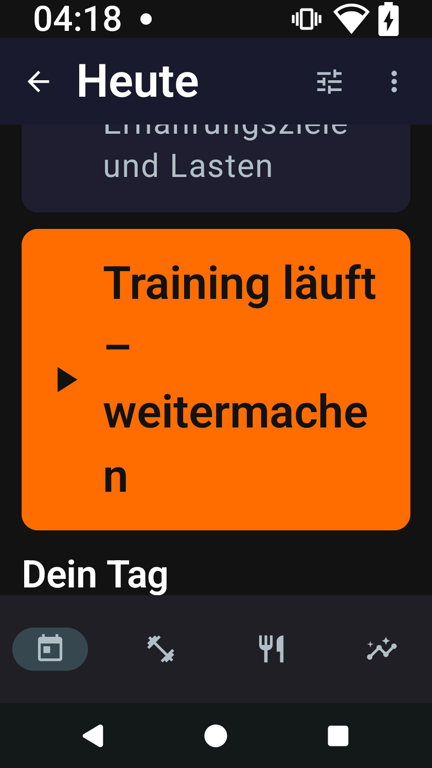
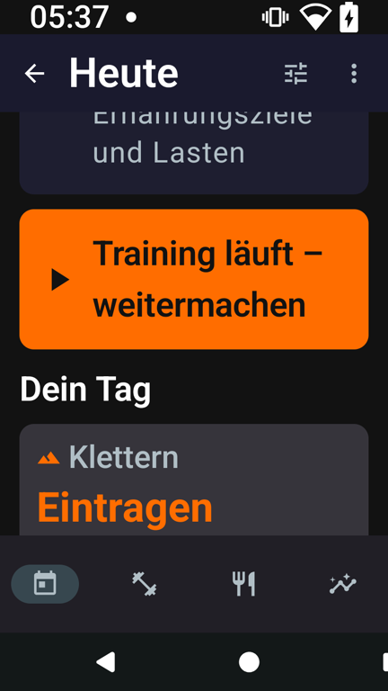
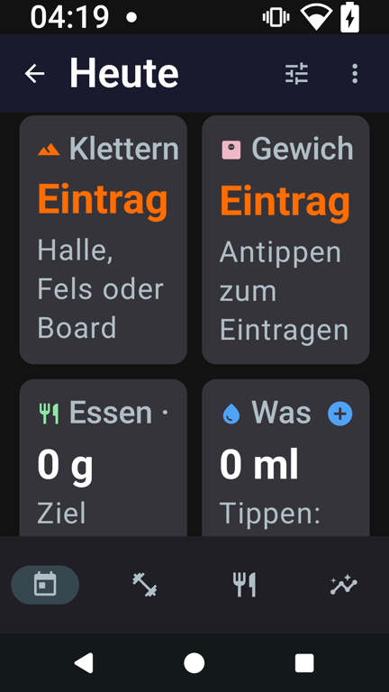
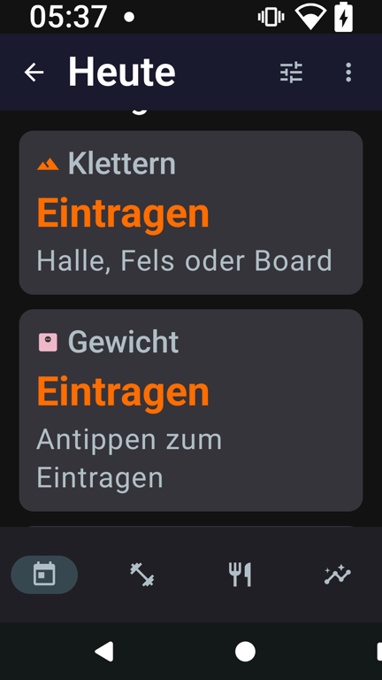
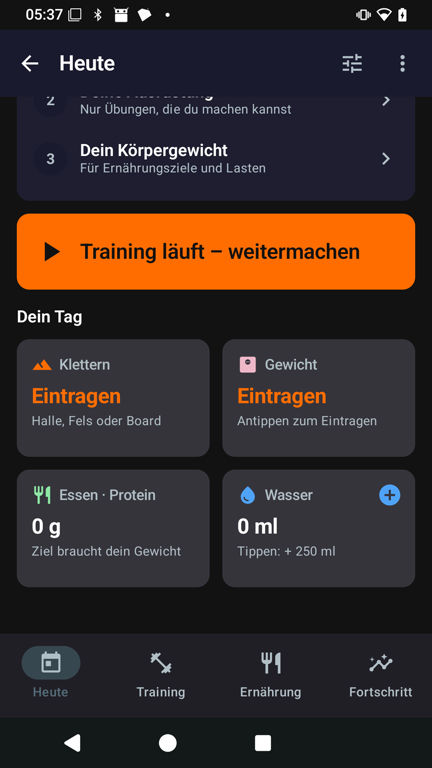

# Today at a large font (PR #102)

Two layout faults in Today, seen on the Nokia at 320 dp and font size 2.0 (German) while checking the test
builds of #98 and #99. Pull request: [#102](https://github.com/CruxCoach/CruxCoach/pull/102), test build 1
(6dfa9e450).

| | Before (release branch) | After (#102) |
|---|---|---|
| Running training |  |  |
| "Dein Tag" tiles |  |  |

- **Running training:** the card's title style broke "weitermachen" inside the word. From font size 1.3 it uses
  the smaller title style.
- **Day tiles:** two in a row cut their labels off ("Eintrag", "Gewich", "Was"). From font size 1.3 they go one
  under the other, like the stat tiles since the UI pass.

At the normal font size and width nothing changes:

Tests: `TodayLargeFontTest` checks the food and water tiles one under the other at font size 2.0 and side by
side at 1.0 (320 dp).
