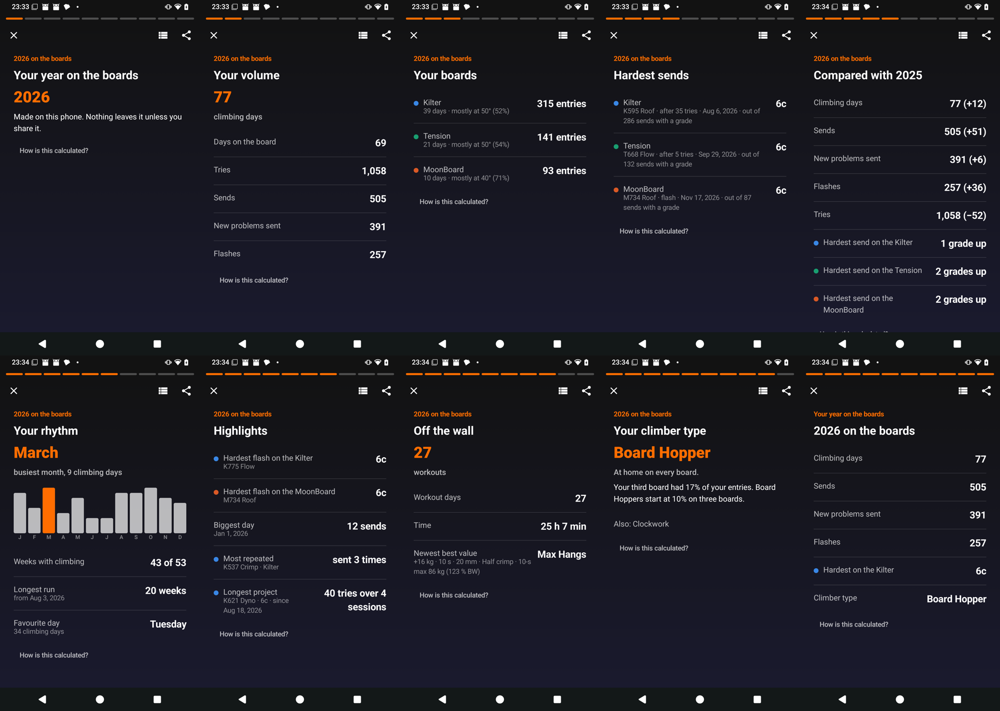
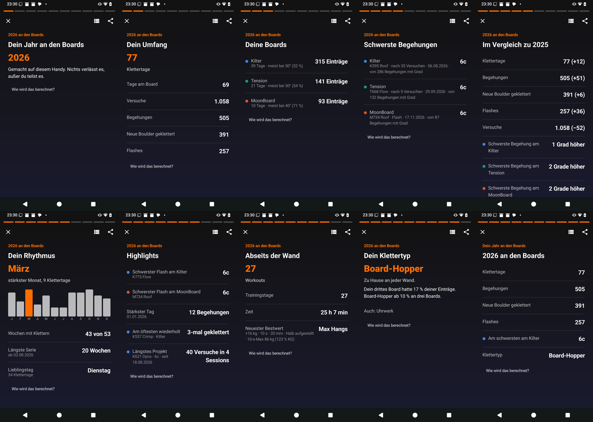
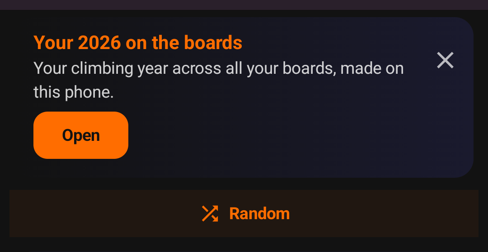
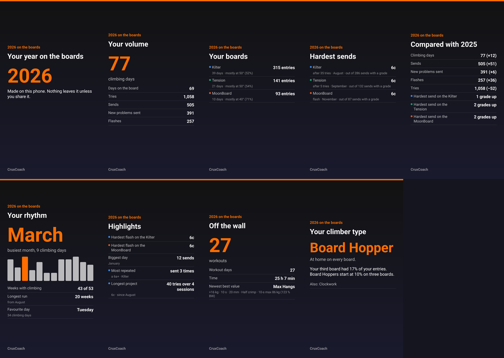
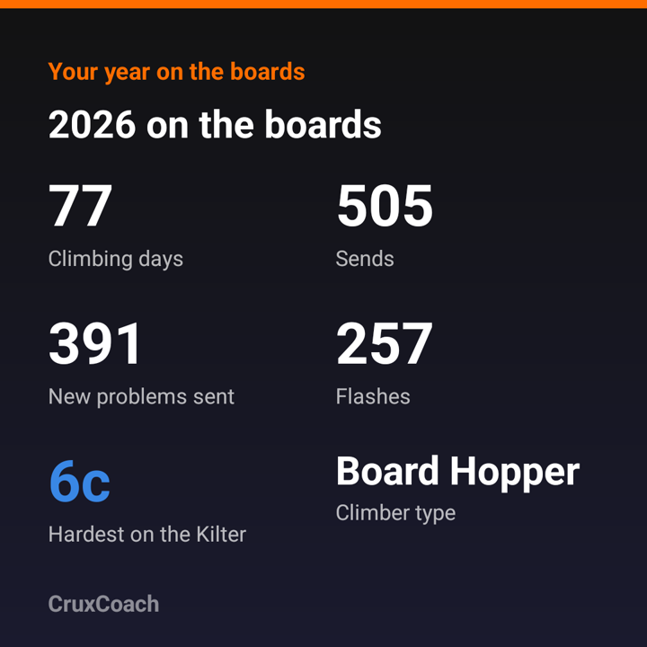
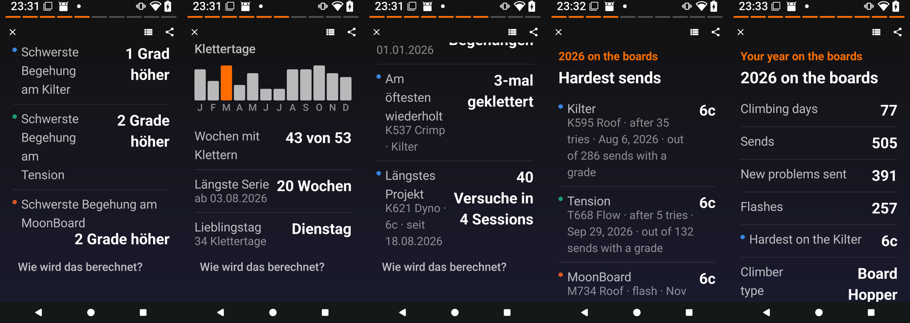
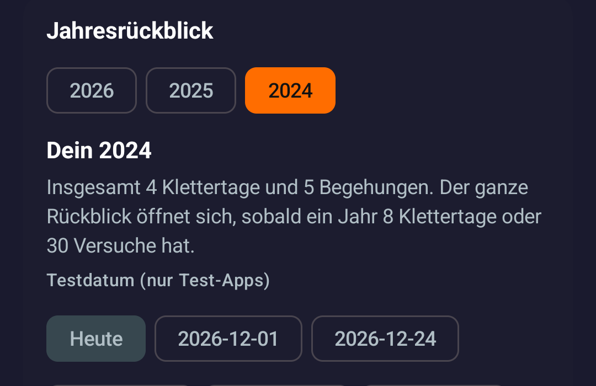
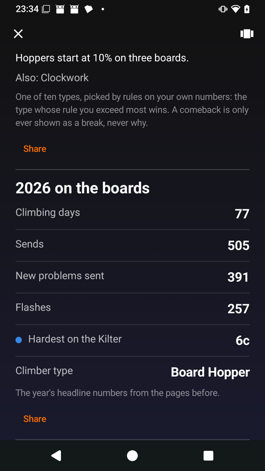

# Year in review: phone test (#64, PR #67)

*2026-11-06. Test builds 1, 3, 5 and 7 of `feat/0.2.5-year-in-review` (PR #67) on an Android 15 phone.*

## In short

- Every number in the review matched a separate count made from the raw logs, on 1 December (the year so far) and
  on 10 January (the finished year).
- The card appears from 1 December to 31 January, says "so far" in December and is gone on 1 February (checked on
  1 December, 10 January and 1 February). Its X hides
  it for that year; the entry in the statistics stays.
- Every page shares as an image drawn on the phone: 1080×1920 per page, 1080×1080 for the summary. Your name,
  problem names and exact dates are off by default.
- Thirteen bugs and rough edges were found on the phone and fixed, most of them at the largest font size and in
  German. Test build 7 has all fixes.
- Not done yet: a check with TalkBack itself (see the questions at the end).

## The test data

A made-up logbook over 2025 and 2026, built so that its results are known in advance:

- **Kilter**, logged in the app (local time, no time zone)
- **Tension**, imported like an Aurora export (UTC times, some of them past local midnight)
- **MoonBoard**, imported like the MoonBoard app's logbook (the day only)
- climbing days logged by hand, workouts with times and best values
- a few climbs logged by hand with hold type tags, which the import skipped (see question 3)
- a second, tiny logbook for 2024: four climbing days and five sends, below the minimum

The phone was set to the Europe/Berlin time zone. Feature builds have a switch in the statistics that sets "today" to
1 December, 24 December, 10 January, 31 January or 1 February, so December and January can be tested in November.
A script counts the same numbers straight from the logs, independently of the app.

## Numbers against the raw logs

The year so far, on 1 December 2026:

| | App | Count from the logs |
|---|---|---|
| Climbing days / days on a board | 72 / 64 | 72 / 64 |
| Tries / sends | 982 / 464 | 982 / 464 |
| New problems sent / flashes | 364 / 242 | 364 / 242 |
| Compared with 2025 (1 January–1 December) | +13 days, +51 sends, +12 new, +40 flashes, −28 tries | 59 days, 413 sends, 352 new, 202 flashes, 1,010 tries in 2025 |
| Kilter | 293 entries, 36 days, mostly 50° (51 %) | 293, 36, 50° (51 %) |
| Tension | 120 entries, 19 days, mostly 50° (55 %) | 120, 19, 50° (55 %) |
| MoonBoard | 93 entries, 10 days, mostly 40° (71 %) | 93, 10, 40° (71 %) |
| Hardest per board | Kilter 6c (out of 265 graded sends), Tension 6c (112), MoonBoard 6c (87) | same, same dates |
| Hardest compared with 2025 | Kilter 1 grade up, Tension and MoonBoard 2 up | 1, 2, 2 |
| Busiest month | March, 9 climbing days (October also 9: the earlier month wins) | March 9, October 9 |
| Weeks with climbing / longest run | 41 of 49 / 18 weeks from 3 August | 41 of 49 / 18 |
| Favourite day | Tuesday, 32 climbing days | Tuesday 32 |
| Biggest day / longest project | 1 January, 12 sends / 40 tries over 4 sessions | same |
| Off the wall | 26 workouts on 26 days, 24 h 30 min | 26, 26, 1,470 min |
| Climber type | Board Hopper (third board 18 %), also Clockwork (18 weeks in a row) | strongest score Board Hopper 1.84, next Clockwork 1.12 |

The finished year, on 10 January 2027: 77 climbing days, 505 sends, 391 new problems, 257 flashes, compared with
2025 +12 days, +51 sends, +6 new, +36 flashes, −52 tries. Same in the app and in the count.

One difference was in the test data, not the app: the MoonBoard import keeps one entry per problem and day, so five
same-day duplicates in the made-up file were merged on import. The count now does the same.

## The card and the entry

| Today | Start screen and logbook | Statistics |
|---|---|---|
| 6 November (the real date) | no card | year picker, "Your 2026 so far" |
| 1 December | "Your 2026 so far" | same |
| 10 January | "Your 2026 on the boards" | same |
| 1 February | no card | same |
| after the X | no card for that year | the entry stays |

If the date moves into December while the app stays open, the card on the start screen now appears when you come
back to it (fixed in build 3).

## The pages

The finished year on 10 January, test build 5, in English and in German. Ten pages: intro, volume, boards,
hardest per board, compared with last year, rhythm, highlights, off the wall, climber type, summary. Tap the right
side for the next page and the left side for the one before; nothing turns by itself. Holding a page hides the
controls. Every page has a "How is this calculated?" note.

The card on the start screen on 10 January:

A hold types page ("Your holds") comes between highlights and training when at least five sends in the year carry
hold type tags. It did not show on the phone; see question 3.

## Share images

Every page has a share button. The sheet shows the image as it will be sent, with three switches, all off by
default: your name (from the community settings), problem names, exact dates. With them off, a problem shows as
its grade and board ("a 6a+ · Kilter") and a date as its month. The image is drawn on the phone and goes out
through the Android share sheet; it carries the numbers and a small CruxCoach wordmark, no link and no tracking.
There is no switch for gym or location because the images never contain either.

All pages of the finished year as shared from test build 7, 1080×1920, with the default switches:

The summary, 1080×1080:

## Largest font size

At the largest font size the pages scroll, rows wrap, and when a value would leave its label too narrow, the
value moves under the label. German pages compared with last year, rhythm and highlights, then English hardest
sends and summary:

## Little data

A second logbook for 2024 with four climbing days and five sends, below the minimum (8 climbing days or 30 tries
in the year). Picking 2024 in the statistics shows a short note instead of the pages, and no card appears for
such a year:

## Screen readers

With TalkBack (or another screen reader that explores by touch) switched on, the review opens as one list instead
of pages. The list was checked through its button (below): every page is a heading, the month chart is read as text
("January 8, February 5, …"), and each page's share button now says which page it shares. Tap left and right, and
"next page" and "previous page" as screen reader actions, are on the pages too. TalkBack itself has not been tried
yet, so the real check is still open.

## Found and fixed

| Build | What | Fix |
|---|---|---|
| 1 | The training page showed no best value: the exercise list was still loading when the review opened. | 3 |
| 1 | The start-screen card did not appear when the date moved into December while the app stayed open. | 3 |
| 1 | Switching between the list and the pages started again at the first page. | 3 |
| 1 | "(52 %)" could break between the number and the percent sign. | 3 |
| 1 | A finished year with little data said "Your 2024 so far". | 5 |
| 3 | At the largest font, a row could break a German word apart ("Schwerst-e Begehung"); the value now moves under the label when the label gets too narrow. | 5 |
| 3 | The tallest bar of the month chart pushed its letter down at the largest font. | 5 |
| 3 | Two months with the same number of days were both highlighted, while the page names one. | 5 |
| 3 | German: "ab 8 Klettertage", "mit 12 Klettertage", "Rakete ab 2 Grade", "an 4 Sessions". | 5 |
| 3 | English: "climbing days" in lower case as a row label, "(51 %)" with a space. | 5 |
| 5 | After scrolling down a long page, the next page opened part-way down: all pages shared one scroll position. | 7 |
| 5 | In the list view, a screen reader heard "Share" ten times; each button now names its page. | 7 |
| 5 | German: the short review of a past year said "In diesem Jahr", which reads as the current year. | 7 |

## Climber types

The ten types, their rules and how they were calibrated are in
[Climber types](2026-11-06-climber-types.md). On the phone, the test logbook got Board Hopper (its third board had
17 % of the entries; Board Hoppers start at 10 %) and, as "also", Clockwork (20 weeks in a row; Clockworks start at
16). That matches the scores counted from the logs: Board Hopper 1.69, Clockwork 1.25, everything else below 1.

## Questions

1. **Minimum amount of data:** the full review opens from 8 climbing days or 30 tries in the year. Below that, no card
   appears and the statistics show a short note instead ("Your 2024: 4 climbing days and 5 sends"). Keep these
   numbers?
2. **Start-screen card in January:** it stays on the start screen until 31 January, with the finished year. Keep
   it there in January, or show it only in the statistics after New Year?
3. **Hold types page:** it counts the hold type tags of climbs logged by hand. The screen for logging such climbs is
   no longer reachable in the app, so the page will almost never show before the board problems carry hold types
   ([#63](https://github.com/CruxCoach/CruxCoach/issues/63)). Keep it (it only shows with 5 or more tagged sends in
   the year), or take it out until #63?
4. **Screen readers:** could you, or anyone in the room, try the list view with TalkBack switched on?
