# Year in review: UI pass

Pull request [#67](https://github.com/CruxCoach/CruxCoach/pull/67) · issue [#64](https://github.com/CruxCoach/CruxCoach/issues/64) · 7 and 8 November 2026

The year in review was checked against the app's design guide (`design.md`) and the screens of 0.2.4. A render test draws every screen with a made-up year on three boards, in every combination of:
- English and German
- 320 dp and 411 dp wide
- normal font and the largest font (200 %)
- dark and light, where the app's theme shows

That makes 8 sets of about 40 pictures each. After every round, a reviewer that had not seen the code went through the pictures. The real flow was checked on a phone with the test builds.

## Rounds

| Review | Fixed in | What the review found | What changed |
| --- | --- | --- | --- |
| 1 | a798e1052 | The share button fell off the sheet at large fonts. Numbers appeared twice. "How is this calculated?" was a text link under each page. The card had its own style. The statistics offered years without a review. Pages gave no hint that they scroll. A failed load looked like an empty year. | Info symbol in the top bar. No number twice. Pinned share button. Card in the "At a glance" style. Only years with a full review. Fade at the bottom of long pages. Designed loading, error, empty and little-data screens. |
| 2 | 716d1937b | Little-data screens didn't say what they mean. The list view's month chart was a paragraph. The share sheet showed switches that change nothing. Labels broke one word per line. | Little data says what opens the full review. Months as rows. Only the switches that change the image. Rows wrap their labels, values never break. |
| 3 | 64ad038f5, 975af6152 | At 320 dp and 200 %, the recap grid broke words. Rows switched layout row by row. The card squeezed its title at the largest font. | The recap falls back to one column. One layout decision per list. Titles at a fixed height. A share button on the last page. The card is one tap. |
| 4 | ef76283ad | Nothing of high weight left. "At least as good as the 0.2.4 screens, also at 320 dp, at the largest font and in German." Smaller points: on the same grade the hardest send could be a worked send while a flash existed, and the hardest-send line was long. | On the same grade a flash comes first, then fewer tries. A flash that is already a board's hardest send is not repeated in the highlights. Dates within the year without the year. The sample size on its own line. |

## Before and after

Left: before the pass. Right: after it. All pictures are renders of a made-up year.

| | |
| --- | --- |
| Your volume (English, 411 dp): the info symbol replaces the text link; "days on the board" no longer repeats the big number | 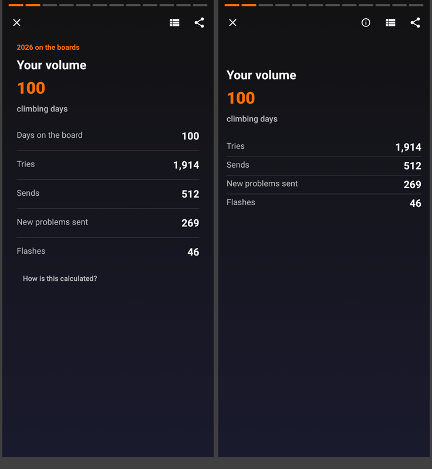 |
| Compared with 2025 (German, 320 dp, largest font): the change and last year's number instead of this year's numbers again | 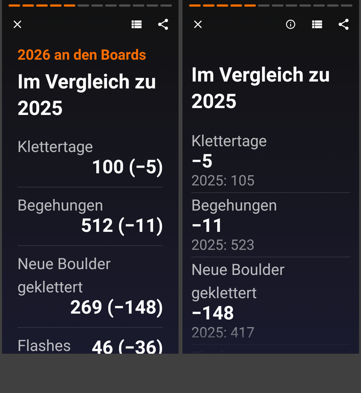 |
| The summary: a recap grid with its own share button | 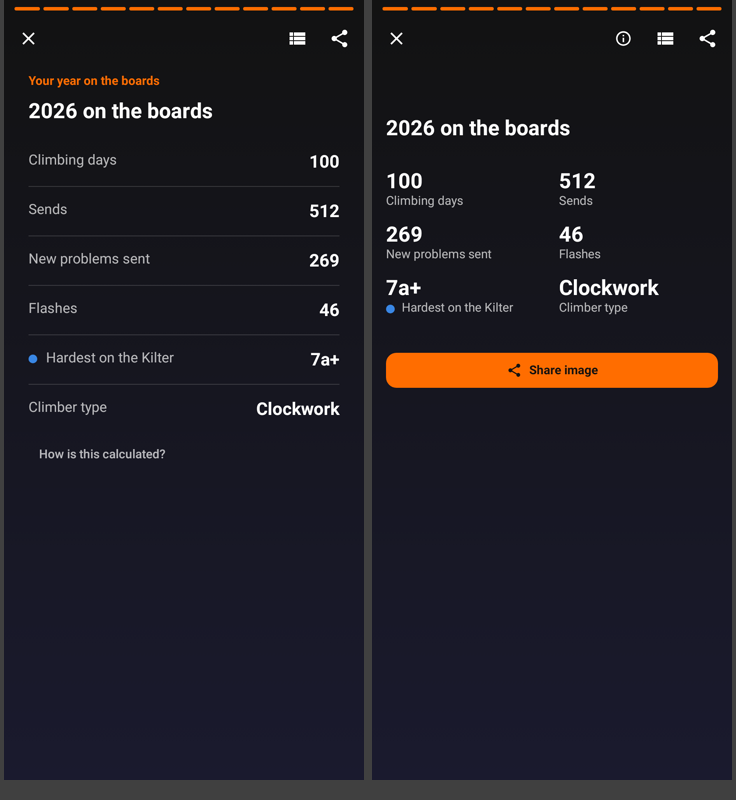 |
| Share sheet (320 dp, largest font): the button stays in reach; only the switches that change the image | 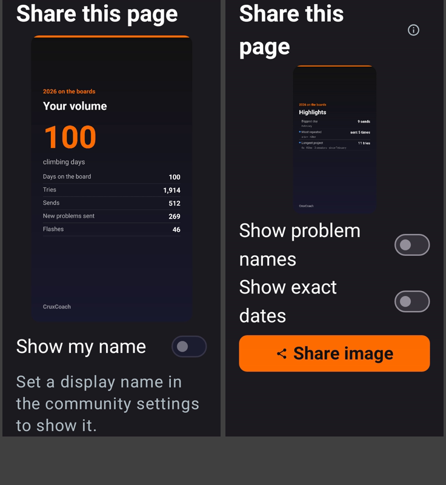 |
| The December/January card (light theme): the app's card style, one tap | 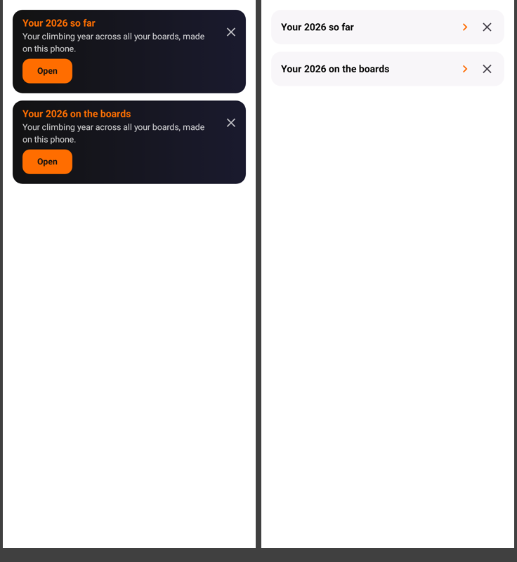 |
| In the statistics (light theme): only years with a full review, one "Open" | 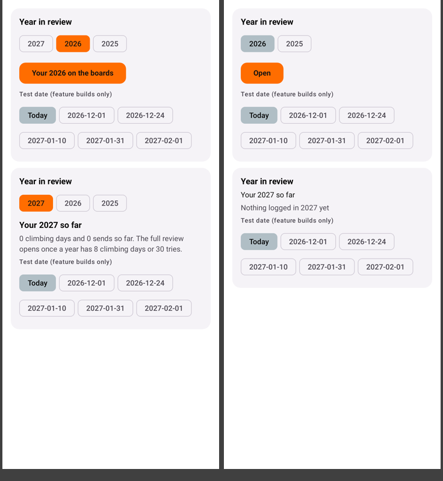 |
| Little data so far: what opens the full review, and how far the year is | 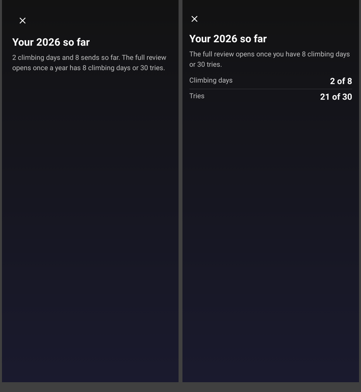 |
| List view for screen readers (German): the month chart as rows, an info symbol per section | 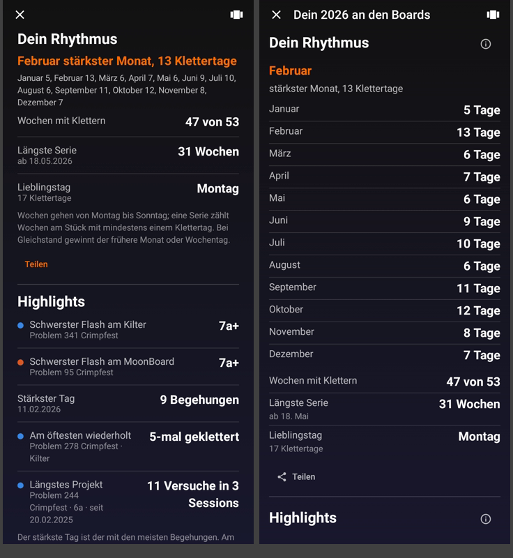 |

The share sheet pictures show two different pages: the volume page before, the highlights page after.

## Decided in this pass

These are UI decisions. Each is easy to change in one place.
- **Pages stay dark in both app themes.** The review is a full-screen story; its share images are dark too. The status and navigation bars keep the app's colours: their light-theme look is part of the app-wide light-theme contrast work in #dev, so this pull request changes no colours.
- **"How is this calculated?" is an info symbol** in the top bar of each page, and beside each section in the list view.
- **The small line above the title ("2026 on the boards") is on the share images only.** On the phone, the progress bar and the title already say where you are.
- **"Compared with 2025" shows the change and last year's number** ("+12", "2025: 65"). This year's numbers stay on the volume page, so none appears twice.
- **On the same grade, a flash is the hardest send**, then the send with fewer tries, then the earlier one. A flash already shown as a board's hardest send is not repeated in the highlights.
- **Dates within the review year leave out the year** ("Jan 18", German "18. Jan."); dates from other years keep it.
- **The hardest sends keep their sample size** ("out of 286 sends with a grade"), like the statistics: a grade from few sends says less.
- **The climber type keeps its rule on the page**, as decided on 6 November.
- **Your boards shows days per board** as the number, with entries and the main angle below.
- **The statistics offer only years with a full review.** With none yet, they show how far the current year is.
- **The share sheet shows only the switches that change that page's image.** It has no name switch while no display name is set.
- **The December/January card is one tap**, with an orange arrow like "Statistics ›" in "At a glance", and its × to hide it.

## Checked on the phone

- **Test build 10** (17398a7cd, after the rebase onto the release branch): with the made-up year and the date set to 10 January, every number on every page matched a separate count from the raw logs. The start-screen card, the card above "At a glance" in the logbook, the entry in the statistics and sharing all work with the new statistics.
- **Test build 12** (716d1937b, round 2 of the pass): tap left and right, hold to hide the controls, the info dialog, the share sheet with its switches and the share chooser, and the list view that keeps your place. In the light theme the review showed light status and navigation bars with light icons. Review round 3 made both bars dark while the review is open; that change was taken out again so that this pull request changes no colours (see build 13).
- **Test build 13** (351f83a7b, all review rounds, no colour changes), 8 November, the date set to 10 January 2027:
  - Every number on every page matched the separate count from the raw logs again.
  - "Your hardest" follows the new tie rule: on the Kilter a 6c flash from 17 December, on the Tension the 6c sent after 2 tries, on the MoonBoard the 6c flash. The highlights don't repeat those two flashes; only the Tension's hardest flash is listed.
  - Dates within the year show without the year ("17. Dez.", "ab 3. Aug.") and don't break across lines.
  - The summary's "Share image" opens the share sheet (no switches: the summary shows no names or dates), then the share chooser; the image is 1080 × 1080. On the highlights page both switches toggle with a tap on the whole row and the preview follows.
  - The list view keeps your place. Holding a page hides the controls. The info dialog opens and closes.
  - At the largest font in German: the card's title wraps next to its arrow, the comparison rows stack cleanly, and the summary becomes one column with its button at the end.
  - Light theme: the review shows the app's light status bar and navigation bar above its dark page; their icons stay readable. That look is left to the app-wide light-theme work. The card in the logbook looks right in light.
  - The board list with its card, a problem, the menu and training open without problems; no crash in the log.

| | |
| --- | --- |
| Your hardest (German, test build 13): flash first on a tied grade, the sample size on its own line | 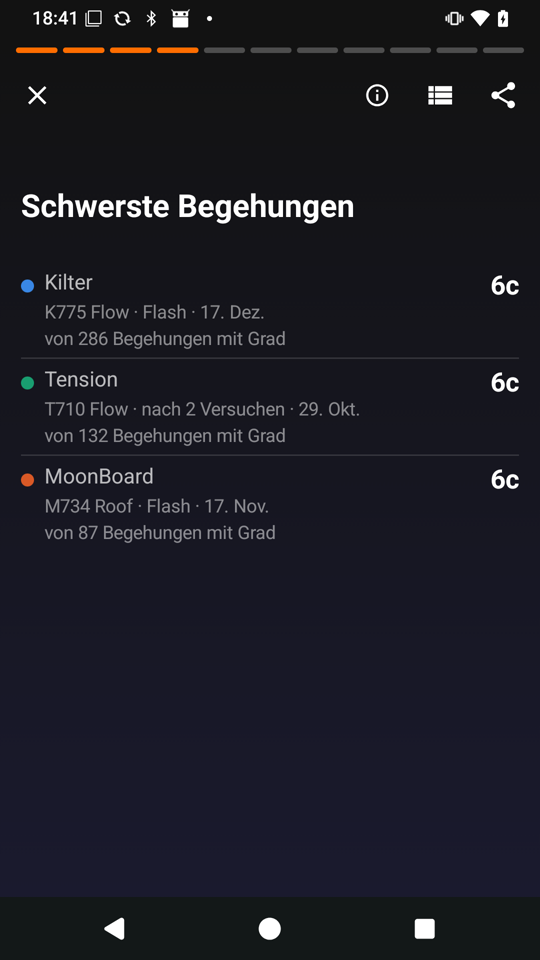 |
| Light theme (test build 13): the app's light bars above the dark review | 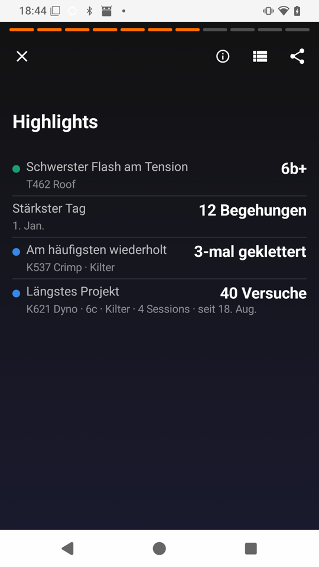 |
| The summary at the largest font (German, test build 13): one column, the share button at the end | 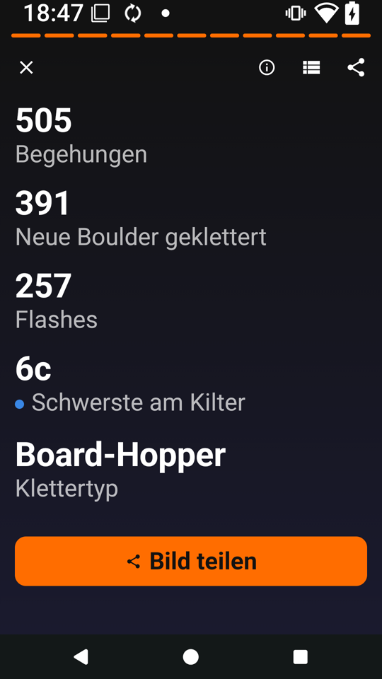 |
