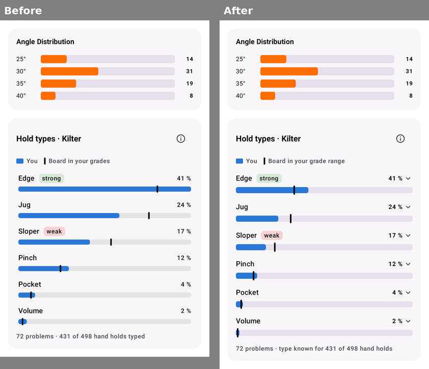
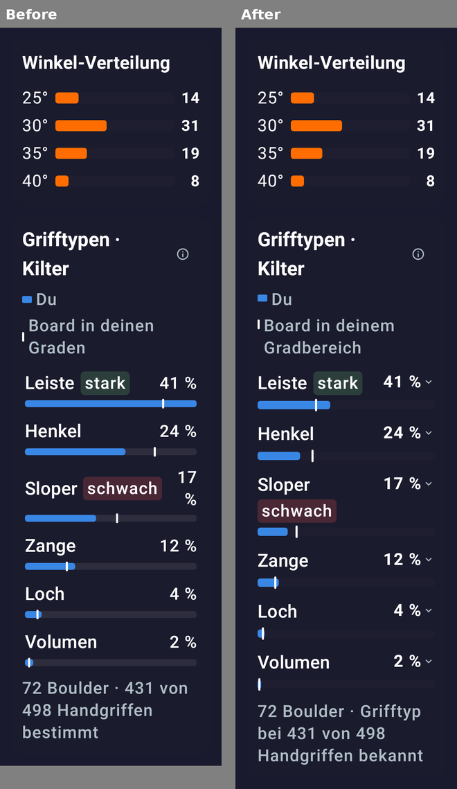
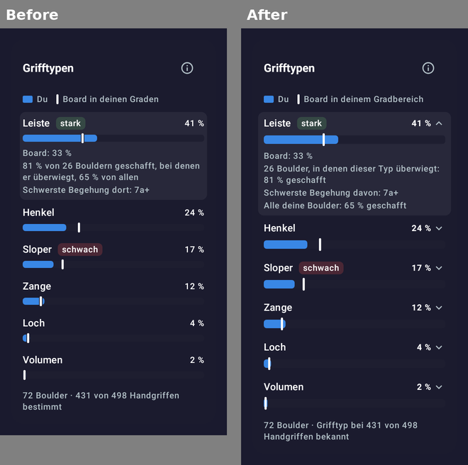
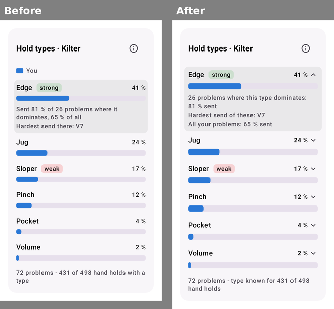

# Hold-type card: UI pass

Room: #feat-hold-types · PR [#95](https://github.com/CruxCoach/CruxCoach/pull/95) into `feat/0.2.5-release` · 2026-11-09

The hold-type card sits in the logbook statistics, between the angles and the hold heatmap (#63). It was measured
against the app's `design.md` and against the 0.2.4 angle card right above it.

The card is still locked in #95, because no board's blind round has been evaluated yet. So this pass works from renders.
The phone check follows once Kilter is unlocked.

## How

- `HoldTypeStatsUiReviewTest` renders the card in six states:
  - in the sheet under the angle card
  - a strong type opened
  - a weak type opened
  - too few problems for strong or weak
  - no board comparison
  - the help dialog

  Each state comes in 16 variants: English and German, dark and light, 320 and 411 dp wide, font scale 1.0 and 2.0.
  The test only runs when `CRUXCOACH_UI_REVIEW_DIR` is set.
- There were four render rounds. In each one I looked at every image myself, and reviewers who had not seen the code
  critiqued the renders against `design.md`: one in round 1, two in rounds 2 and 3 (one per screen width), and one on
  all renders in round 4.
- Round 4 found nothing broken at any size. It found two wording points, which are fixed: the "too few" line now
  names the labels, and the German help says "Erfolgsquote". The two states with that text were rendered once more.

## What changed

| Where | Before | After | Why |
|---|---|---|---|
| Share next to a "weak" chip, German, 320 dp, large font | "17 %" broke into two lines | The chip moves under the name; the share stays on the name's line | Text broken mid-value |
| Bars | Scaled to the largest row | 100 % is the full width, as in the angle card | The two charts sit on one scale |
| Bars and board mark | 10 dp bar, mark with a gap in the card colour | 12 dp bar; the mark reaches past the bar | The gap hid bars of 2 to 4 % |
| Rows | Nothing showed that a row opens | A chevron after the share | The numbers behind strong and weak were only reachable by a hidden tap |
| Share | Regular weight | Bold, like the angle card's counts | Same weight for the same kind of number |
| Opened row | Highlight 4 dp past the text | 8 dp, with the text still lined up with the title | The highlight touched the text |
| Legend without a board comparison | "You" alone | No legend | A legend with one entry tells nothing apart |
| Legend at large font | Mark centred on two lines of text | Mark beside the first line | |
| Opened row, wording | "Sent 81 % of 26 problems where it dominates, 65 % of all" (German used "er", which fits neither Leiste nor Zange) | "26 problems where this type dominates: 81 % sent", then "Hardest send of these", then "All your problems: 65 % sent" | Each number says what it counts; "of these" sits right under the set it means |
| Too few problems | "Too few problems for strong or weak" | "A “strong” or “weak” label needs at least 5 such problems" | Says what is missing |
| Percentages | "65" and "%" could end up on two lines | A non-breaking space before every "%" | Found in German at 411 dp |
| Board label | "Board in your grades" / "Board in deinen Graden" | "Board in your grade range" / "Board in deinem Gradbereich" | The app's term |
| Footer | "431 of 498 hand holds typed" / "… bestimmt" | "type known for 431 of 498 hand holds" / "Grifftyp bei 431 von 498 Handgriffen bekannt" | "typed" and "bestimmt" are ambiguous |
| Help, "Strong and weak" | A sentence without a main verb | "Your send rate on problems where a type makes up at least 40 percent of the hand holds (where it dominates), compared with your rate on all your problems on this board. …" | It is the only definition of the chips, and it now names "dominates" |
| Help, German | "Die Marke zeigt …", "immer ein Board" | "Der Strich zeigt …", "jeweils ein Board" | |

Left as they were:
- **The bar colour.** It is the board's colour, as in the cross-board statistics, not the orange of the angle card. The
  card always shows one board.
- **The title height.** The title and the info button come from the app's shared heading. Changing them would change
  every card with an info button.
- **The title wrapping.** At 320 dp and font 2.0, the title wraps as "Hold types ·" / "Kilter". That is a normal wrap.
- **The type names.** They are a step larger than the angle labels, because each name heads its row.
- **The board's share as a number in the opened row.** The mark shows where it is; the number says how much.

## Before and after

The card under the angle card, English, light, 411 dp:

The same in German, dark, 320 dp, font scale 2.0:

An opened row, German, dark, 320 dp:

Without a board comparison, English, light, 320 dp:

## Still open

- The phone check once Kilter is unlocked: gestures, scrolling, and the help dialog at the largest font.
