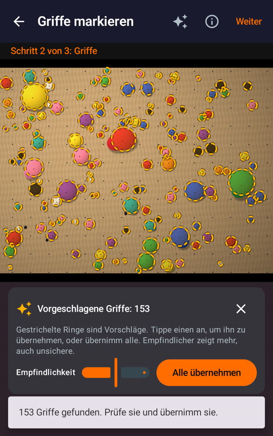
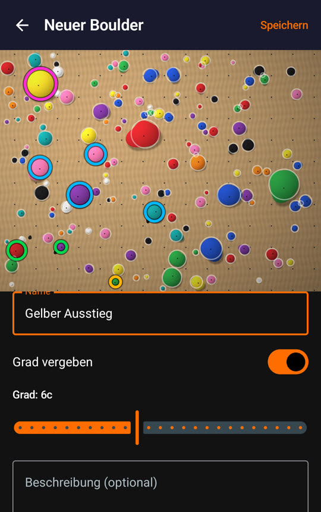
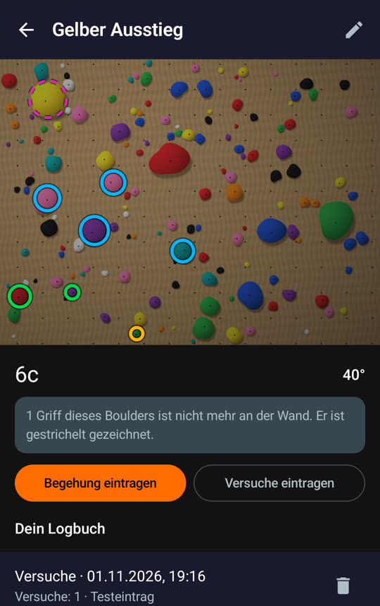
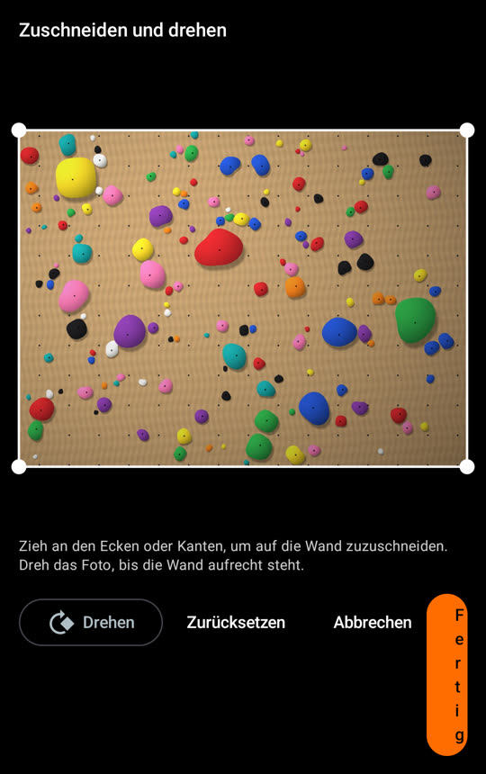
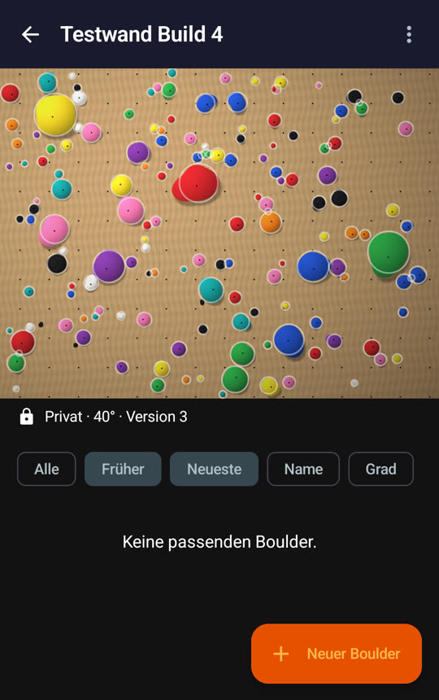
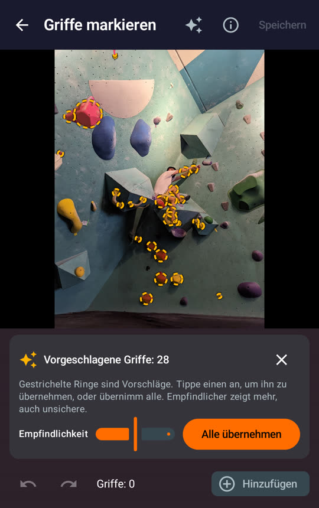

# Spray walls: first test on a phone (test build 4)

Test build 4 of `feat/0.2.5-spray-wall` (commit `c7c229a4`, [PR #41](https://github.com/CruxCoach/CruxCoach/pull/41)), installed from the signed community build and tested on a phone on 2026-11-01. The app language was German and the screen 1080 × 1920 px.

Test photos: a synthetic test wall with 150 holds on plywood, made by the test code from the [hold detection report](2026-11-01-hold-detection.md), and a CC0 photo from Wikimedia Commons of a bouldering gym with a climber on the wall.

**Result:** every step from adding a wall to deleting it works on the phone, without a crash. Two bugs and a few rough edges are listed below. On the real gym photo the hold detection does much worse than on the synthetic walls.

## What was tested

| Step | Result |
|---|---|
| Add a wall: photo from the gallery, crop and rotate | Works. Bug 1: the "Fertig" (Done) button is squeezed |
| Hold suggestions on the test wall | 153 suggestions for 150 holds, about a second after "Weiter" |
| Accept all, undo and redo, add a hold, delete a hold | Works |
| Details: name, angle, private, home wall | Works |
| New problem with start, hand, foot and finish holds | Works; each role has its own ring colour |
| Log a send (with attempts) and an attempts entry with a comment | Works; both show in "Dein Logbuch" |
| Reset with a new photo | Works: version 2, and the old problem stays under "Früher" on its old photo, with its logbook |
| Versions: list and restore version 1 | Works (version 3 = version 1), and the old problem is current again. Bug 2: the list stays on an empty filter |
| Edit holds: remove a finish hold | Works: "1 Griff fehlt" in the list, and the hold is drawn dashed in the problem |
| "Öffentlich" (public) | Asks first and explains what becomes public; cancelled, so nothing was published |
| Delete the wall | Asks first; the wall and both photo files are gone |

  

## Bugs

1. **Crop dialog: the "Fertig" button is squeezed to one letter per line.** Rotate, reset, cancel and done share one row. With the German labels, the first three leave almost no room for the last. Fix: put the buttons in two rows (rotate and reset, then cancel and done), or use a flow row.
2. **After a restore, the list stays on the "Früher" (Earlier) filter and shows "Keine passenden Boulder".** The restore makes the earlier problems current again, so this filter has nothing left to show. The chip stays because it is still selected. Fix: switch back to "Alle" when the selected filter no longer has any problems.

 

## Rough edges

- **"Alle" (All) shows only the problems on the current photo.** Right after a reset, the list says "Keine passenden Boulder" even though the earlier problems are one chip further. "Aktuell" (Current) would say what the chip does.
- **A reset ends in the hold editor.** After "Speichern" the editor stays open with the button greyed out, so it is not obvious that the reset is done. When you add a wall, saving moves on to the next step. A reset could go back to the wall in the same way.
- **Portrait photos fill the whole screen** on the wall, reset and versions screens. The problem list, the "Weiter" button and the versions list are only reachable by scrolling. Limiting the photo height would fix this.
- **Low contrast on the floating buttons** "Wand hinzufügen" and "Neuer Boulder": orange text on an orange button.
- **The photo shrinks in the hold editor when a hold is picked:** the size slider appears and the photo moves under the finger.
- **Opening a wall or the versions screen stalls for a moment:** single frames took up to about 0.5 s.

## Hold detection on a real photo

The real photo shows a bouldering gym, not a spray wall: teal panels, volumes and a climber on the wall. It only hints at what real spray-wall photos will show:

- **Default sensitivity:** 28 suggestions. Most are real holds in warm colours (red, orange, yellow, pink). About 6 to 8 sit on the climber (shirt, skin, shoes). Blue, purple and grey holds are missed, and so is the large yellow hold on the left.
- **Highest sensitivity:** 72 suggestions. It finds more holds but adds large circles on shadows and volumes.

The weak spots are hold colours close to the panel colour (blue on teal) and people in the photo. Tuning needs real spray-wall photos. If you have a spray wall, photos you are happy to share publicly help.

## Not tested yet

- Publishing a wall and following it from a second phone, and "Spraywände hier" in the map's place sheet
- Taking the photo with the camera
- Removing the camera data (location, device) from a photo: the test photos had none
