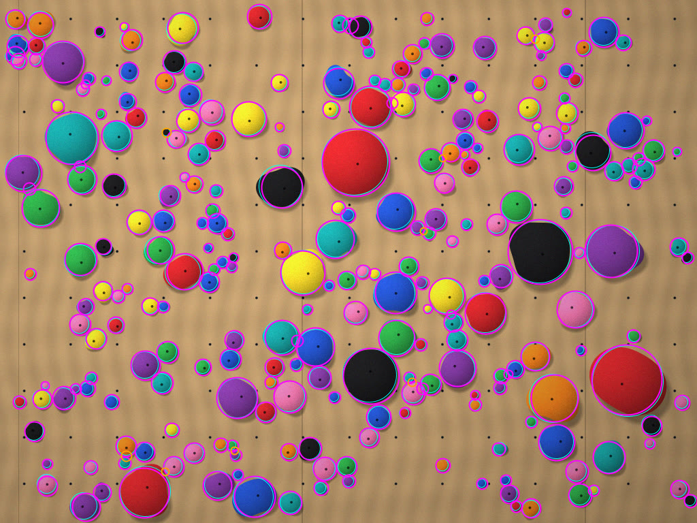
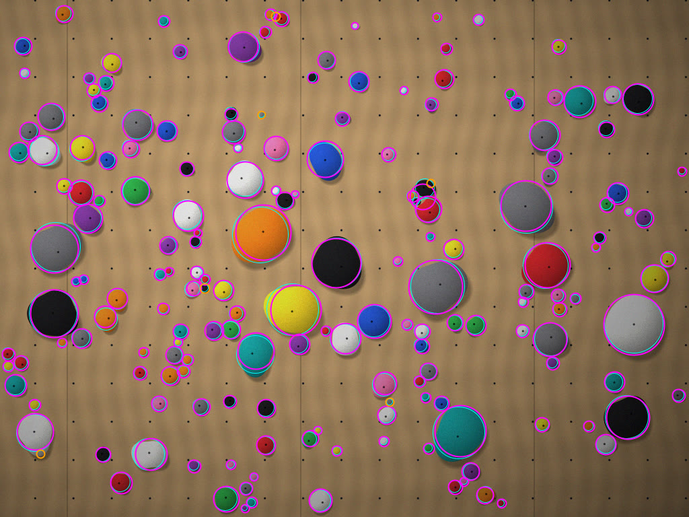
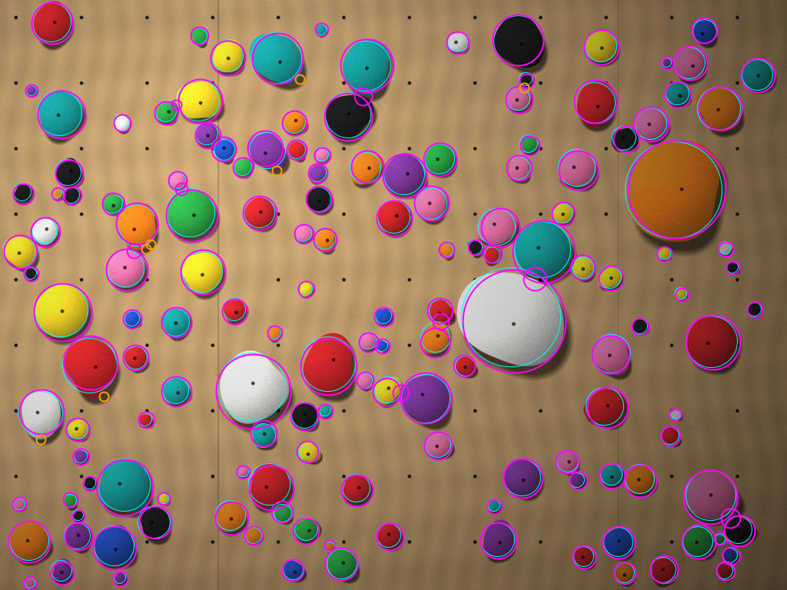
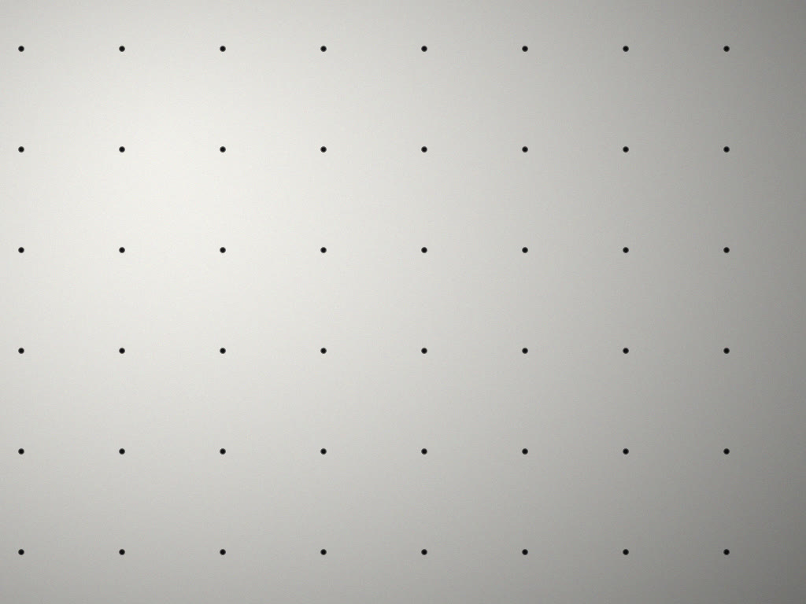

# Spray walls: hold detection on synthetic walls

2026-11-01 · CruxCoach issue [#40](https://github.com/CruxCoach/CruxCoach/issues/40) · draft PR [#41](https://github.com/CruxCoach/CruxCoach/pull/41)

When you add a spray wall, CruxCoach looks for the holds on your photo and shows them as dashed rings. You take them all at once or one by one, and then fix the rest by hand. This report shows how well that works on synthetic test walls, where every hold is known.

## Summary

- Detection runs on the phone with classical computer vision. It uses no model file, no network and no new dependency.
- At the default sensitivity, 95–99 % of the suggestions are holds, and 85–100 % of the holds are found, depending on the wall.
- T-nut bolt holes are never suggested, not even on bare walls or close-ups where the holes are as big as a small foot chip.
- Weak spots: black holds on a black panel, white holds on a white panel, and wooden holds on plywood (69 % found).
- These are synthetic walls. Real photos are the next step, and photos of real spray walls are welcome in the room.

## How it works

The detector (`HoldDetector`, implemented by `SprayHoldDetector` in `shared/.../spraywall/detect`) works on a copy of the photo of at most 1024 px. It goes through six steps:

1. **Panel model.** The panel is the surface that covers most of the photo. Its colour is the densest spot in a histogram of colours. Its brightness is estimated per grid cell, so light falling off across the wall still counts as panel.
2. **Saliency.** Every pixel gets a score for how far it is from the panel, in brightness ratio and in colour. The score is measured in units of the panel's own noise, so plywood grain stays near zero. Plain darkening by up to a third is how a cast shadow looks, and it does not count.
3. **Regions.** Salient pixels form hold regions, and small gaps such as the bolt hole in a hold are filled. The middle of a hold is where the distance to the panel peaks, so touching holds split at their neck. The radius comes from rays that stop at the panel or at the saddle towards the next hold.
4. **Blobs.** A multi-scale blob filter finds holds that are too faint to form a region. A blob confirms a region, or becomes a suggestion of its own where there is no region. Panel seams and bumps on a hold's rim are dropped.
5. **T-nut holes.** Small, dark, grey blobs that share one size and a grid spacing are the bolt holes, and they are dropped.
6. **Confidence.** The confidence comes from the contrast, how compact the shape is, and whether region and blob agree. It is calibrated so that the default sensitivity keeps the clear holds. The slider in the editor moves this threshold.

`HoldDetector` is a one-function interface, so a trained model can take the detector's place later without any change to the editor.

## Test walls

The synthetic walls (`SyntheticWall` in the shared tests) are rendered with a fixed seed, so every run gives the same picture.

- **Panel:** plywood with grain and sheet seams, or black, white or grey paint.
- **T-nut holes:** a square grid of 20 cm. Holds cover the holes they sit on.
- **Holds:** 0 to 260 per wall, from 1.5 cm foot chips to 16 cm volumes, in lumpy shapes. They are coloured, black, white, grey or wooden. Each has shading, a drop shadow and a bolt hole, and some touch each other.
- **Photo:** light falls off across the wall and into the corners, with a spot of light and sensor noise. Some scenarios add blur, more noise or harsh shadows.
- **Size:** 1024 × 768 px (one scenario is portrait), showing 1.6–3.6 m of wall.

A suggestion counts as a hit when its centre lies within 60 % of the hold's radius (plus 2 px) and its radius is between 0.45 and 2.2 times the hold's. Every hold can be hit only once. A suggestion within a hole's radius of an uncovered T-nut hole counts as a hole hit.

## Results

Precision is the share of suggestions that are holds; recall is the share of holds that were suggested. "Default" is the editor's starting sensitivity; the slider goes both ways.

| Scenario | Holds | Precision (default) | Recall (default) | Recall (more sensitive) | Recall (less sensitive) | Hole hits |
| --- | ---: | ---: | ---: | ---: | ---: | ---: |
| Coloured holds on plywood | 120 | 0.98 | 1.00 | 1.00 | 0.98 | 0 |
| Mixed incl. black/white/grey, strong uneven light, 3.6 m wide | 180 | 0.99 | 0.97 | 0.99 | 0.88 | 0 |
| Black panel | 120 | 0.97 | 0.85 | 0.85 | 0.85 | 0 |
| White panel | 120 | 0.99 | 0.87 | 0.90 | 0.82 | 0 |
| Grey panel | 140 | 0.98 | 0.93 | 0.94 | 0.90 | 0 |
| Dense, many touching holds | 260 | 0.96 | 0.99 | 1.00 | 0.93 | 0 |
| Close-up, 1.6 m wide (large bolt holes) | 45 | 0.96 | 1.00 | 1.00 | 1.00 | 0 |
| Portrait photo | 150 | 0.98 | 1.00 | 1.00 | 0.98 | 0 |
| Hard light with strong shadows | 150 | 0.95 | 1.00 | 1.00 | 0.99 | 0 |
| Blurry and noisy | 150 | 0.98 | 0.95 | 0.95 | 0.94 | 0 |
| Wooden holds on plywood | 140 | 0.99 | 0.69 | 0.69 | 0.68 | 0 |
| Bare plywood with T-nut grid | 0 | no suggestions | — | — | — | 0 |
| Bare white panel, close-up | 0 | no suggestions | — | — | — | 0 |

"More sensitive" and "less sensitive" are thresholds 0.3 and 0.7 instead of 0.5. On a desktop JVM one photo takes about 0.15–0.5 s; on a phone expect a few times that, while the scan animation runs.

What the misses are:
- **Black panel:** black holds; white panel: white and some grey holds. They differ from the panel mostly by shading.
- **Wooden holds on plywood:** almost all wooden holds are missed, because they have the panel's colour and brightness.
- **Elsewhere:** single small holds right next to big ones, and a few holds in the darkest corner of the strongly uneven light.

## Stills

Cyan rings are the true holds. Magenta rings are suggestions at the default sensitivity, orange rings suggestions below it (shown only when you slide towards "more"). The small dark dots are T-nut holes.

Dense wall with many touching holds (precision 0.96, recall 0.99):

Mixed holds, strong uneven light, whole 3.6 m wall (0.99, 0.97):

Harsh light with strong cast shadows (0.95, 1.00):

Bare white panel, close-up: the T-nut holes are not suggested:

## Next

- Run the detector on real spray-wall photos and tune it. Synthetic walls are cleaner than real ones: real walls have chalk, rubber marks, volumes, mats in the picture and holds whose colour has faded.
- Wooden holds need a different cue: texture or the hold's own shadow edge. Alternatively, a trained model can sit behind `HoldDetector`.
- The test thresholds in `SprayHoldDetectorTest` sit a little below these numbers, so a real regression fails the build.
