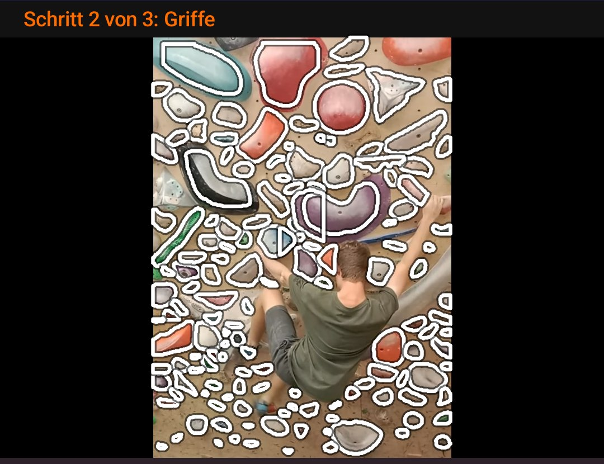
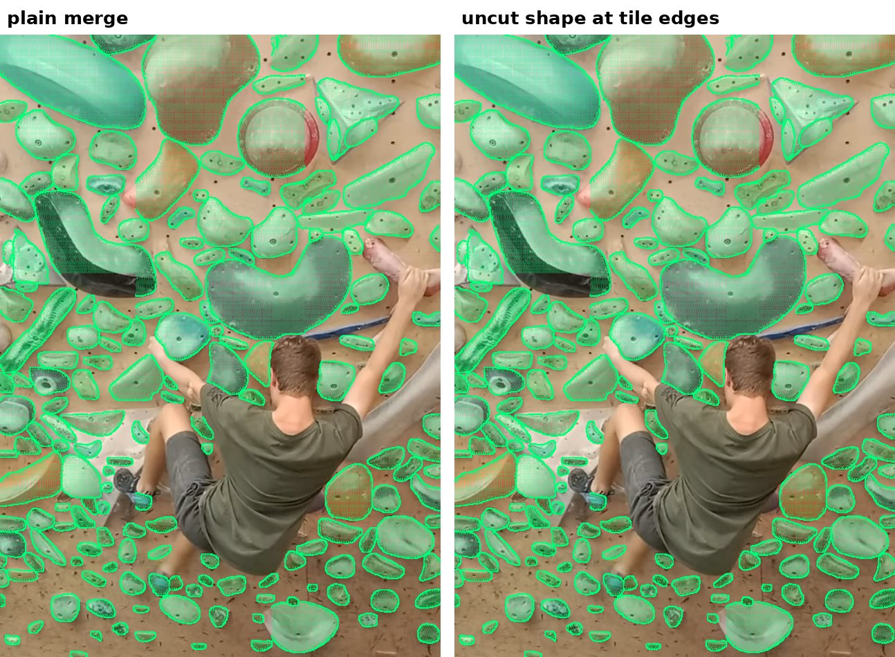
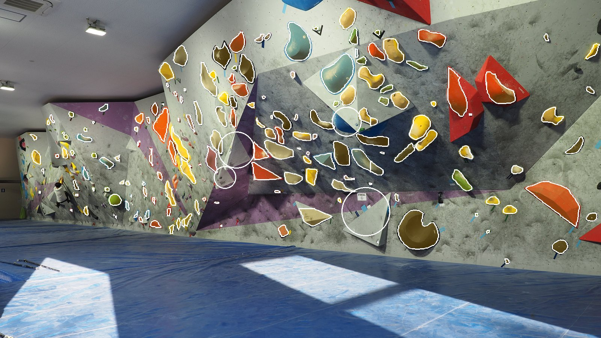
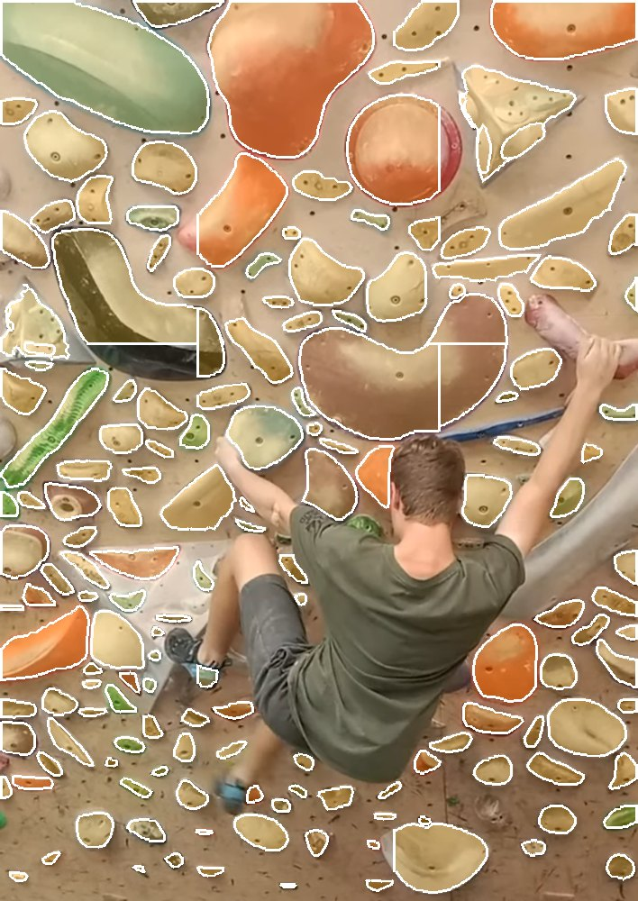

# Spray walls: a hold model on the phone

Draft pull request [#49](https://github.com/CruxCoach/CruxCoach/pull/49) (on top of [#41](https://github.com/CruxCoach/CruxCoach/pull/41)) replaces the classical hold detection with a trained segmentation model that runs on the phone and outlines every hold in its real shape. This report covers what was measured: holds found, precision, recall, gesture savings, time per photo and peak memory on a phone, for the published settings and the tuned ones.

**Result:** on 28 labelled photos (1,940 holds) the tuned setting finds 93 % of the holds with 97 % precision. That saves 91 % of the hand corrections, against 13 % for the current detector. On a 2018 mid-range phone it takes about 27 s per photo and up to about 450 MB of memory.

## The model

- **Model:** BoardSesh's published hold segmentation model `2026-09-18-seg` (RF-DETR-Seg nano, int8 ONNX, 32.5 MB, Apache-2.0). The app downloads it once when the climber asks for it, and checks its size and SHA-256 against the published manifest.
- **Training data and teacher:** trained by BoardSesh on "Climbing Holds and Volumes" v14 from Roboflow Universe (CC BY 4.0), with mask labels from d12's crux-climbing-hold-segmentation-models (MIT).
- **Runtime:** ONNX Runtime for Android 1.31.1 (MIT), on the phone's CPU.
- **Pipeline:** tiling, decoding, outline tracing and tile merging, ported to Kotlin from BoardSesh's hold-detection pipeline (Apache-2.0).
- **Credits:** in NOTICE, THIRD_PARTY_LICENSES.md and the app's licence screen.

## How it was measured

- **Photos:** 28 photos of climbing walls, from 567 to 4,608 px on the long side. They include home spray walls (plywood, painted, black and grey panels), gym walls with volumes, close-ups and whole walls, climbers in front of the wall, a night photo and a textured wall. 22 of them are web photos used for testing only, so they are not shown here. The 6 shown are from Wikimedia Commons (CC0, CC BY, CC BY-SA).
- **Labels:** for each photo, a region with about 100 holds. I labelled the holds myself, starting from the suggestions of the model and of the current detector at low thresholds. I checked each one, removed wrong ones, added missed ones by hand, and marked unsure ones. That gives 1,940 sure holds; unsure holds count neither way. Because the labels start from suggestions, the numbers flatter the model somewhat. A hold that neither detector suggested and that I also missed is not counted.
- **Matching:** a suggestion counts for a hold when one centre lies inside the other's circle. Duplicates count as wrong.
- **Gesture savings:** 1 − (2 × missed + wrong) ÷ (2 × holds). Adding a missed hold by hand takes two gestures and deleting a wrong one takes one, so 100 % means nothing left to correct.
- **Phone:** a 2018 mid-range test phone (Snapdragon 630, 8 cores, 2.8 GB RAM), running the community test builds of #49. A benchmark screen that exists only in test builds runs a setting over the photos in a fresh process and records the suggestions, the time per step and the process's peak memory (VmHWM).

## Results on the phone

All 28 photos, 8 threads:

| Setting | Precision | Recall | Gesture savings | Time per photo (median) | Peak memory |
|---|---|---|---|---|---|
| Current detector (classical) | 0.54 | 0.23 | 13 % | 6 s | 332 MB |
| Published settings: 2×2 tiles, 1024 px, threshold 0.6 | 0.98 | 0.81 | 80 % | about 13 s ¹ | 421 MB |
| Tuned: 3×3 tiles, 1536 px, duplicates at 0.3, threshold 0.5 | 0.97 | 0.93 | 91 % | 27 s ¹ | 452 MB |

The phone finds the same holds as a server run of the same model: 91.0 % against 91.3 % gesture savings for the tuned setting, and 79.8 % against 80.1 % for the published one.

¹ The accuracy and memory figures come from full runs over all 28 photos with test build 2 of #49. That build still scaled the photo with a Kotlin resampler, which took 15.5 s per photo (3×3) and 2.9 s (2×2) in a test build. From test build 4 on, the app uses Android's own bitmap scaling. On six photos that takes 0.2 s, and 3×3 then takes 27 s per photo (median; model 24 s, outlines 3 s). The 2×2 time is the build-2 time minus the old scaling. Full runs with build 4 were running when the phone went offline. On the server, the simpler bilinear scaling gives the same accuracy (91 %).

The times are from test builds, which are debuggable. The Kotlin parts (outlines) run faster in a release build; the model runs in native code either way.

## Tuning

All 28 photos, measured on the server with the same model file and pipeline and scored against the same labels. The phone runs above confirm the two settings that matter.

| Setting | Threshold | Precision | Recall | Gesture savings |
|---|---|---|---|---|
| Published: 2×2 tiles, 1024 px, 15 % tile overlap, duplicates at 0.5 | 0.6 | 0.98 | 0.81 | 80 % |
| Same | 0.4 | 0.92 | 0.89 | 85 % |
| 2×2 tiles, duplicates at 0.3 | 0.4 | 0.95 | 0.88 | 86 % |
| No tiles, 1024 px | 0.4 | 0.98 | 0.56 | 55 % |
| 3×2 tiles, 1280 px, duplicates at 0.3 | 0.4 | 0.93 | 0.92 | 89 % |
| **3×3 tiles, 1536 px, duplicates at 0.3** | **0.5** | **0.97** | **0.93** | **91 %** |
| 3×3 tiles, 1536 px, duplicates at 0.5 | 0.5 | 0.94 | 0.94 | 91 % |
| 3×3 tiles, 2048 px, duplicates at 0.3 | 0.5 | 0.96 | 0.93 | 91 % |
| 4×4 tiles, 2048 px, duplicates at 0.3 | 0.5 | 0.91 | 0.92 | 88 % |
| 3×3 tiles, 25 % tile overlap | 0.5 | 0.95 | 0.90 | 88 % |
| 3×3 tiles, bilinear instead of Lanczos scaling | 0.5 | 0.96 | 0.93 | 91 % |
| 3×3 tiles, uncut shape at tile edges (app default) | 0.5 | 0.97 | 0.93 | 91 % |

"Duplicates at 0.3" means two suggestions whose boxes overlap by more than 30 % (intersection over union) count as one hold. "Tile overlap" is how much neighbouring tiles overlap.

- **Tiles are the main lever.** The model has a fixed 312 px input, so in a whole-wall photo the small holds become a few pixels. A 3×3 grid gives each tile more pixels per hold. More tiles than that adds holds cut in half at the tile edges, and wrong ones.
- **Stricter duplicate removal** (0.3 instead of 0.5) drops the second copy of a hold that two tiles both saw.
- **Threshold 0.5** is the best default for the tuned setting. The sensitivity slider in the editor still shows less sure holds down to 0.3.
- **Model input size and normalisation** are fixed by the published file, so they cannot be tuned.

## Time and memory on the phone

| What | Time |
|---|---|
| Loading the model (once per editor session) | 4.6 s |
| Model, per 312 px tile, 8 threads | about 2.7 s |
| Model, per tile, 4 threads | about 7 s |
| Model, per tile, 2 threads | about 9 s |

ONNX Runtime's other backends do not help on this phone. With XNNPACK the model takes 24.1 s instead of 23.8 s per photo (3×3): the int8 operators stay on the normal CPU path. NNAPI fails on this phone with `ANEURALNETWORKS_BAD_DATA`.

The phone has 8 slow cores. With 4 threads the model seemed to run on the slower half only, so the app now uses every core, up to 8. Peak memory is about 420–460 MB for the whole app process, including the app itself (about 215 MB before the model loads). No setting ran out of memory.

## Where it still misses

- **Tiny holds in whole-wall photos.** In one dense web photo of a big garage wall, a 160 × 120 px strip holds 45 holds of 6–12 px. The tuned setting finds 16 of them. A closer photo, or two photos of half the wall each, solves this better than more tiles.
- **Volumes:** they count as holds here. A few large volumes get a circle instead of an outline.
- **Textured walls:** on a moulded, rock-like gym wall the model sometimes suggests a relief feature as a hold.
- **People:** with a climber in front of the wall, a few suggestions land on hands and shoes, though far fewer than with the current detector.

Holds that a tile border cuts take their shape from the neighbouring tile that sees them whole. The holds found stay the same; the straight edges go away:

## What changed in the app (#49)

- The hold editor offers the model download (33 MB) once. After that, hold finding runs without internet, shows its progress, and suggests holds with their outlines.
- Holds keep their shape: it is stored with the hold, published with the wall version, and drawn filled in the role colour in problems. A hold without a shape is drawn as a circle.
- Defaults: 3×3 tiles at 1536 px, duplicates at 0.3, threshold 0.5, all cores up to 8, native bitmap scaling, holds cut by a tile border take their uncut shape.

Not decided yet: whether the model is downloaded on demand or bundled, and whether this goes into 0.2.5 or 0.2.6.

## Photo credits

- App screenshot, spray wall photo and the tile-border comparison: "Spray wall.png" by Jacob Blight, [CC BY 4.0](https://creativecommons.org/licenses/by/4.0/), via [Wikimedia Commons](https://commons.wikimedia.org/wiki/File:Spray_wall.png). Hold outlines added by the app.
- Gym photo: "Climbing wall 20211103 145408.jpg" by Ka23 13, [CC BY-SA 4.0](https://creativecommons.org/licenses/by-sa/4.0/), via [Wikimedia Commons](https://commons.wikimedia.org/wiki/File:Climbing_wall_20211103_145408.jpg). Hold outlines added; this image is shared under CC BY-SA 4.0.
