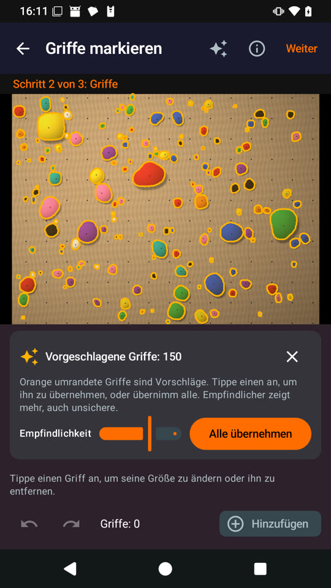
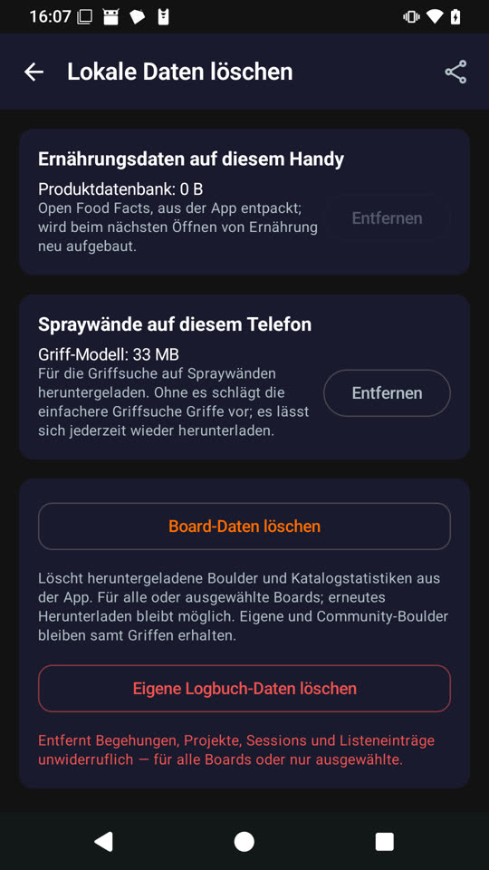
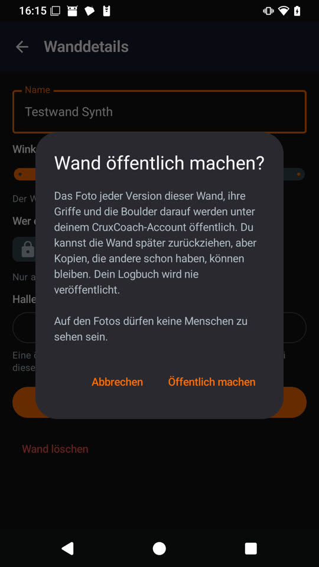
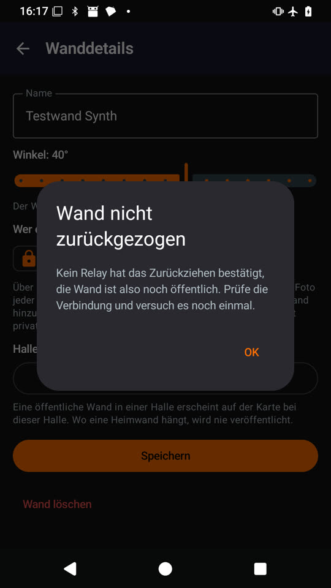
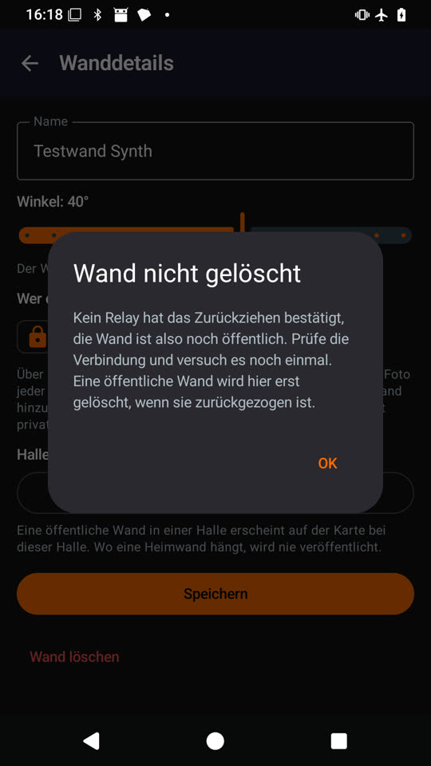

# Spray walls: review of the hold model PR, phone check

Draft pull request [#49](https://github.com/CruxCoach/CruxCoach/pull/49) after the maintainer's review: test build 7 (`cd5da45c`) on the test phone, a 2018 mid-range phone with 8 cores. Everything the review asked for works on the phone. One rough edge found in this check is fixed in `3124608d` (build 8).

## What was checked

| Check | Result |
| --- | --- |
| No telemetry | The app's manifest has no ONNX Runtime start-up provider. The runtime is loaded only when hold finding starts, not at app start. It logs that its telemetry has no transport ("the 1DS Java HttpClient was not initialized"). |
| Network | The app's connections were recorded for 23 minutes: app start, model download, detection, publishing, withdrawing, deleting and the benchmark. All 13 endpoints are known: seven Nostr relays (`relay.damus.io`, `relay.primal.net`, `nos.lol`, `relay.nostr.band`, `nostr-pub.wellorder.net`, `nostr.oxtr.dev`, `purplepag.es`), `blossom.cruxcoach.org` (CruxCoach's relay and the model mirror), the Blossom server `nostr.download` (wall photos), one Linode host, and the local DNS resolver. No connection to Microsoft. |
| Model download | From `blossom.cruxcoach.org`, 33 MB in about 10 s, checked against the pinned SHA-256. |
| Removing the model | Settings → Delete local data → "Spray walls on this phone" → Remove deletes the file. The editor then offers the download again and uses the classical detector meanwhile. |
| Detection | Synthetic test wall: 150 suggestions with the model, 153 with the classical detector. |
| Leaving mid-run | Leaving the editor at 25 % of a run, and three times while the model was still loading: no crash, the app process stays the same, and native memory drops back from 161 MB to 73–89 MB, so the session is freed. |
| Publishing | The confirmation says on its own line that the photos must not show people. Four of five relays took the wall, and the photo landed on Blossom. |
| Withdrawing offline | "Wall not withdrawn: no relay confirmed". The wall stays public. |
| Deleting offline | "Wall not deleted". The wall stays on the phone until a withdrawal works. |
| Withdrawing online | Tombstones taken by 2–3 relays. The photo is gone from Blossom (HTTP 404). The wall is private. |
| Public again, then deleted | The photo is uploaded anew, then deleted from Blossom with the wall. The local photo file is gone. |

Not testable on the phone: a declined Amber request, because the test phone has no Amber. Unit tests cover it, together with a failing local signer, a network error and a declined Blossom authorisation.

  

 

## The shipped setting, measured on the phone

28 labelled wall photos (1,940 holds), the app's own detection code (benchmark in the test build):

| Setting | Median time per photo | Peak memory | Precision | Recall | Hand corrections saved |
| --- | --- | --- | --- | --- | --- |
| **Shipped:** 2×2 tiles, 1024 px, duplicates at 0.3, threshold 0.4 | **12.1 s** (inference 10.6 s) | 427 MB | 0.94 | 0.88 | **85 %** |
| Published setting (threshold 0.6, duplicates at 0.5) | 11.4 s | 425 MB | 0.97 | 0.81 | 79 % |
| 3×3 tiles, 1536 px, threshold 0.5 | 25.3 s | 447 MB | 0.96 | 0.93 | 91 % |
| Classical detector | about 6 s | 330 MB | 0.64 | 0.18 | 13 % |

Loading the model takes about 4.5 s the first time in the editor. 3×3 finds more small holds, but it takes twice as long, so the app ships 2×2.

## APK size

| Build | APK |
| --- | --- |
| #41 without the runtime | 101.1 MB |
| #49 build 6, native libraries uncompressed | 135.5 MB |
| #49 build 7, native libraries compressed | 103.1 MB |

`libonnxruntime.so` is 13.9 MB in the APK instead of 34.2 MB. Android extracts the libraries once at install.

## Fixed after this check (build 8, `3124608d`)

- Withdrawing a wall waits for every relay and the photo server, about 30 s on the test phone, with no sign that anything happens. The save button now shows a spinner and "Withdrawing the wall …".
- In German the new settings section said "Telefon" while the section above it says "Handy". It now says "Handy".
