# Spray walls: UI pass

2026-11-08 · Crux · draft pull request [#84](https://github.com/CruxCoach/CruxCoach/pull/84) (stacked on [#79](https://github.com/CruxCoach/CruxCoach/pull/79))

**Goal:** every spray-wall screen looks and works at least as well as the rest of the app in 0.2.4, measured against the app's design guide (`design.md`): little text, one main action per screen, the app's own components, every number once, designed states, 48 dp targets, the largest font and 320 dp screens, English and German, dark and light.

**State:** six render-and-review cycles done; the last review found only a scrolling panel that shows a half line at its edge and one wording contradiction (fixed). The check on the test phone is still open: the test build of #84 is held back by a training test in the release branch that fails on every pull request since midnight UTC (not related to spray walls).

## How

- `SprayWallUiReviewTest` renders every spray-wall screen and state (37: list, wall, photo steps, crop, hold editor, details and its dialogs, climbs, logbook, versions, the map's "Spray walls here", settings) with the real view models on synthetic walls. Each in English and German, dark and light, font scale 1.0 and 2.0, 411 and 320 dp wide: 333 pictures per cycle.
- After each cycle I looked at the pictures, and reviewers who had not seen the code critiqued them against the guide and two 0.2.4 screens: three per cycle in cycles 1 to 3 (English 411 dp, German 411 dp, German 320 dp), then one per cycle looking only for problems of weight. Then fixes, then the next cycle.
- Dialogs, menus and the crop screen are not drawn at the larger font in these renders (a limit of the test setup); they need the phone.

## Before and after

Before: the test phone with the #79 build (German, dark). After: renders of #84, each as dark | light | dark at the largest font.

### Hold editor

| Before | After |
|---|---|
| 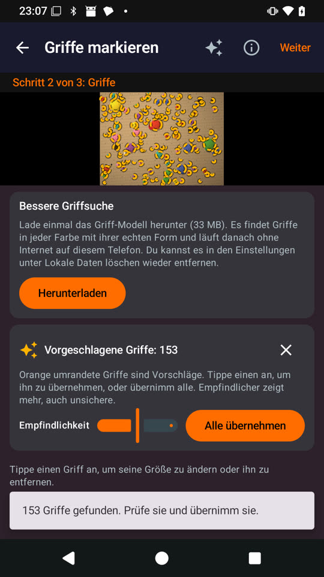 | 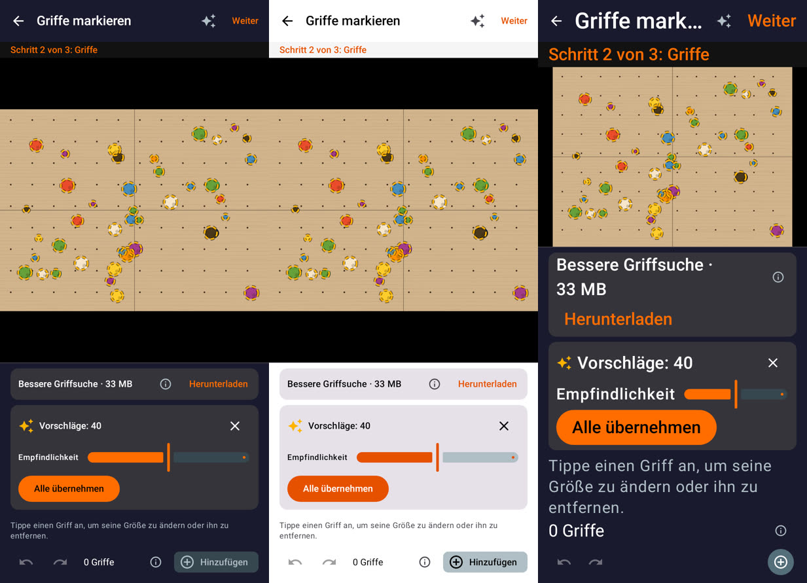 |

The photo was a thumbnail under a model card with a paragraph, a suggestion card with another paragraph, and the number of holds was said twice (card and snackbar). Now the model offer is one line with its size and a quiet "Download", shown only when it helps; the suggestion card has the slider at full width and "Take all" below it; the help is behind the info symbol in the bottom bar; the panel keeps the app's surface instead of an orange tint. On a 320 dp phone the cards scroll within 45 % of the screen, so the photo keeps its room, and at the largest font "Add" becomes an icon and the count gets its own line:

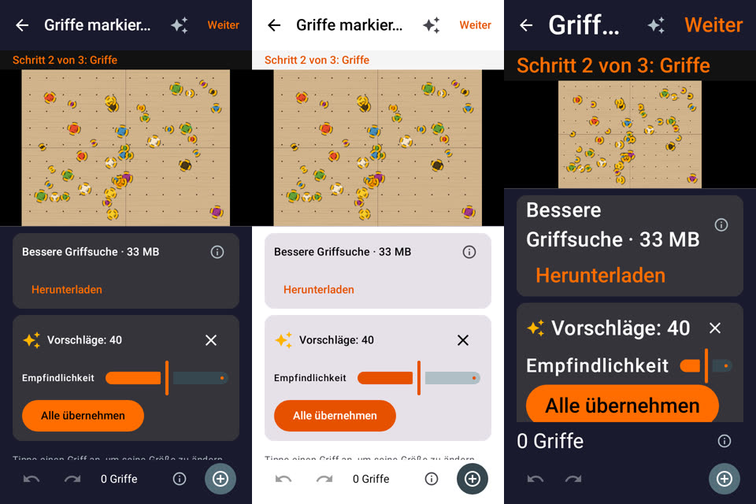

### Wall and climbs

| Before | After |
|---|---|
| 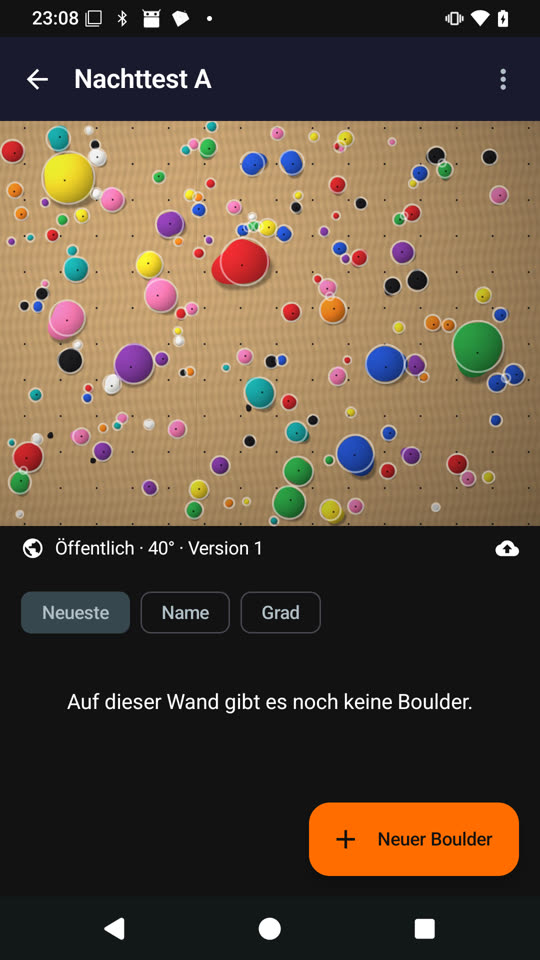 | 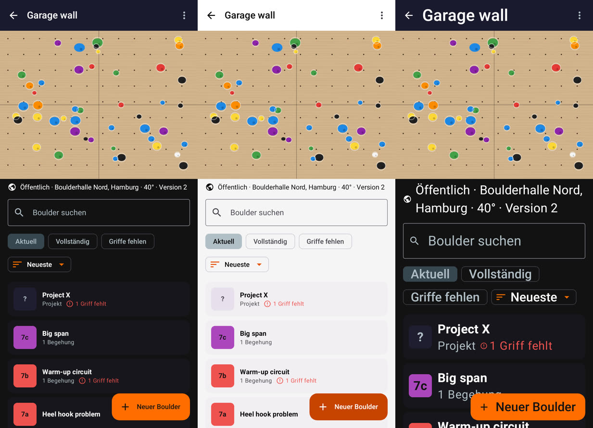 |

Sort chips showed on a wall without climbs, and the upload state was a cloud icon. Now search, filters and sort appear once there are climbs; the filter chips wrap and the sort is one chip with a menu; climbs are cards with the grade square like in the board browser; "1 send" and "1 hold gone" read as counts. A failed upload shows an error card with a filled Retry, and the status line says "Upload pending" only while nothing went wrong:

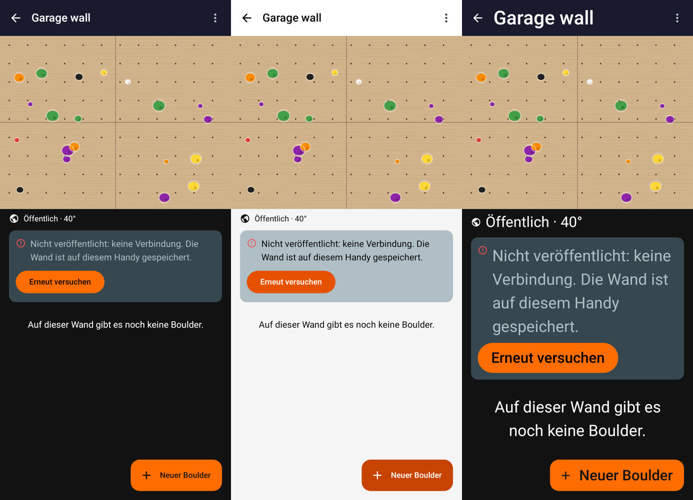

The climb page has the same grade square, a one-line note for missing holds, the attempts counted with − and + like the board log, and each logbook entry says its attempts once:

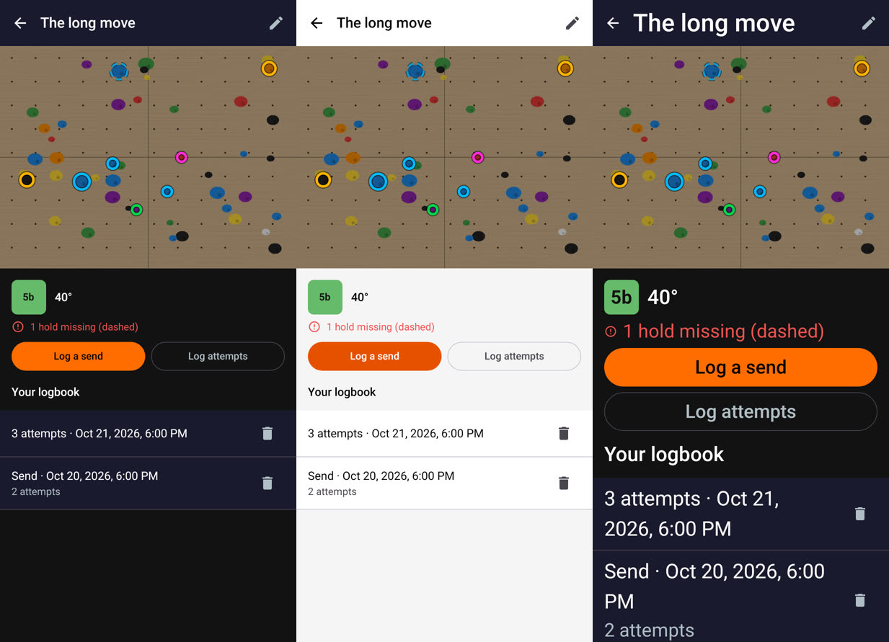

### Adding a wall

| Before | After |
|---|---|
| 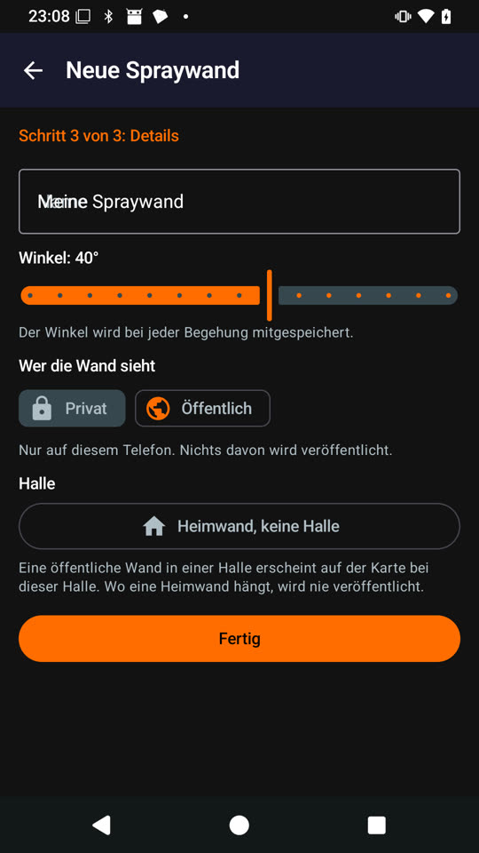 | 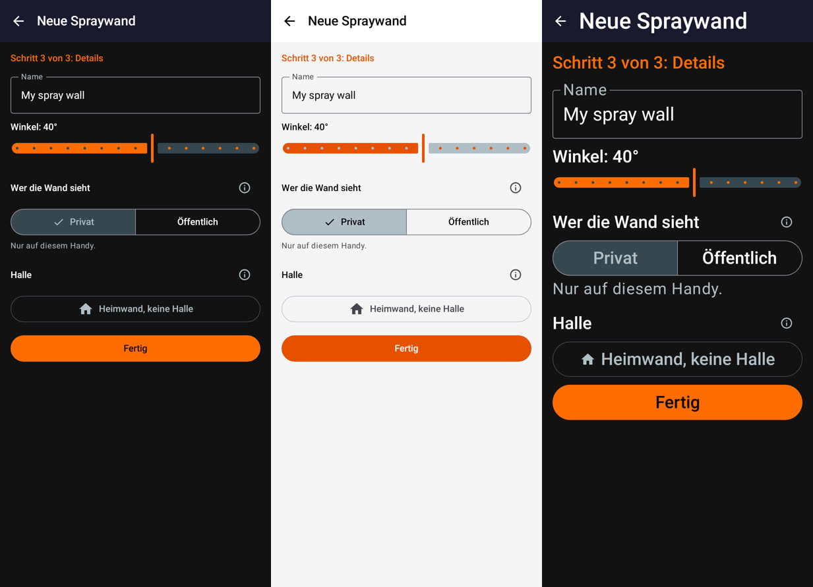 |

Each field had its explanation under it. Now Private/Public is a segmented choice with one line under it, the explanations for visibility and gym sit behind the info symbol, and "Set up account" opens the account screen directly when publishing needs one. The photo step leads with "Take a photo", and once there is a photo with "Continue to the holds"; swapping the photo is a quiet text button:

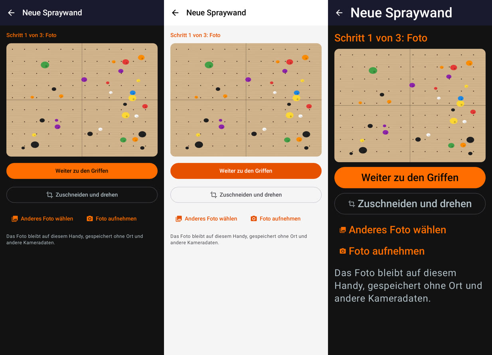

### Wall list

| Before | After |
|---|---|
| 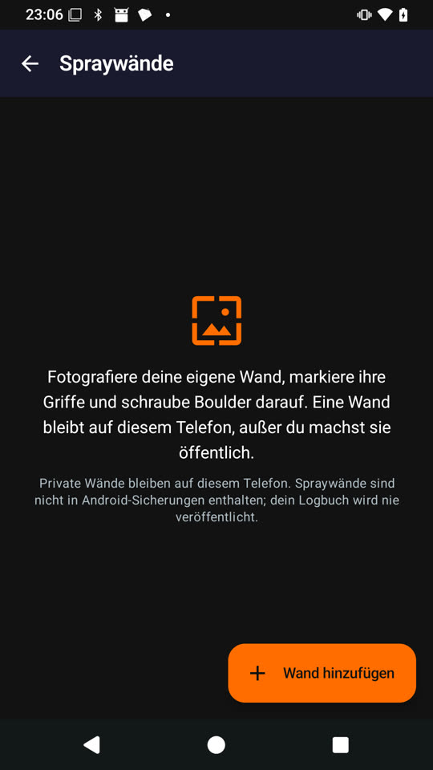 | 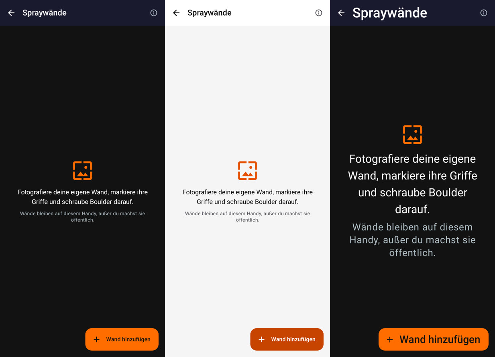 |

The empty list repeated "stays on this phone" twice; now one short line, the rest behind the info symbol. With walls, each card reads "44 holds · 10 climbs · 40°":

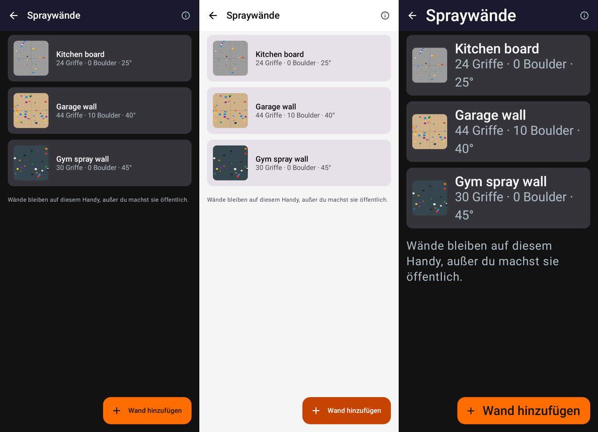

## All changes

- **Less text:** explanations behind the info symbol (wall list, reset, versions, hold model, hold editor help, visibility, gym, venue, climb editor); shorter publish, withdraw and account texts with less jargon; "Handy" instead of "Telefon" in German.
- **One main action:** photo step, climb editor (saves from the app bar only), no found-holds snackbar next to the suggestion card.
- **The app's components:** board-browser climb cards with grade squares, segmented Private/Public, −/+ attempts counter, one sort chip with a menu, wrapping chips.
- **Every number once:** plurals for holds, climbs, sends and attempts; the version number only once a wall has more than one.
- **States:** "Upload pending"; error card with Retry or "Set up account"; readable buttons on the unfinished-reset card; a public wall's reset keeps its "no people on the photo" warning in view.
- **Largest font and 320 dp:** one-line app-bar titles with info buttons moved out of crowded bars, stacked log buttons, non-breaking spaces between numbers and units, a scrolling hold-editor panel, an icon-only "Add" when space is short.
- **Light theme:** notices in body text with an orange icon instead of small orange text; the crop dialog's Turn button stays white on its black background.
- **Names:** someone else's wall and the walls at a gym show the owner's account name instead of the start of their key.

## Seen but not changed here

These come from the app's theme or shared components and show on other screens too:

- Light theme: dialogs, menus and cards use Material's default lilac surfaces.
- Selected chips and segmented buttons have a muted label on slate in the dark theme.
- Orange and red text in the light theme is below 4.5:1 contrast at small sizes.
- The storage row in Settings squeezes its text next to the "Remove" button at the largest font.

## Still open

- The check on the test phone (gestures, navigation, scrolling, keyboard, dialogs at the largest font) once the test build of #84 exists.
