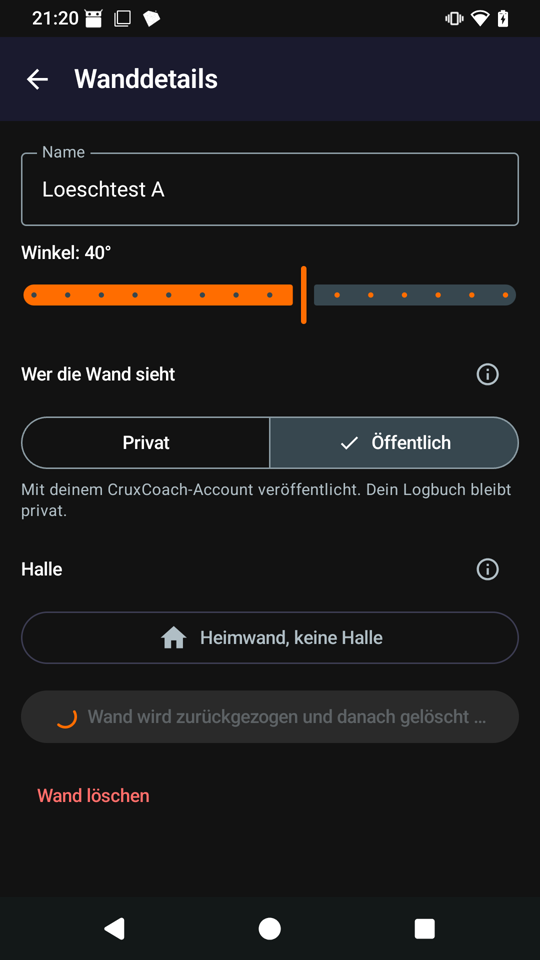
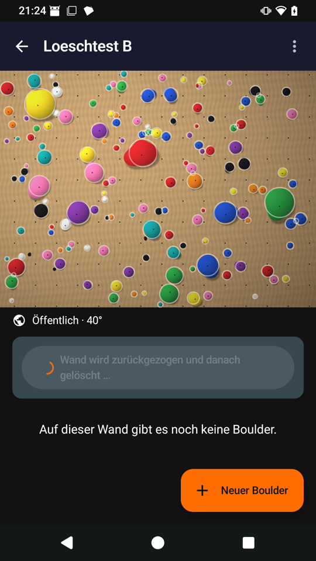
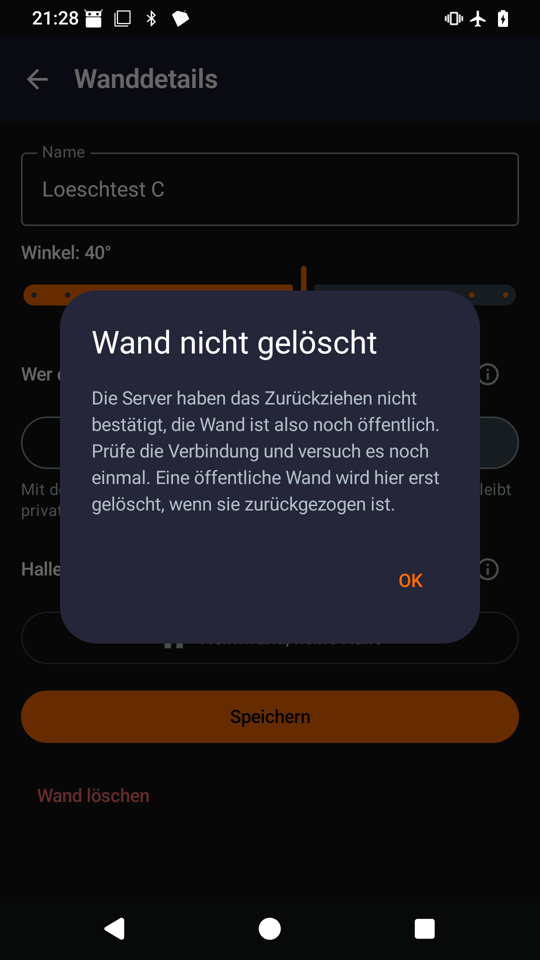
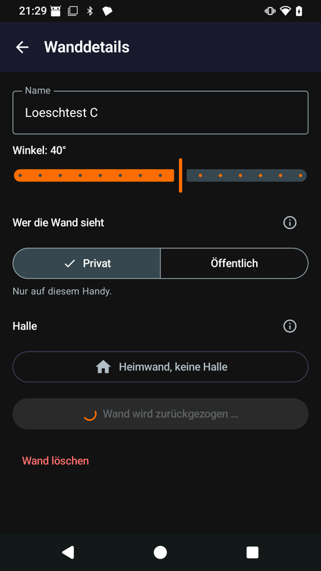

# Deleting a public spray wall: what the wall says while it runs (#131)

2026-11-15 · [#131](https://github.com/CruxCoach/CruxCoach/pull/131), test build 3 (commit c69fd634) on the test phone, German, fresh install without a catalogue. The wall photo is a synthetic test wall.

Deleting a public wall withdraws it from the relays first and deletes it once that worked. Before #131 the wall only said "Wand wird zurückgezogen …" ("Withdrawing the wall …") meanwhile, which a tester read as if withdrawing had deleted the wall.

## Checked on the phone

| What | Result |
|---|---|
| Delete a public wall in its details, online | Save shows "Wand wird zurückgezogen und danach gelöscht …"; about 15 s later the wall is gone and the list is empty. |
| Delete, then Back at once | The wall page's card shows the same text; once the withdrawal is done the page says the wall no longer exists. |
| Delete while offline | "Wand nicht gelöscht" with the reason and "Eine öffentliche Wand wird hier erst gelöscht, wenn sie zurückgezogen ist."; after OK the wall is still there and public, with Save and Delete. |
| Make a public wall private, online | Save shows "Wand wird zurückgezogen …" (unchanged); then the wall is private. |
| Main screen, spray-wall list | Fine. |

Each wall was published first (version and head out), and all three were deleted at the end.

| Details while deleting | Wall page after Back | Offline | Private |
|---|---|---|---|
|  |  |  |  |

## Tests

- 113 spray-wall unit tests pass on the dev server; CI is green.
- The rule that deletes a withdrawn wall runs on real code in `SprayWallPublishingTest`. Broken on purpose, the new tests catch it: without `delete`, "make private" deletes the wall; with `delete` alone, a failed withdrawal deletes it.
- With the old wording, 4 of the 6 new Compose tests fail. The two guards for what stays (the private text, the failure dialog) pass either way.

## Not changed

While a delete runs, the red "Wand löschen" under Save looks as it always does, although it is disabled; that was so before #131.
