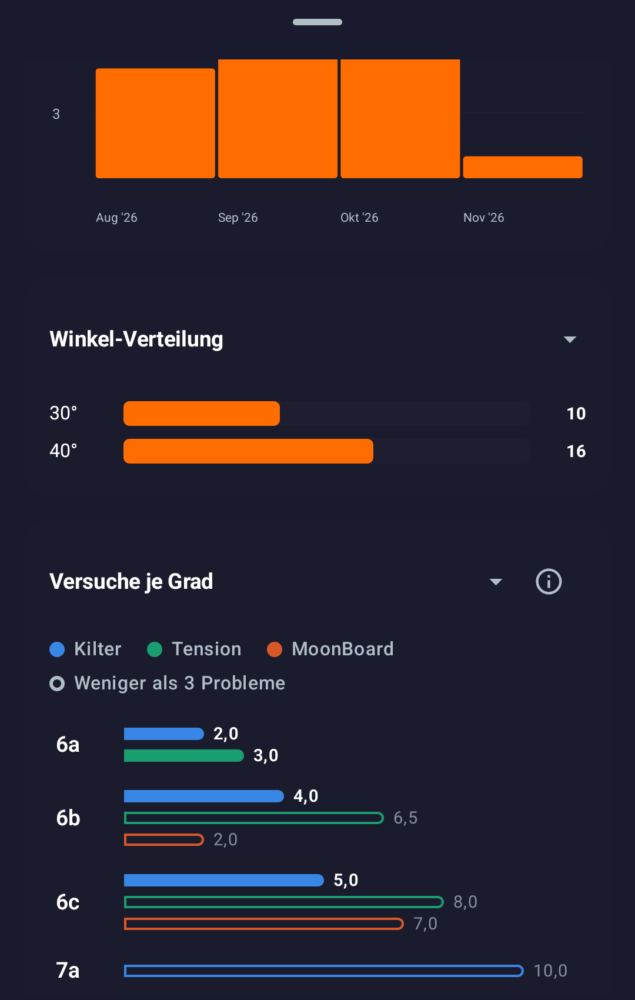
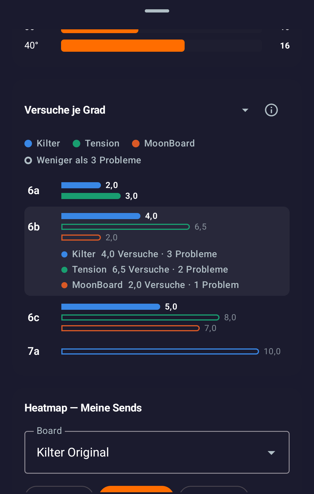
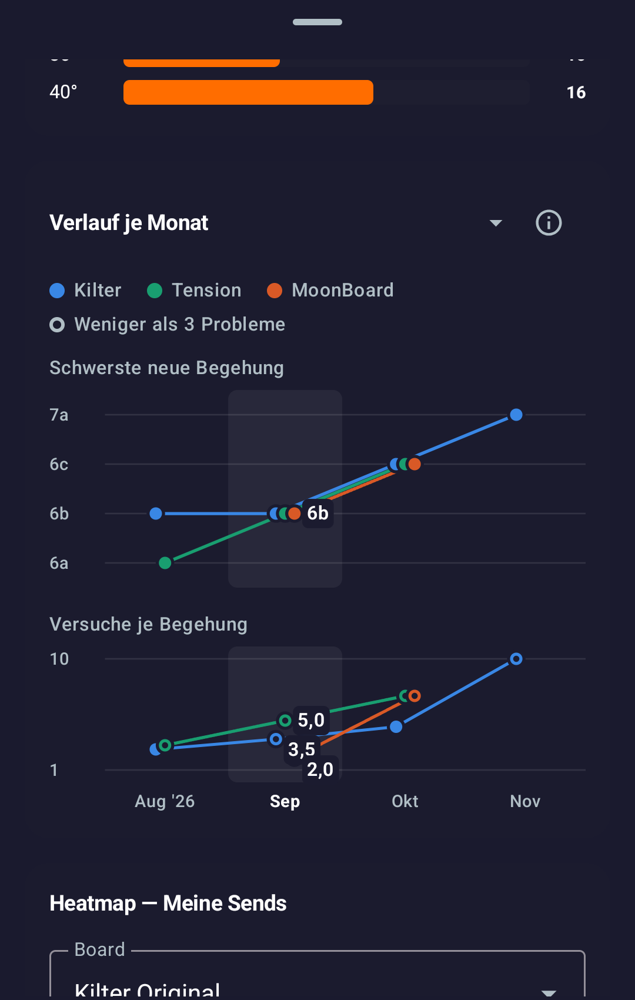
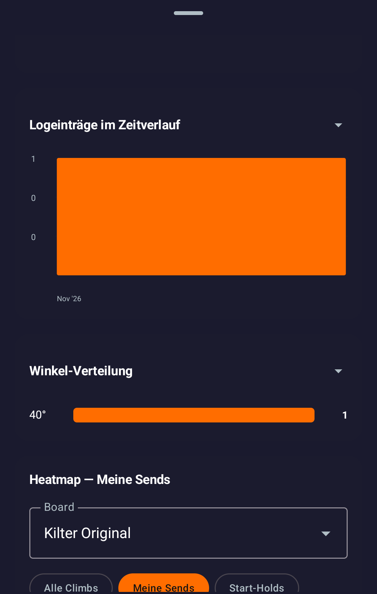

# Phone test of spray walls (#41) and stats across boards (#48)

2026-11-01, on a test phone set to German. Both pull requests target the release branch `feat/0.2.5-release`.

| Pull request | Build tested | Result |
|---|---|---|
| [#48](https://github.com/CruxCoach/CruxCoach/pull/48) stats across boards | test build 1 (`6a86daf9`, tables) and test build 2 (`77cff507`, charts) | every number matches the expected values; one readability issue in the month view |
| [#41](https://github.com/CruxCoach/CruxCoach/pull/41) spray walls | test build 4 (`c7c229a4`) | every step from adding a wall to deleting it works; two bugs; hold detection needs real photos ([report](../feat-spray-walls/2026-11-01-device-test-build-4.md)) |

## Stats across boards (#48)

Both builds are the community test builds from their install pages, signed by APKTrack. Build 2 was installed over build 1 and kept the logbook (#48 changes no database).

### Test data

A made-up logbook, imported from a CruxCoach file: 21 sends and 5 attempt entries on Kilter, Tension and MoonBoard, from August to November 2026. It includes the cases the counting has to get right:

- tries spread over sessions: 3 tries one week, sent with 2 more the next week, counts as 5;
- repeats after the first send, which must not count;
- an open project that was never sent, which must not count;
- the same problem at two angles, which counts as two problems;
- a first send on 1 November whose earlier tries were in October;
- cells with fewer than 3 problems.

The expected numbers were computed separately from the same file, without the app's code.

### Tries per grade (all time)

Average tries until the first send, with the number of problems in brackets. Every cell on the phone matched in both builds.

| Grade | Kilter | Tension | MoonBoard |
|---|---|---|---|
| 6a | 2.0 (3) | 3.0 (3) | – |
| 6b | 4.0 (3) | 6.5 (2) | 2.0 (1) |
| 6c | 5.0 (3) | 8.0 (1) | 7.0 (1) |
| 7a | 10.0 (1) | – | – |

Tapping a grade shows the problems behind each bar:

### Progress per month (all time)

Hardest new send, average tries of the new sends, problems in brackets. Every value on the phone matched in both builds.

| Month | Kilter | Tension | MoonBoard |
|---|---|---|---|
| Nov 2026 | 7a, 10.0 (1) | – | – |
| Oct 2026 | 6c, 4.5 (4) | 6c, 7.0 (2) | 6c, 7.0 (1) |
| Sep 2026 | 6b, 3.5 (2) | 6b, 5.0 (2) | 6b, 2.0 (1) |
| Aug 2026 | 6b, 2.7 (3) | 6a, 3.0 (2) | – |

### What works

- All numbers above, in the tables of build 1 and the charts of build 2.
- "30 Tage" shows only the problems first sent in the last 30 days, with the right values.
- A custom range of one day with sends on only one board hides the section, as intended.
- With the board filter set to Tension, the section still compares all three boards, as described.
- Build 2:
  - Bar lengths are proportional to their values.
  - Cells with fewer than 3 problems are drawn hollow.
  - The info button explains the view.
  - The view switch works.
  - Both month charts work, and tapping a month labels its values.
- Screen readers get a text that lists every month with grade, tries and problems per board.

### What does not work well

1. **Month labels have no board colour.** When a month is selected in "Versuche je Begehung", the value labels are plain white and stack next to each other. In September (5.0, 3.5 and 2.0 on three boards) the "2,0" label covers the MoonBoard point, and only position tells which value belongs to which board. A coloured dot in each label, or the label in the board's colour, would fix it.

### Outside #48

"Logeinträge im Zeitverlauf" labels its axis "1, 0, 0" when the highest bar is 1 (custom range with one send). That chart is older and not changed by #48.

### Not tested

- The light theme and English on the phone. Stills of both are in the [stats across boards report](../feat-0.2.5-analytics/2026-11-01-stats-across-boards.md).
- A real logbook with hundreds of problems.
- Other screen sizes.

## Spray walls (#41)

The spray walls room tested build 4 (`c7c229a4`) on the same phone. Its full report: [First test on a phone, test build 4](../feat-spray-walls/2026-11-01-device-test-build-4.md).

- **Works without a crash:**
  - adding a wall (photo from the gallery, crop and rotate, about 150 hold suggestions in about a second, accept all, undo and redo, add and delete holds);
  - problems with all four hold roles, sends and attempts in the logbook;
  - resetting with a new photo, where older problems stay on their photo under "Earlier";
  - versions and restore, "1 hold missing" with a dashed ring;
  - deleting a wall.
- **Bugs:**
  - In German, the crop dialog's "Fertig" button is squeezed to one letter per line.
  - After a restore, the list stays on an empty "Earlier" filter.
- **Hold detection on a real gym photo:** finds mostly warm-coloured holds, misses blue, purple and grey ones, and puts a few suggestions on the climber. Tuning needs real spray wall photos.
- **Not tested yet:** publishing, the map section, the camera.
