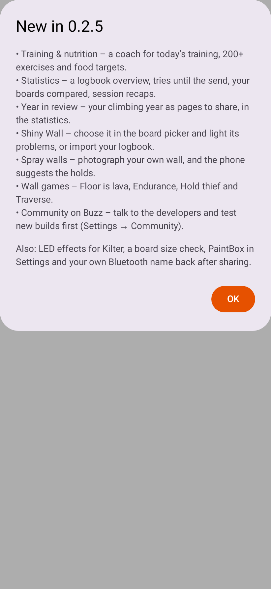
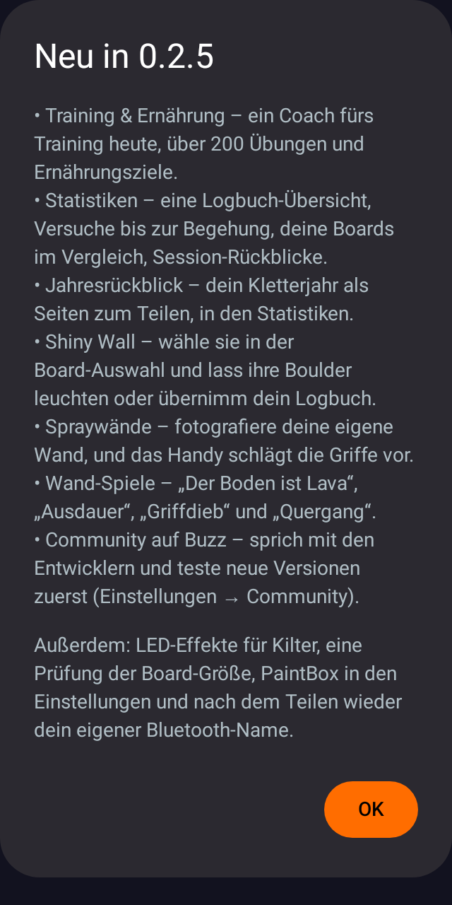

# 0.2.5: What's New and release notes, first draft

Draft of 9 November 2026, written against the release branch at `277534f3e` and the open pull requests of the [0.2.5 plan](https://github.com/CruxCoach/CruxCoach/milestone/1). The final version follows from the freeze head (Sun 15 Nov) as one pull request into `feat/0.2.5-release`.

Lines marked **[if …]** depend on a pull request or a gate; they drop out (or shrink) if it misses the freeze, and the markers go before publishing. The release-key part is left out for now and comes later.

Version 2 of the same day: corrected after a fact check against `CHANGELOG.md`, the strings and the open pull requests (see "Changes in version 2" at the end).

## 1. What's New (the dialog after the update)

Seven short lines and an "Also" line. Order: what most people will use first. Places are named only where a feature is hard to find (Community, PaintBox); the rest sits in the main menu, the board picker or the statistics. With every **[if …]** part in, the English text has about 580 characters plus a 120-character "Also" line (0.2.4: 350 and 100); 0.2.5 is the biggest release so far, and the dialog scrolls.

### English

**New in 0.2.5**

- • Training & nutrition – a coach for today's training, 200+ exercises and food targets.
- • Statistics – a logbook overview, tries until the send, your boards compared, session recaps.
- • Year in review – your climbing year as pages to share, in the statistics.
- • Shiny Wall – choose it in the board picker and light its problems**[if #50:**, or import your logbook**]**.
- • Spray walls – photograph your own wall, and the phone suggests the holds. **[if spray walls stay in 0.2.5]**
- • Wall games – Floor is lava, Endurance, Hold thief and Traverse.
- • Community on Buzz – talk to the developers and test new builds first (Settings → Community).

*Also: LED effects for Kilter, a board size check **[if #53]**, PaintBox in Settings **[if #90]** and your own Bluetooth name back after sharing.*

### Deutsch

**Neu in 0.2.5**

- • Training & Ernährung – ein Coach fürs Training heute, über 200 Übungen und Ernährungsziele.
- • Statistiken – eine Logbuch-Übersicht, Versuche bis zur Begehung, deine Boards im Vergleich, Session-Rückblicke.
- • Jahresrückblick – dein Kletterjahr als Seiten zum Teilen, in den Statistiken.
- • Shiny Wall – wähle sie in der Board-Auswahl und lass ihre Boulder leuchten**[if #50:** oder übernimm dein Logbuch**]**.
- • Spraywände – fotografiere deine eigene Wand, und das Handy schlägt die Griffe vor. **[if spray walls stay]**
- • Wand-Spiele – „Der Boden ist Lava“, „Ausdauer“, „Griffdieb“ und „Quergang“.
- • Community auf Buzz – sprich mit den Entwicklern und teste neue Versionen zuerst (Einstellungen → Community).

*Außerdem: LED-Effekte für Kilter, eine Prüfung der Board-Größe **[if #53]**, PaintBox in den Einstellungen **[if #90]** und nach dem Teilen wieder dein eigener Bluetooth-Name.*

### Notes on the wording

- The names are the ones on the screens: "Training & nutrition" / "Training & Ernährung" in the main menu, "Session recap" / "Session-Rückblick", "Versuche bis zur Begehung", "Spray walls" / "Spraywände", the four game names, "Community", and the "PaintBox" row in Settings (its "Extras" is a group heading, not a page). German says "Boulder" like the rest of the app.
- The year in review is in the statistics all year; only the invitation card waits for 1 December. So the line names the statistics, not a date.
- The community line is the one already on the branch (#51, #82), unchanged. The Shiny Wall and wall-game lines of #54 are folded into the lines above, so on its rebase #54 can leave `whatsnew_025_body` as the branch has it. That removes one of its two conflicts.
- If the hold-type card (#95) passes its gate, it goes into the "Also" line: "hold types in the Kilter statistics" / "Grifftypen in den Kilter-Statistiken".
- If the dialog reads too long on a small phone, the first candidates for the "Also" line are wall games and community.

### Rendered

The dialog with every line in (the app's own dialog, rendered on the computer in English and German, dark and light, 320 and 411 dp wide, font size 1.0 and 2.0). At 320 dp and font size 1.0 the German text just fits without scrolling; at font size 2.0 it scrolls and the OK button stays in view. The dialog's test passes with the new lines.

| English, light, 411 dp | German, dark, 320 dp |
|---|---|
|  |  |

### What the final pull request changes (from the freeze head)

- `whatsnew_025_body` (EN, DE): the seven lines, with `&#160;` before each dash like the community line.
- a new `whatsnew_025_hint` (EN, DE) and its `Text` in `Release025WhatsNewDialog`, styled like the 0.2.4 hint.
- `CommunityJoinTest`: the community line check matches a substring, since the body has more lines.
- `RELEASE_NOTES.md`: the text in section 2, with "Unreleased" in the heading until the release preparation puts the date there (the release workflow refuses a heading that still says "Unreleased").
- `CHANGELOG.md`: a line for the Kilter Homewall 10x12 image (#75 has none), and "Settings → Board accounts & imports" in the Shiny Wall account entry (it says "Settings → Imports"). Contrast (#92) and PaintBox (#90, its entry says "Settings → Extras") are better fixed in their own PRs.
- Not in it: registering `RELEASE_025`, `versionCode` 11, `versionName` and the release date. They belong to the release preparation.

## 2. Release notes (`RELEASE_NOTES.md`, GitHub release and Zapstore)

> # CruxCoach 0.2.5 — Unreleased
>
> This release adds training and nutrition for climbers, statistics that compare your boards, a year in review, Shiny Wall, wall games and spray walls.
>
> ## Highlights
> - **Training, built for climbers.** A new area in the main menu suggests
>   today's training from your board logbook, your week, your equipment and
>   how you feel, and says why. Over 200 exercises with steps and pictograms,
>   a training logger that plans loads from your own values, rest and hang
>   timers, and a coach that learns from what you change. An injury mode spares
>   what hurts. The comeback plan after an injury is a training aid, not a
>   medical device: it helps you build up again together with your doctor or
>   physio.
> - **Nutrition that follows your training.** Protein, carbohydrate and energy
>   targets follow your training and climbing days. Foods come from offline
>   food tables, a barcode scan, a typed sentence or an optional photo model
>   that runs on the phone; nothing is sent. Training and nutrition data stay on
>   the phone and go into the cloud backup and the export, injuries only when
>   you switch them on. Health Connect is optional.
> - **Statistics that compare your boards.** The logbook opens with one
>   overview card instead of six tiles: your hardest send and flash, the last
>   30 days against the 30 before, and your milestones. The period filter moved
>   into the logbook filter. The statistics show every number once, how many
>   tries you need until the send, and, if you climb on more than one board,
>   how the boards compare and how they feel for you. Each logbook day and each
>   timed session has a recap to share as an image.
> - **Your year in review.** Your climbing year across all your boards,
>   imported logbooks included, as pages to tap through: volume, hardest sends,
>   rhythm, highlights and your climber type. Every page can be shared as an
>   image, without your name, problem names or exact dates unless you switch
>   them on. It is in the statistics all year, and a card invites you from
>   1 December to 31 January. It is computed on the phone; nothing is uploaded.
> - **Shiny Wall and wall games.** Choose your Shiny Wall (Mini, Standard,
>   Max, Full or Max Full) in the board picker, browse its problems with its
>   own categories and light them over Bluetooth; gyms with a Shiny Wall appear
>   on the board map. **[if #50:** Import your Shiny Wall logbook, favourites
>   and lists under Settings → Board accounts & imports. The import only reads;
>   your email and password go to Shiny Wall's sign-in service, which runs on
>   Google Firebase. Standard walls only; accounts that sign in with Google
>   can't connect.**]** Wall games (Floor is lava, Endurance, Hold thief and
>   Traverse) turn the board into a game on Shiny Wall, Kilter, the other
>   Aurora boards and MoonBoard.
> - **Spray walls. [if spray walls stay in 0.2.5]** Photograph your own wall,
>   and the phone suggests the holds; an optional hold model (33 MB, offline
>   once downloaded) finds holds of every colour with their real shape. Set
>   problems with start, hand, foot and finish holds and log them in a private
>   logbook. A wall stays on your phone unless you make it public; then others
>   find it at its gym on the board map. Spray walls are not in backups or
>   exports yet.
>
> ## Other improvements
> - **LED effects** for Kilter boards, contributed by Dapeebb: the lit climb
>   can pulse, flash or run through a rainbow (Settings → Board & Bluetooth →
>   LED effects).
> - **PaintBox [if #90]**, contributed by Hugie: paint pictures on your
>   board's LEDs, every hold a pixel, sent once or live (Settings → PaintBox).
> - **Board size check [if #53]:** if the board lights different holds than
>   the app shows, the board picker and a climb's ⋯ menu light a few marked
>   holds so you can compare and pick the size that fits. **[if #55:** The
>   board picker also shows how common each board, Kilter size and MoonBoard
>   version is in gyms.**]**
> - **Hold types [if #95 passes its gate]:** the Kilter statistics show which
>   kinds of hand holds your problems use and where your send rate is higher or
>   lower than usual.
> - **Community:** Settings → Community explains the CruxCoach community on
>   Buzz, where you can talk to the developers and test new builds first.
> - **US units:** Settings → Units shows loads, body weight, lengths, food and
>   drinks in lb, in, oz and fl oz.
> - After sharing a board with other apps, your phone gets its own Bluetooth
>   name back, also after a crash or a restart. Swiping CruxCoach away from the
>   recent apps or connecting the phone to a car now ends sharing.
> - Catalogue updates no longer wait 15 seconds per board when a server never
>   answers, and a catalogue import frees its temporary file at once.
> - The Kilter Homewall 10x12 image shows its real holds.
> - Links in Settings → About and the MoonBoard data request no longer close the
>   app on a phone without a browser or an email app.
> - **[if #92]** Orange and status colours are easier to read, above all in
>   the light theme.
>
> ## Compatibility
> CruxCoach 0.2.5 requires **Android 9 or newer**, like 0.2.4, and works without
> Google services. It asks for two new permissions only when you use them: the
> camera (food photos, barcodes, spray walls) and Health Connect. After a phone
> restart it checks once that the phone has its own Bluetooth name again. The
> app is bigger than 0.2.4, mostly because of the offline food tables. A 0.2.4
> backup restores in 0.2.5, and 0.2.4 restores a 0.2.5 backup without the
> training data.

### Notes on the release notes

- Training, statistics, spray walls and the year in review are new for everyone coming from 0.2.4, so the fixes made to them during 0.2.5 (weight fields, the coach's weekly limits, pain scale 0–10, the UI passes) are part of the features, not listed as fixes.
- Contributors are credited like in `CHANGELOG.md`: Dapeebb for the LED effects, Hugie for PaintBox. No PR numbers, like the 0.2.4 notes.
- The backup sentence rests on the backup tests on the branch; the update check of RC1 checks it again.
- Pain 10 and older builds (line proposed from the training room on 9 Nov): the stable 0.2.4 has no training part in its backups and skips fields it does not know, so it restores a 0.2.5 backup with a pain value of 10 like any other, without the training data. Only the test builds with training from before #94 (merged 9 Nov) check the training part with the 0–9 scale and refuse such a backup. That concerns testers, not users of 0.2.4, so the notes keep the sentence above and get no line for it.

## Changes in version 2

- What's New: "from your logbook" and "finds the holds" said more than the app does (the logbook is one of several inputs; the holds are suggestions you correct). The year in review is in the statistics all year, so its line names the statistics instead of 1 December. PaintBox is a row in Settings, not under "Settings → Extras". German: "Boulder" instead of "Probleme", the du-form throughout, game names in quotes.
- Release notes: the comeback plan's "a training aid, not a medical device" is in; nutrition has its own highlight; the backup sentence for training data was wrong (it goes into the cloud backup and the export); new lines for the logbook overview replacing the tiles, US units, swiping away ending sharing, the new permissions, the app size and spray walls not being in backups; the size-and-version line belongs to #55; no internal terms ("relay", "every path").
