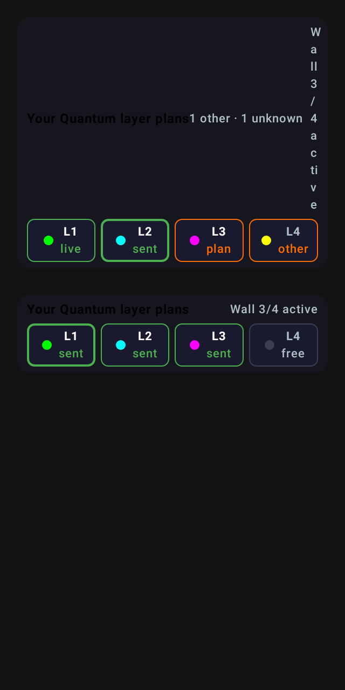
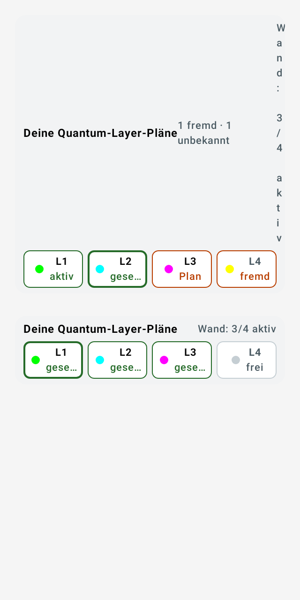
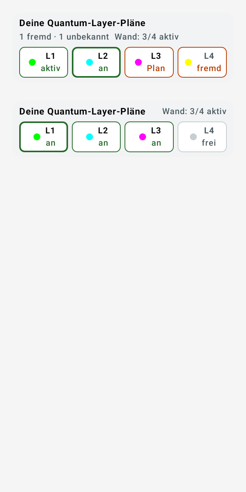
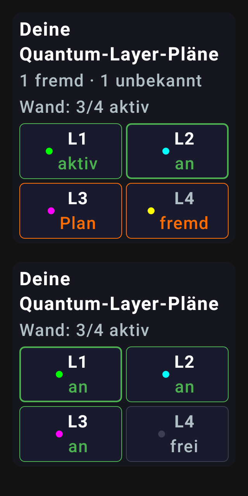
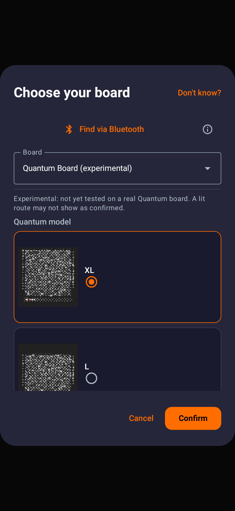
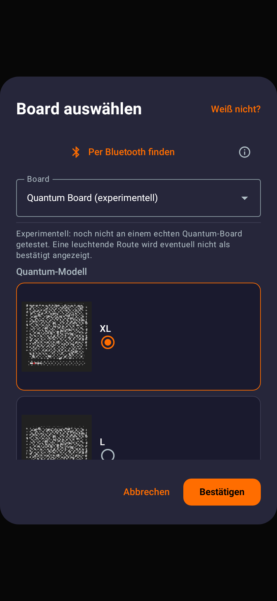

# Quantum for 0.2.5: player routes, experimental marks

15 Nov 2026 · [#134](https://github.com/CruxCoach/CruxCoach/pull/134) (draft into `feat/0.2.5-release`) · Crux

Quantum stays in 0.2.5 and in stable, marked experimental. Nobody can test on a real Quantum board before 22 Nov, so the PR moves the Bluetooth path onto the controller's everyday player route and makes the app tolerant of small differences in the board's answers. Details and the full test list are in the PR.

## What changes for a climber

| Before | After |
|---|---|
| A climb went out as TURN_OFF_USER, then ACTIVATE_WALL lit "until removed" | One BOARD_SWIPE per colour, lit for the board's own auto-off time (31 minutes if it names none) |
| Sent only when the board's route list named the route | Sent when the board takes the write without an error; the list only adds whether it names the route |
| A board error code was often overwritten before it was read | The board's answer is read first, so "colour taken", "board full" and the others reach the user |
| Removing a layer the list did not name sent nothing | Removing always sends TURN_OFF_USER for this phone's own layer |
| PaintBox stopped after the first colour when the list did not confirm it | PaintBox lights every colour and turns them all off before the next picture or a climb |
| A board whose grid size differed was refused, and an answer with extra bytes was unreadable | The size is logged; answers may carry extra bytes |
| No hint that Quantum is untested | "Experimental" where a Quantum board is picked or connected, and in the docs (EN/DE) |

A route the board takes but does not list shows **"sent; the board does not list it"** in the layer rack and stays there until its play time is over, so it can still be turned off.

Known limit: an S Fitness is handled like the other models (four layers, one colour per route).

## UI check

Rendered with a Compose review test: the layer strip with the new state and the board picker with Quantum, in English and German, 320 and 411 dp wide, font 1.0 and 2.0, dark and light.

**Layer strip, 320 dp.** Before: the header broke into single letters (this is older than the PR), and the German short label "gesendet" was cut to "gese…".

 

After: the header wraps as whole parts, the German chip says "an" (the full text stays in the rack), and at the largest font on a narrow screen the chips sit two per row.

 

(The strip's title is drawn dark on dark in the "before" pictures because of the render setup, not the app.)

**Board picker.** The board field says "Quantum Board (experimental)", and the note sits above the model choice, so it shows without scrolling.

 

## Open until a real board

Whether a BOARD_SWIPE route appears in the route list; whether the duration counts minutes; the board record of the L, M, S and Belay; whether a second frame for the same route adds holds or replaces them; whether a new route for a user who already has one replaces it or is refused; whether the board's answers are per phone or shared.
